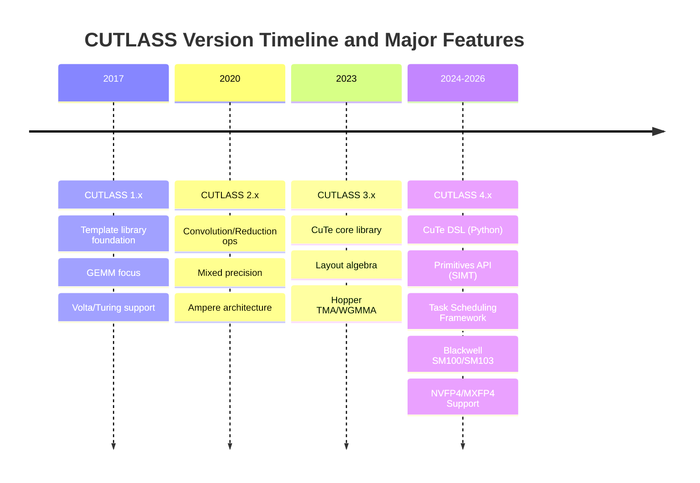
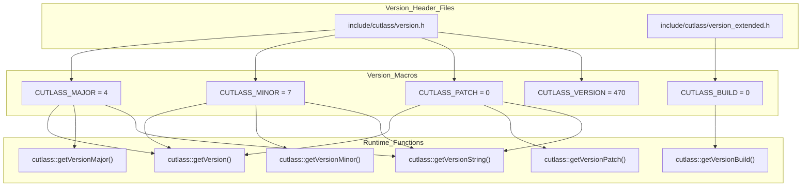
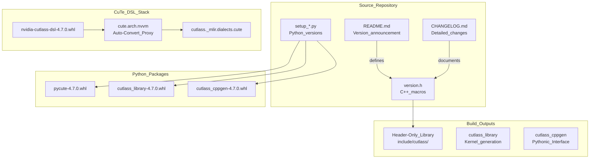

<!-- source: DeepWiki mcp.deepwiki.com · repo NVIDIA/cutlass · page 1.4 Version Information and Release Strategy · fetched 2026-10-26 -->

# Version Information and Release Strategy

<details>
<summary>Relevant source files</summary>

The following files were used as context for generating this wiki page:

- [.gitignore](.gitignore)
- [CHANGELOG.md](CHANGELOG.md)
- [CONTRIBUTORS.md](CONTRIBUTORS.md)
- [README.md](README.md)
- [include/cutlass/gemm/collective/sm90_mma_array_tma_gmma_ss_warpspecialized_fp8.hpp](include/cutlass/gemm/collective/sm90_mma_array_tma_gmma_ss_warpspecialized_fp8.hpp)
- [include/cutlass/version.h](include/cutlass/version.h)
- [python/CuTeDSL/cutlass/base_dsl/env_manager.py](python/CuTeDSL/cutlass/base_dsl/env_manager.py)
- [python/CuTeDSL/cutlass/base_dsl/runtime/cuda.py](python/CuTeDSL/cutlass/base_dsl/runtime/cuda.py)
- [python/CuTeDSL/cutlass/cute/__init__.py](python/CuTeDSL/cutlass/cute/__init__.py)
- [python/CuTeDSL/cutlass/cute/arch/nvvm_wrappers.py](python/CuTeDSL/cutlass/cute/arch/nvvm_wrappers.py)
- [python/CuTeDSL/cutlass/cute/core.py](python/CuTeDSL/cutlass/cute/core.py)
- [python/CuTeDSL/cutlass/jax/primitive.py](python/CuTeDSL/cutlass/jax/primitive.py)
- [python/CuTeDSL/requirements-cu13.txt](python/CuTeDSL/requirements-cu13.txt)
- [python/CuTeDSL/requirements.txt](python/CuTeDSL/requirements.txt)
- [python/cutlass_cppgen/__init__.py](python/cutlass_cppgen/__init__.py)
- [python/cutlass_library/sm90_utils.py](python/cutlass_library/sm90_utils.py)
- [python/setup_cutlass.py](python/setup_cutlass.py)
- [python/setup_library.py](python/setup_library.py)
- [python/setup_pycute.py](python/setup_pycute.py)

</details>


This page documents CUTLASS version numbering conventions, release strategy, and how version information is managed across the C++ library, Python packages, and build system. For information about GPU architecture support and compatibility, see [GPU Architecture Support Matrix](#1.3). For details about library organization and structure, see [Library Organization and Header Structure](#1.2).

## Version Numbering Scheme

CUTLASS follows semantic versioning with the format `MAJOR.MINOR.PATCH[.BUILD]`:

- **MAJOR**: Incremented for significant architectural changes or API-breaking modifications.
- **MINOR**: Incremented for new features and functionality additions.
- **PATCH**: Incremented for bug fixes and minor improvements.
- **BUILD**: Optional build number for development releases.

The version is encoded as an integer using the formula: `CUTLASS_VERSION = (MAJOR * 100) + (MINOR * 10) + PATCH`. For example, version 4.7.0 is encoded as 470.

Sources: [include/cutlass/version.h:41-52](), [README.md:4-6]()

## Current Version: CUTLASS 4.7.0

As of August 2026, the current release is CUTLASS 4.7.0. This version represents a significant milestone in the CUTLASS 4 ecosystem, particularly for the Python DSL:

- **CuTe DSL Primitives API**: Introduced as a transitional lower-level abstraction beneath CuTe, enabling Tensor Core programming through SIMT via thin wrappers over NVVM operations [README.md:49-52](), [CHANGELOG.md:8-11]().
- **Task Scheduling Framework**: Provides static analysis of execution schedules for warp-specialized kernels to detect concurrency issues and visualize resource dependencies [README.md:53](), [CHANGELOG.md:12]().
- **Blackwell FMHA Improvements**: Added a 2-kernel backward implementation targeting FP8 on Blackwell SM103, showing approximately 25% improvement over the 1-kernel variant [README.md:69-71](), [CHANGELOG.md:28-30]().
- **Tooling**: Optimal code generation with CUDA Toolkit 13.3 [README.md:80](), [CHANGELOG.md:39]().

The version is consistent across all components:

| Component | Version | Location |
|-----------|---------|----------|
| C++ Library | 4.7.0 | [include/cutlass/version.h:41-43]() |
| pycute Package | 4.7.0 | [python/setup_pycute.py:39]() |
| cutlass_library Package | 4.7.0 | [python/setup_library.py:39]() |
| cutlass_cppgen Package | 4.7.0 | [python/setup_cutlass.py:54]() |
| nvidia-cutlass-dsl | 4.7.0 | [python/CuTeDSL/requirements.txt:3]() |

Sources: [README.md:4-6](), [include/cutlass/version.h:41-43](), [python/setup_pycute.py:39](), [python/setup_library.py:39](), [python/setup_cutlass.py:54]()

## Major Version Evolution



### CUTLASS 1.x & 2.x: Foundation and Expansion (2017-2022)

CUTLASS 1.x and 2.x established the C++ template library foundation for high-performance linear algebra, supporting architectures from Volta through Ampere. These versions introduced primitives for mixed-precision computations (FP64, FP32, TF32, FP16, BF16, INT8, INT4) and specialized data movement like async copies [README.md:17-26]().

### CUTLASS 3.x: CuTe Transformation (2023)

CUTLASS 3.0 introduced **CuTe**, a core library to describe and manipulate tensors of threads and data using hierarchical multidimensional layouts. This replaced ad-hoc indexing with an algebraic system, enabling efficient support for Hopper (SM90) features like TMA and WGMMA.

### CUTLASS 4.x: Python DSL and Blackwell (2024-2026)

CUTLASS 4 adds **CUTLASS DSLs**, specifically the **CuTe DSL**. This allows for metaprogramming that does not require deep C++ expertise while maintaining peak performance [README.md:28-30]().
- **CuTe DSL Primitives**: A thin wrapper over `NVVM` operations to use where CuTe abstractions might reduce development velocity [CHANGELOG.md:9]().
- **Blackwell Support**: Performance utilization of peak theoretical throughput on Blackwell SM100 [README.md:89-94]().
- **Mixed Precision**: Support for NVIDIA NVFP4 and OCP standard MXFP4, MXFP6, and MXFP8 block scaled data types [README.md:23]().
- **Task Scheduling**: Static analysis for warp-specialized kernels to detect hazards and visualize dependencies [README.md:53]().

Sources: [README.md:28-57](), [CHANGELOG.md:3-85]()

## Version Information in Code

### C++ Version Macros



The C++ library defines version information through preprocessor macros and inline functions:

**Compile-Time Macros:**
- `CUTLASS_MAJOR`, `CUTLASS_MINOR`, `CUTLASS_PATCH`: Core version components [include/cutlass/version.h:41-43]().
- `CUTLASS_VERSION`: Combined version integer [include/cutlass/version.h:52]().
- `CUTLASS_BUILD`: Build number, defaults to 0 unless `CUTLASS_VERSIONS_GENERATED` is defined [include/cutlass/version.h:45-50]().

**Runtime Functions:**
- `cutlass::getVersion()`: Returns integer-encoded version [include/cutlass/version.h:56-58]().
- `cutlass::getVersionString()`: Returns a string representation of the version [include/cutlass/version.h:73-79]().

### Python Package Versions

All Python packages maintain synchronized version numbers:

```python
# pycute package
name='pycute',
version='4.7.0' # [python/setup_pycute.py:39]
```

```python
# cutlass_library package
name='cutlass_library',
version='4.7.0' # [python/setup_library.py:39]
```

```python
# cutlass_cppgen package
name='cutlass_cppgen',
version='4.7.0' # [python/setup_cutlass.py:54]
```

The `cutlass_cppgen` package also exposes versioning through its `__init__.py`:
```python
this.__version__ = '4.7.0' # [python/cutlass_cppgen/__init__.py:136]
```

Sources: [python/setup_pycute.py:39](), [python/setup_library.py:39](), [python/setup_cutlass.py:54](), [python/cutlass_cppgen/__init__.py:136]()

## Release Components and Artifacts



### C++ Library (Header-Only)
The core CUTLASS library remains header-only. Version information is compiled into user code via macros in `include/cutlass/version.h`.

### Python Packages
Three primary Python packages are released:
1. `pycute`: Python implementation of CuTe [python/setup_pycute.py:40]().
2. `cutlass_library`: Generation scripts and manifest management [python/setup_library.py:40]().
3. `cutlass_cppgen`: The "Pythonic Interface" for kernel generation [python/setup_cutlass.py:55]().

### CuTe DSL Stack
The `nvidia-cutlass-dsl` package provides the high-performance Python programming model. It utilizes a `_NvvmAutoConvertProxy` to wrap raw MLIR NVVM operations, allowing users to pass `Numeric` DSL objects directly to hardware-level instructions [python/CuTeDSL/cutlass/cute/arch/nvvm_wrappers.py:66-86]().

## CHANGELOG Organization

The `CHANGELOG.md` documents changes by major version and release date.

**Recent Release Structure:**
- **4.7.0 (2026-08-04)**: Introduction of Primitives API, Task Scheduling framework, and Blackwell FMHA 2-kernel backward [CHANGELOG.md:5-40]().
- **4.6.1 (2026-07-13)**: Bug fixes for Flash Attention v2 on Ampere and Jax FFI registration [CHANGELOG.md:41-53]().
- **4.6.0 (2026-07-01)**: `cute.compile_to` API, IKET (In-Kernel-Event-Tracing) profiler, and SASS dumping support [CHANGELOG.md:54-72]().

Sources: [CHANGELOG.md:1-85]()

## Compatibility Requirements

### System Requirements
- **Architecture**: Volta (SM70) through Blackwell (SM100) [README.md:26]().
- **CUDA Toolkit**: Performs best with **CUDA 13.3** for optimal code generation [README.md:80](), [CHANGELOG.md:39]().
- **Windows Support**: Note that CUTLASS 4.x builds are currently down on Windows platforms for all CUDA toolkits [README.md:82-83]().

### Python Requirements
- **Python**: 3.9+ for RMM support [python/cutlass_cppgen/__init__.py:101]().
- **cuda-python**: Required version `>= 11.8.0` [python/setup_cutlass.py:68]().
- **Package Versions**: Must ensure `cuda-python` version is greater than or equal to the installed `NVCC` version [python/cutlass_cppgen/__init__.py:166-175]().

## Version Query at Runtime

### C++ Runtime Query
```cpp
#include <cutlass/version.h>
// Returns 470
uint32_t version = cutlass::getVersion(); 
// Returns string representation (e.g. "4.7.0")
std::string ver_str = cutlass::getVersionString(); 
```
Sources: [include/cutlass/version.h:56-79]()

### Python Runtime Query
```python
import cutlass_cppgen
# Returns '4.7.0'
print(cutlass_cppgen.__version__)

# Returns NVCC version string (e.g. "13.3")
print(cutlass_cppgen.nvcc_version())
```
Sources: [python/cutlass_cppgen/__init__.py:60-70, 136]()

---

