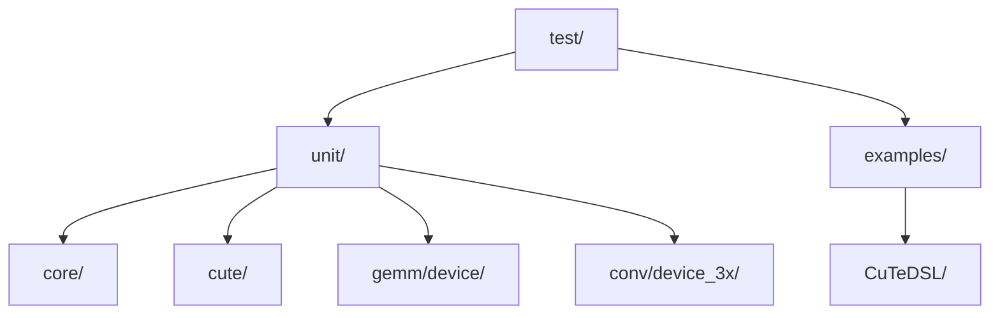
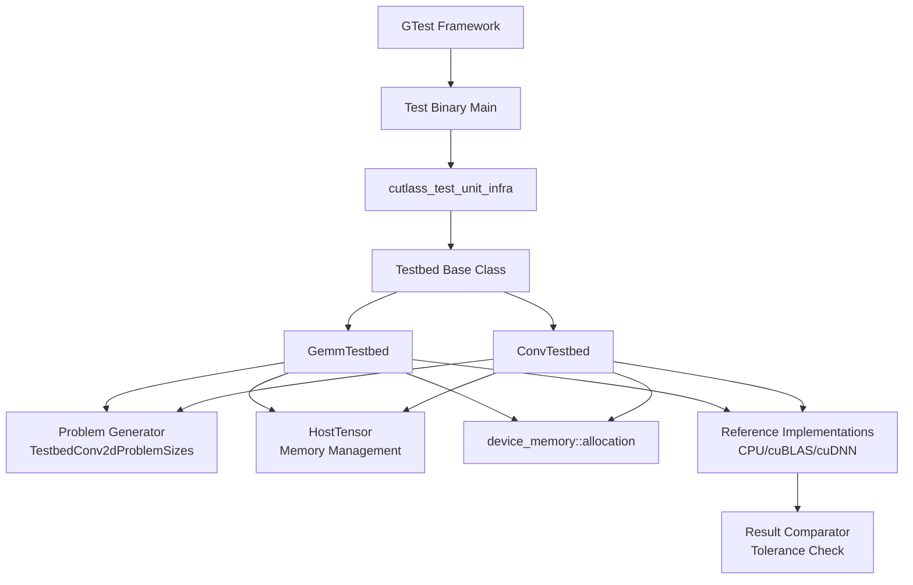
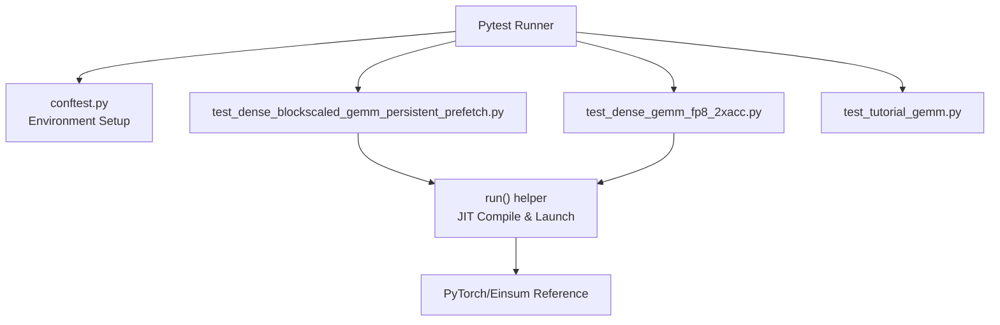
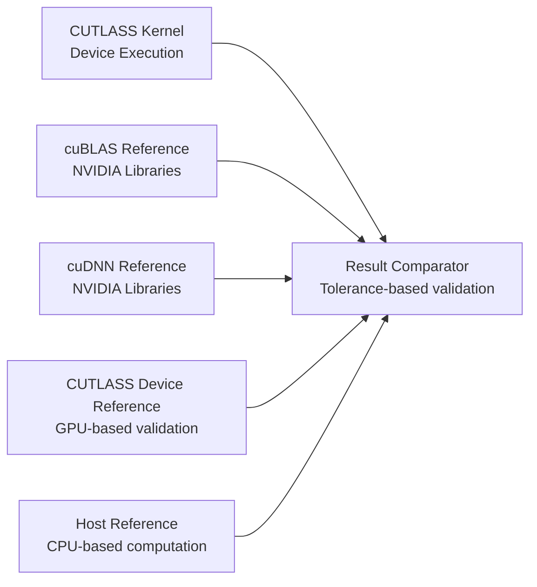

<!-- source: DeepWiki mcp.deepwiki.com · repo NVIDIA/cutlass · page 10 Testing and Validation Infrastructure · fetched 2026-10-26 -->

# Testing and Validation Infrastructure

Relevant source files

The following files were used as context for generating this wiki page:

- [CMakeLists.txt](CMakeLists.txt)
- [examples/python/CuTeDSL/cute/blackwell/kernel/rmsnorm/rmsnorm.py](examples/python/CuTeDSL/cute/blackwell/kernel/rmsnorm/rmsnorm.py)
- [include/cute/atom/copy_traits_sm90_im2col.hpp](include/cute/atom/copy_traits_sm90_im2col.hpp)
- [include/cute/atom/copy_traits_sm90_tma.hpp](include/cute/atom/copy_traits_sm90_tma.hpp)
- [include/cutlass/arch/grid_dependency_control.h](include/cutlass/arch/grid_dependency_control.h)
- [include/cutlass/cuda_host_adapter.hpp](include/cutlass/cuda_host_adapter.hpp)
- [include/cutlass/gemm/collective/sm100_mma_warpspecialized_blockwise_scaling.hpp](include/cutlass/gemm/collective/sm100_mma_warpspecialized_blockwise_scaling.hpp)
- [test/examples/CuTeDSL/conftest.py](test/examples/CuTeDSL/conftest.py)
- [test/examples/CuTeDSL/hopper/conftest.py](test/examples/CuTeDSL/hopper/conftest.py)
- [test/examples/CuTeDSL/hopper/test_dense_gemm_fp8_2xacc.py](test/examples/CuTeDSL/hopper/test_dense_gemm_fp8_2xacc.py)
- [test/examples/CuTeDSL/hopper/test_grouped_gemm.py](test/examples/CuTeDSL/hopper/test_grouped_gemm.py)
- [test/examples/CuTeDSL/sm_100a/conftest.py](test/examples/CuTeDSL/sm_100a/conftest.py)
- [test/examples/CuTeDSL/sm_100a/test_dense_blockscaled_gemm_persistent_prefetch.py](test/examples/CuTeDSL/sm_100a/test_dense_blockscaled_gemm_persistent_prefetch.py)
- [test/examples/CuTeDSL/sm_100a/test_dense_gemm_persistent_prefetch.py](test/examples/CuTeDSL/sm_100a/test_dense_gemm_persistent_prefetch.py)
- [test/examples/CuTeDSL/sm_100a/test_rmsnorm.py](test/examples/CuTeDSL/sm_100a/test_rmsnorm.py)
- [test/examples/CuTeDSL/sm_100a/test_tutorial_gemm.py](test/examples/CuTeDSL/sm_100a/test_tutorial_gemm.py)
- [test/unit/CMakeLists.txt](test/unit/CMakeLists.txt)
- [test/unit/conv/device/conv2d_problems.h](test/unit/conv/device/conv2d_problems.h)

This document provides an overview of the CUTLASS testing and validation infrastructure. CUTLASS employs a comprehensive testing strategy using Google Test (GTest) for unit tests, reference implementations for correctness validation, CTest integration for automated test execution, and Pytest for the Python-based CuTe DSL. The testing framework covers all operation types (GEMM, convolution, attention), architectures (SM70-SM100), and data types supported by CUTLASS.

For performance profiling and benchmarking, see [Performance Profiling](#10.3). For build system configuration, see [Build System and Compilation](#9).

## Test Organization

CUTLASS tests are organized hierarchically by operation type, with comprehensive coverage across architectures, data types, and kernel configurations.

**Test Directory Structure**:

Unit tests are organized under `test/unit/` by subsystem, with device tests for operations (GEMM, convolution), core library tests, and CuTe library tests. Python-based DSL tests reside in `test/examples/CuTeDSL/` and are organized by GPU architecture (e.g., `hopper/`, `sm_100a/`).

Sources: [test/unit/CMakeLists.txt:175-208](), [test/examples/CuTeDSL/conftest.py:41-45]()

### Test Target Categories

| Test Target | Description | Path |
|------------|-------------|------|
| `test_unit_gemm` | GEMM operation tests across all architectures | [test/unit/gemm/]() |
| `test_unit_conv` | Convolution operation tests (fprop, dgrad, wgrad) | [test/unit/conv/]() |
| `test_unit_cute` | CuTe library core functionality tests | [test/unit/cute/]() |
| `test_unit_epilogue` | Epilogue fusion and activation tests | [test/unit/epilogue/]() |
| `test_unit_core` | Core utilities and layout tests | [test/unit/core/]() |
| `test_unit_pipeline` | Pipeline and synchronization tests | [test/unit/pipeline/]() |

Sources: [test/unit/CMakeLists.txt:175-208]()

## Unit Test Framework

CUTLASS uses Google Test (GTest) for comprehensive unit testing. The test framework provides fixture classes, testbed utilities, and automated problem generation to validate kernel correctness across diverse configurations.

**Unit Test Architecture**:

GTest provides the test runner framework, `cutlass_test_unit_infra` provides common infrastructure, testbed classes manage problem setup and memory allocation, problem generators create test cases, reference implementations compute expected results, and comparators verify correctness.

Sources: [test/unit/CMakeLists.txt:33-60](), [test/unit/conv/device/conv2d_problems.h:114-161]()

## Python DSL Testing (CuTe DSL)

For the Python interface and CuTe DSL, CUTLASS utilizes `pytest` to validate kernels. These tests often cover complex Blackwell (SM100) and Hopper (SM90) features like TMA prefetch, block-scaled GEMM, and RMSNorm.

**Python Testing Components**:

Python tests leverage `torch` for reference comparisons and GPU memory management. The infrastructure includes architecture detection (e.g., `get_sm_version()`) and automatic cache clearing to prevent OOM errors. The `ImmutableSysPath` class is used to prevent test files from modifying the environment [test/examples/CuTeDSL/conftest.py:62-102]().

Sources: [test/examples/CuTeDSL/conftest.py:141-163](), [test/examples/CuTeDSL/sm_100a/test_dense_blockscaled_gemm_persistent_prefetch.py:44-47](), [test/examples/CuTeDSL/sm_100a/test_rmsnorm.py:54-63]()

## Reference Implementations and Validation

CUTLASS validates kernel correctness by comparing against multiple reference implementations, including host-side CPU implementations and vendor-optimized libraries.

**Reference Implementation Hierarchy**:

CUTLASS kernels are validated against cuBLAS/cuDNN (vendor libraries), CUTLASS device reference implementations (GPU-based), and host reference implementations (CPU-based). For details, see [Reference Implementations and Validation](#10.2).

Sources: [test/unit/conv/device/conv2d_problems.h:1-30](), [tools/util/include/cutlass/util/reference/host/gett.hpp:31-49]()

## CTest Integration

CUTLASS integrates with CMake's CTest framework for automated test discovery and execution.

### Test CMake Functions

| Function | Purpose | Source |
|----------|---------|--------|
| `cutlass_test_unit_add_executable` | Register unit test executable with CTest | [test/unit/CMakeLists.txt:64-126]() |
| `cutlass_test_unit_add_executable_split_file` | Split large test files for parallel compilation | [test/unit/CMakeLists.txt:129-170]() |

The `cutlass_test_unit_add_executable` function handles GTest output configuration and result caching. The `cutlass_test_unit_add_executable_split_file` utility uses `split_test_cmake.py` to break down large `.cu` files into individual tests, reducing memory pressure during builds. For details, see [Unit Test Framework and CTest Integration](#10.1).

Sources: [test/unit/CMakeLists.txt:64-170]()

## Validation Strategies

### Problem Size Generation
The `TestbedConv2dProblemSizes` class generates multiple problem categories (default, rigorous, ResNet-based) to ensure comprehensive test coverage. It includes utilities to `prune()` problem sets based on `InputSizeSpecification` or `StrideSpecification`.

Sources: [test/unit/conv/device/conv2d_problems.h:54-161]()

### Architecture-Specific Validation
Validation tests are often categorized by "Level" (L0, L1, Benchmark) to balance coverage and execution time [test/examples/CuTeDSL/hopper/test_dense_gemm_fp8_2xacc.py:32-54]():
* **L0**: Fast compile-only or small problem size tests.
* **L1**: Thorough correctness tests against references.
* **Bench**: Performance benchmarks (skipped by default).

Sources: [test/examples/CuTeDSL/hopper/test_dense_gemm_fp8_2xacc.py:32-54](), [CMakeLists.txt:121-123]()

### Numeric Validation
Validation utilities like `rmsnorm_host` or `torch.einsum` provide a ground truth for specialized kernels, ensuring that device-side optimizations (like TMA prefetch or two-pass algorithms) maintain numeric parity within defined tolerances. Tests for Blackwell utilize specific markers like `@pytest.mark.arch(["100a"])` to ensure they only run on compatible hardware [test/examples/CuTeDSL/sm_100a/test_dense_blockscaled_gemm_persistent_prefetch.py:51-51]().

Sources: [test/examples/CuTeDSL/sm_100a/test_rmsnorm.py:75-86](), [test/examples/CuTeDSL/sm_100a/test_dense_gemm_persistent_prefetch.py:91-113]()

---

