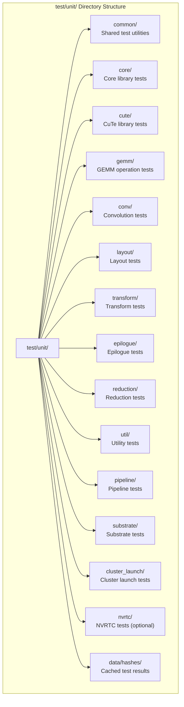
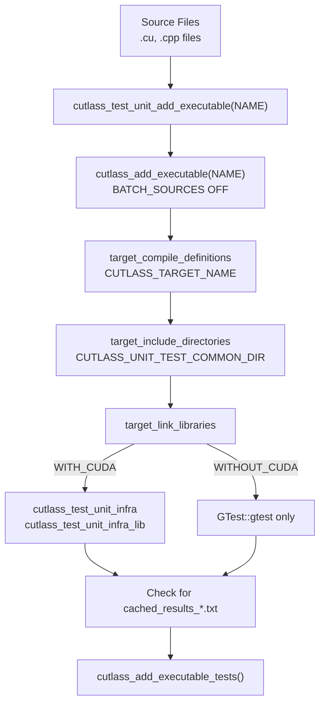
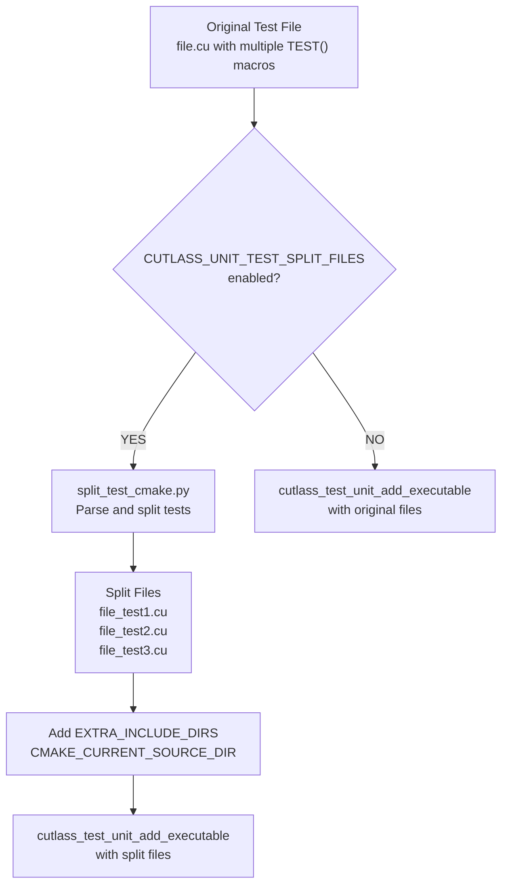

<!-- source: DeepWiki mcp.deepwiki.com · repo NVIDIA/cutlass · page 10.1 Unit Test Framework and CTest Integration · fetched 2026-10-26 -->

# Unit Test Framework and CTest Integration

<details>
<summary>Relevant source files</summary>

The following files were used as context for generating this wiki page:

- [CMakeLists.txt](CMakeLists.txt)
- [include/cute/atom/copy_traits_sm90_im2col.hpp](include/cute/atom/copy_traits_sm90_im2col.hpp)
- [include/cute/atom/copy_traits_sm90_tma.hpp](include/cute/atom/copy_traits_sm90_tma.hpp)
- [include/cutlass/arch/grid_dependency_control.h](include/cutlass/arch/grid_dependency_control.h)
- [include/cutlass/conv/kernel/default_conv2d.h](include/cutlass/conv/kernel/default_conv2d.h)
- [include/cutlass/conv/kernel/default_conv2d_dgrad.h](include/cutlass/conv/kernel/default_conv2d_dgrad.h)
- [include/cutlass/conv/kernel/default_conv2d_fprop_with_broadcast.h](include/cutlass/conv/kernel/default_conv2d_fprop_with_broadcast.h)
- [include/cutlass/conv/kernel/default_conv2d_fprop_with_reduction.h](include/cutlass/conv/kernel/default_conv2d_fprop_with_reduction.h)
- [include/cutlass/conv/kernel/default_conv2d_wgrad.h](include/cutlass/conv/kernel/default_conv2d_wgrad.h)
- [include/cutlass/conv/kernel/default_conv3d_dgrad.h](include/cutlass/conv/kernel/default_conv3d_dgrad.h)
- [include/cutlass/conv/kernel/default_conv3d_wgrad.h](include/cutlass/conv/kernel/default_conv3d_wgrad.h)
- [include/cutlass/cuda_host_adapter.hpp](include/cutlass/cuda_host_adapter.hpp)
- [include/cutlass/gemm/collective/sm100_mma_warpspecialized_blockwise_scaling.hpp](include/cutlass/gemm/collective/sm100_mma_warpspecialized_blockwise_scaling.hpp)
- [include/cutlass/gemm/kernel/gemm_universal_blockwise.h](include/cutlass/gemm/kernel/gemm_universal_blockwise.h)
- [include/cutlass/gemm/threadblock/mma_multistage_blockwise.h](include/cutlass/gemm/threadblock/mma_multistage_blockwise.h)
- [test/unit/CMakeLists.txt](test/unit/CMakeLists.txt)
- [test/unit/conv/device/CMakeLists.txt](test/unit/conv/device/CMakeLists.txt)
- [test/unit/conv/device/conv2d_fprop_implicit_gemm_f16nhwc_f16nhwc_f16nhwc_simt_f16_sm60.cu](test/unit/conv/device/conv2d_fprop_implicit_gemm_f16nhwc_f16nhwc_f16nhwc_simt_f16_sm60.cu)
- [test/unit/conv/device/conv2d_fprop_implicit_gemm_f16nhwc_f16nhwc_f32nhwc_tensor_op_f32_sm70.cu](test/unit/conv/device/conv2d_fprop_implicit_gemm_f16nhwc_f16nhwc_f32nhwc_tensor_op_f32_sm70.cu)
- [test/unit/conv/device/conv2d_fprop_with_broadcast_sm70.cu](test/unit/conv/device/conv2d_fprop_with_broadcast_sm70.cu)
- [test/unit/conv/device/conv2d_problems.h](test/unit/conv/device/conv2d_problems.h)
- [test/unit/gemm/device/CMakeLists.txt](test/unit/gemm/device/CMakeLists.txt)
- [test/unit/gemm/device/gemm_f8t_f8n_bf16t_tensor_op_f32_blockwise_sm89.cu](test/unit/gemm/device/gemm_f8t_f8n_bf16t_tensor_op_f32_blockwise_sm89.cu)

</details>


This page documents CUTLASS's unit test framework infrastructure, including the test directory organization, CMake functions for building test executables, CTest integration, test splitting for parallel builds, and test installation. For information about reference implementations and validation strategies, see page 10.2.

## Test Directory Structure

CUTLASS unit tests are organized under the `test/unit/` directory with subdirectories for different components:



Each subdirectory contains a `CMakeLists.txt` that registers its tests using the framework described below. The `common/` directory contains shared test infrastructure such as `filter_architecture.cpp` for runtime GPU capability detection.

**Sources:** [test/unit/CMakeLists.txt:175-208]()

## Test Infrastructure Libraries

CUTLASS provides two core test infrastructure libraries that all unit tests link against:

### cutlass_test_unit_infra

An `OBJECT` library providing core test infrastructure:

```cmake
cutlass_add_library(
  cutlass_test_unit_infra 
  OBJECT
  common/filter_architecture.cpp
)
```

This library links against:
- `CUTLASS` - The main CUTLASS interface library
- `cutlass_tools_util_includes` - Utility headers from `tools/util/include`
- `nvidia::cublas` (optional) - cuBLAS for reference implementations
- `GTest::gtest` - Google Test framework
- `cudart` - CUDA Runtime
- `cuda_driver` - CUDA Driver API

The `filter_architecture.cpp` file provides runtime detection of GPU compute capabilities to skip tests on unsupported architectures.

**Sources:** [test/unit/CMakeLists.txt:33-48]()

### cutlass_test_unit_infra_lib

A second `OBJECT` library containing test entry point functionality:

```cmake
cutlass_add_library(
  cutlass_test_unit_infra_lib
  OBJECT
  test_unit.cpp
)

target_link_libraries(
  cutlass_test_unit_infra_lib
  PUBLIC
  cutlass_test_unit_infra
)
```

This library depends on `cutlass_test_unit_infra` and provides the main test execution framework.

**Sources:** [test/unit/CMakeLists.txt:50-60]()

## Test Executable Registration

### cutlass_test_unit_add_executable Function

The primary function for adding unit test executables is `cutlass_test_unit_add_executable`, defined in [test/unit/CMakeLists.txt:64-126](). This function wraps CMake's executable creation with CUTLASS-specific configuration:

**Test Registration Flow:**



**Function Parameters:**

| Parameter | Type | Description |
|-----------|------|-------------|
| `NAME` | String | Test executable name |
| `WITHOUT_CUDA` | Option | Flag for host-only tests (avoids CUDA dependencies) |
| `DO_NOT_LOWERCASE_TEST_NAME` | Option | Preserves case in CTest registration |
| `TEST_SETS_SUPPORTED` | Multi-value | Test set membership (e.g., "default", "nightly") |
| `EXTRA_INCLUDE_DIRS` | Multi-value | Additional include directories beyond `common/` |

**Example Usage:**

```cmake
cutlass_test_unit_add_executable(
  cutlass_test_unit_gemm_device
  gemm_device_test1.cu
  gemm_device_test2.cu
  TEST_SETS_SUPPORTED default nightly
)
```

**Compile Definitions:**

Each test executable receives a compile definition identifying itself:
```cmake
target_compile_definitions(${NAME} PUBLIC CUTLASS_TARGET_NAME="${NAME}")
```

This allows tests to self-identify in error messages.

**Linking Behavior:**

Tests are linked differently based on whether they require CUDA:

- **WITH CUDA** (default): Links `cutlass_test_unit_infra` and `cutlass_test_unit_infra_lib`.
- **WITHOUT_CUDA**: Links only `GTest::gtest` for pure host-side tests.

**Sources:** [test/unit/CMakeLists.txt:64-126]()

## CTest Integration

### cutlass_add_executable_tests Function

After creating the test executable, `cutlass_test_unit_add_executable` calls `cutlass_add_executable_tests` to register the tests with CTest. This function handles:

1. **Test Discovery:** Identifies individual test cases within the executable.
2. **Test Registration:** Registers each test with CTest using `add_test()`.
3. **Test Sets:** Applies test set filtering based on `TEST_SETS_SUPPORTED`.
4. **Command Options:** Adds GTest command-line options.

**Test Command Options:**

```cmake
set(CUTLASS_TEST_UNIT_TEST_COMMAND_OPTIONS 
  --gtest_output=xml:${NAME_STEM}.gtest.xml)
```

This generates XML output compatible with CI/CD systems like Jenkins, GitLab CI, or GitHub Actions.

**Sources:** [test/unit/CMakeLists.txt:110-124]()

### Result Cache Files

The test framework checks for cached result files to accelerate test execution:

```cmake
set(RESULT_CACHE_FILE "${CUTLASS_TEST_UNIT_RESULTS_CACHE_DIR}/cached_results_${NAME}.txt")

if (EXISTS ${RESULT_CACHE_FILE})
  set(RESULT_CACHE_FILE_ARGS RESULT_CACHE_FILE ${RESULT_CACHE_FILE})
endif()
```

Cache files are stored in `test/unit/data/hashes/` with the naming convention `cached_results_${NAME}.txt`. These files contain hashes of reference computation results to avoid expensive recomputation during testing.

**Cache Directory:**
```cmake
set(CUTLASS_TEST_UNIT_RESULTS_CACHE_DIR ${CMAKE_CURRENT_LIST_DIR}/data/hashes)
```

**Sources:** [test/unit/CMakeLists.txt:62](), [test/unit/CMakeLists.txt:104-108]()

## Test Splitting for Parallel Builds

### cutlass_test_unit_add_executable_split_file Function

To reduce memory consumption during highly parallel builds, CUTLASS provides `cutlass_test_unit_add_executable_split_file`, which automatically splits test source files so that each file contains at most one `TEST()` macro:

**File Splitting Process:**



**Splitting Logic:**

1. **Invokes Python Script:** Executes `tools/util/scripts/split_test_cmake.py` with the target name and source files.
2. **Output Location:** Writes split files to `CMAKE_CURRENT_BINARY_DIR`.
3. **Output Manifest:** Writes list of new files to `test_split_files.txt`.
4. **Include Path Addition:** Adds `CMAKE_CURRENT_SOURCE_DIR` to include paths because split files are in a different directory but may use relative includes like `#include "../testbed.hpp"`.
5. **Error Handling:** Logs errors to `test_split_error.log` if splitting fails.

**Configuration:**

The splitting is controlled by the CMake variable:
```cmake
set(CUTLASS_UNIT_TEST_SPLIT_FILES ON/OFF)
```

**Sources:** [test/unit/CMakeLists.txt:129-170]()

## Test Configuration

### Test Level Configuration

CUTLASS tests are organized into three levels of thoroughness:

| Test Level | Value | Description | Use Case |
|------------|-------|-------------|----------|
| Sanity | 0 | Basic functionality tests | Quick smoke tests |
| Release-Quality | 1 | Standard test coverage | CI/CD pipelines |
| Exhaustive | 2 | Comprehensive test suite | Nightly/release validation |

The test level is set via the `CUTLASS_TEST_LEVEL` CMake variable:

```cmake
set(CUTLASS_TEST_LEVEL "0" CACHE STRING "Level of tests to compile.")
```

**Sources:** [CMakeLists.txt:121-122]()

### Subsystem-Specific Registration

Individual subsystems like GEMM and Convolution define specialized functions for registering tests to ensure architecture-specific dependencies are handled correctly.

#### GEMM Device Tests
GEMM tests use `cutlass_test_unit_gemm_device_add_executable` to register device-level tests. This function automatically adds dependencies to the `cutlass_test_unit_gemm_device` target.

**Sources:** [test/unit/gemm/device/CMakeLists.txt:42-46]()

#### Convolution Test Specialization
Convolution tests are grouped by architecture and operator class. For example, in `test/unit/conv/device/CMakeLists.txt`, tests are added based on the maximum architecture detected:

```cmake
if (CUTLASS_NVCC_MAX_ARCH GREATER_EQUAL 80)
  add_dependencies(
    cutlass_test_unit_conv_device
    cutlass_test_unit_conv_device_tensorop_f16_sm80
    ...
  )
endif()
```

**Sources:** [test/unit/conv/device/CMakeLists.txt:78-130]()

## Test Execution and CTest Configuration

### Test Custom Targets

CUTLASS provides custom targets for running subsets of unit tests:

**Top-Level Targets:**

```cmake
add_custom_target(cutlass_test_unit)  # All unit tests
add_custom_target(test_unit)          # Alias for convenience
```

**Per-Subsystem Targets:**

Each test subdirectory creates its own target (e.g., `cutlass_test_unit_gemm_device`). These are linked to the top-level targets via dependencies:

```cmake
foreach(SUBDIR ${SUBDIRS})
  add_subdirectory(${SUBDIR})
  add_dependencies(cutlass_test_unit cutlass_test_unit_${SUBDIR})
  add_dependencies(test_unit test_unit_${SUBDIR})
endforeach()
```

**Sources:** [test/unit/CMakeLists.txt:172-208](), [test/unit/gemm/device/CMakeLists.txt:29-30]()

### GTest Integration

CUTLASS unit tests use the Google Test (GTest) framework. The infrastructure links against `GTest::gtest` and uses standard GTest macros like `TEST()` and `EXPECT_TRUE()`.

**Example Test Definition:**
```cpp
TEST(SM60_Device_Conv2d_Fprop_Analytic_ImplicitGemm_f16nhwc_f16nhwc_f16nhwc_simt_f16,
  128x128_8x2_64x64x8) {
  // ... test implementation ...
  EXPECT_TRUE(test::conv::device::TestAllConv2d<Conv2dFprop>());
}
```

**Sources:** [test/unit/conv/device/conv2d_fprop_implicit_gemm_f16nhwc_f16nhwc_f16nhwc_simt_f16_sm60.cu:46-88](), [test/unit/CMakeLists.txt:161-163]()

### NVRTC Test Support

CUTLASS optionally builds tests using NVRTC (NVIDIA Runtime Compilation). This is enabled if both `nvidia::nvrtc` and `nvidia::cuda_driver` targets are found:

```cmake
if(TARGET nvidia::nvrtc AND TARGET nvidia::cuda_driver)
  set(CUTLASS_NVRTC_ENABLE_INIT ON)
endif()
```

**Sources:** [test/unit/CMakeLists.txt:190-194]()

---

