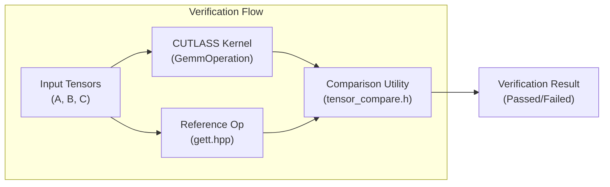

<!-- source: DeepWiki mcp.deepwiki.com · repo NVIDIA/cutlass · page 10.3 Performance Profiling · fetched 2026-10-26 -->

# Performance Profiling

<details>
<summary>Relevant source files</summary>

The following files were used as context for generating this wiki page:

- [include/cute/arch/cluster_sm90.hpp](include/cute/arch/cluster_sm90.hpp)
- [include/cutlass/gemm/collective/sm90_mma_tma_gmma_rs_warpspecialized.hpp](include/cutlass/gemm/collective/sm90_mma_tma_gmma_rs_warpspecialized.hpp)
- [include/cutlass/gemm/collective/sm90_mma_tma_gmma_ss_warpspecialized.hpp](include/cutlass/gemm/collective/sm90_mma_tma_gmma_ss_warpspecialized.hpp)
- [include/cutlass/gemm/collective/sm90_mma_tma_gmma_ss_warpspecialized_fp8.hpp](include/cutlass/gemm/collective/sm90_mma_tma_gmma_ss_warpspecialized_fp8.hpp)
- [include/cutlass/pipeline/sm90_pipeline.hpp](include/cutlass/pipeline/sm90_pipeline.hpp)
- [test/unit/gemm/device/gemm_testbed_3x.hpp](test/unit/gemm/device/gemm_testbed_3x.hpp)
- [tools/library/src/reduction/init_reduction_operations.cu](tools/library/src/reduction/init_reduction_operations.cu)
- [tools/library/src/reduction/reduction_device.cu](tools/library/src/reduction/reduction_device.cu)
- [tools/profiler/src/gemm_operation_profiler.cu](tools/profiler/src/gemm_operation_profiler.cu)
- [tools/profiler/src/options.cu](tools/profiler/src/options.cu)

</details>


## Purpose and Scope

Performance profiling is essential for optimizing CUTLASS kernel implementations and selecting appropriate configurations for production workloads. This document covers profiling techniques, measurement methodologies, and usage of the `cutlass_profiler`. The `cutlass_profiler` is a command-line benchmarking utility that measures kernel performance, verifies correctness, and supports automated parameter tuning across the library's extensive operation space.

This page covers:
- Performance measurement techniques using CUDA events and profiling tools.
- The `cutlass_profiler` architecture, command-line interface, and operation selection.
- Benchmarking modes including exhaustive search for optimal configurations.
- Result interpretation and performance optimization workflows.
- Integration with external profiling tools (NSight Compute, NSight Systems).

---

## Performance Measurement Techniques

### CUDA Event Timing

CUTLASS kernels use CUDA events for precise GPU-side timing measurements. The profiler utilizes `GpuTimer` [tools/profiler/src/gemm_operation_profiler.cu:47]() to record kernel execution time, excluding host-side overhead.

### Key Performance Metrics

| Metric | Formula | Units | Description |
|--------|---------|-------|-------------|
| **Runtime** | CUDA event elapsed time | milliseconds | Kernel execution time. |
| **GFLOPs/s** | `(2 × M × N × K) / (runtime × 1e9)` | billion FLOPs per second | Computational throughput for GEMM. |
| **Bandwidth** | `total_bytes / (runtime × 1e9)` | GiB/s | Memory system utilization. |

For GEMM operations, the FLOPs calculation is typically `2 × M × N × K` (one multiply and one add per element). The profiler reports these in its final performance report [tools/profiler/src/gemm_operation_profiler.cu:87-88]().

### External Profiling Tools

**NSight Compute** provides detailed kernel-level profiling. It is particularly useful for analyzing:
- **TMA Utilization**: On SM90+, monitoring the Tensor Memory Accelerator throughput via `cutlass::PipelineTmaAsync` [include/cutlass/gemm/collective/sm90_mma_tma_gmma_ss_warpspecialized_fp8.hpp:113]().
- **Pipeline Stalls**: Analyzing producer/consumer synchronization in warp-specialized kernels [include/cutlass/pipeline/sm90_pipeline.hpp:59-87]().

---

## cutlass_profiler Architecture and Data Flow

The profiler is built on the CUTLASS Library `Handle` and `Operation` abstractions, allowing it to dynamically discover and execute kernels compiled into the library.

### Profiler System Entity Map

```mermaid
graph TB
    subgraph "Host Space"
        HANDLE["Handle<br/>(tools/library/src/handle.cu)"]
        PROFILER["GemmOperationProfiler<br/>(tools/profiler/src/gemm_operation_profiler.cu)"]
        OPTIONS["Options<br/>(tools/profiler/src/options.cu)"]
    end
    
    subgraph "Library Entity Space"
        OP_BASE["Operation<br/>(tools/library/include/cutlass/library/library.h)"]
        GEMM_OP["GemmOperation<br/>(tools/library/src/gemm_operation.h)"]
        MANIFEST["Manifest<br/>(tools/library/include/cutlass/library/manifest.h)"]
    end
    
    subgraph "Execution Space"
        WORKSPACE["Device Workspace<br/>(cudaMalloc)"]
        KERNEL["GPU Kernel<br/>(GemmUniversal)"]
    end

    OPTIONS --> PROFILER
    PROFILER --> HANDLE
    HANDLE --> OP_BASE
    MANIFEST -- "contains" --> OP_BASE
    OP_BASE <|-- GEMM_OP
    
    GEMM_OP -- "initialize()" --> WORKSPACE
    GEMM_OP -- "run()" --> KERNEL
```

**Sources:** [tools/profiler/src/gemm_operation_profiler.cu:59-85](), [tools/profiler/src/options.cu:59](), [tools/library/src/reduction/init_reduction_operations.cu:56-64]()

### Profiler Data Flow

The `GemmOperationProfiler` [tools/profiler/src/gemm_operation_profiler.cu:59]() orchestrates the benchmarking of GEMM variants. It parses command-line arguments into an `Options` structure [tools/profiler/src/options.cu:59](), which includes device selection and problem sizes.

1.  **Discovery**: The profiler queries the `Singleton` manifest to find all `Operation` objects matching the filter.
2.  **Validation**: For each operation, `can_implement()` is called to check if the kernel supports the specific problem size (M, N, K) and alignment.
3.  **Workspace Allocation**: The profiler determines the required global memory for temporary buffers, such as those used in Split-K reduction [tools/library/src/reduction/reduction_device.cu:67-73]().
4.  **Execution**: The `run()` method launches the kernel on the stream managed by the `Handle`.

**Sources:** [tools/profiler/src/gemm_operation_profiler.cu:59-85](), [tools/profiler/src/options.cu:59-91](), [tools/library/src/reduction/reduction_device.cu:101-112]()

---

## Command-Line Interface

### Core Arguments

The `GemmOperationProfiler` defines several specific arguments for GEMM problems [tools/profiler/src/gemm_operation_profiler.cu:64-83]():

| Argument | Type | Description |
|----------|------|-------------|
| `--m`, `--n`, `--k` | Integer | GEMM problem dimensions (M, N, K). |
| `--A`, `--B`, `--C`, `--D` | Tensor | Tensor descriptors (datatype:layout). |
| `--alpha`, `--beta` | Scalar | Epilogue scaling factors. |
| `--split_k_mode` | Enumerated | Split-K mode: `serial` or `parallel`. |
| `--split_k_slices` | Integer | Number of partitions of the K dimension. |
| `--batch_count` | Integer | Number of GEMMs in a batch. |
| `--use_pdl` | Integer | Use Programmatic Dependent Launches (PDL/GDC). |
| `--swizzle_size` | Integer | Maximum swizzle size to use [test/unit/gemm/device/gemm_testbed_3x.hpp:178-189](). |

### Examples

The profiler provides usage examples for common scenarios [tools/profiler/src/gemm_operation_profiler.cu:103-136]():

```bash
# Profile a specific problem size
$ cutlass_profiler --operation=Gemm --m=1024 --n=1024 --k=128

# Schmoo over problem size and beta
$ cutlass_profiler --operation=Gemm --m=1024:4096:256 --n=1024:4096:256 --k=128:8192:128 --beta=0,1,2.5

# Profile with parallel Split-K
$ cutlass_profiler --operation=Gemm --split_k_mode=parallel --split_k_slices=2 --m=1024 --n=1024 --k=128
```

**Sources:** [tools/profiler/src/gemm_operation_profiler.cu:64-83](), [tools/profiler/src/gemm_operation_profiler.cu:103-136]()

---

## Verification and Reference Implementations

### Verification Workflow

To ensure performance optimizations do not break correctness, the profiler compares kernel outputs against a reference implementation.



### Reference Backends

1.  **Reference Device**: Executes a simple GEMM on the GPU.
2.  **Reference Host**: Executes on the CPU using `cutlass::reference::host::gett` [test/unit/gemm/device/gemm_testbed_3x.hpp:53]().
3.  **cuBLAS**: Uses the cuBLAS library as a high-performance reference provider [tools/profiler/src/gemm_operation_profiler.cu:84]().

**Sources:** [test/unit/gemm/device/gemm_testbed_3x.hpp:49-53](), [tools/profiler/src/gemm_operation_profiler.cu:84-85]()

---

## Advanced Profiling: Warp Specialization and Pipelines

Modern CUTLASS kernels (SM90+) use warp specialization, which complicates profiling as multiple warps perform different roles (Producers vs. Consumers).

### Pipeline Coordination

Profiling these kernels often requires looking at the `MainloopPipeline` [include/cutlass/gemm/collective/sm90_mma_tma_gmma_ss_warpspecialized_fp8.hpp:113](). The `PipelineState` [include/cutlass/pipeline/sm90_pipeline.hpp:171]() tracks the circular buffer index and phase, ensuring that producers [include/cutlass/pipeline/sm90_pipeline.hpp:59]() do not overwrite data currently being used by consumers [include/cutlass/pipeline/sm90_pipeline.hpp:75]().

### SM90 TMA and GMMA

On Hopper (SM90), profiling focuses on the efficiency of `SM90_TMA_LOAD` [include/cutlass/gemm/collective/sm90_mma_tma_gmma_ss_warpspecialized_fp8.hpp:143]() and `GMMA` instructions. The profiler can measure the impact of different `Stages` [include/cutlass/gemm/collective/sm90_mma_tma_gmma_ss_warpspecialized_fp8.hpp:57]() in the asynchronous pipeline to hide memory latency. For FP8 kernels, the `MainloopSm90TmaGmmaWarpSpecializedFP8` policy [include/cutlass/gemm/collective/sm90_mma_tma_gmma_ss_warpspecialized_fp8.hpp:75]() defines specific shared storage layouts for SMEM [include/cutlass/gemm/collective/sm90_mma_tma_gmma_ss_warpspecialized_fp8.hpp:151-153]().

### Hardware-Specific Attributes
The profiler queries device attributes such as SM count and clock rate to normalize performance data [tools/profiler/src/options.cu:149-184](). On SM90, it also accounts for cluster configurations using `cute::cluster_shape()` [include/cute/arch/cluster_sm90.hpp:140-151]().

**Sources:** [include/cutlass/gemm/collective/sm90_mma_tma_gmma_ss_warpspecialized_fp8.hpp:113-114](), [include/cutlass/pipeline/sm90_pipeline.hpp:171-213](), [include/cutlass/gemm/collective/sm90_mma_tma_gmma_ss_warpspecialized_fp8.hpp:139-146](), [tools/profiler/src/options.cu:149-184](), [include/cute/arch/cluster_sm90.hpp:140-151]()

---

