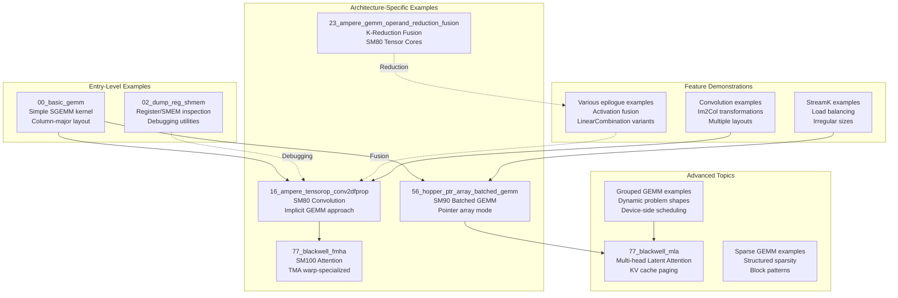
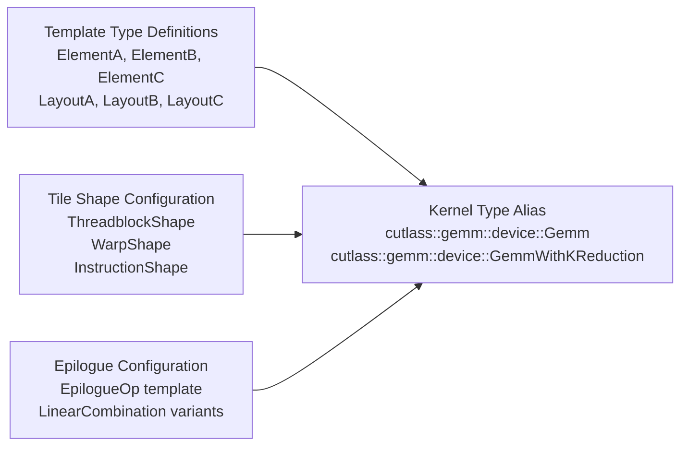
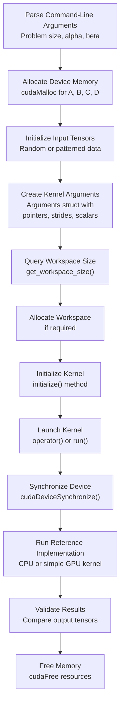
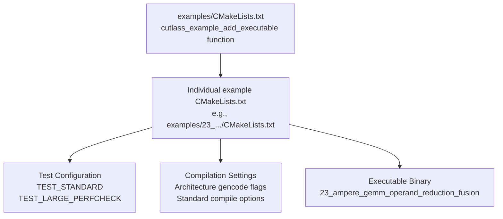

<!-- source: DeepWiki mcp.deepwiki.com · repo NVIDIA/cutlass · page 11 Examples and Tutorials · fetched 2026-10-26 -->

# Examples and Tutorials

Relevant source files

The following files were used as context for generating this wiki page:

- [examples/23_ampere_gemm_operand_reduction_fusion/CMakeLists.txt](examples/23_ampere_gemm_operand_reduction_fusion/CMakeLists.txt)
- [examples/23_ampere_gemm_operand_reduction_fusion/ampere_gemm_operand_reduction_fusion.cu](examples/23_ampere_gemm_operand_reduction_fusion/ampere_gemm_operand_reduction_fusion.cu)
- [examples/CMakeLists.txt](examples/CMakeLists.txt)
- [examples/cute/tutorial/sgemm_1.cu](examples/cute/tutorial/sgemm_1.cu)
- [examples/cute/tutorial/sgemm_2.cu](examples/cute/tutorial/sgemm_2.cu)
- [examples/cute/tutorial/sgemm_sm70.cu](examples/cute/tutorial/sgemm_sm70.cu)
- [examples/cute/tutorial/sgemm_sm80.cu](examples/cute/tutorial/sgemm_sm80.cu)
- [include/cutlass/epilogue/threadblock/epilogue_gemm_k_reduction.h](include/cutlass/epilogue/threadblock/epilogue_gemm_k_reduction.h)
- [include/cutlass/gemm/device/gemm_with_k_reduction.h](include/cutlass/gemm/device/gemm_with_k_reduction.h)
- [include/cutlass/gemm/kernel/default_gemm_with_k_reduction.h](include/cutlass/gemm/kernel/default_gemm_with_k_reduction.h)
- [include/cutlass/gemm/kernel/gemm_with_k_reduction.h](include/cutlass/gemm/kernel/gemm_with_k_reduction.h)
- [include/cutlass/gemm/threadblock/default_mma_core_with_reduction.h](include/cutlass/gemm/threadblock/default_mma_core_with_reduction.h)
- [include/cutlass/gemm/warp/default_mma_with_reduction_tensor_op.h](include/cutlass/gemm/warp/default_mma_with_reduction_tensor_op.h)
- [include/cutlass/gemm/warp/mma_with_reduction_tensor_op.h](include/cutlass/gemm/warp/mma_with_reduction_tensor_op.h)

This page provides an overview of the CUTLASS examples directory and tutorial resources. The examples demonstrate progressively complex usage patterns, from basic GEMM kernels to advanced features like fused operations, convolution, batched execution, and attention mechanisms. Each example is a self-contained program that illustrates specific CUTLASS capabilities with commented code and validation logic.

For Python-based kernel authoring, see [CuTe DSL Kernel Authoring](#3.1). For generated kernel library usage, see [cutlass_cppgen API Reference](#3.5). For comprehensive API documentation, see [API Reference](#13).

## Example Organization Structure

The `examples/` directory contains over 70+ numbered examples organized by complexity and feature area. Examples follow a consistent structure with source files, CMake build configuration, and often reference implementations for validation.

Sources: [examples/23_ampere_gemm_operand_reduction_fusion/ampere_gemm_operand_reduction_fusion.cu:32-41](), [examples/CMakeLists.txt:83-178]()

## Common Example Patterns

All CUTLASS examples follow similar patterns for kernel instantiation, problem specification, memory management, and validation. Understanding these patterns accelerates learning.

### Kernel Instantiation Pattern

The C++ API uses template metaprogramming to compose kernels. A typical instantiation involves defining the data types, layouts, and tile shapes before aliasing the final kernel type.

Sources: [examples/23_ampere_gemm_operand_reduction_fusion/ampere_gemm_operand_reduction_fusion.cu:68-138](), [include/cutlass/gemm/kernel/default_gemm_with_k_reduction.h:116-142](), [include/cutlass/gemm/device/gemm_with_k_reduction.h:135-161]()

### Execution Flow Pattern

Sources: [include/cutlass/gemm/kernel/gemm_with_k_reduction.h:109-188](), [include/cutlass/gemm/device/gemm_with_k_reduction.h:135-161]()

## Building and Running Examples

Examples use the CMake build system and are configured with `cutlass_example_add_executable()`. Each example can be built individually or as part of the entire examples suite.

### Build Configuration

| Build Command | Description |
|---------------|-------------|
| `cmake .. -DCUTLASS_NVCC_ARCHS='80;90;100'` | Configure for specific architectures |
| `make 23_ampere_gemm_operand_reduction_fusion` | Build single example |
| `make cutlass_examples` | Build all examples |
| `ctest -R test_examples_23` | Run example tests |

Sources: [examples/CMakeLists.txt:32-80](), [examples/23_ampere_gemm_operand_reduction_fusion/CMakeLists.txt:30-39]()

## CuTe Tutorials and Notebooks

CUTLASS 3.x introduced CuTe, a layout algebra library. Tutorials for CuTe are provided both as C++ source files and Python notebooks.

### CuTe C++ Tutorial Series
A sequence of C++ examples demonstrates CuTe's power in managing complex memory layouts and tiling. These are found in `examples/cute/tutorial/`. Key examples include:

*   **`sgemm_1.cu`**: Basic SGEMM using `local_partition` and simple thread layouts [examples/cute/tutorial/sgemm_1.cu:118-142]().
*   **`sgemm_2.cu`**: Demonstrates `TiledCopy` and `TiledMMA` for hardware-accelerated movement and math [examples/cute/tutorial/sgemm_2.cu:107-142]().
*   **`sgemm_sm70.cu`**: Shows pipelining and register-buffered data movement for Volta [examples/cute/tutorial/sgemm_sm70.cu:107-143]().
*   **`sgemm_sm80.cu`**: Demonstrates Ampere-specific `cp.async` and `SharedStorage` management [examples/cute/tutorial/sgemm_sm80.cu:48-52](), [examples/cute/tutorial/sgemm_sm80.cu:143-150]().

For details, see [CuTe Layout and Tensor Tutorial](#11.2).

Sources: [examples/cute/tutorial/sgemm_1.cu:1-142](), [examples/cute/tutorial/sgemm_2.cu:1-142](), [examples/cute/tutorial/sgemm_sm70.cu:1-143](), [examples/cute/tutorial/sgemm_sm80.cu:1-150]()

## Example Categories by Feature

### Basic GEMM Examples (00-10)

Entry-level examples demonstrating fundamental GEMM operations with various data types and layouts. These examples typically use the `cutlass::gemm::device::Gemm` template.

See [Basic GEMM Examples](#11.1) for detailed walkthrough of `00_basic_gemm` and `02_dump_reg_shmem`.

### Epilogue Fusion and Reduction

Examples demonstrating operations that fuse element-wise logic or reductions with the GEMM mainloop. 

**Key Example: 23_ampere_gemm_operand_reduction_fusion**
This example demonstrates reducing one of the GEMM operands (A or B) along the K-dimension during the computation. The output contains both the result matrix $D$ and an $M \times 1$ or $1 \times N$ reduction vector.

| Component | Code Entity | Role |
|-----------|-------------|------|
| Kernel | `cutlass::gemm::kernel::GemmWithKReduction` | Top-level kernel structure [include/cutlass/gemm/kernel/gemm_with_k_reduction.h:63-63]() |
| Mainloop | `cutlass::gemm::threadblock::DefaultMmaWithReduction` | CTA-level MMA with reduction logic [include/cutlass/gemm/kernel/default_gemm_with_k_reduction.h:121-125]() |
| Epilogue | `cutlass::epilogue::threadblock::EpilogueGemmKReduction` | Stores the reduced vector to memory [include/cutlass/epilogue/threadblock/epilogue_gemm_k_reduction.h:73-73]() |

Sources: [examples/23_ampere_gemm_operand_reduction_fusion/ampere_gemm_operand_reduction_fusion.cu:32-41](), [include/cutlass/gemm/kernel/default_gemm_with_k_reduction.h:130-141](), [include/cutlass/gemm/threadblock/default_mma_core_with_reduction.h:154-156]()

### Convolution Examples (16-20)

Examples using implicit GEMM algorithm for convolution operations. These demonstrate `cutlass::conv::device::ImplicitGemmConvolution` with various tensor layouts.

See [Convolution Examples](#11.3) for detailed coverage of `16_ampere_tensorop_conv2dfprop`.

### Hopper and Blackwell Architecture Examples (50-95)

Examples demonstrating SM90 Hopper and SM100 Blackwell features including TMA (Tensor Memory Accelerator), warp specialization, and advanced attention mechanisms.

See [Hopper Batched GEMM Example](#11.5) and [Blackwell FMHA Examples](#11.4) for details.

Sources: [examples/CMakeLists.txt:131-177]()

## Example-to-Concept Mapping

| Concept | Primary Examples | Key Classes/Functions |
|---------|------------------|----------------------|
| Basic GEMM | `00_basic_gemm` | `cutlass::gemm::device::Gemm` |
| Operand Reduction | `23_ampere_gemm_operand_reduction_fusion` | `GemmWithKReduction` |
| CuTe Layouts | `examples/cute/tutorial/*` | `cute::Layout`, `cute::Tensor` |
| Batched GEMM | `56_hopper_ptr_array_batched_gemm` | Pointer-array batched mode |
| FMHA / Attention | `77_blackwell_fmha`, `88_hopper_fmha` | `Sm100FmhaFwdKernelTmaWarpspecialized` |
| Distributed GEMM | `65_distributed_gemm`, `82_blackwell_distributed_gemm` | NVSHMEM integration |

## Example Validation Strategy

All examples include reference implementations for correctness validation. This typically involves running a CPU-based reference and comparing results using absolute or relative difference utilities.

Sources: [examples/23_ampere_gemm_operand_reduction_fusion/ampere_gemm_operand_reduction_fusion.cu:143-155]()

## Related Documentation

- For Python-based kernel development: [CuTe DSL Kernel Authoring](#3.1)
- For programmatic kernel generation: [cutlass_cppgen API Reference](#3.5)
- For CuTe fundamentals: [CuTe Core Abstractions](#2)
- For testing examples: [Testing and Validation Infrastructure](#10)

---

