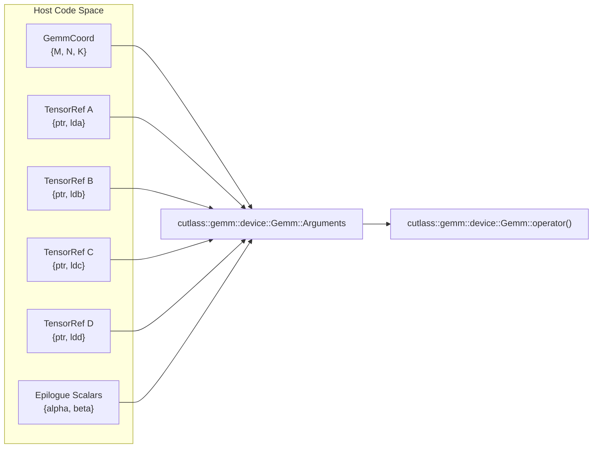
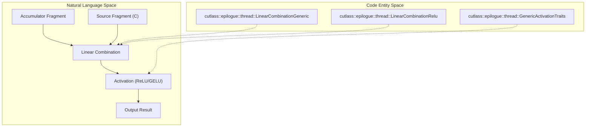

<!-- source: DeepWiki mcp.deepwiki.com · repo NVIDIA/cutlass · page 11.1 Basic GEMM Examples · fetched 2026-10-26 -->

# Basic GEMM Examples

<details>
<summary>Relevant source files</summary>

The following files were used as context for generating this wiki page:

- [examples/00_basic_gemm/basic_gemm.cu](examples/00_basic_gemm/basic_gemm.cu)
- [examples/03_visualize_layout/CMakeLists.txt](examples/03_visualize_layout/CMakeLists.txt)
- [examples/06_splitK_gemm/splitk_gemm.cu](examples/06_splitK_gemm/splitk_gemm.cu)
- [examples/07_volta_tensorop_gemm/volta_tensorop_gemm.cu](examples/07_volta_tensorop_gemm/volta_tensorop_gemm.cu)
- [examples/08_turing_tensorop_gemm/turing_tensorop_gemm.cu](examples/08_turing_tensorop_gemm/turing_tensorop_gemm.cu)
- [examples/12_gemm_bias_relu/gemm_bias_relu.cu](examples/12_gemm_bias_relu/gemm_bias_relu.cu)
- [examples/16_ampere_tensorop_conv2dfprop/ampere_tensorop_conv2dfprop.cu](examples/16_ampere_tensorop_conv2dfprop/ampere_tensorop_conv2dfprop.cu)
- [include/cutlass/arch/mma_sm75.h](include/cutlass/arch/mma_sm75.h)
- [include/cutlass/arch/mma_sm80.h](include/cutlass/arch/mma_sm80.h)
- [include/cutlass/epilogue/thread/linear_combination_clamp.h](include/cutlass/epilogue/thread/linear_combination_clamp.h)
- [include/cutlass/epilogue/thread/linear_combination_gelu.h](include/cutlass/epilogue/thread/linear_combination_gelu.h)
- [include/cutlass/epilogue/thread/linear_combination_generic.h](include/cutlass/epilogue/thread/linear_combination_generic.h)
- [include/cutlass/epilogue/thread/linear_combination_hardswish.h](include/cutlass/epilogue/thread/linear_combination_hardswish.h)
- [include/cutlass/epilogue/thread/linear_combination_relu.h](include/cutlass/epilogue/thread/linear_combination_relu.h)
- [include/cutlass/epilogue/thread/linear_combination_relu0.h](include/cutlass/epilogue/thread/linear_combination_relu0.h)
- [include/cutlass/epilogue/thread/linear_combination_sigmoid.h](include/cutlass/epilogue/thread/linear_combination_sigmoid.h)
- [include/cutlass/epilogue/thread/linear_combination_silu.h](include/cutlass/epilogue/thread/linear_combination_silu.h)
- [tools/util/include/cutlass/util/host_tensor_planar_complex.h](tools/util/include/cutlass/util/host_tensor_planar_complex.h)

</details>


This document covers the fundamental GEMM (General Matrix Multiply) examples that demonstrate core CUTLASS usage patterns. These examples illustrate the minimal C++ API required to configure, launch, and validate CUTLASS GEMM kernels. The examples progress from basic kernel invocation to exploring epilogue fusion with activations like ReLU, GELU, and SiLU.

## Overview

CUTLASS provides introductory examples demonstrating essential GEMM kernel usage:

| Example | Purpose | Key Concepts |
|---------|---------|--------------|
| `00_basic_gemm` | Fundamental kernel instantiation and launch | Template configuration, argument construction, verification |
| `02_dump_reg_shmem` | Resource usage inspection | Register and shared memory profiling |
| `06_splitK_gemm` | Partitioning K-dimension | Parallelizing GEMM across SMs for small M, N and large K |
| `12_gemm_bias_relu` | Epilogue fusion | Fusing bias addition and ReLU activation into the GEMM kernel |

These examples focus on the device-level API (`cutlass::gemm::device::Gemm` [include/cutlass/gemm/device/gemm.h:1-100]()) rather than lower-level tile or collective operations.

**Sources:** [examples/00_basic_gemm/basic_gemm.cu:32-54](), [examples/12_gemm_bias_relu/gemm_bias_relu.cu:32-48]()

## Example 00_basic_gemm: Fundamental GEMM Usage

The `00_basic_gemm` example serves as the entry point for understanding CUTLASS's device-level GEMM API. It demonstrates the minimal code required to instantiate a CUTLASS GEMM template, construct its arguments, launch the kernel, and verify correctness. The example computes `D = alpha * A * B + beta * C` using single-precision floating-point arithmetic with column-major layout [examples/00_basic_gemm/basic_gemm.cu:79-90]().

### Core API Workflow

The basic GEMM workflow follows a standard pattern:

1. Define a GEMM kernel type with specific data types and layouts [examples/00_basic_gemm/basic_gemm.cu:103-108]().
2. Construct kernel arguments from problem dimensions and tensor pointers [examples/00_basic_gemm/basic_gemm.cu:122-127]().
3. Launch the kernel and handle status codes [examples/00_basic_gemm/basic_gemm.cu:133-141]().
4. Verify results against a reference implementation.

**Sources:** [examples/00_basic_gemm/basic_gemm.cu:78-145]()

### GEMM Kernel Type Definition

#### Type Composition Pattern

CUTLASS GEMM kernels are instantiated through template specialization of `cutlass::gemm::device::Gemm`. The template parameters specify the element types and memory layouts for input and output tensors.

The type definition in [examples/00_basic_gemm/basic_gemm.cu:103-108]() shows the minimal specialization:

| Template Parameter | Value | Purpose |
|-------------------|-------|---------|
| `ElementA` | `float` | Data type of matrix A elements |
| `LayoutA` | `cutlass::layout::ColumnMajor` | Memory layout of matrix A |
| `ElementB` | `float` | Data type of matrix B elements |
| `LayoutB` | `cutlass::layout::ColumnMajor` | Memory layout of matrix B |
| `ElementC` | `float` | Data type of matrix C/D elements |
| `LayoutC` | `cutlass::layout::ColumnMajor` | Memory layout of matrix C/D |

**Sources:** [examples/00_basic_gemm/basic_gemm.cu:101-108]()

### Arguments Structure and Construction

#### Arguments Object Design

CUTLASS follows a design pattern where kernel arguments are constructed in host code and passed to device kernels by value. The `CutlassGemm::Arguments` structure encapsulates all parameters needed for kernel execution.

**GEMM Argument Mapping**

Title: "Mapping Host Arguments to Gemm Kernel Entities"


The arguments construction in [examples/00_basic_gemm/basic_gemm.cu:122-127]() follows this pattern:

```cpp
CutlassGemm::Arguments args(
  {M, N, K},      // GemmCoord problem_size
  {A, lda},       // TensorRef<ElementA> ref_A
  {B, ldb},       // TensorRef<ElementB> ref_B
  {C, ldc},       // TensorRef<ElementC> ref_C
  {C, ldc},       // TensorRef<ElementC> ref_D (may differ from C)
  {alpha, beta}   // EpilogueOutputOp::Params epilogue
);
```

**Sources:** [examples/00_basic_gemm/basic_gemm.cu:113-127]()

## Example 12: GEMM with Bias and ReLU Fusion

This example demonstrates how to use specialized epilogues to fuse operations like bias addition and activation functions into the GEMM kernel, reducing global memory round-trips.

### Epilogue Fusion Mechanism

The epilogue is the final phase of the GEMM kernel where the accumulated result is scaled and combined with an optional source tensor. By swapping the default `LinearCombination` with `LinearCombinationRelu`, the kernel can compute:
`D = max(0, alpha * (A * B) + beta * C + bias)` [examples/12_gemm_bias_relu/gemm_bias_relu.cu:89-92]().

**Epilogue Data Flow and Code Association**

Title: "Epilogue Pipeline to Code Entity Mapping"


In `12_gemm_bias_relu.cu`, the `EpilogueOp` is configured as follows:
- **ElementOutput**: `float` [examples/12_gemm_bias_relu/gemm_bias_relu.cu:55]()
- **Activation**: `LinearCombinationRelu` [examples/12_gemm_bias_relu/gemm_bias_relu.cu:93]()
- **ScaleType**: `NoBetaScaling` (used when adding a bias vector) [examples/12_gemm_bias_relu/gemm_bias_relu.cu:102]()

**Sources:** [examples/12_gemm_bias_relu/gemm_bias_relu.cu:89-102](), [include/cutlass/epilogue/thread/linear_combination_relu.h:69-79](), [include/cutlass/epilogue/thread/linear_combination_generic.h:113-136]()

### Implementation of Activation Functions

Activation functions are implemented as functors or through `LinearCombinationGeneric` specializations:
- `LinearCombinationRelu`: Applies a linear combination followed by a maximum operation against a threshold (default 0) [include/cutlass/epilogue/thread/linear_combination_relu.h:69-79]().
- `LinearCombinationGELU`: Specialization using the `GELU` activation functor [include/cutlass/epilogue/thread/linear_combination_gelu.h:53-64]().
- `LinearCombinationSilu`: Specialization using the `SiLu` activation functor [include/cutlass/epilogue/thread/linear_combination_silu.h:53-64]().
- `LinearCombinationSigmoid`: Specialization using the `Sigmoid` activation functor [include/cutlass/epilogue/thread/linear_combination_sigmoid.h:53-64]().
- `LinearCombinationClamp`: Clamps values before converting to the output type [include/cutlass/epilogue/thread/linear_combination_clamp.h:69-79]().

**Sources:** [include/cutlass/epilogue/thread/linear_combination_relu.h:69-79](), [include/cutlass/epilogue/thread/linear_combination_gelu.h:53-64](), [include/cutlass/epilogue/thread/linear_combination_silu.h:53-64](), [include/cutlass/epilogue/thread/linear_combination_sigmoid.h:53-64](), [include/cutlass/epilogue/thread/linear_combination_clamp.h:69-79]()

## Example 06_splitK_gemm: Partitioning K-dimension

This example demonstrates the "split-K" strategy to increase SM occupancy for problems with a large K dimension but small M and N.

### Split-K Mechanism
When M and N are small, a standard GEMM might launch only a few threadblocks, leaving most SMs idle. Split-K partitions the K dimension into multiple chunks, each processed by a different threadblock [examples/06_splitK_gemm/splitk_gemm.cu:36-44](). These partial products are then accumulated into the final output matrix.

- **Split-K Factor**: Determines the number of threadblocks per output tile [examples/06_splitK_gemm/splitk_gemm.cu:42-44]().
- **Kernel Choice**: Uses `cutlass::gemm::device::GemmSplitKParallel` [examples/06_splitK_gemm/splitk_gemm.cu:96]().

**Sources:** [examples/06_splitK_gemm/splitk_gemm.cu:32-50](), [examples/06_splitK_gemm/splitk_gemm.cu:92-96]()

## Verification and Testing Infrastructure

### Reference Implementation

The examples use reference implementations to verify correctness.
- `00_basic_gemm` uses a naive triple-nested loop kernel `InitializeMatrix_kernel` and reference checks [examples/00_basic_gemm/basic_gemm.cu:155-168]().
- Advanced examples use `cutlass::HostTensor` to manage memory and provide host-side verification [examples/12_gemm_bias_relu/gemm_bias_relu.cu:133-144]().

### HostTensor and Planar Complex Tensors

For complex numbers, CUTLASS provides `HostTensorPlanarComplex` which manages memory for real and imaginary parts separately (planar) while providing a unified interface for host and device access [tools/util/include/cutlass/util/host_tensor_planar_complex.h:59-124]().

**Sources:** [examples/00_basic_gemm/basic_gemm.cu:155-168](), [tools/util/include/cutlass/util/host_tensor_planar_complex.h:59-124]()

---

