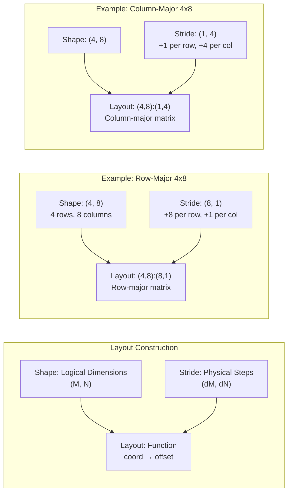
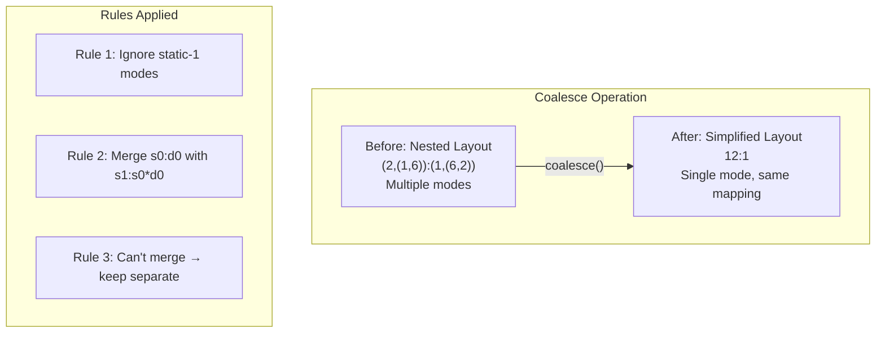
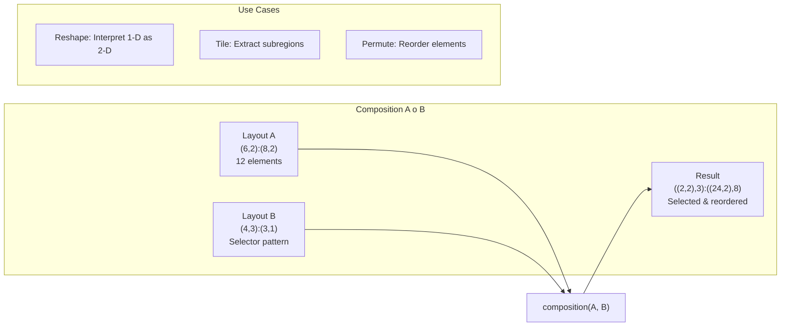
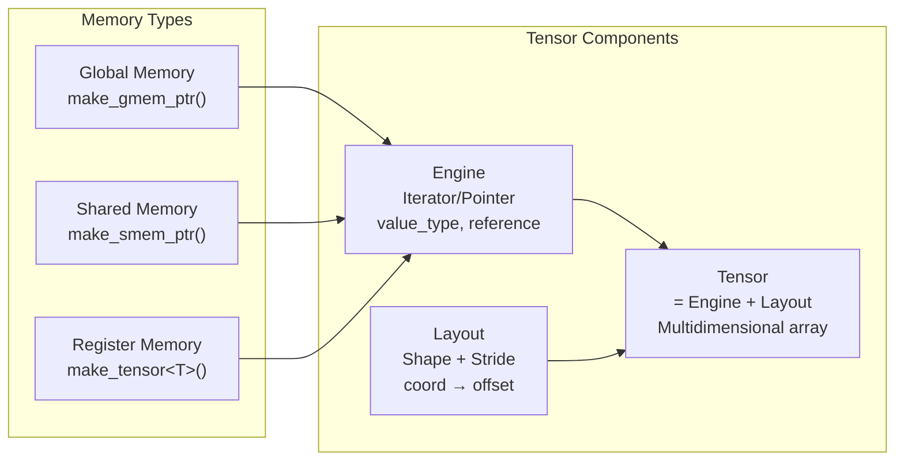
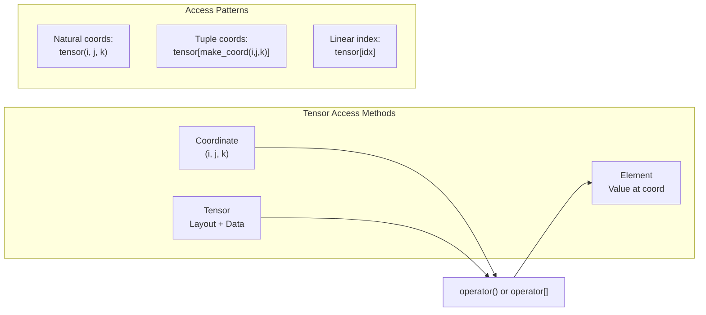
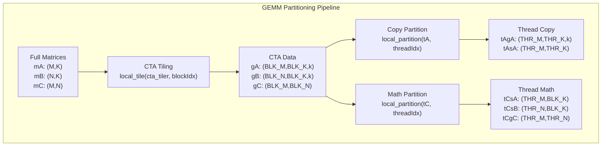

<!-- source: DeepWiki mcp.deepwiki.com · repo NVIDIA/cutlass · page 11.2 CuTe Layout and Tensor Tutorial · fetched 2026-10-26 -->

# CuTe Layout and Tensor Tutorial

<details>
<summary>Relevant source files</summary>

The following files were used as context for generating this wiki page:

- [examples/cute/tutorial/sgemm_1.cu](examples/cute/tutorial/sgemm_1.cu)
- [examples/cute/tutorial/sgemm_2.cu](examples/cute/tutorial/sgemm_2.cu)
- [examples/cute/tutorial/sgemm_sm70.cu](examples/cute/tutorial/sgemm_sm70.cu)
- [examples/cute/tutorial/sgemm_sm80.cu](examples/cute/tutorial/sgemm_sm80.cu)
- [media/docs/cpp/cute/02_layout_algebra.md](media/docs/cpp/cute/02_layout_algebra.md)
- [media/docs/cpp/cute/03_tensor.md](media/docs/cpp/cute/03_tensor.md)
- [media/docs/cpp/cute/0t_mma_atom.md](media/docs/cpp/cute/0t_mma_atom.md)
- [media/docs/cpp/cute/0x_gemm_tutorial.md](media/docs/cpp/cute/0x_gemm_tutorial.md)
- [test/unit/layout/tensor.cu](test/unit/layout/tensor.cu)
- [test/unit/layout/tensor_nhwc.cu](test/unit/layout/tensor_nhwc.cu)

</details>


## Purpose and Scope

This tutorial provides hands-on guidance for using CuTe's `Layout` and `Tensor` abstractions through practical examples. It demonstrates how to create layouts, perform layout algebra operations, construct tensors, and partition data across threads. This page focuses on code examples and usage patterns, building from simple to complex scenarios.

For comprehensive reference documentation on layout algebra theory and all operations, see [Layout Algebra](2.1). For detailed Tensor API reference, see [Tensor Container and Operations](2.2). For advanced usage in MMA operations, see [MMA Atoms and TiledMMA](2.3).

## Layout Fundamentals

CuTe `Layout`s are mathematical functions that map logical coordinates to physical offsets in memory. Every `Layout` consists of two components: `Shape` (domain) and `Stride` (function behavior) [media/docs/cpp/cute/03_tensor.md:8-10]().

### Creating Basic Layouts

Title: Layout Structure and Examples


**Creating Layouts with `make_layout`**

Layouts can be constructed with static or dynamic dimensions [media/docs/cpp/cute/03_tensor.md:102-122]():

```cpp
// Static shapes and strides using Int<N>{}
auto layout_static = make_layout(make_shape(Int<4>{}, Int<8>{}),
                                 make_stride(Int<8>{}, Int<1>{}));  // (4,8):(8,1)

// Dynamic shapes and strides
auto layout_dynamic = make_layout(make_shape(4, 8),
                                  make_stride(8, 1));                 // (4,8):(8,1)

// Column-major shorthand
auto layout_col = make_layout(make_shape(Int<4>{}, Int<8>{}));       // (4,8):(1,4)

// Row-major using LayoutRight
auto layout_row = make_layout(make_shape(Int<4>{}, Int<8>{}),
                              LayoutRight{});                         // (4,8):(8,1)
```

**Layout as Function**

A layout maps coordinates to offsets [media/docs/cpp/cute/02_layout_algebra.md:16-17](). The logical domain of the function is the `Shape`, and the mapping is defined by the `Stride` [media/docs/cpp/cute/02_layout_algebra.md:43-48]().

```cpp
auto layout = make_layout(make_shape(4, 8), make_stride(8, 1));  // 4x8 row-major
int offset0 = layout(0, 0);    // offset = 0
int offset1 = layout(1, 0);    // offset = 8  (one row down)
int offset2 = layout(0, 1);    // offset = 1  (one column right)
int offset3 = layout(2, 3);    // offset = 2*8 + 3*1 = 19
```

Sources: [media/docs/cpp/cute/02_layout_algebra.md:1-50](), [media/docs/cpp/cute/03_tensor.md:1-50]()

## Layout Operations

### Coalesce: Simplifying Layouts

`coalesce` simplifies a layout by merging adjacent modes with compatible shapes and strides, reducing computational overhead without changing the function behavior [media/docs/cpp/cute/02_layout_algebra.md:13-18](). It flattens the layout and applies binary operations to adjacent modes [media/docs/cpp/cute/02_layout_algebra.md:50]().

Title: Coalesce Operation Logic


**Example: Full Coalesce**

```cpp
// Complex nested layout
auto layout = make_layout(make_shape(Int<2>{}, make_shape(Int<1>{}, Int<6>{})),
                          make_stride(Int<1>{}, make_stride(Int<6>{}, Int<2>{})));
// layout is (2,(1,6)):(1,(6,2))

auto result = coalesce(layout);  // result is _12:_1 [media/docs/cpp/cute/02_layout_algebra.md:31-34]
```

**Example: By-mode Coalesce**

Sometimes the shape of the layout must be preserved (e.g., keeping it 2-D). An overload of `coalesce` takes a `trg_profile` to specify where to apply the operation [media/docs/cpp/cute/02_layout_algebra.md:54-60]().

```cpp
auto a = Layout<Shape <_2,Shape <_1,_6>>,
                Stride<_1,Stride<_6,_2>>>{};
auto result = coalesce(a, Step<_1,_1>{});   // (_2,_6):(_1,_2) [media/docs/cpp/cute/02_layout_algebra.md:65-67]
```

Sources: [media/docs/cpp/cute/02_layout_algebra.md:13-76]()

### Composition: Reshaping and Reordering

`composition(A, B)` results in a layout `R` such that `R(c) = A(B(c))` [media/docs/cpp/cute/02_layout_algebra.md:84-85](). It is used for partitioning data across threads and extracting tiles [media/docs/cpp/cute/02_layout_algebra.md:9]().

Title: Composition Mapping


**Example: Computing Composition**

```cpp
// A = (6,2):(8,2)
// B = (4,3):(3,1)
// R = composition(A, B) = ((2,2),3):((24,2),8) [media/docs/cpp/cute/02_layout_algebra.md:87-109]
```

Sources: [media/docs/cpp/cute/02_layout_algebra.md:77-130]()

## Tensor Fundamentals

A `Tensor` represents a multidimensional array by combining an `Engine` and a `Layout` [media/docs/cpp/cute/03_tensor.md:3-7](). The `Engine` holds the data (via an iterator), and the `Layout` provides the logical-to-physical mapping [media/docs/cpp/cute/03_tensor.md:9-11]().

Title: Tensor Components and Memory


### Creating Tensors

**Nonowning Tensors (Views)**
Nonowning tensors act like raw pointers; copying them does not deep-copy elements [media/docs/cpp/cute/03_tensor.md:83-85]().

```cpp
float* A = ...;

// Untagged pointer [media/docs/cpp/cute/03_tensor.md:106-108]
Tensor tensor_8 = make_tensor(A, make_layout(Int<8>{}));

// Tagged global memory pointer [media/docs/cpp/cute/03_tensor.md:111-112]
Tensor gmem_8s = make_tensor(make_gmem_ptr(A), Int<8>{});

// Tagged shared memory pointer [media/docs/cpp/cute/03_tensor.md:118-120]
__shared__ float smem[32];
Layout smem_layout = make_layout(make_shape(Int<4>{}, Int<8>{}));
Tensor smem_4x8_col = make_tensor(make_smem_ptr(smem), smem_layout);
```

**Owning Tensors (Register Arrays)**
Owning tensors behave like `std::array`; they allocate memory and deep-copy on assignment [media/docs/cpp/cute/03_tensor.md:79-81]().

```cpp
// Allocate register array, 4x8 column-major [media/docs/cpp/cute/03_tensor.md:145-149]
Tensor rmem_4x8_col = make_tensor<float>(Shape<_4,_8>{});

// Allocate with same shape/layout as another tensor
Tensor rmem_like = make_fragment_like(rmem_4x8_col); [examples/cute/tutorial/sgemm_sm70.cu:112]
```

Sources: [media/docs/cpp/cute/03_tensor.md:76-176](), [examples/cute/tutorial/sgemm_sm70.cu:112]()

### Accessing Tensor Elements

Tensors provide hierarchical access operations similar to layouts [media/docs/cpp/cute/03_tensor.md:27-40]().

Title: Tensor Access Flow


**Example: Multi-dimensional Access**

```cpp
// Access via operator() with natural coordinates [media/docs/cpp/cute/03_tensor.md:21-25]
A(2, 3) = 3.14f;

// Access via linear index [media/docs/cpp/cute/03_tensor.md:21]
A[15] = 2.71f;
```

Sources: [media/docs/cpp/cute/03_tensor.md:15-40]()

## Practical Example: GEMM Partitioning

This example demonstrates a complete partitioning strategy for a GEMM kernel, showing how `local_tile` and `local_partition` work together [examples/cute/tutorial/sgemm_1.cu:98-142]().

Title: GEMM Data Flow


**GEMM Partitioning Implementation**

In `sgemm_1.cu`, global memory is first partitioned into CTA-sized blocks, then further partitioned for individual threads using `local_partition` [media/docs/cpp/cute/0x_gemm_tutorial.md:118-120]().

```cpp
// 1. Represent the full tensors [examples/cute/tutorial/sgemm_1.cu:98-100]
Tensor mA = make_tensor(make_gmem_ptr(A), select<0,2>(shape_MNK), dA); 
Tensor mB = make_tensor(make_gmem_ptr(B), select<1,2>(shape_MNK), dB); 
Tensor mC = make_tensor(make_gmem_ptr(C), select<0,1>(shape_MNK), dC); 

// 2. Get CTA-level tiles [examples/cute/tutorial/sgemm_1.cu:103-106]
auto cta_coord = make_coord(blockIdx.x, blockIdx.y, _);
Tensor gA = local_tile(mA, cta_tiler, cta_coord, Step<_1, X,_1>{}); 
Tensor gB = local_tile(mB, cta_tiler, cta_coord, Step< X,_1,_1>{}); 
Tensor gC = local_tile(mC, cta_tiler, cta_coord, Step<_1,_1, X>{}); 

// 3. Thread-level partitioning for copy [examples/cute/tutorial/sgemm_1.cu:120-124]
Tensor tAgA = local_partition(gA, tA, threadIdx.x); 
Tensor tAsA = local_partition(sA, tA, threadIdx.x); 

// 4. Thread-level partitioning for math [examples/cute/tutorial/sgemm_1.cu:138-142]
Tensor tCsA = local_partition(sA, tC, threadIdx.x, Step<_1, X>{});
Tensor tCsB = local_partition(sB, tC, threadIdx.x, Step< X,_1>{});
Tensor tCgC = local_partition(gC, tC, threadIdx.x, Step<_1,_1>{});
```

Sources: [examples/cute/tutorial/sgemm_1.cu:98-142](), [media/docs/cpp/cute/0x_gemm_tutorial.md:118-143]()

## Summary

CuTe `Layout` and `Tensor` abstractions provide a powerful algebra for managing memory access patterns:

| Component | Purpose | Key Operations |
|-----------|---------|----------------|
| **Layout** | Maps logical coordinates to offsets | `coalesce`, `composition`, `logical_divide`, `logical_product` |
| **Tensor** | Multidimensional view of data | `make_tensor`, `local_tile`, `local_partition`, `make_fragment_like` |
| **Partitioning** | Distributes work across threads/CTAs | `local_tile` (extract blocks), `local_partition` (distribute elements) |

**Key Takeaways:**
- Layouts are pure functions: `coord -> offset` [media/docs/cpp/cute/02_layout_algebra.md:16]().
- Tensors combine these functions with memory pointers [media/docs/cpp/cute/03_tensor.md:7-11]().
- Static layouts (using `Int<N>`) allow the compiler to optimize indexing [media/docs/cpp/cute/03_tensor.md:149]().
- The `local_tile` and `local_partition` utilities automate complex index calculations for GEMM and other tiled algorithms [media/docs/cpp/cute/0x_gemm_tutorial.md:132-143]().

Sources: [media/docs/cpp/cute/02_layout_algebra.md:1-125](), [media/docs/cpp/cute/03_tensor.md:1-176](), [media/docs/cpp/cute/0x_gemm_tutorial.md:1-143]()

---

