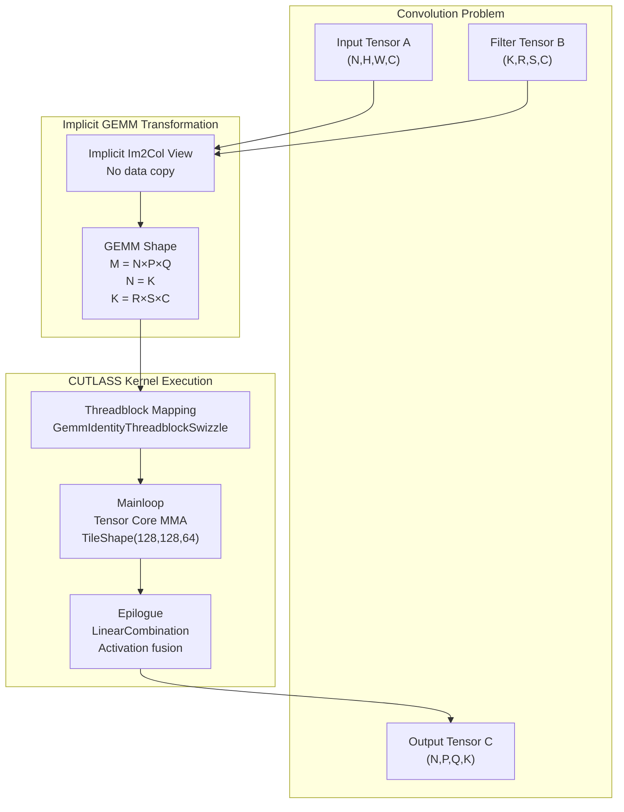
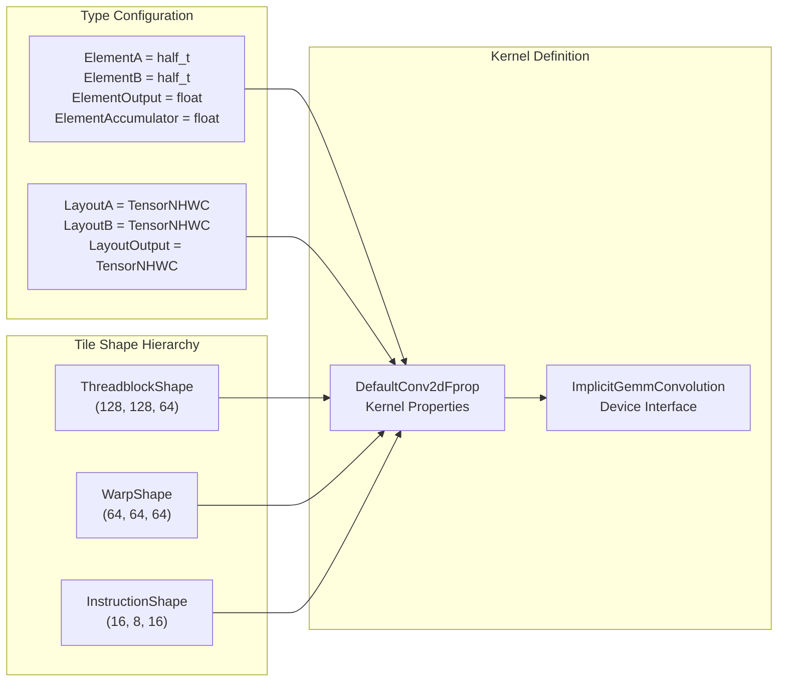
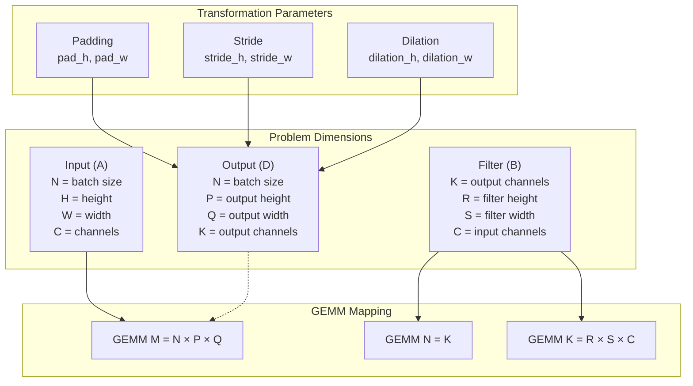
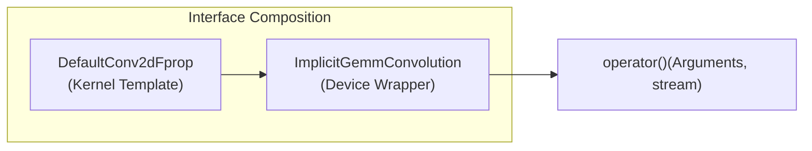

<!-- source: DeepWiki mcp.deepwiki.com · repo NVIDIA/cutlass · page 11.3 Convolution Examples · fetched 2026-10-26 -->

# Convolution Examples

Relevant source files

The following files were used as context for generating this wiki page:

- [include/cutlass/conv/kernel/default_conv2d.h](include/cutlass/conv/kernel/default_conv2d.h)
- [include/cutlass/conv/kernel/default_conv2d_dgrad.h](include/cutlass/conv/kernel/default_conv2d_dgrad.h)
- [include/cutlass/conv/kernel/default_conv2d_fprop.h](include/cutlass/conv/kernel/default_conv2d_fprop.h)
- [include/cutlass/conv/kernel/default_conv2d_fprop_with_broadcast.h](include/cutlass/conv/kernel/default_conv2d_fprop_with_broadcast.h)
- [include/cutlass/conv/kernel/default_conv2d_fprop_with_reduction.h](include/cutlass/conv/kernel/default_conv2d_fprop_with_reduction.h)
- [include/cutlass/conv/kernel/default_conv2d_wgrad.h](include/cutlass/conv/kernel/default_conv2d_wgrad.h)
- [include/cutlass/conv/kernel/default_conv3d_dgrad.h](include/cutlass/conv/kernel/default_conv3d_dgrad.h)
- [include/cutlass/conv/kernel/default_conv3d_wgrad.h](include/cutlass/conv/kernel/default_conv3d_wgrad.h)
- [include/cutlass/conv/threadblock/conv2d_dgrad_output_gradient_tile_access_iterator_analytic.h](include/cutlass/conv/threadblock/conv2d_dgrad_output_gradient_tile_access_iterator_analytic.h)
- [include/cutlass/conv/threadblock/conv2d_fprop_activation_tile_access_iterator_optimized.h](include/cutlass/conv/threadblock/conv2d_fprop_activation_tile_access_iterator_optimized.h)
- [include/cutlass/conv/threadblock/conv2d_fprop_filter_tile_access_iterator_optimized.h](include/cutlass/conv/threadblock/conv2d_fprop_filter_tile_access_iterator_optimized.h)
- [include/cutlass/conv/threadblock/conv2d_tile_iterator.h](include/cutlass/conv/threadblock/conv2d_tile_iterator.h)
- [test/unit/conv/device/CMakeLists.txt](test/unit/conv/device/CMakeLists.txt)
- [test/unit/conv/device/conv2d_fprop_implicit_gemm_f16nhwc_f16nhwc_f16nhwc_simt_f16_sm60.cu](test/unit/conv/device/conv2d_fprop_implicit_gemm_f16nhwc_f16nhwc_f16nhwc_simt_f16_sm60.cu)
- [test/unit/conv/device/conv2d_fprop_implicit_gemm_f16nhwc_f16nhwc_f16nhwc_tensor_op_f16_sm80.cu](test/unit/conv/device/conv2d_fprop_implicit_gemm_f16nhwc_f16nhwc_f16nhwc_tensor_op_f16_sm80.cu)
- [test/unit/conv/device/conv2d_fprop_implicit_gemm_f16nhwc_f16nhwc_f32nhwc_tensor_op_f32_sm70.cu](test/unit/conv/device/conv2d_fprop_implicit_gemm_f16nhwc_f16nhwc_f32nhwc_tensor_op_f32_sm70.cu)
- [test/unit/conv/device/conv2d_fprop_implicit_gemm_f16nhwc_f16nhwc_f32nhwc_tensor_op_f32_sm75.cu](test/unit/conv/device/conv2d_fprop_implicit_gemm_f16nhwc_f16nhwc_f32nhwc_tensor_op_f32_sm75.cu)
- [test/unit/conv/device/conv2d_fprop_implicit_gemm_tf32nhwc_tf32nhwc_f32nhwc_tensor_op_f32_sm80.cu](test/unit/conv/device/conv2d_fprop_implicit_gemm_tf32nhwc_tf32nhwc_f32nhwc_tensor_op_f32_sm80.cu)
- [test/unit/conv/device/conv2d_fprop_with_broadcast_sm70.cu](test/unit/conv/device/conv2d_fprop_with_broadcast_sm70.cu)
- [test/unit/conv/device/conv2d_strided_dgrad_implicit_gemm_f16nhwc_f16nhwc_f32nhwc_tensor_op_f32_sm80.cu](test/unit/conv/device/conv2d_strided_dgrad_implicit_gemm_f16nhwc_f16nhwc_f32nhwc_tensor_op_f32_sm80.cu)

This page demonstrates how to use CUTLASS convolution kernels through practical examples. CUTLASS implements convolution operations using the **Implicit GEMM** algorithm, which transforms convolution into matrix multiplication to leverage tensor core hardware. The examples cover Conv2d forward propagation (fprop), kernel configuration, problem size specification, and epilogue fusion.

For general GEMM examples, see [Basic GEMM Examples](#11.1). For information about activation functions that can be fused in the epilogue, see [Epilogue Fusion and Activation Functions](#5.3).

## Overview of Implicit GEMM Convolution

CUTLASS convolution kernels transform the convolution operation into a GEMM (General Matrix Multiply) computation. This approach, known as **Implicit GEMM**, avoids explicit data transformation overhead while enabling the use of tensor cores and optimized GEMM infrastructure.

**Sources:** [include/cutlass/conv/kernel/default_conv2d_fprop.h:32-36](), [include/cutlass/conv/kernel/default_conv2d_fprop.h:135-187]()

## Primary Conv2d Fprop Example

The convolution implementation utilizes the `DefaultConv2dFprop` template to compose a kernel for specific architectures and data types.

### Example Structure

**Sources:** [test/unit/conv/device/conv2d_fprop_implicit_gemm_f16nhwc_f16nhwc_f16nhwc_tensor_op_f16_sm80.cu:59-81](), [include/cutlass/conv/kernel/default_conv2d_fprop.h:61-84]()

### Kernel Configuration Details

The kernel is defined by specifying parameters in the `DefaultConv2dFprop` template:

| Component | Type/Value | Purpose |
|-----------|------------|---------|
| `ElementA` | `cutlass::half_t` | Input activation tensor element type [test/unit/conv/device/conv2d_fprop_implicit_gemm_f16nhwc_f16nhwc_f16nhwc_tensor_op_f16_sm80.cu:52-52]() |
| `ElementB` | `cutlass::half_t` | Filter/weight tensor element type [test/unit/conv/device/conv2d_fprop_implicit_gemm_f16nhwc_f16nhwc_f16nhwc_tensor_op_f16_sm80.cu:53-53]() |
| `ElementC` | `cutlass::half_t` | Output tensor element type [test/unit/conv/device/conv2d_fprop_implicit_gemm_f16nhwc_f16nhwc_f16nhwc_tensor_op_f16_sm80.cu:54-54]() |
| `ElementAccumulator` | `cutlass::half_t` | Accumulation type [test/unit/conv/device/conv2d_fprop_implicit_gemm_f16nhwc_f16nhwc_f16nhwc_tensor_op_f16_sm80.cu:55-55]() |
| `LayoutA` | `TensorNHWC` | Input layout (batch, height, width, channels) [test/unit/conv/device/conv2d_fprop_implicit_gemm_f16nhwc_f16nhwc_f16nhwc_tensor_op_f16_sm80.cu:60-60]() |
| `OperatorClass` | `OpClassTensorOp` | Use tensor cores for computation [test/unit/conv/device/conv2d_fprop_implicit_gemm_f16nhwc_f16nhwc_f16nhwc_tensor_op_f16_sm80.cu:64-64]() |
| `ThreadblockShape` | `GemmShape<128, 128, 64>` | Threadblock tile dimensions [test/unit/conv/device/conv2d_fprop_implicit_gemm_f16nhwc_f16nhwc_f16nhwc_tensor_op_f16_sm80.cu:66-66]() |
| `Stages` | `3` | Pipeline stages for software pipelining [test/unit/conv/device/conv2d_fprop_implicit_gemm_f16nhwc_f16nhwc_f16nhwc_tensor_op_f16_sm80.cu:76-76]() |
| `IteratorAlgorithm` | `kOptimized` | Optimized iterator implementation [test/unit/conv/device/conv2d_fprop_implicit_gemm_f16nhwc_f16nhwc_f16nhwc_tensor_op_f16_sm80.cu:119-119]() |

**Sources:** [include/cutlass/conv/kernel/default_conv2d_fprop.h:61-84](), [test/unit/conv/device/conv2d_fprop_implicit_gemm_f16nhwc_f16nhwc_f16nhwc_tensor_op_f16_sm80.cu:59-81]()

## Conv2d Problem Size Specification

Convolution problems are specified using the `Conv2dProblemSize` structure which encapsulates all dimensions, padding, stride, and dilation parameters.

### Problem Size Creation

The convolution problem is defined with:
- **Input size**: `(N, H, W, C)` [test/unit/conv/device/conv2d_fprop_implicit_gemm_f16nhwc_f16nhwc_f16nhwc_tensor_op_f16_sm80.cu:172-172]()
- **Filter size**: `(K, R, S, C)` [test/unit/conv/device/conv2d_fprop_implicit_gemm_f16nhwc_f16nhwc_f16nhwc_tensor_op_f16_sm80.cu:173-173]()
- **Padding**: `(pad_h, pad_w)` [test/unit/conv/device/conv2d_fprop_implicit_gemm_f16nhwc_f16nhwc_f16nhwc_tensor_op_f16_sm80.cu:174-174]()
- **Stride**: `(stride_h, stride_w)` [test/unit/conv/device/conv2d_fprop_implicit_gemm_f16nhwc_f16nhwc_f16nhwc_tensor_op_f16_sm80.cu:175-175]()
- **Dilation**: `(dilation_h, dilation_w)` [test/unit/conv/device/conv2d_fprop_implicit_gemm_f16nhwc_f16nhwc_f16nhwc_tensor_op_f16_sm80.cu:176-176]()

**Sources:** [test/unit/conv/device/conv2d_fprop_implicit_gemm_f16nhwc_f16nhwc_f16nhwc_tensor_op_f16_sm80.cu:171-177]()

## Epilogue Operations and Activation Fusion

CUTLASS supports fusing epilogue operations like broadcasts and reductions directly into the convolution kernel.

### Fused Epilogue Variants

- **Broadcast**: `DefaultConv2dFpropWithBroadcast` enables fusing element-wise operations with a broadcast vector (e.g., bias addition) [include/cutlass/conv/kernel/default_conv2d_fprop_with_broadcast.h:80-122]().
- **Reduction**: `DefaultConv2dFpropWithReduction` allows performing reductions (e.g., summing along a dimension) as part of the epilogue [include/cutlass/conv/kernel/default_conv2d_fprop_with_reduction.h:81-122]().

**Sources:** [include/cutlass/conv/kernel/default_conv2d_fprop_with_broadcast.h:80-122](), [include/cutlass/conv/kernel/default_conv2d_fprop_with_reduction.h:81-122]()

## Device-Wide Implicit GEMM Interface

The `ImplicitGemmConvolution` class provides the high-level device interface for executing convolutions. It is instantiated with a specific convolution kernel (e.g., from `DefaultConv2dFprop`).

**Sources:** [test/unit/conv/device/conv2d_fprop_implicit_gemm_f16nhwc_f16nhwc_f16nhwc_simt_f16_sm60.cu:58-83](), [test/unit/conv/device/conv2d_fprop_implicit_gemm_f16nhwc_f16nhwc_f16nhwc_simt_f16_sm60.cu:129-129]()

## Test Problem Sets and Validation

CUTLASS includes comprehensive unit tests across various architectures (SM50 to SM89+) and data types (F16, F32, CF32, TF32).

### Architecture Support in Tests

| Arch | Operation Class | Data Types | File Example |
|------|-----------------|------------|--------------|
| SM50 | SIMT | F32, CF32 | `conv2d_fprop_implicit_gemm_f32nhwc...simt_f32_sm50.cu` [test/unit/conv/device/CMakeLists.txt:118-121]() |
| SM60 | SIMT | F16 | `conv2d_fprop_implicit_gemm_f16nhwc...simt_f16_sm60.cu` [test/unit/conv/device/CMakeLists.txt:126-126]() |
| SM75 | TensorOp | F16 | `conv2d_fprop_implicit_gemm_f16nhwc...tensor_op_f32_sm75.cu` [test/unit/conv/device/CMakeLists.txt:177-177]() |
| SM80 | TensorOp | F16, TF32 | `conv2d_fprop_implicit_gemm_f16nhwc...tensor_op_f16_sm80.cu` [test/unit/conv/device/CMakeLists.txt:194-194]() |

**Sources:** [test/unit/conv/device/CMakeLists.txt:46-210](), [test/unit/conv/device/conv2d_fprop_implicit_gemm_f16nhwc_f16nhwc_f16nhwc_simt_f16_sm60.cu:46-88]()

## Key Configuration Trade-offs

| Parameter | Impact |
|-----------|--------|
| `IteratorAlgorithm` | `kAnalytic` provides maximum flexibility for padding/stride [include/cutlass/conv/threadblock/conv2d_dgrad_output_gradient_tile_access_iterator_analytic.h:103-103](); `kOptimized` improves performance for standard layouts [include/cutlass/conv/threadblock/conv2d_fprop_activation_tile_access_iterator_optimized.h:88-88](). |
| `StrideSupport` | `kUnity` assumes unit stride (1x1) for faster coordinate math; `kStrided` supports arbitrary strides but adds coordinate overhead [include/cutlass/conv/kernel/default_conv2d_fprop.h:79-79](). |
| `Alignment` | Higher alignment (e.g., 128-bit) enables vectorized global memory access [include/cutlass/conv/kernel/default_conv2d_fprop.h:81-83](). |

**Sources:** [include/cutlass/conv/kernel/default_conv2d_fprop.h:77-84](), [include/cutlass/conv/threadblock/conv2d_fprop_activation_tile_access_iterator_optimized.h:88-89]()

---

