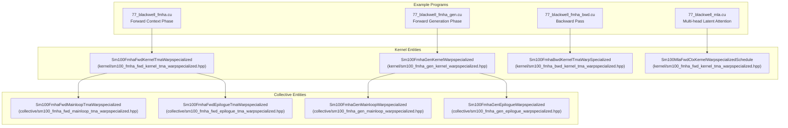
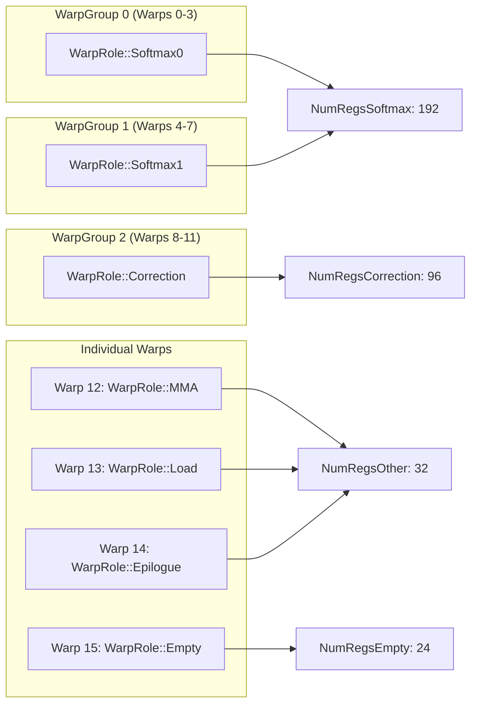

<!-- source: DeepWiki mcp.deepwiki.com · repo NVIDIA/cutlass · page 11.4 Blackwell FMHA Examples · fetched 2026-10-26 -->

# Blackwell FMHA Examples

Relevant source files

The following files were used as context for generating this wiki page:

- [examples/77_blackwell_fmha/77_blackwell_fmha.cu](examples/77_blackwell_fmha/77_blackwell_fmha.cu)
- [examples/77_blackwell_fmha/77_blackwell_fmha_bwd.cu](examples/77_blackwell_fmha/77_blackwell_fmha_bwd.cu)
- [examples/77_blackwell_fmha/77_blackwell_fmha_gen.cu](examples/77_blackwell_fmha/77_blackwell_fmha_gen.cu)
- [examples/77_blackwell_fmha/77_blackwell_mla.cu](examples/77_blackwell_fmha/77_blackwell_mla.cu)
- [examples/77_blackwell_fmha/CMakeLists.txt](examples/77_blackwell_fmha/CMakeLists.txt)
- [examples/77_blackwell_fmha/collective/fmha_fusion.hpp](examples/77_blackwell_fmha/collective/fmha_fusion.hpp)
- [examples/77_blackwell_fmha/collective/sm100_fmha_fwd_epilogue_tma_warpspecialized.hpp](examples/77_blackwell_fmha/collective/sm100_fmha_fwd_epilogue_tma_warpspecialized.hpp)
- [examples/77_blackwell_fmha/collective/sm100_fmha_fwd_mainloop_tma_warpspecialized.hpp](examples/77_blackwell_fmha/collective/sm100_fmha_fwd_mainloop_tma_warpspecialized.hpp)
- [examples/77_blackwell_fmha/device/fmha_device_bwd.hpp](examples/77_blackwell_fmha/device/fmha_device_bwd.hpp)
- [examples/77_blackwell_fmha/kernel/fmha_kernel_bwd_convert.hpp](examples/77_blackwell_fmha/kernel/fmha_kernel_bwd_convert.hpp)
- [examples/77_blackwell_fmha/kernel/fmha_kernel_bwd_sum_OdO.hpp](examples/77_blackwell_fmha/kernel/fmha_kernel_bwd_sum_OdO.hpp)
- [examples/77_blackwell_fmha/kernel/sm100_fmha_bwd_kernel_tma_warpspecialized.hpp](examples/77_blackwell_fmha/kernel/sm100_fmha_bwd_kernel_tma_warpspecialized.hpp)
- [examples/77_blackwell_fmha/kernel/sm100_fmha_fwd_kernel_tma_warpspecialized.hpp](examples/77_blackwell_fmha/kernel/sm100_fmha_fwd_kernel_tma_warpspecialized.hpp)
- [examples/77_blackwell_fmha/kernel/sm100_fmha_mla_reduction.hpp](examples/77_blackwell_fmha/kernel/sm100_fmha_mla_reduction.hpp)
- [examples/77_blackwell_fmha/reference/fmha_bwd_reference.hpp](examples/77_blackwell_fmha/reference/fmha_bwd_reference.hpp)
- [examples/77_blackwell_fmha/reference/fmha_fwd_reference.hpp](examples/77_blackwell_fmha/reference/fmha_fwd_reference.hpp)
- [examples/77_blackwell_fmha/reference/reference_abs_error.hpp](examples/77_blackwell_fmha/reference/reference_abs_error.hpp)

This document describes the example programs demonstrating Fused Multi-Head Attention (FMHA) kernels for NVIDIA Blackwell (SM100) architecture. These examples showcase context-phase attention, generation-phase attention, Multi-head Latent Attention (MLA), and backward pass implementations with various masking strategies and optimizations.

For FMHA kernel implementation details, see the collective and kernel components referenced below. For general GEMM examples, see [11.1](). For Hopper architecture examples, see [11.5]().

## Example Programs Overview

The `examples/77_blackwell_fmha/` directory contains several main example programs, each demonstrating different aspects of FMHA on Blackwell architecture:

Titled Diagram: Example Program to Code Entity Mapping

**Sources:** [examples/77_blackwell_fmha/CMakeLists.txt:30-37](), [examples/77_blackwell_fmha/77_blackwell_fmha.cu:31-68](), [examples/77_blackwell_fmha/77_blackwell_fmha_gen.cu:31-48](), [examples/77_blackwell_fmha/77_blackwell_mla.cu:31-33](), [examples/77_blackwell_fmha/77_blackwell_fmha_bwd.cu:31-69]()

### Program Compilation Variants

Each example program is compiled with specific flags to optimize for Blackwell features:

| Executable Flag | Description | File Context |
|-----------------|-------------|--------------|
| `--use_fast_math` | Enables high-performance math intrinsics | [examples/77_blackwell_fmha/CMakeLists.txt:39-39]() |
| `-ftemplate-backtrace-limit=0` | Facilitates debugging complex C++ template expansions | [examples/77_blackwell_fmha/CMakeLists.txt:39-39]() |

**Sources:** [examples/77_blackwell_fmha/CMakeLists.txt:30-40]()

## Command-Line Options and Test Configurations

### Forward Context Phase Options

The forward context phase example (`77_blackwell_fmha.cu`) supports extensive command-line parameters to configure problem geometry and masking:

| Argument | Description | Default |
|----------|-------------|---------|
| `--b` | Batch size | 1 |
| `--h` | Number of query heads | 1 |
| `--h_k` | Number of KV heads (for GQA/MQA) | 1 |
| `--q` | Query sequence length | 256 |
| `--k` | KV sequence length | 256 |
| `--d` | Head dimension | 128 |
| `--varlen` | Enables variable sequence length mode | false |
| `--mask` | Mask type: `no`, `causal`, or `residual` | `no` |

**Sources:** [examples/77_blackwell_fmha/77_blackwell_fmha.cu:114-131](), [examples/77_blackwell_fmha/77_blackwell_fmha.cu:180-193]()

### Backward Pass Options

The backward pass example (`77_blackwell_fmha_bwd.cu`) introduces gradients for query (`dQ`), key (`dK`), value (`dV`), and output (`dO`).

| Option | Description |
|--------|-------------|
| `--d_vo` | Head dimension for V and O tensors (defaults to `--d`) |
| `--skip_reference` | Skips reference check for performance benchmarking |
| `--init_style_do` | Initialization pattern for dO gradients (random, zero, etc.) |

**Sources:** [examples/77_blackwell_fmha/77_blackwell_fmha_bwd.cu:107-138]()

### Pre-configured Test Cases

The CMake configuration defines multiple test scenarios that exercise different functionality:

| Test Name | Configuration | Purpose |
|-----------|---------------|---------|
| `TEST_BASIC` | `--b=1 --h=4 --q=512 --k=512 --d=128 --verify --mask=no` | Basic functionality validation |
| `TEST_CAUSAL_00` | `--b=1 --h=4 --q=512 --k=512 --d=128 --verify --mask=causal` | Causal masking (Q at beginning) |
| `TEST_CAUSAL_01` | `--verify --b=1 --h=1 --h_k=1 --q=1013 --k=1024 --d=128 --mask=causal --causal-type=qend` | Causal masking (Q at end) |
| `TEST_VARLEN` | `--b=1 --h=4 --q=512 --k=512 --d=128 --verify --mask=residual --varlen` | Variable sequence length support |

**Sources:** [examples/77_blackwell_fmha/CMakeLists.txt:42-45]()

## Kernel Architecture and Warp Specialization

### Warp Role Assignment

The forward context kernel uses a 16-warp configuration with specialized roles to maximize throughput:

Titled Diagram: Sm100FmhaCtxKernelWarpspecializedSchedule Role Mapping

**Sources:** [examples/77_blackwell_fmha/kernel/sm100_fmha_fwd_kernel_tma_warpspecialized.hpp:53-87]()

### Backward Pass Warp Assignment

The backward pass kernel (`Sm100FmhaBwdKernelTmaWarpSpecialized`) uses a different warp assignment encoded in `kWarpAssignment`:

| Role | Warp Indices (mapped from `kWarpAssignment`) |
|------|--------------|
| `WarpRole::Load` | Warp 1 |
| `WarpRole::Mma` | Warp 2 |
| `WarpRole::Compute` | Warps 3-10 |
| `WarpRole::Reduce` | Warps 11-14 |

**Sources:** [examples/77_blackwell_fmha/kernel/sm100_fmha_bwd_kernel_tma_warpspecialized.hpp:90-95]()

### Pipeline Coordination

The kernel uses multiple pipeline stages to overlap computation and data movement:

| Pipeline Name | Type | Stage Count | Purpose |
|---------------|------|-------------|---------|
| `PipelineQ` | `PipelineTmaUmmaAsync` | 2 | Coordinates TMA load of Q into SMEM |
| `PipelineKV` | `PipelineTmaUmmaAsync` | 3-4 | Coordinates TMA load of K/V into SMEM |
| `PipelineS` | `PipelineUmmaAsync` | 1 | Protects S matrix in TMEM during Softmax |
| `PipelineO` | `PipelineUmmaAsync` | 2 | Protects O matrix in TMEM during Correction |
| `PipelineE` | `PipelineAsync` | 2 | Coordinates Correction output to Epilogue |

**Sources:** [examples/77_blackwell_fmha/collective/sm100_fmha_fwd_mainloop_tma_warpspecialized.hpp:145-168]()

## Masking and Variable Length Support

### Masking Strategies

The examples support multiple masking strategies through polymorphic mask types defined in `fmha_fusion.hpp`:

- **`NoMask`**: No masking applied; used for dense attention. [examples/77_blackwell_fmha/collective/fmha_fusion.hpp:41-81]()
- **`ResidualMask`**: Masks out-of-bounds elements when sequence length is not a multiple of the tile size. [examples/77_blackwell_fmha/collective/fmha_fusion.hpp:83-133]()
- **`CausalMask<bool kIsQBegin>`**: Implements causal attention. `kIsQBegin` handles cases where Q starts at the beginning or end of the matrix. [examples/77_blackwell_fmha/collective/fmha_fusion.hpp:191-208]()

### Variable Length Sequences

Variable length support uses `VariableLength` objects (max_seqlen, cumulative_seqlen_ptr) to handle packed sequences. The `apply_variable_length` utility is used in references and kernels to adjust sequence offsets dynamically.

**Sources:** [examples/77_blackwell_fmha/77_blackwell_fmha.cu:51-56](), [examples/77_blackwell_fmha/reference/fmha_fwd_reference.hpp:78-78]()

## Multi-Head Latent Attention (MLA)

MLA is an inference optimization that uses a latent dimension for KV cache efficiency. The example `77_blackwell_mla.cu` showcases:
- **Latent Dimensions**: Support for `dl` (latent) and `dr` (rope) dimensions. [examples/77_blackwell_fmha/CMakeLists.txt:75-75]()
- **Split-KV**: Parallelizing KV processing using `split_kv` factor. [examples/77_blackwell_fmha/77_blackwell_mla.cu:75-75]()
- **Paged KV Cache**: Support for paged memory layout in inference. [examples/77_blackwell_fmha/77_blackwell_mla.cu:79-82]()

## Mainloop Execution Flow

### Forward Context Mainloop

The mainloop (`Sm100FmhaFwdMainloopTmaWarpspecialized`) implements the attention computation using TMEM for intermediate storage:

1. **TMEM Allocation**: Allocates specific columns for S (Score), O (Output), P (Probability), and V (statistics). [examples/77_blackwell_fmha/collective/sm100_fmha_fwd_mainloop_tma_warpspecialized.hpp:121-134]()
2. **Q and KV Load**: TMA-based asynchronous loads into SMEM. [examples/77_blackwell_fmha/collective/sm100_fmha_fwd_mainloop_tma_warpspecialized.hpp:173-176]()
3. **UMMA Execution**: Matrix multiplies `Q*K` and `P*V` using Blackwell's UMMA instructions. [examples/77_blackwell_fmha/collective/sm100_fmha_fwd_mainloop_tma_warpspecialized.hpp:90-105]()

**Sources:** [examples/77_blackwell_fmha/collective/sm100_fmha_fwd_mainloop_tma_warpspecialized.hpp:121-176]()

## Backward Pass Implementation

The backward pass (`Sm100FmhaBwd`) coordinates multiple sub-kernels:

1. **`FmhaKernelBwdSumOdO`**: Pre-computes dot product of O and dO for softmax gradient scaling. [examples/77_blackwell_fmha/device/fmha_device_bwd.hpp:128-130]()
2. **`Sm100FmhaBwdKernelTmaWarpSpecialized`**: The main backward kernel calculating `dQ`, `dK`, and `dV`. [examples/77_blackwell_fmha/device/fmha_device_bwd.hpp:135-139]()
3. **`FmhaKernelBwdConvert`**: Handles numeric conversion of gradients if necessary. [examples/77_blackwell_fmha/device/fmha_device_bwd.hpp:131-133]()

**Sources:** [examples/77_blackwell_fmha/device/fmha_device_bwd.hpp:128-151]()

## Reference Implementations

The examples include GPU-based reference kernels for validation. These references typically use a simpler, non-warp-specialized approach with shared memory for intermediate results to ensure correctness.

- **Forward Reference**: `fmha_reference_kernel` in `fmha_fwd_reference.hpp`. [examples/77_blackwell_fmha/reference/fmha_fwd_reference.hpp:47-168]()
- **MLA Reference**: `fmha_mla_reference.hpp`. [examples/77_blackwell_fmha/77_blackwell_mla.cu:48-48]()
- **Backward Reference**: `fmha_bwd_reference.hpp`. [examples/77_blackwell_fmha/77_blackwell_fmha_bwd.cu:85-85]()

---

