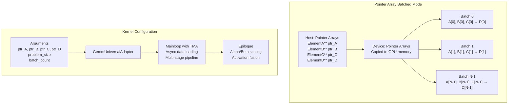
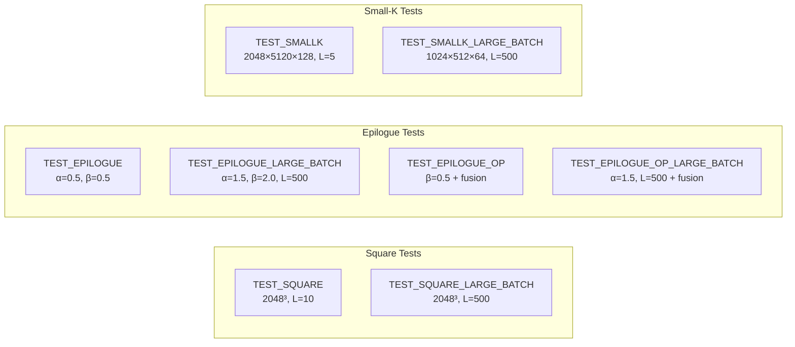
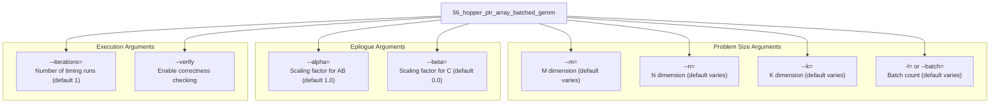
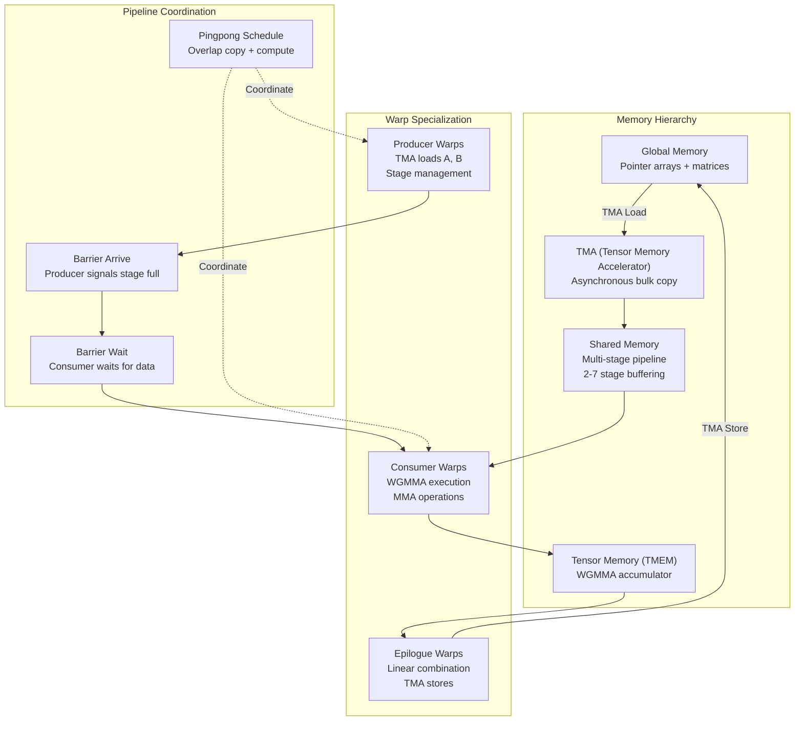
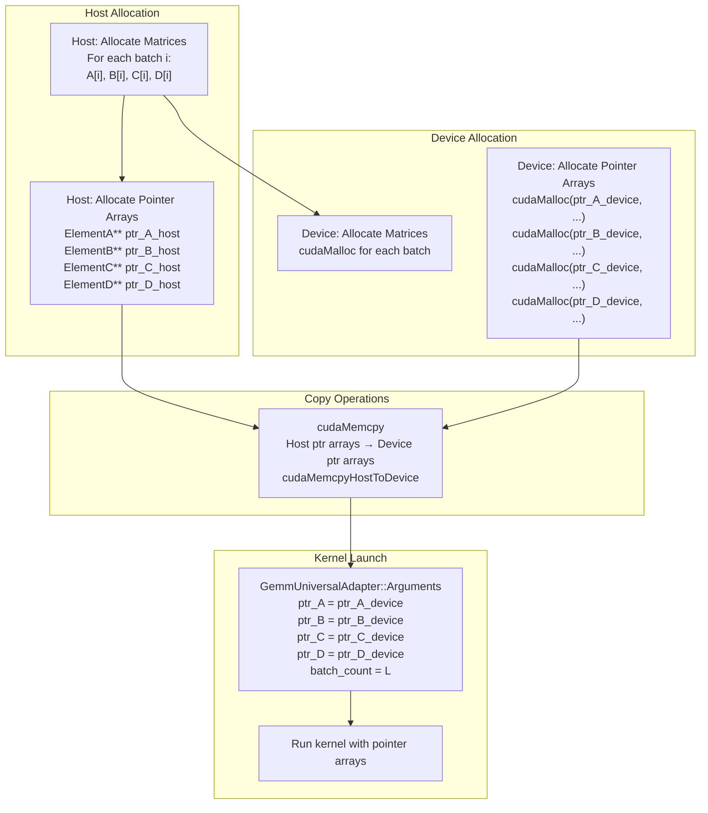
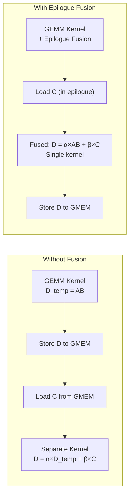

<!-- source: DeepWiki mcp.deepwiki.com · repo NVIDIA/cutlass · page 11.5 Hopper Batched GEMM Example · fetched 2026-10-26 -->

# Hopper Batched GEMM Example

<details>
<summary>Relevant source files</summary>

The following files were used as context for generating this wiki page:

- [CUDA.cmake](CUDA.cmake)
- [Doxyfile](Doxyfile)
- [PUBLICATIONS.md](PUBLICATIONS.md)
- [cmake/version_extended.h.in](cmake/version_extended.h.in)
- [examples/02_dump_reg_shmem/CMakeLists.txt](examples/02_dump_reg_shmem/CMakeLists.txt)
- [examples/05_batched_gemm/batched_gemm.cu](examples/05_batched_gemm/batched_gemm.cu)
- [examples/56_hopper_ptr_array_batched_gemm/CMakeLists.txt](examples/56_hopper_ptr_array_batched_gemm/CMakeLists.txt)
- [include/cutlass/conv/device/implicit_gemm_convolution.h](include/cutlass/conv/device/implicit_gemm_convolution.h)
- [include/cutlass/gemm/device/gemm.h](include/cutlass/gemm/device/gemm.h)
- [include/cutlass/gemm/device/gemm_array.h](include/cutlass/gemm/device/gemm_array.h)
- [include/cutlass/gemm/device/gemm_batched.h](include/cutlass/gemm/device/gemm_batched.h)
- [include/cutlass/gemm/device/gemm_complex.h](include/cutlass/gemm/device/gemm_complex.h)
- [include/cutlass/gemm/device/gemm_sparse.h](include/cutlass/gemm/device/gemm_sparse.h)
- [include/cutlass/reduction/device/reduce_split_k.h](include/cutlass/reduction/device/reduce_split_k.h)

</details>


## Purpose and Scope

This page documents example 56 (`56_hopper_ptr_array_batched_gemm`), which demonstrates pointer-array batched GEMM execution on NVIDIA Hopper (SM90) architecture. This example showcases how to perform multiple independent GEMM operations in a single kernel launch where each batch has different input/output pointers stored in arrays on the device.

**Related pages:**
- For general GEMM kernel architecture, see [Universal GEMM Kernel Architecture](#4.1)
- For SM90-specific optimizations, see [SM90 TMA Warp-Specialized GEMM](#4.2)
- For grouped GEMM with dynamic problem shapes, see [Grouped and Batched GEMM](#4.4)
- For Hopper architecture features, see [SM90 Hopper Architecture Features](#7.1)

## Overview

The `56_hopper_ptr_array_batched_gemm` example demonstrates batched GEMM execution where multiple independent matrix multiplication problems are solved in parallel. Unlike strided batched GEMM where matrices are laid out contiguously in memory with fixed strides, pointer-array batched GEMM uses device-side arrays of pointers to locate each batch's input and output matrices independently.

**Key features demonstrated:**
- Pointer-array batched GEMM execution mode.
- Hopper TMA (Tensor Memory Accelerator) for data movement.
- Warp-specialized kernels with pingpong scheduling.
- Epilogue fusion with alpha/beta scaling.
- Support for various problem sizes including small-K scenarios.

Sources: [examples/56_hopper_ptr_array_batched_gemm/CMakeLists.txt:1-55]()

## Batched GEMM Execution Modes



**Diagram: Pointer-Array Batched GEMM Architecture**

In pointer-array mode, the kernel receives arrays of pointers on the device that point to the memory locations of each batch's matrices. This allows for non-contiguous memory layouts and independent matrix locations per batch. This is distinct from the strided batched mode implemented in `cutlass::gemm::device::GemmUniversalBase` [include/cutlass/gemm/device/gemm.h:58-69](), which accommodates streamk, batched strided, and batched array variants. While older versions of CUTLASS used `GemmArray` [include/cutlass/gemm/device/gemm_array.h:56-79]() and `GemmBatched` [include/cutlass/gemm/device/gemm_batched.h:56-79](), Hopper kernels typically leverage the `GemmUniversalAdapter`.

Sources: [examples/56_hopper_ptr_array_batched_gemm/CMakeLists.txt:30-54](), [include/cutlass/gemm/device/gemm.h:58-69](), [include/cutlass/gemm/device/gemm_array.h:56-79](), [include/cutlass/gemm/device/gemm_batched.h:56-79]()

## Test Configurations

The example includes eight distinct test configurations that exercise different aspects of batched GEMM performance and functionality:

### Configuration Summary Table

| Configuration Name | Problem Size (M×N×K) | Batch Count | Alpha | Beta | Purpose |
|-------------------|---------------------|-------------|-------|------|---------|
| TEST_SQUARE | 2048×2048×2048 | 10 | 1.0 | 0.0 | Basic square matrices |
| TEST_SQUARE_LARGE_BATCH | 2048×2048×2048 | 500 | 1.0 | 0.0 | Large batch count stress test |
| TEST_EPILOGUE | Default | Default | 0.5 | 0.5 | Epilogue scaling validation |
| TEST_EPILOGUE_LARGE_BATCH | Default | 500 | 1.5 | 2.0 | Large batch with epilogue |
| TEST_EPILOGUE_OP | Default | Default | 1.0 | 0.5 | Epilogue operation fusion |
| TEST_EPILOGUE_OP_LARGE_BATCH | Default | 500 | 1.5 | 0.0 | Large batch epilogue ops |
| TEST_SMALLK | 2048×5120×128 | 5 | 1.0 | 0.0 | Small K dimension (128) |
| TEST_SMALLK_LARGE_BATCH | 1024×512×64 | 500 | 1.0 | 0.0 | Small K with large batch |

Sources: [examples/56_hopper_ptr_array_batched_gemm/CMakeLists.txt:30-40]()

### Test Configuration Details



**Diagram: Test Configuration Categories**

**Square Tests:** Validate performance on balanced problem sizes where M, N, and K dimensions are equal or similar.

**Epilogue Tests:** Exercise epilogue fusion capabilities including linear combination operations ($D = \alpha \times AB + \beta \times C$) and activation functions.

**Small-K Tests:** Target scenarios with small K dimensions ($\le 128$), common in machine learning workloads like attention mechanisms and MoE (Mixture of Experts) layers.

Sources: [examples/56_hopper_ptr_array_batched_gemm/CMakeLists.txt:30-54]()

## Building and Running

### Build Instructions

The example is built using the CMake build system as part of the CUTLASS examples. It requires Hopper architecture support (`sm_90` or `sm_90a`).

```bash
# From CUTLASS root directory
mkdir build && cd build
cmake .. -DCUTLASS_NVCC_ARCHS="90;90a"
make 56_hopper_ptr_array_batched_gemm
```

The executable will be generated at:
`build/examples/56_hopper_ptr_array_batched_gemm/56_hopper_ptr_array_batched_gemm`

Sources: [examples/56_hopper_ptr_array_batched_gemm/CMakeLists.txt:42-54](), [CUDA.cmake:73-88]()

### Command-Line Usage



**Diagram: Command-Line Interface**

### Example Invocations

**Run square problem with 10 batches:**
```bash
./56_hopper_ptr_array_batched_gemm --m=2048 --n=2048 --k=2048 -l=10 --iterations=1
```

**Run with epilogue scaling:**
```bash
./56_hopper_ptr_array_batched_gemm --alpha=0.5 --beta=0.5 --iterations=1
```

**Run small-K configuration:**
```bash
./56_hopper_ptr_array_batched_gemm --m=2048 --n=5120 --k=128 --l=5 --iterations=1
```

**Run large batch stress test:**
```bash
./56_hopper_ptr_array_batched_gemm --m=2048 --n=2048 --k=2048 -l=500 --iterations=1
```

Sources: [examples/56_hopper_ptr_array_batched_gemm/CMakeLists.txt:30-54]()

## Kernel Architecture

### Hopper-Specific Features

The example uses Hopper SM90 architecture features for optimal performance:



**Diagram: Hopper Warp-Specialized Pipeline**

- **TMA (Tensor Memory Accelerator):** Hardware unit for asynchronous bulk memory copies between global memory and shared memory, eliminating explicit copy instructions from warps.
- **WGMMA (Warp Group Matrix Multiply-Accumulate):** Hopper tensor core instruction that operates on warp groups (128 threads) for larger tile sizes and improved throughput.
- **Warp Specialization:** Division of warps into specialized roles (producer, consumer, epilogue) for optimal pipeline utilization.
- **Pingpong Schedule:** Alternating double-buffering strategy where producer and consumer warps operate on different pipeline stages simultaneously.

Sources: [examples/56_hopper_ptr_array_batched_gemm/CMakeLists.txt:1-55]()

## Pointer Array Management

### Host-to-Device Pointer Array Setup



**Diagram: Pointer Array Setup Flow**

The pointer-array batched mode requires explicit management of arrays containing pointers to each batch's matrices. This example follows the pattern where pointers to matrices in Global Memory are passed to the kernel in an array. While example 56 focuses on Hopper, the pointer-array concept is common in CUTLASS for non-strided batched GEMM and Grouped GEMM.

Sources: [examples/56_hopper_ptr_array_batched_gemm/CMakeLists.txt:42-44](), [examples/05_batched_gemm/batched_gemm.cu:102-139]()

## Performance Considerations

### Batch Count Impact

- **Small Batch ($L \le 10$):** Lower GPU occupancy; may not fully saturate SMs; better for latency-sensitive workloads.
- **Medium Batch ($10 < L \le 100$):** Good balance of occupancy and overhead; efficient SM utilization.
- **Large Batch ($L > 100$):** Maximum GPU occupancy; amortizes kernel launch overhead; best for throughput optimization.

Sources: [examples/56_hopper_ptr_array_batched_gemm/CMakeLists.txt:30-40]()

### Small-K Optimization

Small K dimensions ($K \le 128$) present unique challenges:
- **Reduced arithmetic intensity:** The compute-to-memory ratio is low.
- **Pipeline stages:** Pipeline stages may not be fully utilized due to short mainloop duration.
- **Overhead:** Higher relative overhead from data movement and synchronization.

Optimizations in the example include using specialized tile sizes and adjusting pipeline stages based on the K dimension to maintain high throughput even when $K$ is small.

Sources: [examples/56_hopper_ptr_array_batched_gemm/CMakeLists.txt:39-40]()

### Epilogue Fusion Benefits



**Diagram: Epilogue Fusion Advantage**

Epilogue fusion eliminates intermediate memory traffic by combining the matrix multiply with post-processing operations in a single kernel. This reduces global memory accesses and improves overall performance. This technique is a cornerstone of CUTLASS performance, often cited in research for accelerating transformer layers and mixture-of-experts [PUBLICATIONS.md:19-21](), [PUBLICATIONS.md:35-35]().

Sources: [examples/56_hopper_ptr_array_batched_gemm/CMakeLists.txt:33-37](), [PUBLICATIONS.md:19-21](), [PUBLICATIONS.md:35-35]()

## Testing and Validation

### CTest Integration

The example integrates with CTest for automated testing:

```bash
# Run all 56_hopper_ptr_array_batched_gemm tests
ctest -R 56_hopper_ptr_array_batched_gemm

# Run specific test configuration
ctest -R 56_hopper_ptr_array_batched_gemm.*TEST_SQUARE$
```

Each test configuration validates:
1. **Correctness:** Output matches CPU reference implementation.
2. **Performance:** Reports TFLOPS and execution time.
3. **Memory:** Ensures no memory errors or leaks.

Sources: [examples/56_hopper_ptr_array_batched_gemm/CMakeLists.txt:42-54]()

## Key Code Entities

### Main Components

The example source file `56_hopper_ptr_array_batched_gemm.cu` uses modern CUTLASS 3.x components:

- **GemmUniversalAdapter:** Template class that wraps the universal GEMM kernel and provides a unified interface for different execution modes.
- **Arguments Structure:** Defined in the underlying kernel, it contains parameters like pointer arrays, problem dimensions, and epilogue coefficients.
- **CollectiveMma:** Mainloop implementation using TMA and warp specialization for Hopper architecture.
- **CollectiveEpilogue:** Epilogue implementation supporting linear combination and activation fusion.
- **TileScheduler:** Work distribution policy for batched execution, typically `PersistentTileSchedulerSm90`.

Sources: [examples/56_hopper_ptr_array_batched_gemm/CMakeLists.txt:44](), [include/cutlass/gemm/device/gemm.h:167-200]()

## Comparison with Other GEMM Examples

| Example | Architecture | Batching Mode | Key Feature |
|---------|-------------|---------------|-------------|
| 00_basic_gemm | SM70+ | Single | Basic CUTLASS introduction |
| 05_batched_gemm | SM70+ | Strided/Array | Pre-Hopper batched GEMM patterns [examples/05_batched_gemm/batched_gemm.cu:43-46]() |
| 56_hopper_ptr_array_batched_gemm | SM90 | Pointer-array | Hopper TMA + batched execution |

Sources: [examples/56_hopper_ptr_array_batched_gemm/CMakeLists.txt:1-55](), [examples/05_batched_gemm/batched_gemm.cu:43-46]()

---

