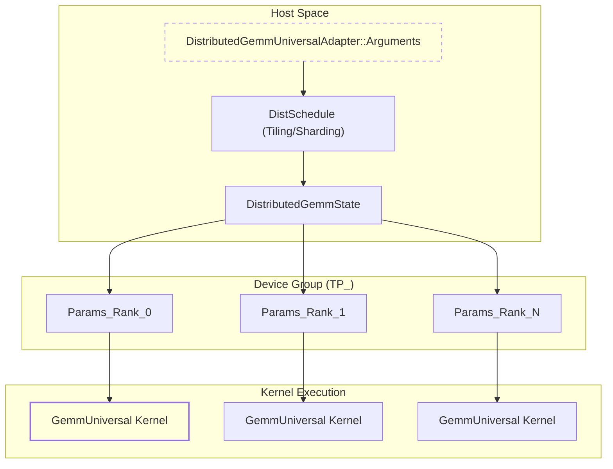
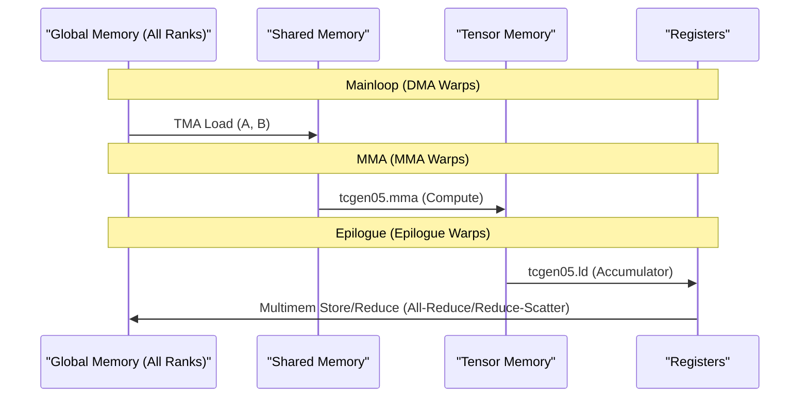

<!-- source: DeepWiki mcp.deepwiki.com · repo NVIDIA/cutlass · page 11.6 Distributed GEMM and Collective Communication Examples · fetched 2026-10-26 -->

# Distributed GEMM and Collective Communication Examples

Relevant source files

The following files were used as context for generating this wiki page:

- [examples/65_distributed_gemm/65_distributed_gemm.cu](examples/65_distributed_gemm/65_distributed_gemm.cu)
- [examples/82_blackwell_distributed_gemm/82_blackwell_distributed_gemm.cu](examples/82_blackwell_distributed_gemm/82_blackwell_distributed_gemm.cu)
- [examples/python/CuTeDSL/cute/blackwell/kernel/distributed/all_reduce_one_shot_lamport.py](examples/python/CuTeDSL/cute/blackwell/kernel/distributed/all_reduce_one_shot_lamport.py)
- [examples/python/CuTeDSL/cute/blackwell/kernel/distributed/all_reduce_simple.py](examples/python/CuTeDSL/cute/blackwell/kernel/distributed/all_reduce_simple.py)
- [examples/python/CuTeDSL/cute/blackwell/kernel/distributed/all_reduce_tma.py](examples/python/CuTeDSL/cute/blackwell/kernel/distributed/all_reduce_tma.py)
- [examples/python/CuTeDSL/cute/blackwell/kernel/distributed/all_reduce_two_shot_multimem.py](examples/python/CuTeDSL/cute/blackwell/kernel/distributed/all_reduce_two_shot_multimem.py)
- [examples/python/CuTeDSL/cute/blackwell/kernel/distributed/distributed_all_gather_gemm_blackwell.py](examples/python/CuTeDSL/cute/blackwell/kernel/distributed/distributed_all_gather_gemm_blackwell.py)
- [examples/python/CuTeDSL/cute/blackwell/kernel/distributed/distributed_gemm_all_reduce_blackwell.py](examples/python/CuTeDSL/cute/blackwell/kernel/distributed/distributed_gemm_all_reduce_blackwell.py)
- [examples/python/CuTeDSL/cute/blackwell/kernel/distributed/distributed_gemm_all_reduce_lamport_blackwell.py](examples/python/CuTeDSL/cute/blackwell/kernel/distributed/distributed_gemm_all_reduce_lamport_blackwell.py)
- [examples/python/CuTeDSL/cute/blackwell/kernel/distributed/distributed_gemm_all_reduce_ldxstmc_blackwell.py](examples/python/CuTeDSL/cute/blackwell/kernel/distributed/distributed_gemm_all_reduce_ldxstmc_blackwell.py)
- [examples/python/CuTeDSL/cute/blackwell/kernel/distributed/distributed_gemm_blockscaled_all_reduce_ldmcxstmc_blackwell.py](examples/python/CuTeDSL/cute/blackwell/kernel/distributed/distributed_gemm_blockscaled_all_reduce_ldmcxstmc_blackwell.py)
- [examples/python/CuTeDSL/cute/blackwell/kernel/distributed/distributed_gemm_reduce_scatter_blackwell.py](examples/python/CuTeDSL/cute/blackwell/kernel/distributed/distributed_gemm_reduce_scatter_blackwell.py)
- [examples/python/CuTeDSL/dsl_tutorials/jax/elementwise_apply_example.py](examples/python/CuTeDSL/dsl_tutorials/jax/elementwise_apply_example.py)
- [include/cutlass/conv/device/conv_universal_adapter.hpp](include/cutlass/conv/device/conv_universal_adapter.hpp)
- [include/cutlass/experimental/distributed/device/dist_gemm_universal_wrapper.hpp](include/cutlass/experimental/distributed/device/dist_gemm_universal_wrapper.hpp)
- [include/cutlass/gemm/device/gemm_universal_adapter.h](include/cutlass/gemm/device/gemm_universal_adapter.h)

Distributed GEMM (DistGEMM) in CUTLASS provides experimental support for multi-GPU workloads, specifically targeting Tensor Parallel (TP) patterns like All-Gather + GEMM and GEMM + Reduce-Scatter. These implementations leverage high-speed interconnects (NVLink) and specialized hardware features like TMA (Tensor Memory Accelerator) and Multimem instructions to overlap communication with computation.

## Overview of Distributed GEMM Architecture

The distributed GEMM framework in CUTLASS 3.x utilizes a wrapper-based architecture where a standard local GEMM kernel is encapsulated within distributed logic. This logic manages inter-GPU synchronization, buffer management, and the sharding of problem shapes across a Tensor Parallel (TP) group.

### Key Components and Entities

| Code Entity | Description |
|:---|:---|
| `DistributedGemmUniversalAdapter` | The primary device-side handle that manages local GEMM stages and CUDA graph instantiation for distributed execution. |
| `DistSchedule` | Defines the tiling and sharding strategy (e.g., `AllGather1D_TilingCD_RotatingA`). |
| `multimem` instructions | Hardware instructions used for low-latency reduction and broadcast across GPUs. |
| `NVSHMEM` | Used in Python/CuTe DSL examples for symmetric memory management and remote memory access. |
| `SyncNvlDevices` | A utility class for synchronizing multiple NVIDIA devices using NVL (NVLink) barriers. |

### System Mapping: Host to Device Distributed Execution

The following diagram illustrates how distributed arguments are mapped from the host-side adapter to the underlying kernel parameters across multiple GPUs.

**Title: Distributed GEMM Parameter Mapping**

Sources: [include/cutlass/experimental/distributed/device/dist_gemm_universal_wrapper.hpp:53-152](), [examples/65_distributed_gemm/65_distributed_gemm.cu:149-150](), [include/cutlass/gemm/device/gemm_universal_adapter.h:113-118]()

## Supported Distributed Schedules

CUTLASS supports several 1D decomposition schedules for distributed GEMM, primarily located in the `cutlass::distributed::schedules` namespace.

*   **All-Gather + GEMM**:
    *   `AllGather1D_TilingCD_RotatingA`: Input A is rotated across GPUs while C/D are tiled. [examples/65_distributed_gemm/65_distributed_gemm.cu:149-149]()
    *   `AllGather1D_TilingCD_RotatingB`: Input B is rotated across GPUs. [examples/65_distributed_gemm/65_distributed_gemm.cu:144-144]()
*   **GEMM + Reduce-Scatter**:
    *   `ReduceScatter1D_TilingA_RotatingC`: GEMM followed by a reduction of C across ranks. [examples/65_distributed_gemm/65_distributed_gemm.cu:146-146]()
    *   `ReduceScatter1D_TilingB_RotatingC`: GEMM followed by reduction where B is the tiled operand. [examples/65_distributed_gemm/65_distributed_gemm.cu:147-147]()

Sources: [examples/65_distributed_gemm/65_distributed_gemm.cu:138-149](), [examples/82_blackwell_distributed_gemm/82_blackwell_distributed_gemm.cu:138-149]()

## Blackwell Distributed GEMM (SM100)

On the Blackwell architecture (SM100), distributed GEMM leverages `tcgen05.mma` instructions and TMA multicast. These kernels often use **Warp Specialization** to separate data movement (DMA warps) from computation (MMA warps).

### Reduction Strategies
The Blackwell distributed examples implement several reduction strategies for All-Reduce and Reduce-Scatter:

1.  **LDMC (Reduce-Scatter)**: Each rank processes its owned output tiles. Producers store local GEMM output to global memory. Consumers wait for flags and then use `multimem.ld_reduce` to fetch and reduce data from all ranks. [examples/python/CuTeDSL/cute/blackwell/kernel/distributed/distributed_gemm_reduce_scatter_blackwell.py:91-106]()
2.  **LDMCxSTMC (All-Reduce)**: Producers store local GEMM output and broadcast a flag update. Consumers wait for all ranks, perform `multimem.ld_reduce` to compute the sum, and use `multimem.st` to broadcast the final result back to all ranks. [examples/python/CuTeDSL/cute/blackwell/kernel/distributed/distributed_gemm_all_reduce_blackwell.py:91-105]()
3.  **LDxSTMC (All-Reduce)**: A variant where data is loaded from peers using standard weak global loads (`ld.weak.global.v4.u32`), reduced in registers, and then broadcasted via `multimem.st`. [examples/python/CuTeDSL/cute/blackwell/kernel/distributed/distributed_gemm_all_reduce_ldxstmc_blackwell.py:93-108]()
4.  **Lamport (One-Shot)**: A data-as-flag approach where TMA multicast store fanned out to peers is used. Consumers spin-wait on a sentinel value (-0.0) in the data buffer itself. [examples/python/CuTeDSL/cute/blackwell/kernel/distributed/distributed_gemm_all_reduce_lamport_blackwell.py:97-110]()

### Block-Scaled Distributed GEMM
Blackwell also supports distributed GEMM with block-scaling (e.g., MXFP8/MXFP4). These kernels use `tcgen05.mma` with scale factors and implement the `LDMCxSTMC` all-reduce pattern in the epilogue. [examples/python/CuTeDSL/cute/blackwell/kernel/distributed/distributed_gemm_blockscaled_all_reduce_ldmcxstmc_blackwell.py:58-82]()

**Title: Blackwell Distributed GEMM Pipeline**

Sources: [examples/python/CuTeDSL/cute/blackwell/kernel/distributed/distributed_gemm_all_reduce_blackwell.py:90-107](), [examples/python/CuTeDSL/cute/blackwell/kernel/distributed/distributed_gemm_reduce_scatter_blackwell.py:91-108](), [examples/python/CuTeDSL/cute/blackwell/kernel/distributed/distributed_all_gather_gemm_blackwell.py:57-72]()

## Distributed Collective Communication Examples

### Example 65: Distributed GEMM for Hopper
This example demonstrates Tensor Parallel GEMMs on SM90. It requires an any-to-any NVLink topology and utilizes `Grid Dependency Control` (GDC) to manage dependent kernel launches across the grid. [examples/65_distributed_gemm/65_distributed_gemm.cu:32-86]()

### Example 82: Distributed GEMM for Blackwell
Similar to Example 65 but specialized for SM100. It utilizes `tcgen05.mma` and is recommended to be built with `CUTLASS_ENABLE_GDC_FOR_SM100`. [examples/82_blackwell_distributed_gemm/82_blackwell_distributed_gemm.cu:32-85]()

### TMA-based All-Reduce (Tutorial)
The `all_reduce_tma.py` example provides a pure communication tutorial. It shows how to use 1D TMA loads to pull data from remote GPU memory (via NVSHMEM) and use TMA multicast to broadcast the sum.
*   **Pipeline**: Uses a 2-stage pipeline to overlap TMA loads across different ranks. [examples/python/CuTeDSL/cute/blackwell/kernel/distributed/all_reduce_tma.py:59-59]()
*   **Alignment**: Requires 16-byte alignment for TMA operations. [examples/python/CuTeDSL/cute/blackwell/kernel/distributed/all_reduce_tma.py:160-160]()

### Multimem Two-Shot All-Reduce
The `all_reduce_two_shot_multimem.py` example demonstrates the use of `multimem_ld_reduce_4xf32` and `multimem_st_4xb32` on symmetric memory. This offloads the reduction and broadcast to the Nvlink Switch (NVLS), reducing traffic by up to 8x. [examples/python/CuTeDSL/cute/blackwell/kernel/distributed/all_reduce_two_shot_multimem.py:73-86]()

## Implementation Constraints

Distributed GEMM kernels have specific hardware and software requirements:
1.  **Topology**: Requires an any-to-any NVLink network for optimal performance. [examples/65_distributed_gemm/65_distributed_gemm.cu:38-38]()
2.  **Alignment**: Contiguous dimensions must be at least 16-byte aligned (e.g., 8 elements for FP16/BF16). [examples/python/CuTeDSL/cute/blackwell/kernel/distributed/distributed_all_gather_gemm_blackwell.py:105-107]()
3.  **Software**: `nvshmem4py` or PyTorch `_symmetric_memory` is required for Python-based distributed examples to manage symmetric memory. [examples/python/CuTeDSL/cute/blackwell/kernel/distributed/all_reduce_two_shot_multimem.py:50-58](), [examples/python/CuTeDSL/cute/blackwell/kernel/distributed/all_reduce_simple.py:79-82]()
4.  **Data Types**: Multimem instructions like `multimem.ld_reduce` do not handle NaN issues for FP8. [examples/python/CuTeDSL/cute/blackwell/kernel/distributed/distributed_gemm_all_reduce_blackwell.py:89-89]()

Sources: [examples/python/CuTeDSL/cute/blackwell/kernel/distributed/distributed_all_gather_gemm_blackwell.py:96-109](), [examples/python/CuTeDSL/cute/blackwell/kernel/distributed/distributed_gemm_reduce_scatter_blackwell.py:101-108](), [examples/python/CuTeDSL/cute/blackwell/kernel/distributed/all_reduce_two_shot_multimem.py:73-87]()

---

