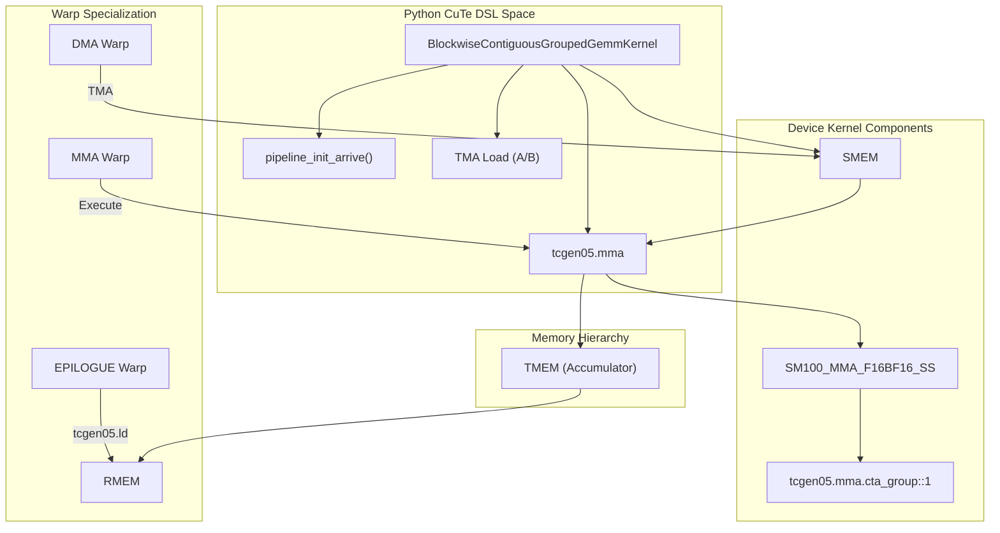
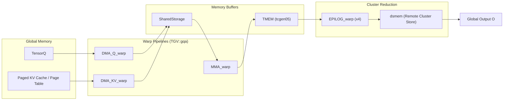

<!-- source: DeepWiki mcp.deepwiki.com · repo NVIDIA/cutlass · page 11.7 MoE GEMM and Low-Latency GQA Examples · fetched 2026-10-26 -->

# MoE GEMM and Low-Latency GQA Examples

<details>
<summary>Relevant source files</summary>

The following files were used as context for generating this wiki page:

- [examples/77_blackwell_fmha/collective/fmha_common.hpp](examples/77_blackwell_fmha/collective/fmha_common.hpp)
- [examples/93_blackwell_low_latency_gqa/CMakeLists.txt](examples/93_blackwell_low_latency_gqa/CMakeLists.txt)
- [examples/93_blackwell_low_latency_gqa/common.cuh](examples/93_blackwell_low_latency_gqa/common.cuh)
- [examples/93_blackwell_low_latency_gqa/readme.md](examples/93_blackwell_low_latency_gqa/readme.md)
- [examples/93_blackwell_low_latency_gqa/tgv_gqa.cu](examples/93_blackwell_low_latency_gqa/tgv_gqa.cu)
- [examples/93_blackwell_low_latency_gqa/tgv_gqa.cuh](examples/93_blackwell_low_latency_gqa/tgv_gqa.cuh)
- [examples/93_blackwell_low_latency_gqa/tgv_gqa_paged.cuh](examples/93_blackwell_low_latency_gqa/tgv_gqa_paged.cuh)
- [examples/python/CuTeDSL/cute/blackwell/kernel/attention/mamba2_ssd/mamba2_ssd.py](examples/python/CuTeDSL/cute/blackwell/kernel/attention/mamba2_ssd/mamba2_ssd.py)
- [examples/python/CuTeDSL/cute/blackwell/kernel/blockwise_gemm/blockwise_gemm.py](examples/python/CuTeDSL/cute/blackwell/kernel/blockwise_gemm/blockwise_gemm.py)
- [examples/python/CuTeDSL/cute/blackwell/kernel/blockwise_gemm/contiguous_grouped_gemm.py](examples/python/CuTeDSL/cute/blackwell/kernel/blockwise_gemm/contiguous_grouped_gemm.py)
- [examples/python/CuTeDSL/cute/blackwell/kernel/blockwise_gemm/masked_grouped_gemm.py](examples/python/CuTeDSL/cute/blackwell/kernel/blockwise_gemm/masked_grouped_gemm.py)
- [include/cute/arch/mma_sm100_umma.hpp](include/cute/arch/mma_sm100_umma.hpp)
- [include/cute/atom/mma_traits_sm100.hpp](include/cute/atom/mma_traits_sm100.hpp)

</details>


This section documents the CUTLASS examples for Mixture-of-Experts (MoE) GEMM and low-latency Grouped Query Attention (GQA) specifically optimized for the NVIDIA Blackwell (SM100) architecture. These examples demonstrate advanced scheduling techniques, such as Ragged Contiguous (RC) grouping, and the use of narrow-precision formats like FP4 with blockwise scaling and flash decoding strategies.

## Mixture-of-Experts (MoE) GEMM

Mixture-of-Experts workloads often involve executing many GEMMs with varying problem sizes (ragged) or grouped problem definitions. The Blackwell architecture introduces hardware features like `tcgen05` MMA instructions and Tensor Memory (TMEM) that significantly accelerate these patterns.

### Ragged Contiguous (RC) Grouped GEMM
The RC-grouped GEMM is a specialized variant of Grouped GEMM where problem shapes share certain dimensions (e.g., $M$ and $K$ are constant across experts, while $N$ varies). This is common in MoE layers where the batch size and hidden dimension are fixed, but the number of tokens assigned to each expert differs.

Key implementation details in the Blackwell CuTe DSL examples:
*   **Contiguous Grouped GEMM**: Implements persistent blockwise contiguous grouped dense GEMM where Matrix B has a grouped dimension $L$, and Matrix A/C have valid $M$ dimensions composed of different groups [examples/python/CuTeDSL/cute/blackwell/kernel/blockwise_gemm/contiguous_grouped_gemm.py:49-56]().
*   **Masked Grouped GEMM**: Supports persistent blockwise masked grouped dense GEMM where $L$ is the group dimension for all matrices A, B, and C [examples/python/CuTeDSL/cute/blackwell/kernel/blockwise_gemm/masked_grouped_gemm.py:49-53]().
*   **Warp Roles**: These kernels use specialized warps: a **DMA warp** for TMA loads, a **SCALE warp** for loading scale factors (SFA/SFB), an **MMA warp** for `tcgen05.mma`, and an **EPILOGUE warp** for loading from TMEM to RMEM via `tcgen05.ld` and applying scales [examples/python/CuTeDSL/cute/blackwell/kernel/blockwise_gemm/contiguous_grouped_gemm.py:79-87]().

### Narrow Precision and FP4 Variants
Blackwell supports NVFP4 (4-bit) and MX (Microscaling) formats. These require specific UMMA (Universal MMA) atoms and layouts.

*   **Data Types**: The `BlockwiseGemmKernel` and its grouped variants primarily support `Float8E4M3FN` for inputs and `Float32` for accumulation [examples/python/CuTeDSL/cute/blackwell/kernel/blockwise_gemm/blockwise_gemm.py:123-127]().
*   **Layouts**: Specialized layouts for UMMA shared memory include `Layout_MN_SW128_32B_Atom` which uses `Swizzle<2,5,2>` for optimal memory access on Blackwell [include/cute/atom/mma_traits_sm100.hpp:73-76]().
*   **MMA Atoms**: Blackwell-specific atoms like `SM100_MMA_F16BF16_SS` and `SM100_MMA_F16BF16_TS` (for TMEM-sourced A) are used to target the `tcgen05.mma` hardware [include/cute/arch/mma_sm100_umma.hpp:86-103](), [include/cute/arch/mma_sm100_umma.hpp:171-185]().

### MoE GEMM Implementation Map
The following diagram maps the high-level MoE GEMM concepts to the specific CUTLASS entities used in the Blackwell implementation.

**MoE GEMM Entity Relationship**

Sources: [examples/python/CuTeDSL/cute/blackwell/kernel/blockwise_gemm/contiguous_grouped_gemm.py:79-87](), [include/cute/arch/mma_sm100_umma.hpp:105-115](), [include/cute/atom/mma_traits_sm100.hpp:72-75]()

---

## Low-Latency GQA (Flash Decoding)

The Low-Latency GQA example (Example 93) targets the generation phase of LLM inference, where sequence lengths are small (often $Q=1$) but KV caches can be very large. This implementation utilizes "TGV GQA", a CuTe-based kernel optimized for Blackwell [examples/93_blackwell_low_latency_gqa/readme.md:3-6]().

### Flash Decoding and Paged KV Cache
Flash Decoding splits the sequence length (`kvL`) across different thread blocks to increase parallelism, followed by a global reduction of the partial results.

*   **KV Cache Variants**: Supports both contiguous KV cache (`--mode 0`) and paged KV cache (`--mode 1`) [examples/93_blackwell_low_latency_gqa/readme.md:6-7]().
*   **Paged Layout**: The paged variant uses a buffer of shape `(num_pages_total, 2, Page_Size, kvH, dH)` where `2` selects between K and V, and a `page_table` for mapping [examples/93_blackwell_low_latency_gqa/readme.md:7-11]().
*   **Warp Roles**: The kernel uses 7 warps: 1 for `DMA_Q`, 1 for `DMA_KV`, 1 for `MMA`, and 4 for `EPILOG` (softmax + cluster reduction). Warp 3 is unused [examples/93_blackwell_low_latency_gqa/tgv_gqa_paged.cuh:57-65]().

### Cluster Reduction
On Blackwell, clusters perform flash-decoding style reductions. Each cluster works on a single KV head in a batch [examples/93_blackwell_low_latency_gqa/readme.md:46-47]().

*   **Remote Stores**: Uses `st.async.shared::cluster.mbarrier` via `store_shared_remote_f32` to send partial results to reduction CTAs within the cluster [examples/93_blackwell_low_latency_gqa/common.cuh:59-63]().
*   **Fmax/Fsum Reduction**: Threads use `credux` and inter-warp reduction, then store local results to destination CTA's `dsmem` (distributed shared memory) using `get_dsmem_tensor` [examples/93_blackwell_low_latency_gqa/readme.md:66-79](), [examples/93_blackwell_low_latency_gqa/common.cuh:66-77]().
*   **TMEM Management**: Accumulators are stored in TMEM and loaded into RMEM for the epilogue using `tmem_load` (wrapping `tcgen05.ld`) [examples/93_blackwell_low_latency_gqa/common.cuh:81-101]().

### GQA Data Flow and Code Entities
This diagram illustrates the data flow from memory through the warp-specialized pipelines to the final output.

**GQA Flash Decoding Data Flow**

Sources: [examples/93_blackwell_low_latency_gqa/tgv_gqa_paged.cuh:57-65](), [examples/93_blackwell_low_latency_gqa/readme.md:59-63](), [examples/93_blackwell_low_latency_gqa/common.cuh:59-77]()

---

## Summary of Example Configurations

| Example | Feature | Precision | Architecture |
| :--- | :--- | :--- | :--- |
| **92_blackwell_moe_gemm** | RC-Grouped / Masked | FP8 / BF16 | SM100 |
| **93_blackwell_low_latency_gqa** | Flash Decoding / Paged KV | BF16 / FP8 | SM100 |
| **Mamba2 SSD** | State Space Decomposition | FP16 / BF16 | SM100 |

### Building and Running
Blackwell examples are built with the `100a` architecture flag. The GQA example includes a comprehensive test harness for both contiguous and paged modes [examples/93_blackwell_low_latency_gqa/readme.md:16-20]().

**GQA Example Command:**
```bash
# Run contiguous KV cache (default)
./93_blackwell_low_latency_gqa --kvL 8192 --kvH 8 --qH 64 --BS 1
# Run paged KV cache (mode 1)
./93_blackwell_low_latency_gqa --kvL 8192 --kvH 8 --qH 64 --BS 1 --mode 1
```
Sources: [examples/93_blackwell_low_latency_gqa/readme.md:23-26](), [examples/93_blackwell_low_latency_gqa/tgv_gqa.cu:48-51]()

---

