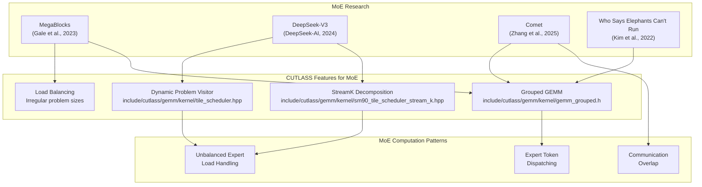
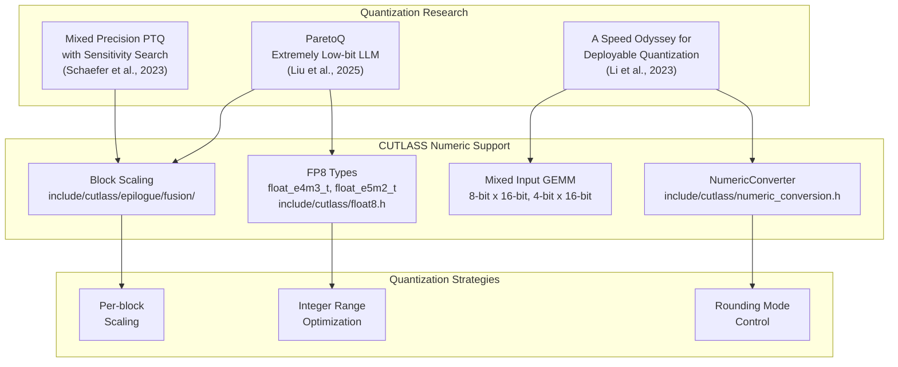

<!-- source: DeepWiki mcp.deepwiki.com · repo NVIDIA/cutlass · page 12 Research Applications and Publications · fetched 2026-10-26 -->

# Research Applications and Publications

<details>
<summary>Relevant source files</summary>

The following files were used as context for generating this wiki page:

- [CITATION.cff](CITATION.cff)
- [CUDA.cmake](CUDA.cmake)
- [Doxyfile](Doxyfile)
- [PUBLICATIONS.md](PUBLICATIONS.md)
- [cmake/version_extended.h.in](cmake/version_extended.h.in)
- [examples/02_dump_reg_shmem/CMakeLists.txt](examples/02_dump_reg_shmem/CMakeLists.txt)
- [examples/56_hopper_ptr_array_batched_gemm/CMakeLists.txt](examples/56_hopper_ptr_array_batched_gemm/CMakeLists.txt)
- [tools/util/include/cutlass/util/device_groupnorm.h](tools/util/include/cutlass/util/device_groupnorm.h)

</details>


## Purpose and Scope

This document catalogs the research papers, applications, and publications that have utilized CUTLASS as a foundational library. It organizes the research by application domain, highlights key contributions to the field, and provides guidance on citing CUTLASS in academic work. The publications demonstrate CUTLASS's impact across diverse GPU computing domains including large language models (LLMs), attention mechanisms, sparse computing, mixture-of-experts (MoE) architectures, quantization, and high-performance computing.

For information about CUTLASS examples and tutorials, see [Examples and Tutorials](#11). For build and testing infrastructure, see [Testing and Validation Infrastructure](#10).

---

## Research Impact Overview

CUTLASS has been adopted by the research community since 2020, with publications spanning multiple areas of GPU-accelerated computing. The library has enabled breakthrough work in efficient transformer architectures, sparse neural networks, quantization techniques, and distributed training systems.

**Total Publications Tracked**: 32 papers (2020-2025)

**Primary Application Domains**:
- Large Language Models and Attention Mechanisms
- Sparse Computing and Structured Sparsity
- Mixture of Experts (MoE) Architectures
- Quantization and Mixed Precision Training
- Communication-Computation Overlap
- Graph Analytics and Knowledge Graphs
- Neural Rendering and Computer Graphics
- General GPU Performance Optimization

Sources: [PUBLICATIONS.md:1-105]()

---

## Application Domain Classification

### Domain: Large Language Models and Attention Mechanisms

```mermaid
graph TB
    subgraph "Attention Research Using CUTLASS"
        FlashAttn2["FlashAttention-2<br/>(Dao, 2023)"]
        FlashAttnCase["FlashAttention-2 Case Study<br/>(Bikshandi & Shah, 2023)"]
        ByteTrans["ByteTransformer<br/>(Zhai et al., 2023)"]
        ShadowKV["ShadowKV<br/>(Sun et al., 2024)"]
        NeighAttn["Faster Neighborhood Attention<br/>(Hassani et al., 2024)"]
        GenNeighAttn["Generalized Neighborhood Attention<br/>(Hassani et al., 2025)"]
        DynamicSparse["Dynamic N:M Sparse Attention<br/>(Chen et al., 2023)"]
    end
    
    subgraph "CUTLASS Components Used"
        TMA["TMA Operations<br/>include/cutlass/arch/tma.h"]
        WGMMA["WGMMA Instructions<br/>include/cutlass/arch/wgmma.h"]
        CollectiveMMA["CollectiveMma<br/>include/cutlass/gemm/collective/"]
        SM90Kernel["SM90 Warp-Specialized<br/>include/cutlass/gemm/kernel/sm90_gemm_tma_warpspecialized.hpp"]
        Epilogue["Epilogue Fusion<br/>include/cutlass/epilogue/"]
    end
    
    subgraph "Key Techniques"
        OnlineSoftmax["Online Softmax<br/>Correction"]
        TileScheduling["StreamK Tile<br/>Scheduling"]
        WarpSpec["Warp Specialization<br/>Patterns"]
        Pipeline["Multi-Stage<br/>Pipelines"]
    end
    
    FlashAttn2 --> TMA
    FlashAttn2 --> WGMMA
    FlashAttn2 --> OnlineSoftmax
    FlashAttnCase --> SM90Kernel
    FlashAttnCase --> WarpSpec
    ByteTrans --> CollectiveMMA
    ByteTrans --> TileScheduling
    ShadowKV --> TMA
    NeighAttn --> Pipeline
    DynamicSparse --> WGMMA
    GenNeighAttn --> TMA
```



**Key Publications**:

1. **FlashAttention-2: Faster Attention with Better Parallelism and Work Partitioning** (July 2023)
   - Tri Dao [PUBLICATIONS.md:33]()
   - Demonstrates advanced use of warp specialization and TMA for efficient attention.
   
2. **A Case Study in CUDA Kernel Fusion: Implementing FlashAttention-2 on NVIDIA Hopper Architecture using the CUTLASS Library** (December 2023)
   - Ganesh Bikshandi, Jay Shah [PUBLICATIONS.md:27]()
   - Detailed implementation guide showing how to use CUTLASS 3.x components for attention.

3. **ByteTransformer: A High-Performance Transformer Boosted for Variable-Length Inputs** (May 2023, IPDPS Best Paper)
   - Yujia Zhai et al. [PUBLICATIONS.md:37]()
   - Uses CUTLASS for handling variable-length sequence batching.

4. **Faster Neighborhood Attention: Reducing the O(n^2) Cost of Self Attention at the Threadblock Level** (March 2024)
   - Ali Hassani, Wen-Mei Hwu, Humphrey Shi [PUBLICATIONS.md:23]().

5. **Generalized Neighborhood Attention: Multi-dimensional Sparse Attention at the Speed of Light** (April 2025)
   - Ali Hassani et al. [PUBLICATIONS.md:9]()

Sources: [PUBLICATIONS.md:9](), [PUBLICATIONS.md:15](), [PUBLICATIONS.md:23](), [PUBLICATIONS.md:27](), [PUBLICATIONS.md:33](), [PUBLICATIONS.md:37]()

---

### Domain: Mixture of Experts (MoE)



**Key Publications**:

1. **DeepSeek-V3 Technical Report** (December 2024)
   - DeepSeek-AI [PUBLICATIONS.md:13]()
   - Large-scale MoE model using CUTLASS for expert computation, specifically leveraging StreamK for load balancing.

2. **Comet: Fine-grained Computation-communication Overlapping for Mixture-of-Experts** (February 2025)
   - Shulai Zhang et al. [PUBLICATIONS.md:5]()
   - Advanced communication-computation overlap techniques using CUTLASS grouped GEMM.

3. **MegaBlocks: Efficient Sparse Training with Mixture-of-Experts** (May 2023)
   - Trevor Gale, Deepak Narayanan, Cliff Young, Matei Zaharia [PUBLICATIONS.md:35]().

Sources: [PUBLICATIONS.md:5](), [PUBLICATIONS.md:13](), [PUBLICATIONS.md:35](), [PUBLICATIONS.md:53]()

---

### Domain: Quantization and Mixed Precision



**Key Publications**:

1. **ParetoQ: Scaling Laws in Extremely Low-bit LLM Quantization** (February 2025)
   - Zechun Liu et al. [PUBLICATIONS.md:7]()
   - Uses CUTLASS FP8 support and block scaling.

2. **A Speed Odyssey for Deployable Quantization of LLMs** (November 2023)
   - Qingyuan Li et al. [PUBLICATIONS.md:31]()
   - Fast INT4/INT8 inference using CUTLASS numeric converters.

Sources: [PUBLICATIONS.md:7](), [PUBLICATIONS.md:31](), [PUBLICATIONS.md:43]()

---

### Domain: Sparse Computing

**Key Publications**:

1. **Dynamic N:M Fine-Grained Structured Sparse Attention Mechanism** (February 2023)
   - Zhaodong Chen et al., PPoPP [PUBLICATIONS.md:45]().
   - Uses CUTLASS sparse tensor core operations for N:M sparsity.

2. **Accelerating Sparse DNN Models without Hardware-Support via Tile-Wise Sparsity** (November 2020)
   - Cong Guo et al., SC20 [PUBLICATIONS.md:71]().

Sources: [PUBLICATIONS.md:45](), [PUBLICATIONS.md:71]()

---

### Domain: Communication-Computation Overlap

**Key Publications**:

1. **FLUX: Fast Software-based Communication Overlap On GPUs Through Kernel Fusion** (June 2024)
   - Li-Wen Chang et al. [PUBLICATIONS.md:17]()
   - Uses CUTLASS Grid Dependency Control (GDC) features for dependent launches.

2. **Breaking the Computation and Communication Abstraction Barrier in Distributed Machine Learning Workloads** (February 2022)
   - Abhinav Jangda et al., ASPLOS [PUBLICATIONS.md:59]().

Sources: [PUBLICATIONS.md:17](), [PUBLICATIONS.md:59]()

---

### Domain: Compiler and Code Generation

**Key Publications**:

1. **EVT: Accelerating Deep Learning Training with Epilogue Visitor Tree** (April 2024)
   - Zhaodong Chen et al., ASPLOS [PUBLICATIONS.md:21]().
   - Extends CUTLASS epilogue fusion capabilities.

2. **Graphene: An IR for Optimized Tensor Computations on GPUs** (March 2023)
   - Hagedorn et al., ASPLOS [PUBLICATIONS.md:41]().

Sources: [PUBLICATIONS.md:21](), [PUBLICATIONS.md:41]()

---

## Citation Information

### Official Metadata
If you use CUTLASS in your research, please cite it using the metadata provided in the repository.

**Metadata Summary**:
- **Title**: CUTLASS [CITATION.cff:2]()
- **Version**: 3.0.0 [CITATION.cff:111]()
- **Authors**: Vijay Thakkar, Pradeep Ramani, Cris Cecka, Aniket Shivam, Honghao Lu, Ethan Yan, Jack Kosaian, Mark Hoemmen, Haicheng Wu, Andrew Kerr, Matt Nicely, Duane Merrill, Dustyn Blasig, Aditya Atluri, Fengqi Qiao, Piotr Majcher, Paul Springer, Markus Hohnerbach, Jin Wang, Manish Gupta. [CITATION.cff:7-87]()
- **Affiliation**: NVIDIA (and Google) [CITATION.cff:11,86]()

Sources: [CITATION.cff:1-112]()

### BibTeX Entries

```bibtex
@misc{cutlass,
  author = {NVIDIA Corporation},
  title = {CUTLASS: CUDA Templates for Linear Algebra Subroutines and Solvers},
  year = {2017--2025},
  url = {https://github.com/NVIDIA/cutlass},
  note = {Version 3.x/4.x}
}

@article{osama2023streamk,
  title={Stream-K: Work-centric Parallel Decomposition for Dense Matrix-Matrix Multiplication on the GPU},
  author={Osama, Muhammad and Merrill, Duane and Cecka, Cris and Garland, Michael and Owens, John D.},
  journal={arXiv preprint arXiv:2301.03598},
  year={2023}
}
```

Sources: [PUBLICATIONS.md:47](), [CITATION.cff:1-112]()

---

## Publication Timeline and Adoption Trends

| Year | Publications | Primary Focus Areas |
|------|-------------|---------------------|
| 2025 | 3 | Extreme Quantization (ParetoQ), MoE Overlap (Comet), Sparse Attention |
| 2024 | 6 | LLM Inference (DeepSeek-V3, ShadowKV), Comm Overlap (FLUX), Epilogue Trees (EVT) |
| 2023 | 11 | FlashAttention-2, Stream-K, MegaBlocks, ByteTransformer, Graphene IR |
| 2022 | 5 | GPU Load Balancing, MoE Production, Bolt Auto-tuner, Precision Recovery |
| 2021 | 2 | Fault Tolerance, Neural Radiance Caching |
| 2020 | 3 | Knowledge Graph Analytics, Sparse DNNs, Strassen's Algorithm |

Sources: [PUBLICATIONS.md:3-75]()

---

