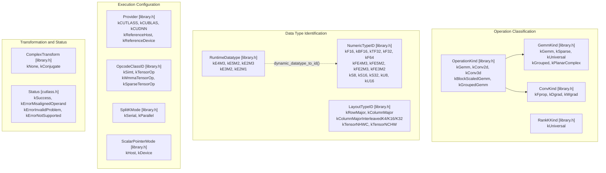
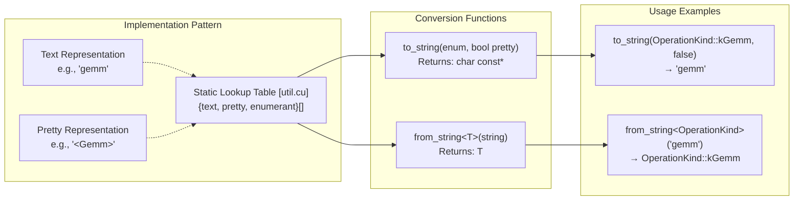

<!-- source: DeepWiki mcp.deepwiki.com · repo NVIDIA/cutlass · page 13 API Reference · fetched 2026-10-26 -->

# API Reference

<details>
<summary>Relevant source files</summary>

The following files were used as context for generating this wiki page:

- [examples/79_blackwell_geforce_gemm/CMakeLists.txt](examples/79_blackwell_geforce_gemm/CMakeLists.txt)
- [examples/80_blackwell_geforce_sparse_gemm/CMakeLists.txt](examples/80_blackwell_geforce_sparse_gemm/CMakeLists.txt)
- [examples/87_blackwell_geforce_gemm_blockwise/CMakeLists.txt](examples/87_blackwell_geforce_gemm_blockwise/CMakeLists.txt)
- [include/cutlass/gemm/collective/builders/sm1xx_common.inl](include/cutlass/gemm/collective/builders/sm1xx_common.inl)
- [python/cutlass_library/library.py](python/cutlass_library/library.py)
- [tools/library/include/cutlass/library/handle.h](tools/library/include/cutlass/library/handle.h)
- [tools/library/include/cutlass/library/library.h](tools/library/include/cutlass/library/library.h)
- [tools/library/src/conv2d_operation.h](tools/library/src/conv2d_operation.h)
- [tools/library/src/conv3d_operation.h](tools/library/src/conv3d_operation.h)
- [tools/library/src/gemm_operation.h](tools/library/src/gemm_operation.h)
- [tools/library/src/grouped_gemm_operation_3x.hpp](tools/library/src/grouped_gemm_operation_3x.hpp)
- [tools/library/src/handle.cu](tools/library/src/handle.cu)
- [tools/library/src/reduction/reduction_operation.h](tools/library/src/reduction/reduction_operation.h)
- [tools/library/src/reference/conv_reference_operation.h](tools/library/src/reference/conv_reference_operation.h)
- [tools/library/src/reference/gemm_reference_operation.h](tools/library/src/reference/gemm_reference_operation.h)

</details>


This page provides a comprehensive reference for CUTLASS library API components, including enumerations, utility functions, and type conversion facilities. This reference covers the runtime library interfaces used for operation configuration, type identification, and data manipulation.

For detailed enumeration descriptions, see [Enumeration Reference](#13.1). For detailed utility function signatures, see [Utility Functions Reference](#13.2). For numeric type system details, see [Numeric Type System and Conversions](#8.1).

## API Organization

The CUTLASS API reference is organized into three major categories:

1.  **Enumerations**: Type-safe identifiers for operations, data types, layouts, and execution modes.
2.  **String Conversion Functions**: Bidirectional conversion between enumerations and string representations.
3.  **Type Query and Conversion Utilities**: Functions for querying type properties and performing data conversions.

All reference implementations are located in [tools/library/src/util.cu:1-2018]() with corresponding header declarations in the library interface files.

## Enumeration System Architecture

The following diagram maps the high-level system categories to the specific enumeration types defined in the codebase.

### System to Code Entity Mapping: Enumerations

Sources: [tools/library/include/cutlass/library/library.h:72-220](), [tools/library/src/util.cu:49-1186]()

## Library Handle and Operation Abstraction

The `cutlass::library` namespace provides an object-oriented approach to managing GPU operations. The `Operation` class serves as the base for all kernels, including GEMM, Convolution, and Reduction.

### System to Code Entity Mapping: Library Objects
```mermaid
graph TD
    subgraph "Host Management"
        Handle["Handle [handle.h]<br/>Manages stream, workspace,<br/>and scalar pointer mode"]
        Singleton["Singleton [singleton.h]<br/>Maintains global operation manifest"]
    end

    subgraph "Operation Hierarchy"
        Operation["Operation [library.h]<br/>Abstract Base Class"]
        GemmOp["GemmOperation [gemm_operation.h]<br/>Standard GEMM"]
        GroupedGemmOp["GroupedGemmOperation3xBase [grouped_gemm_operation_3x.hpp]<br/>SM90+ Grouped GEMM"]
        ReductionOp["ReductionOperation [reduction_operation.h]<br/>Split-K reduction"]
    end

    Handle -->|"executes"| Operation
    Operation <|-- GemmOp
    Operation <|-- GroupedGemmOp
    Operation <|-- ReductionOp
```
Sources: [tools/library/include/cutlass/library/handle.h:48-210](), [tools/library/include/cutlass/library/library.h:83-131](), [tools/library/src/grouped_gemm_operation_3x.hpp:48-82]()

## String Conversion Architecture

All enumerations provide bidirectional string conversion through a consistent interface pattern. This allows the CUTLASS Profiler and Library to parse command-line arguments and generate human-readable reports.

### Conversion Flow: String to Code Entity

Sources: [tools/library/src/util.cu:64-78](), [tools/library/src/util.cu:81-92](), [tools/library/src/util.cu:349-377]()

## Type Query Functions

CUTLASS provides comprehensive type introspection functions for querying properties of `NumericTypeID` values at runtime.

| Function | Return Type | Purpose | Line Reference |
| :--- | :--- | :--- | :--- |
| `sizeof_bits(NumericTypeID)` | `int` | Returns size in bits for the type | [tools/library/src/util.cu:567-606]() |
| `is_complex_type(NumericTypeID)` | `bool` | Returns true if type is complex-valued | [tools/library/src/util.cu:609-619]() |
| `get_real_type(NumericTypeID)` | `NumericTypeID` | Returns underlying real type from complex type | [tools/library/src/util.cu:622-632]() |
| `is_integer_type(NumericTypeID)` | `bool` | Returns true if type is integer (signed or unsigned) | [tools/library/src/util.cu:635-652]() |
| `is_signed_type(NumericTypeID)` | `bool` | Returns true if type is signed | [tools/library/src/util.cu:655-682]() |
| `is_float_type(NumericTypeID)` | `bool` | Returns true if type is floating-point | [tools/library/src/util.cu:695-721]() |

Sources: [tools/library/src/util.cu:567-721]()

### Type Size Mapping
The `sizeof_bits()` function returns bit sizes for all supported types, including specialized sub-byte and Blackwell-specific formats:

| Type Category | Types | Bit Sizes |
| :--- | :--- | :--- |
| **FP8 Variants** | FE4M3, FE5M2, FE2M3, FE3M2, FUE4M3 | 8, 8, 6, 6, 8 |
| **Sub-byte FP** | F4, F6, FE2M1 | 4, 6, 4 |
| **Standard FP** | F16, BF16, TF32, F32, F64 | 16, 16, 32, 32, 64 |
| **Complex FP** | CF16, CBF16, CTF32, CF32, CF64 | 32, 32, 64, 64, 128 |
| **Integers** | S2, S4, S8, S32, U8, U32 | 2, 4, 8, 32, 8, 32 |

Sources: [tools/library/src/util.cu:567-606]()

## Layout Type System

Layout types specify memory organization patterns for tensor data.

| Layout Category | Code Entities (`LayoutTypeID`) | Stride Rank |
| :--- | :--- | :--- |
| **Matrix** | `kRowMajor`, `kColumnMajor` | 1 |
| **Interleaved** | `kColumnMajorInterleavedK32`, `kRowMajorInterleavedK64` | 1 |
| **Tensor 4D** | `kTensorNCHW`, `kTensorNHWC` | 3 |
| **Tensor 5D** | `kTensorNCDHW`, `kTensorNDHWC` | 4 |

Sources: [tools/library/src/util.cu:725-830]()

## Data Conversion Functions

CUTLASS provides conversion functions for transforming data between different representations, primarily used for initializing tensors from strings or constants.

### Lexical Cast and Casting Functions
-   **`lexical_cast`**: Parses a string into a typed byte array or formats a byte array into a string. [tools/library/src/util.cu:1189-1561]()
-   **`cast_from_int64`**: Casts an `int64_t` value into the target `NumericTypeID` representation. [tools/library/src/util.cu:1564-1697]()
-   **`cast_from_double`**: Casts a `double` value into the target `NumericTypeID` representation. [tools/library/src/util.cu:1836-1981]()

### Runtime to Static Type Mapping
The `dynamic_datatype_to_id()` function converts runtime-determined `RuntimeDatatype` enumerants (often used in SM100 Blackwell kernels) to corresponding `NumericTypeID` values for the library system. [tools/library/src/util.cu:1984-2009]()

## Usage Examples

### String Conversion
```cpp
// Convert enumeration to string
char const* op_name = to_string(OperationKind::kGemm, false);  // Returns "gemm"

// Parse string to enumeration
NumericTypeID type = from_string<NumericTypeID>("f16"); // Returns NumericTypeID::kF16
```

### Type Queries
```cpp
// Query type properties
int bits = sizeof_bits(NumericTypeID::kF16);  // Returns 16
bool is_complex = is_complex_type(NumericTypeID::kCF32);  // Returns true
```

### Data Conversion
```cpp
// String to typed bytes
std::vector<uint8_t> bytes;
bool success = lexical_cast(bytes, NumericTypeID::kF32, "3.14159"); // [tools/library/src/util.cu:1189]()
```

Sources: [tools/library/src/util.cu:1-2018](), [tools/library/include/cutlass/library/handle.h:1-210]()

---

