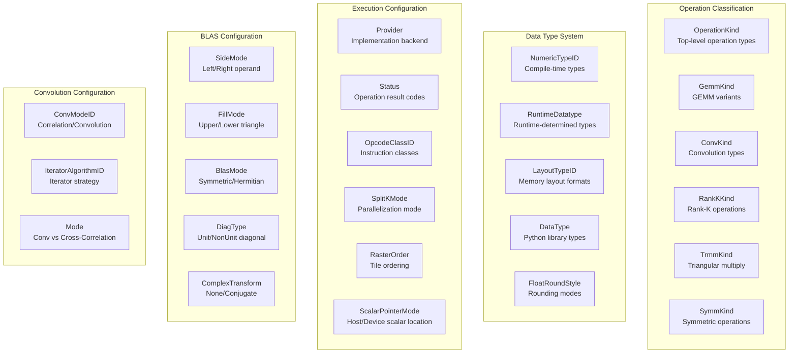
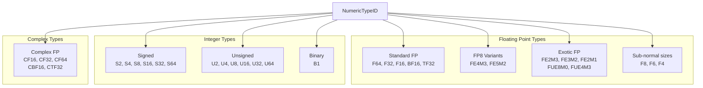
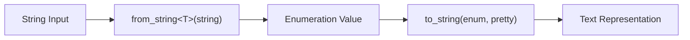

<!-- source: DeepWiki mcp.deepwiki.com · repo NVIDIA/cutlass · page 13.1 Enumeration Reference · fetched 2026-10-26 -->

# Enumeration Reference

<details>
<summary>Relevant source files</summary>

The following files were used as context for generating this wiki page:

- [examples/13_two_tensor_op_fusion/device/b2b_implicit_gemm_convolution.h](examples/13_two_tensor_op_fusion/device/b2b_implicit_gemm_convolution.h)
- [examples/79_blackwell_geforce_gemm/CMakeLists.txt](examples/79_blackwell_geforce_gemm/CMakeLists.txt)
- [examples/80_blackwell_geforce_sparse_gemm/CMakeLists.txt](examples/80_blackwell_geforce_sparse_gemm/CMakeLists.txt)
- [examples/87_blackwell_geforce_gemm_blockwise/CMakeLists.txt](examples/87_blackwell_geforce_gemm_blockwise/CMakeLists.txt)
- [include/cutlass/conv/conv2d_problem_size.h](include/cutlass/conv/conv2d_problem_size.h)
- [include/cutlass/conv/conv3d_problem_size.h](include/cutlass/conv/conv3d_problem_size.h)
- [include/cutlass/gemm/collective/builders/sm1xx_common.inl](include/cutlass/gemm/collective/builders/sm1xx_common.inl)
- [include/cutlass/half.h](include/cutlass/half.h)
- [include/cutlass/integer_subbyte.h](include/cutlass/integer_subbyte.h)
- [include/cutlass/numeric_conversion.h](include/cutlass/numeric_conversion.h)
- [include/cutlass/platform/platform.h](include/cutlass/platform/platform.h)
- [python/cutlass_library/library.py](python/cutlass_library/library.py)
- [test/unit/core/numeric_conversion.cu](test/unit/core/numeric_conversion.cu)
- [tools/library/src/grouped_gemm_operation_3x.hpp](tools/library/src/grouped_gemm_operation_3x.hpp)

</details>


## Purpose and Scope

This page documents all enumeration types defined in the CUTLASS library, their valid values, and associated utility functions for string conversion, type queries, and numeric operations. These enumerations provide type-safe identifiers for operations, data types, layouts, and architectural features throughout CUTLASS.

For information about the actual C++ numeric types these enumerations represent, see [Numeric Type System and Conversions](8.1). For layout implementations, see [Layout Types and Memory Formats](8.4).

## Overview of Enumeration Categories

CUTLASS enumerations are organized into several logical categories based on their purpose within the library:

Title: Enumeration Categories and Relationships


Sources: [tools/library/src/util.cu:49-1139](), [python/cutlass_library/library.py:58-116](), [include/cutlass/numeric_conversion.h:63-72](), [include/cutlass/conv/conv2d_problem_size.h:71-71]()

## Core Operation Enumerations

### OperationKind

Identifies the top-level operation type being performed. Used for operation dispatch and library manifest organization.

| Enumerant | String Value | Pretty Name | Description |
|-----------|--------------|-------------|-------------|
| `kGemm` | "gemm" | "Gemm" | General matrix multiply |
| `kEqGemm` | "eq_gemm" | "EqGemm" | Equation-based GEMM |
| `kBlockScaledGemm` | "block_scaled_gemm" | "blockScaledGemm" | Block-wise scaled GEMM |
| `kBlockwiseGemm` | "blockwise_gemm" | "blockwiseGemm" | Blockwise GEMM operation |
| `kRankK` | "rank_k" | "RankK" | Rank-K update (SYRK/HERK) |
| `kRank2K` | "rank_2k" | "Rank2K" | Rank-2K update |
| `kTrmm` | "trmm" | "Trmm" | Triangular matrix multiply |
| `kSymm` | "symm" | "Symm" | Symmetric matrix multiply |
| `kConv2d` | "conv2d" | "Conv2d" | 2D convolution |
| `kConv3d` | "conv3d" | "Conv3d" | 3D convolution |
| `kSparseGemm` | "spgemm" | "SparseGemm" | Sparse GEMM |
| `kGroupedGemm` | "grouped_gemm" | "GroupedGemm" | Grouped/batched GEMM |
| `kInvalid` | - | "Invalid" | Invalid/uninitialized |

**Conversion Functions:**
- `char const *to_string(OperationKind, bool pretty)` - Convert to string representation
- `OperationKind from_string<OperationKind>(std::string const &)` - Parse from string

Sources: [tools/library/src/util.cu:329-377](), [tools/library/src/grouped_gemm_operation_3x.hpp:76-76]()

### Status

Reports the execution status of a CUTLASS operation.

| Enumerant | String Value | Pretty Name |
|-----------|--------------|-------------|
| `kSuccess` | "success" | "Success" |
| `kErrorMisalignedOperand` | "misaligned_operand" | "Error: misaligned operand" |
| `kErrorInvalidProblem` | "invalid_problem" | "Error: invalid problem" |
| `kErrorNotSupported` | "not_supported" | "Error: not supported" |
| `kErrorInternal` | "internal" | "Error: internal" |
| `kInvalid` | - | "Invalid" |

**Conversion Functions:**
- `char const *to_string(Status, bool pretty)`
- `Status from_string<Status>(std::string const &)`

Sources: [tools/library/src/util.cu:381-423]()

### Provider

Identifies which implementation backend executes an operation.

| Enumerant | String Value | Pretty Name | Description |
|-----------|--------------|-------------|-------------|
| `kNone` | "none" | "None" | No provider |
| `kCUTLASS` | "cutlass" | "CUTLASS" | CUTLASS implementation |
| `kReferenceHost` | "host" | "reference_host" | CPU reference |
| `kReferenceDevice` | "device" | "reference_device" | GPU reference |
| `kCUBLAS` | "cublas" | "cuBLAS" | cuBLAS library |
| `kCUDNN` | "cudnn" | "cuDNN" | cuDNN library |
| `kInvalid` | - | "Invalid" | Invalid provider |

**Conversion Functions:**
- `char const *to_string(Provider, bool pretty)`
- `Provider from_string<Provider>(std::string const &)`

Sources: [tools/library/src/util.cu:49-92]()

## GEMM and Convolution Enumerations

### GemmKind

Distinguishes between different GEMM operation variants.

| Enumerant | String Value | Pretty Name |
|-----------|--------------|-------------|
| `kGemm` | "gemm" | "<Gemm>" |
| `kSparse` | "spgemm" | "<Sparse>" |
| `kUniversal` | "universal" | "<Universal>" |
| `kPlanarComplex` | "planar_complex" | "<PlanarComplex>" |
| `kPlanarComplexArray` | "planar_complex_array" | "<PlanarComplexArray>" |
| `kGrouped` | "grouped" | "<Grouped>" |

Sources: [tools/library/src/util.cu:97-126](), [tools/library/src/grouped_gemm_operation_3x.hpp:75-75]()

### ConvMode (Convolution Mode)

Defines the mathematical nature of the convolution operation.

| Enumerant | Value | Description |
|-----------|-------|-------------|
| `kConvolution` | 0 | Standard convolution |
| `kCrossCorrelation` | 1 | Cross-correlation (sliding window without kernel flip) |

Sources: [include/cutlass/conv/convolution.h:49-52](), [include/cutlass/conv/conv2d_problem_size.h:71-71]()

### SplitKMode

Determines how split-K decomposition is executed across thread blocks.

| Enumerant | String Value | Pretty Name | Description |
|-----------|--------------|-------------|-------------|
| `kSerial` | "serial" | "<serial>" | Serial reduction across K dimension |
| `kParallel` | "parallel" | "<parallel>" | Parallel reduction with atomics |

Sources: [tools/library/src/util.cu:922-961]()

## Numeric Type System

### NumericTypeID

Comprehensive enumeration of all numeric types supported by CUTLASS, used for compile-time type identification.

Title: NumericTypeID Hierarchy


Sources: [tools/library/src/util.cu:476-562](), [include/cutlass/gemm/collective/builders/sm1xx_common.inl:66-90](), [include/cutlass/numeric_types.h:72-89]()

### FloatRoundStyle

Defines the rounding mode for numeric conversions, supporting standard and hardware-specific options.

| Enumerant | Description |
|-----------|-------------|
| `round_indeterminate` | Rounding mode unknown |
| `round_toward_zero` | Truncate toward zero |
| `round_to_nearest` | Round to nearest even (standard) |
| `round_to_nearest_satfinite` | Round to nearest even, capping to destination min/max |
| `round_toward_infinity` | Round toward positive infinity |
| `round_toward_neg_infinity` | Round toward negative infinity |
| `round_half_ulp_truncate` | Add 0.5ulp then truncate |

Sources: [include/cutlass/numeric_conversion.h:63-72]()

### Python Library DataType

The `DataType` enum in the Python library maps Python identifiers to C++ type tags for code generation.

| Enumerant | C++ Tag |
|-----------|---------|
| `DataType.f16` | `cutlass::half_t` |
| `DataType.bf16` | `cutlass::bfloat16_t` |
| `DataType.f32` | `float` |
| `DataType.e4m3` | `cutlass::float_e4m3_t` |
| `DataType.e5m2` | `cutlass::float_e5m2_t` |
| `DataType.s32` | `int32_t` |
| `DataType.f8` | `cutlass::type_erased_dynamic_float8_t` |

Sources: [python/cutlass_library/library.py:69-116](), [python/cutlass_library/library.py:183-222]()

## Layout and Memory Format Enumerations

### LayoutTypeID

Identifies memory layout formats for matrices and tensors.

| Enumerant | Aliases | Description |
|-----------|---------|-------------|
| `kRowMajor` | "row", "t" | Row-major layout |
| `kColumnMajor` | "column", "col", "n" | Column-major layout |
| `kTensorNHWC` | "nhwc" | Batch, height, width, channel |
| `kTensorNDHWC` | "ndhwc" | Batch, depth, height, width, channel |
| `kColumnMajorInterleavedK32` | "nk32" | Column-major with K=32 interleaving |

Sources: [tools/library/src/util.cu:725-830](), [include/cutlass/gemm/collective/builders/sm1xx_common.inl:93-134]()

## Architecture and Instruction Enumerations

### OpcodeClassID

Identifies the instruction class used for computation.

| Enumerant | String | Description |
|-----------|--------|-------------|
| `kSimt` | "simt" | Single instruction, multiple threads (CUDA cores) |
| `kTensorOp` | "tensorop" | Tensor Core operations |
| `kWmmaTensorOp` | "wmmatensorop" | WMMA Tensor Core operations |
| `kSparseTensorOp` | "sptensorop" | Sparse Tensor Core operations |

Sources: [tools/library/src/util.cu:834-876]()

### UMMA::Major

Hopper/Blackwell specific enumeration for UMMA (Unstructured MMA) layout majorness.

| Enumerant | Mapping |
|-----------|---------|
| `cute::UMMA::Major::K` | Maps to `RowMajor` for Matrix A or `ColumnMajor` for Matrix B |
| `cute::UMMA::Major::MN` | Maps to `ColumnMajor` for Matrix A or `RowMajor` for Matrix B |

Sources: [include/cutlass/gemm/collective/builders/sm1xx_common.inl:94-134]()

## String Conversion and Utility Functions

### Conversion Function Pattern

All enumerations follow a consistent pattern for string conversion:

Title: Enumeration String Conversion Workflow


**Function Signatures:**

```cpp
// Convert enumeration to string
char const *to_string(EnumType enumerant, bool pretty = false);

// Parse string to enumeration
template <>
EnumType from_string<EnumType>(std::string const &str);
```

Sources: [tools/library/src/util.cu:49-1139]()

### Numeric Type Utility Functions

| Function | Purpose |
|----------|---------|
| `sizeof_bits(NumericTypeID)` | Returns the size in bits of the specified numeric type. |
| `is_complex_type(NumericTypeID)` | Returns true if the type is a complex number variant. |
| `is_integer_type(NumericTypeID)` | Returns true for any signed or unsigned integer type. |
| `is_float_type(NumericTypeID)` | Returns true for any floating-point type (F64 to FP4). |
| `get_real_type(NumericTypeID)` | Returns the underlying real type for a complex type. |

Sources: [tools/library/src/util.cu:566-721]()

### Lexical Cast (String ↔ Numeric)

The `lexical_cast` functions bridge the gap between human-readable strings and internal byte representations of numeric types.

```cpp
// Parse string into byte representation
bool lexical_cast(std::vector<uint8_t> &bytes, 
                  NumericTypeID type, 
                  std::string const &str);

// Convert byte representation to string
std::string lexical_cast(std::vector<uint8_t> &bytes, 
                          NumericTypeID type);
```

Sources: [tools/library/src/util.cu:1189-1561]()

## Summary Table: All Enumeration Types

| Enumeration | Purpose | Key Enumerants |
|-------------|---------|----------------|
| `OperationKind` | Top-level operation classification | kGemm, kConv2d, kGroupedGemm |
| `Status` | Operation result codes | kSuccess, kErrorNotSupported |
| `Provider` | Implementation backend | kCUTLASS, kReferenceDevice |
| `GemmKind` | GEMM variant type | kUniversal, kSparse, kGrouped |
| `NumericTypeID` | Compile-time numeric types | kF32, kF16, kFE4M3, kS8 |
| `LayoutTypeID` | Memory layout format | kRowMajor, kColumnMajor, kTensorNHWC |
| `OpcodeClassID` | Instruction class | kSimt, kTensorOp |
| `ComplexTransform` | Complex operand transformation | kNone, kConjugate |
| `FloatRoundStyle` | Conversion rounding behavior | round_to_nearest, round_toward_zero |
| `ConvMode` | Convolution mathematical mode | kConvolution, kCrossCorrelation |

Sources: [tools/library/src/util.cu:1-2018](), [include/cutlass/numeric_conversion.h:63-72](), [include/cutlass/conv/convolution.h:49-52]()

---

