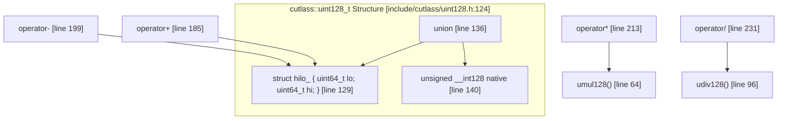
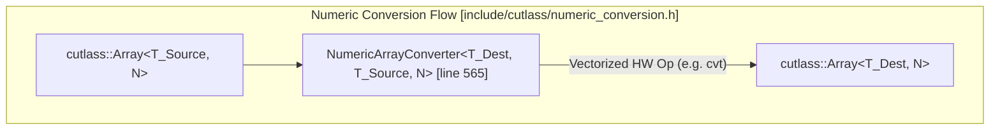
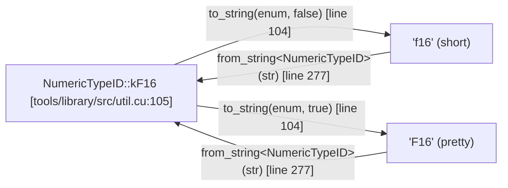

<!-- source: DeepWiki mcp.deepwiki.com · repo NVIDIA/cutlass · page 13.2 Utility Functions Reference · fetched 2026-10-26 -->

# Utility Functions Reference

Relevant source files

The following files were used as context for generating this wiki page:

- [examples/55_hopper_mixed_dtype_gemm/CMakeLists.txt](examples/55_hopper_mixed_dtype_gemm/CMakeLists.txt)
- [include/cute/algorithm/axpby.hpp](include/cute/algorithm/axpby.hpp)
- [include/cute/algorithm/tuple_algorithms.hpp](include/cute/algorithm/tuple_algorithms.hpp)
- [include/cutlass/detail/layout.hpp](include/cutlass/detail/layout.hpp)
- [include/cutlass/gemm/gemm.h](include/cutlass/gemm/gemm.h)
- [include/cutlass/uint128.h](include/cutlass/uint128.h)
- [test/unit/core/CMakeLists.txt](test/unit/core/CMakeLists.txt)
- [test/unit/core/uint128.cu](test/unit/core/uint128.cu)
- [tools/util/include/cutlass/util/packed_stride.hpp](tools/util/include/cutlass/util/packed_stride.hpp)

This page documents the utility functions provided by CUTLASS for working with enumerations, numeric types, data conversions, and specialized arithmetic. These functions are primarily used by the library infrastructure for string parsing, type introspection, and runtime type conversions.

## Overview

The CUTLASS library provides a comprehensive set of utility functions in the `cutlass::library` namespace for runtime operations on types and enumerations. These utilities support command-line parsing, profiling tools, kernel generation, and dynamic dispatch. Additionally, CUTLASS includes core arithmetic utilities like `uint128_t` for high-precision indexing and CuTe-based stride packing for kernel configuration.

## Specialized Arithmetic and Sub-byte Types

CUTLASS defines specialized types to handle precision requirements and memory constraints that standard C++ types do not cover, such as 128-bit integers and sub-byte integers (e.g., 4-bit, 2-bit).

### uint128_t Implementation

The implementation uses a union to support native 128-bit types (like `unsigned __int128` in GCC) when available, falling back to a structure of two 64-bit integers (`lo` and `hi`). [include/cutlass/uint128.h:124-142]()

Title: cutlass::uint128_t Data Layout

- **umul128**: Multiplies two 64-bit integers to produce a 128-bit result. [include/cutlass/uint128.h:64-92]()
- **udiv128**: Divides a 128-bit value (high/low 64-bit pair) by a 64-bit divisor to produce a 64-bit quotient. [include/cutlass/uint128.h:96-119]()

### integer_subbyte

The `integer_subbyte` template allows representing integers smaller than 8 bits (e.g., `int4_t`, `uint2_t`) using a `uint8_t` storage backing. It provides bitmasking and sign-extension logic for conversions to standard `int` or `unsigned`. [include/cutlass/integer_subbyte.h:51-66]()

**Sources:** [include/cutlass/uint128.h:124-210](), [include/cutlass/integer_subbyte.h:51-199]()

## Numeric Conversion and Rounding

CUTLASS provides a robust numeric conversion system, `NumericConverter`, which supports various rounding styles and hardware-accelerated instructions (e.g., PTX `cvt` instructions).

### NumericConverter and Rounding Styles

The `NumericConverter` template [include/cutlass/numeric_conversion.h:74-90]() supports the following `FloatRoundStyle` modes:

| Mode | Description |
|------|-------------|
| `round_toward_zero` | Standard truncation. |
| `round_to_nearest` | Round to nearest even (default). |
| `round_half_ulp_truncate` | Specialized rounding for fixed-point/integer mapping. |

For `float` to `int8_t` conversion on NVIDIA GPUs, CUTLASS uses inline assembly to invoke `cvt.rni.sat.s8.f32` (round to nearest, saturate). [include/cutlass/numeric_conversion.h:161-162]()

### Array Conversion

`NumericArrayConverter` allows for vectorized conversions of `cutlass::Array` types, often mapping to vectorized instructions like `__half22float2`. [include/cutlass/numeric_conversion.h:565-585]()

Title: Numeric Array Conversion Data Flow

**Sources:** [include/cutlass/numeric_conversion.h:56-200](), [test/unit/core/numeric_conversion.cu:51-60]()

## Enumeration String Conversion

All major enumeration types in CUTLASS provide bidirectional conversion between their enumerants and string representations. Each enumeration supports two string formats: a short text format suitable for command-line arguments and a pretty-printed format for display.

### Conversion Function Pattern

Title: Enumeration String Mapping System

**Sources:** [tools/library/src/util.cu:1-2018]()

### Supported Enumerations

The following table lists major enumerations with string conversion support:

| Enumeration Type | Purpose | Example Text | Example Pretty |
|-----------------|---------|--------------|----------------|
| `Provider` | Kernel implementation provider | "cutlass" | "CUTLASS" |
| `OperationKind` | Type of operation | "gemm" | "Gemm" |
| `NumericTypeID` | Numeric data type identifier | "f16" | "F16" |
| `LayoutTypeID` | Memory layout identifier | "row" | (same) |
| `OpcodeClassID` | Instruction class | "tensorop" | "<tensorop>" |
| `GemmKind` | GEMM variant | "universal" | "<Universal>" |

**Sources:** [tools/library/src/util.cu:49-472]()

## Layout and Stride Utilities

### `make_cute_packed_stride`

In CUTLASS 3.x, kernels use CuTe layouts. The `make_cute_packed_stride` utility constructs canonical CuTe stride types for mainloop parameters, handling cases with and without batch modes. It ensures that the stride for the minor dimension is always `Int<1>` (packed). [tools/util/include/cutlass/util/packed_stride.hpp:49-135]()

| Function Variant | Stride Result Type | Use Case |
|------------------|-------------------|----------|
| No Batch | `Stride<IntT, Int<1>>` | Standard 2D Row-Major |
| With Batch | `Stride<IntT, Int<1>, int64_t>` | Batched GEMM (M, K, L) |
| Group Mode | `Stride<IntT, Int<1>, Int<0>>` | Grouped GEMM |

**Sources:** [tools/util/include/cutlass/util/packed_stride.hpp:49-135]()

### Stride Mapping for Convolutions

Specializations of `make_cute_packed_stride` handle the mapping of 4D/5D convolution tensors (e.g., `NHWC`, `NDHWC`) into the rank-3 strides required by GEMM-based collective mainloops. [tools/util/include/cutlass/util/packed_stride.hpp:146-168]()

## Problem Size Utilities

CUTLASS provides structures to manage and validate problem dimensions for GEMM and Convolution.

- **Conv2dProblemSize**: Manages `N, H, W, C, K, R, S` and derived `P, Q`. [include/cutlass/conv/conv2d_problem_size.h:64-75]()
- **Conv3dProblemSize**: Extends 2D with `D, T, Z` dimensions. [include/cutlass/conv/conv3d_problem_size.h:59-75]()

These structures include constructors that automatically compute output dimensions based on padding, stride, and dilation. [include/cutlass/conv/conv2d_problem_size.h:174-177]()

## Platform and Type Traits

The `cutlass/platform/platform.h` header provides a compatibility layer for STL features in CUDA device code. It includes:
- **Type Traits**: `is_same`, `enable_if`, `conditional`, `is_integral`. [include/cutlass/platform/platform.h:72-94]()
- **Functional**: `plus`, `less`, `greater`, `min`, `max`. [include/cutlass/platform/platform.h:61-65]()

**Sources:** [include/cutlass/platform/platform.h:32-134]()

## Tuple and Tensor Algorithms

CUTLASS leverages CuTe's tuple algorithms for meta-programming and runtime tensor manipulation.
- **for_each**: Iterates over tuple elements, supporting nested tuples. [include/cute/algorithm/tuple_algorithms.hpp:171-183]()
- **axpby**: Implements $y = \alpha x + \beta y$ for CuTe Tensors, handling complex and real types with zero-beta optimizations. [include/cute/algorithm/axpby.hpp:62-92]()

**Sources:** [include/cute/algorithm/tuple_algorithms.hpp:171-183](), [include/cute/algorithm/axpby.hpp:62-92]()

## Usage Context

These utility functions are primarily used by:
1.  **Unit Tests**: Initializing tensors and verifying results (e.g., `numeric_conversion.cu`). [test/unit/core/numeric_conversion.cu:81-84]()
2.  **Profiler**: Parsing command-line arguments and formatting performance results via `to_string`/`from_string`.
3.  **Kernel Infrastructure**: Mapping high-level layout tags to CuTe stride objects for SM90+ kernels using `TagToStrideA` and `make_cute_packed_stride`. [include/cutlass/gemm/gemm.h:59-64](), [include/cutlass/detail/layout.hpp:53-63]()

**Sources:** [tools/library/src/util.cu:1-2018](), [include/cutlass/uint128.h:1-210](), [tools/util/include/cutlass/util/packed_stride.hpp:1-135](), [include/cutlass/numeric_conversion.h:1-200]()

---

