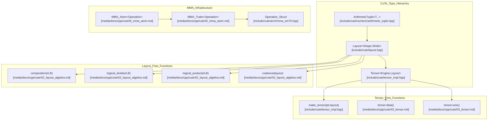
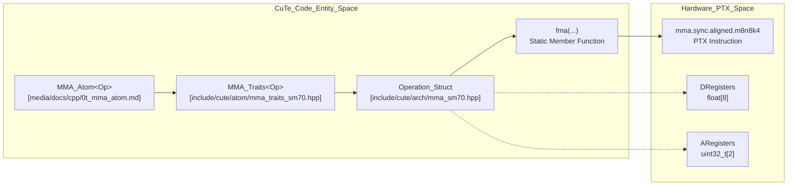

<!-- source: DeepWiki mcp.deepwiki.com · repo NVIDIA/cutlass · page 2 CuTe Core Abstractions · fetched 2026-10-26 -->

# CuTe Core Abstractions

Relevant source files

The following files were used as context for generating this wiki page:

- [include/cute/container/tuple.hpp](include/cute/container/tuple.hpp)
- [include/cute/layout.hpp](include/cute/layout.hpp)
- [include/cute/numeric/arithmetic_tuple.hpp](include/cute/numeric/arithmetic_tuple.hpp)
- [include/cute/tensor_impl.hpp](include/cute/tensor_impl.hpp)
- [include/cutlass/detail/helper_macros.hpp](include/cutlass/detail/helper_macros.hpp)
- [include/cutlass/epilogue/collective/sm90_epilogue_tma_warpspecialized.hpp](include/cutlass/epilogue/collective/sm90_epilogue_tma_warpspecialized.hpp)
- [include/cutlass/functional.h](include/cutlass/functional.h)
- [include/cutlass/gemm/collective/sm120_blockscaled_sparse_mma_tma.hpp](include/cutlass/gemm/collective/sm120_blockscaled_sparse_mma_tma.hpp)
- [include/cutlass/wmma_array.h](include/cutlass/wmma_array.h)
- [media/docs/cpp/cute/02_layout_algebra.md](media/docs/cpp/cute/02_layout_algebra.md)
- [media/docs/cpp/cute/03_tensor.md](media/docs/cpp/cute/03_tensor.md)
- [media/docs/cpp/cute/0t_mma_atom.md](media/docs/cpp/cute/0t_mma_atom.md)
- [media/docs/cpp/cute/0x_gemm_tutorial.md](media/docs/cpp/cute/0x_gemm_tutorial.md)
- [test/unit/core/functional.cu](test/unit/core/functional.cu)
- [test/unit/layout/tensor.cu](test/unit/layout/tensor.cu)
- [test/unit/layout/tensor_nhwc.cu](test/unit/layout/tensor_nhwc.cu)

## Purpose and Scope

This page provides a deep dive into CuTe (CUDA Templates), the foundational abstraction layer that forms the basis of CUTLASS 3.x, 4.x, and beyond. CuTe defines three core abstractions—**Layout**, **Tensor**, and **Atoms**—that compose to create portable, efficient GPU kernels across architectures from Volta (SM70) through Blackwell (SM100).

CuTe's central innovation is treating layouts as mathematical functions from integers to integers, enabling compile-time reasoning about data access patterns, automatic vectorization, and provable correctness guarantees. This page explains how these abstractions work together and their implementation in the CUTLASS codebase.

For detailed information on specific components, see child pages:
- [Layout Algebra](#2.1) — Explain the layout algebra system: Shape, Stride, coalesce, composition, complement, logical_divide, and logical_product operations with examples
- [Tensor Container and Operations](#2.2) — Document the Tensor abstraction, Engine types (ArrayEngine, ViewEngine), memory tagging, make_tensor, and tensor manipulation operations
- [MMA Atoms and TiledMMA](#2.3) — Explain MMA_Atom, MMA_Traits, TiledMMA, ThrMMA abstractions and how they map to hardware matrix multiply-accumulate operations
- [Copy Atoms and TMA Operations](#2.4) — Document Copy_Traits, TMA load/store operations, im2col transformations, asynchronous data movement, and tensor map encoding

Sources: [media/docs/cpp/cute/02_layout_algebra.md:1-11](), [media/docs/cpp/cute/03_tensor.md:1-11](), [media/docs/cpp/cute/0t_mma_atom.md:1-24](), [include/cute/layout.hpp:31-41](), [include/cute/tensor_impl.hpp:31-40]()

## CuTe Philosophy: Layouts as Mathematical Functions

CuTe's foundational principle is that **layouts are functions from integers to integers**. A layout `L : ℕ → ℕ` maps logical coordinates to storage offsets. This mathematical abstraction enables:

- **Compile-time composition**: Layout operations compose like mathematical functions.
- **Zero-cost abstractions**: Static layouts compile to direct offset calculations.
- **Correctness proofs**: Layout algebra satisfies mathematical postconditions.
- **Architecture independence**: Same layout code works across GPU generations.

Title: CuTe Core Abstractions Architecture

Sources: [media/docs/cpp/cute/02_layout_algebra.md:15-19](), [media/docs/cpp/cute/03_tensor.md:3-11](), [include/cute/numeric/arithmetic_tuple.hpp:44-54](), [include/cute/layout.hpp:98-101]()

## Three-Layer Abstraction System

CuTe's three layers enable progressive refinement from mathematical abstractions to hardware instructions.

### Layer 1: Layout Algebra

A `Layout` is defined by two components that together specify a function from coordinates to offsets:
- **Shape**: Tuple of integers defining logical dimensions (domain of the function).
- **Stride**: Tuple of integers defining storage pattern (how coordinates map to offsets).

The `Layout` class is defined in `include/cute/layout.hpp` and uses the template signature:
`Layout<Shape, Stride>` [include/cute/layout.hpp:98-101]()

**Core Layout Operations**:

| Function | Signature | Postcondition |
|----------|-----------|---------------|
| `coalesce` | `coalesce(Layout A)` | `size(result) == size(A)`, simplifies hierarchy [media/docs/cpp/cute/02_layout_algebra.md:21-25]() |
| `composition` | `composition(A, B)` | `result(i) == A(B(i))` [media/docs/cpp/cute/02_layout_algebra.md:120-123]() |
| `logical_divide` | `logical_divide(A, B)` | Splits layout `A` according to `B` [media/docs/cpp/cute/02_layout_algebra.md:6-7]() |
| `logical_product` | `logical_product(A, B)` | Reproduces layout `A` according to `B` [media/docs/cpp/cute/02_layout_algebra.md:6-7]() |

For details, see [Layout Algebra](#2.1).

Sources: [media/docs/cpp/cute/02_layout_algebra.md:1-12](), [include/cute/layout.hpp:47-60]()

### Layer 2: Tensor Container

The `Tensor` class (defined in `include/cute/tensor_impl.hpp`) combines a `Layout` with an `Engine` to create a multidimensional array:
`Tensor<Engine, Layout>` [include/cute/tensor_impl.hpp:135-137]()

The `Engine` is a wrapper around an iterator or array providing access to data.

**Engine Type Hierarchy**:

| Engine Type | Ownership | Typical Use |
|-------------|-----------|-------------|
| `ArrayEngine<T,N>` | Owning | Register or Shared memory allocations [include/cute/tensor_impl.hpp:70-71]() |
| `ViewEngine<Iter>` | Non-owning | Views of Global/Shared memory [include/cute/tensor_impl.hpp:106-107]() |
| `ConstViewEngine<Iter>` | Non-owning | Read-only views [include/cute/tensor_impl.hpp:119-120]() |

For details, see [Tensor Container and Operations](#2.2).

Sources: [media/docs/cpp/cute/03_tensor.md:41-55](), [include/cute/tensor_impl.hpp:59-68]()

### Layer 3: Atoms and Tiled Operations

Atoms decouple PTX instruction usage from logical operation semantics by pairing an `Operation` struct with a `Traits` specialization.

**MMA Atom Structure**:
`MMA_Atom<Operation>` where `MMA_Traits<Operation>` is specialized to define logical shapes and layouts [media/docs/cpp/cute/0t_mma_atom.md:26-31]().

**Operation Struct Example**:
The `SM70_8x8x4_F32F16F16F32_NT` struct encodes the PTX instruction for Volta 8x8x4 MMA, defining `DRegisters`, `ARegisters`, etc. [media/docs/cpp/cute/0t_mma_atom.md:85-115]().

Title: MMA Atom to Hardware Mapping

For details on MMA, see [MMA Atoms and TiledMMA](#2.3). For Copy/TMA, see [Copy Atoms and TMA Operations](#2.4).

Sources: [media/docs/cpp/cute/0t_mma_atom.md:26-50](), [media/docs/cpp/cute/0t_mma_atom.md:111-122](), [media/docs/cpp/cute/0t_mma_atom.md:153-174]()

## Integration with CUTLASS Operations

CuTe abstractions form the implementation layer for CUTLASS 3.x+ kernels. Tutorials demonstrate how these abstractions compose to form full kernels.

**Key Integration Points**:

| CUTLASS Component | CuTe Usage | Reference |
|-------------------|------------|-----------|
| `ProblemShape` | Pack M, N, K into `IntTuple` | [media/docs/cpp/cute/0x_gemm_tutorial.md:59-60]() |
| `make_tensor` | Create GMEM views from raw pointers | [media/docs/cpp/cute/0x_gemm_tutorial.md:72-74]() |
| `CtaTiler` | Shape-based tiling of problem tensors | [media/docs/cpp/cute/0x_gemm_tutorial.md:126-127]() |
| `CollectiveMma` | Orchestrates mainloop using CuTe Tensors | [include/cutlass/gemm/collective/sm120_blockscaled_sparse_mma_tma.hpp:79-94]() |

Sources: [media/docs/cpp/cute/0x_gemm_tutorial.md:1-127](), [include/cutlass/gemm/collective/sm120_blockscaled_sparse_mma_tma.hpp:59-78]()

---

