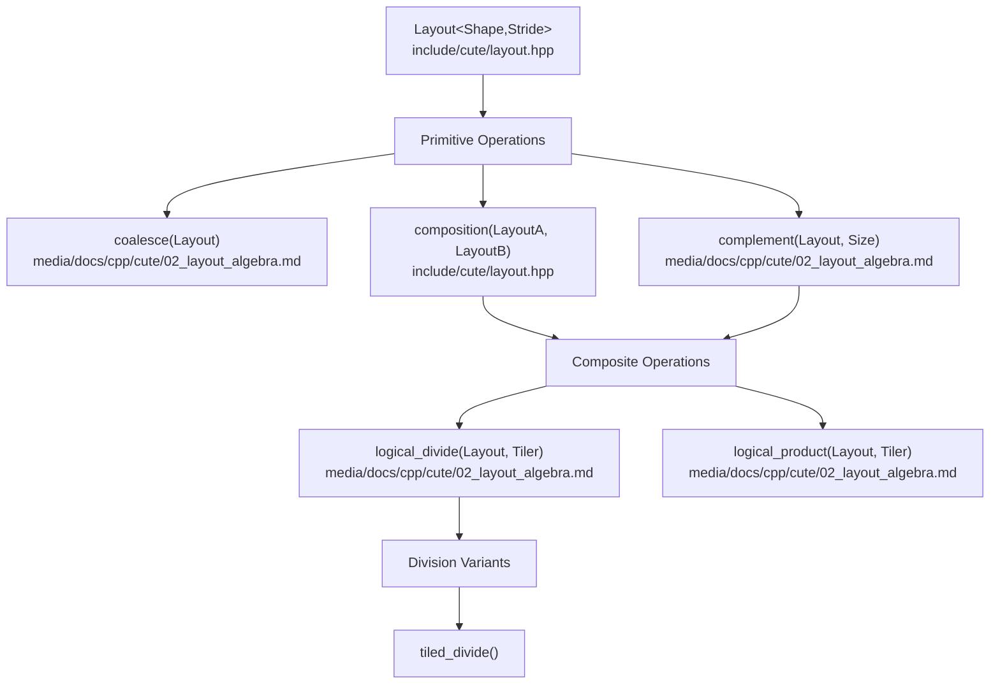
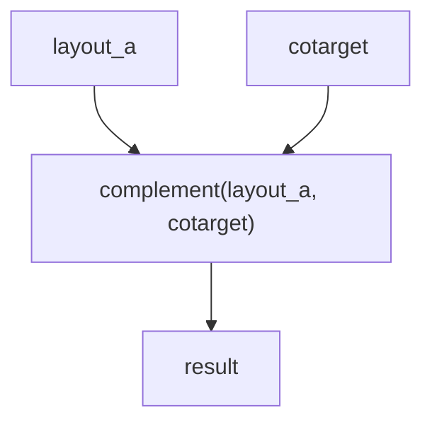
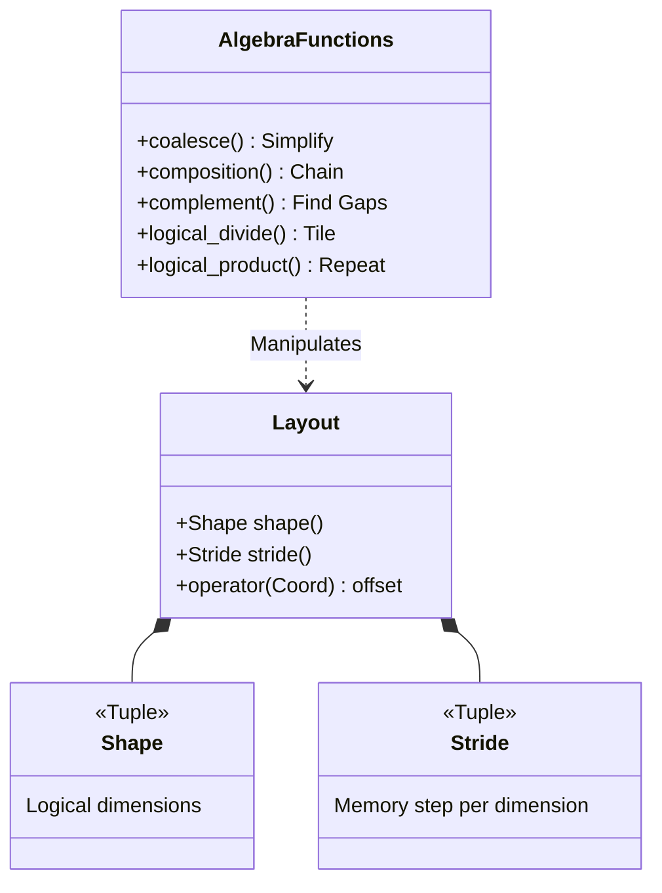

<!-- source: DeepWiki mcp.deepwiki.com · repo NVIDIA/cutlass · page 2.1 Layout Algebra · fetched 2026-10-26 -->

# Layout Algebra

<details>
<summary>Relevant source files</summary>

The following files were used as context for generating this wiki page:

- [examples/55_hopper_mixed_dtype_gemm/CMakeLists.txt](examples/55_hopper_mixed_dtype_gemm/CMakeLists.txt)
- [include/cute/algorithm/axpby.hpp](include/cute/algorithm/axpby.hpp)
- [include/cute/algorithm/tuple_algorithms.hpp](include/cute/algorithm/tuple_algorithms.hpp)
- [include/cute/container/tuple.hpp](include/cute/container/tuple.hpp)
- [include/cute/layout.hpp](include/cute/layout.hpp)
- [include/cute/numeric/arithmetic_tuple.hpp](include/cute/numeric/arithmetic_tuple.hpp)
- [include/cute/tensor_impl.hpp](include/cute/tensor_impl.hpp)
- [include/cutlass/detail/helper_macros.hpp](include/cutlass/detail/helper_macros.hpp)
- [include/cutlass/detail/layout.hpp](include/cutlass/detail/layout.hpp)
- [include/cutlass/epilogue/collective/sm90_epilogue_tma_warpspecialized.hpp](include/cutlass/epilogue/collective/sm90_epilogue_tma_warpspecialized.hpp)
- [include/cutlass/functional.h](include/cutlass/functional.h)
- [include/cutlass/gemm/collective/sm120_blockscaled_sparse_mma_tma.hpp](include/cutlass/gemm/collective/sm120_blockscaled_sparse_mma_tma.hpp)
- [include/cutlass/gemm/gemm.h](include/cutlass/gemm/gemm.h)
- [include/cutlass/wmma_array.h](include/cutlass/wmma_array.h)
- [media/docs/cpp/cute/02_layout_algebra.md](media/docs/cpp/cute/02_layout_algebra.md)
- [media/docs/cpp/cute/03_tensor.md](media/docs/cpp/cute/03_tensor.md)
- [media/docs/cpp/cute/0t_mma_atom.md](media/docs/cpp/cute/0t_mma_atom.md)
- [media/docs/cpp/cute/0x_gemm_tutorial.md](media/docs/cpp/cute/0x_gemm_tutorial.md)
- [test/unit/core/functional.cu](test/unit/core/functional.cu)
- [test/unit/layout/tensor.cu](test/unit/layout/tensor.cu)
- [test/unit/layout/tensor_nhwc.cu](test/unit/layout/tensor_nhwc.cu)
- [tools/util/include/cutlass/util/packed_stride.hpp](tools/util/include/cutlass/util/packed_stride.hpp)

</details>


## Overview

A `Layout` is CuTe's fundamental abstraction for describing data organization. The core principle is:

> **Layouts are functions from integers to integers.**

This function maps logical coordinates (how you think about data) to memory offsets (where data actually lives). The `Layout` class in [include/cute/layout.hpp:98-101]() implements this as a combination of a `Shape` and a `Stride`.

```cpp
template <class Shape, class Stride = LayoutLeft::Apply<Shape>>
struct Layout : private cute::tuple<Shape, Stride> {
  // Function application: coordinate -> offset
  template <class Coord>
  CUTE_HOST_DEVICE constexpr
  auto operator()(Coord const& coord) const;
};
```

### Shape and Stride

A `Layout` is constructed from two hierarchical tuples:

- **Shape**: The domain of the function. Defines the logical extent in each dimension. A shape `(M,N)` means coordinates range from `(0,0)` to `(M-1,N-1)`. [media/docs/cpp/cute/02_layout_algebra.md:15-18]()
- **Stride**: How the function maps coordinates to offsets. For coordinate `(i,j)` and stride `(d0,d1)`, the offset is `i*d0 + j*d1`. [media/docs/cpp/cute/02_layout_algebra.md:43-48]()

Both `Shape` and `Stride` can be:
- **Static integers**: `Int<N>` known at compile time. [include/cute/layout.hpp:48-51]()
- **Dynamic integers**: Runtime values.
- **Nested tuples**: Hierarchical modes like `Shape<_2, Shape<_1, _6>>`. [media/docs/cpp/cute/02_layout_algebra.md:31-32]()

Example from [media/docs/cpp/cute/02_layout_algebra.md:83-103]():

```cpp
// 2D layout: 6x2 matrix
Layout A = make_layout(make_shape(6, 2),        // Shape:  (6,2)
                       make_stride(8, 2));       // Stride: (8,2)

// Evaluation: A(3,1) = 3*8 + 1*2 = 26
```

### The Algebra Operations

The Layout algebra supports combining and transforming these functions:

| Operation | Function | Purpose |
|-----------|----------|---------|
| Simplification | `coalesce` | Reduce modes without changing mapping |
| Composition | `composition` | Chain two layouts as functions |
| Complement | `complement` | Find "rest" elements not in layout |
| Division | `logical_divide` | Split layout into tile and remainder |
| Product | `logical_product` | Replicate layout pattern |

Sources: [include/cute/layout.hpp:98-217](), [media/docs/cpp/cute/02_layout_algebra.md:1-20]()

---

## Fundamental Operations

The layout algebra builds a hierarchy of operations, where primitive operations serve as building blocks for high-level tiling and partitioning.



**Diagram: Layout Algebra Operation Hierarchy**

Sources: [media/docs/cpp/cute/02_layout_algebra.md:1-15](), [include/cute/layout.hpp:186-234]()

---

## Coalesce

The `coalesce` operation simplifies a layout by reducing its number of modes while preserving it as a mathematical function. [media/docs/cpp/cute/02_layout_algebra.md:13-18]()

### Function Signature

The postconditions guarantee functional equivalence: [media/docs/cpp/cute/02_layout_algebra.md:21-26]()

```cpp
// @post size(@a result) == size(@a layout)
// @post depth(@a result) <= 1
// @post for all i, 0 <= i < size(@a layout), @a result(i) == @a layout(i)
Layout coalesce(Layout const& layout)
```

### Coalescing Rules

The implementation applies binary transformation rules to adjacent integral modes `s0:d0` and `s1:d1`: [media/docs/cpp/cute/02_layout_algebra.md:43-48]()

| Case | Pattern | Result | Description |
|------|---------|--------|-------------|
| 1 | `s0:d0 ++ _1:d1` | `s0:d0` | Ignore static-1 size modes |
| 2 | `_1:d0 ++ s1:d1` | `s1:d1` | Ignore static-1 size modes |
| 3 | `s0:d0 ++ s1:(s0*d0)` | `(s0*s1):d0` | Merge contiguous modes |
| 4 | `s0:d0 ++ s1:d1` | `(s0,s1):(d0,d1)` | Cannot merge |

Example: [media/docs/cpp/cute/02_layout_algebra.md:31-34]()
```cpp
auto layout = Layout<Shape <_2,Shape <_1,_6>>,
                     Stride<_1,Stride<_6,_2>>>{};
auto result = coalesce(layout);  // Result: _12:_1
```

### By-mode Coalesce
An overload exists to coalesce specific sublayouts while maintaining a target profile (e.g., keeping a layout 2-D). [media/docs/cpp/cute/02_layout_algebra.md:58-60]()

```cpp
Layout coalesce(Layout const& layout, IntTuple const& trg_profile)
```

Sources: [media/docs/cpp/cute/02_layout_algebra.md:13-75]()

---

## Composition

Functional composition `A ∘ B` creates a new layout where `R(c) = A(B(c))`. [media/docs/cpp/cute/02_layout_algebra.md:79-85]()


**Diagram: composition(layout_a, layout_b) Data Flow**

### Post-Conditions

```cpp
// @post compatible(@a layout_b, @a result)
// @post for all i, 0 <= i < size(@a layout_b), 
//       @a result(i) == @a layout_a(@a layout_b(i))
Layout composition(LayoutA const& layout_a, LayoutB const& layout_b)
```
[media/docs/cpp/cute/02_layout_algebra.md:120-124]()

### Computing Composition

Composition is computed by distributing over sublayouts. For integral `B = s:d`, it determines a layout that produces every `d`-th element of `A` and keeps the first `s` elements. This often involves "dividing out" elements from the shape of `A`. [media/docs/cpp/cute/02_layout_algebra.md:132-148]()

Sources: [media/docs/cpp/cute/02_layout_algebra.md:77-336](), [include/cute/layout.hpp:189-194]()

---

## Complement

The `complement` operation finds a layout representing elements NOT touched by the input layout, effectively describing "the rest" or "layout of repetitions." [media/docs/cpp/cute/02_layout_algebra.md:338-341]()



**Diagram: complement() Operation**

### Properties

1. **Bounded Size**: The complement completes the codomain up to `size(cotarget)`. [media/docs/cpp/cute/02_layout_algebra.md:354-358]()
2. **Ordered**: Strides are positive and increasing. [media/docs/cpp/cute/02_layout_algebra.md:347-350]()
3. **Disjoint**: No overlap between `A` and its complement. [media/docs/cpp/cute/02_layout_algebra.md:350-352]()

Sources: [media/docs/cpp/cute/02_layout_algebra.md:338-380]()

---

## Division (Tiling)

Division operations split a layout into tile and rest components. [media/docs/cpp/cute/02_layout_algebra.md:381-385]()

### Logical Divide

$$A \oslash B := A \circ (B, \text{complement}(B, \text{size}(A)))$$
[media/docs/cpp/cute/02_layout_algebra.md:387-390]()

Result structure:
- **Mode 0**: Elements in the tile.
- **Mode 1**: Elements in the rest.

### Usage Pattern: local_tile

The `local_tile` function partitions global tensors across thread blocks. [media/docs/cpp/cute/0x_gemm_tutorial.md:129-132]()

```cpp
// Example from sgemm_1.cu
auto cta_tiler = make_shape(Int<128>{}, Int<128>{}, Int<8>{});
auto cta_coord = make_coord(blockIdx.x, blockIdx.y, _);
Tensor gA = local_tile(mA, cta_tiler, cta_coord, Step<_1, X, _1>{}); 
```
[media/docs/cpp/cute/0x_gemm_tutorial.md:118-127]()

Sources: [media/docs/cpp/cute/02_layout_algebra.md:381-481](), [media/docs/cpp/cute/0x_gemm_tutorial.md:116-132]()

---

## Product (Tiling)

Product operations replicate a layout pattern according to another layout. [media/docs/cpp/cute/02_layout_algebra.md:482-486]()

### Logical Product

$$A \otimes B := (A, \text{complement}(A, \text{size}(A) \cdot \text{cosize}(B)) \circ B)$$
[media/docs/cpp/cute/02_layout_algebra.md:488-491]()

### Blocked vs. Raked Products

- **blocked_product**: Results in contiguous blocks. [media/docs/cpp/cute/02_layout_algebra.md:545-555]()
- **raked_product**: Results in interleaved (cyclical) distribution. [media/docs/cpp/cute/02_layout_algebra.md:557-569]()

Sources: [media/docs/cpp/cute/02_layout_algebra.md:482-583]()

---

## Code Entity Reference

### Mapping to Natural Language Space


**Diagram: Layout Algebra Code Entities**

### Key Classes and Functions

| Entity | Source | Role |
|--------|--------|------|
| `Layout` | [include/cute/layout.hpp:99]() | Core mapping class |
| `coalesce` | [media/docs/cpp/cute/02_layout_algebra.md:25]() | Mode simplification |
| `composition` | [media/docs/cpp/cute/02_layout_algebra.md:123]() | Functional chaining |
| `complement` | [media/docs/cpp/cute/02_layout_algebra.md:344]() | Gap filling |
| `logical_divide` | [media/docs/cpp/cute/02_layout_algebra.md:387]() | Tiling logic |
| `local_tile` | [media/docs/cpp/cute/0x_gemm_tutorial.md:129]() | Tensor partitioning |
| `Tensor` | [media/docs/cpp/cute/03_tensor.md:7]() | Container deploying Layouts |
| `ArithmeticTuple` | [include/cute/numeric/arithmetic_tuple.hpp:45]() | Support for tuple arithmetic in coordinates |

Sources: [media/docs/cpp/cute/02_layout_algebra.md](), [media/docs/cpp/cute/03_tensor.md](), [media/docs/cpp/cute/0x_gemm_tutorial.md](), [include/cute/layout.hpp](), [include/cute/numeric/arithmetic_tuple.hpp]()

---

