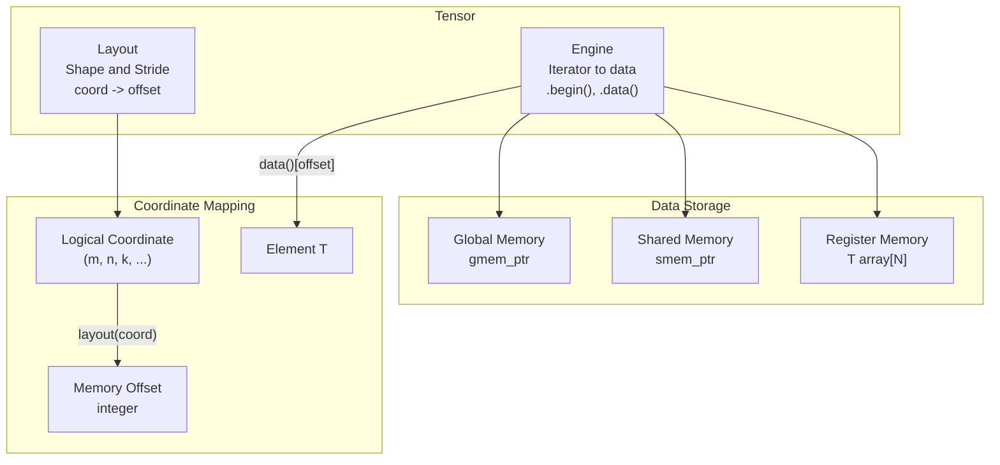
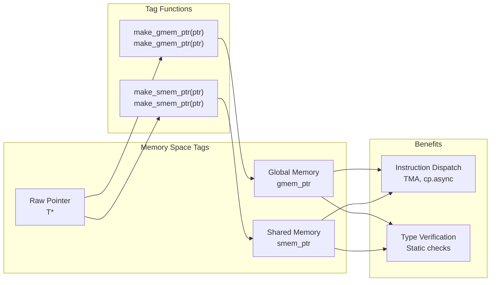
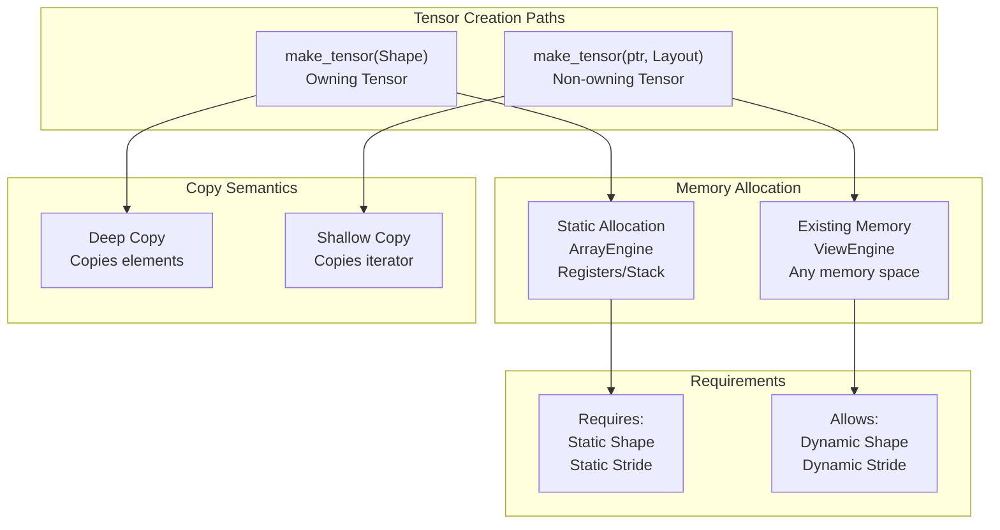
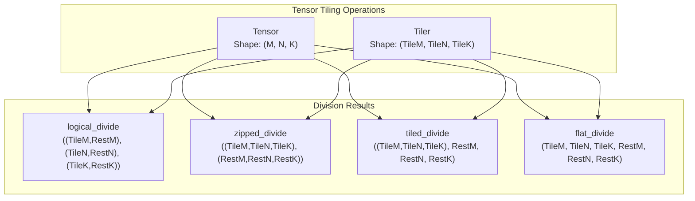
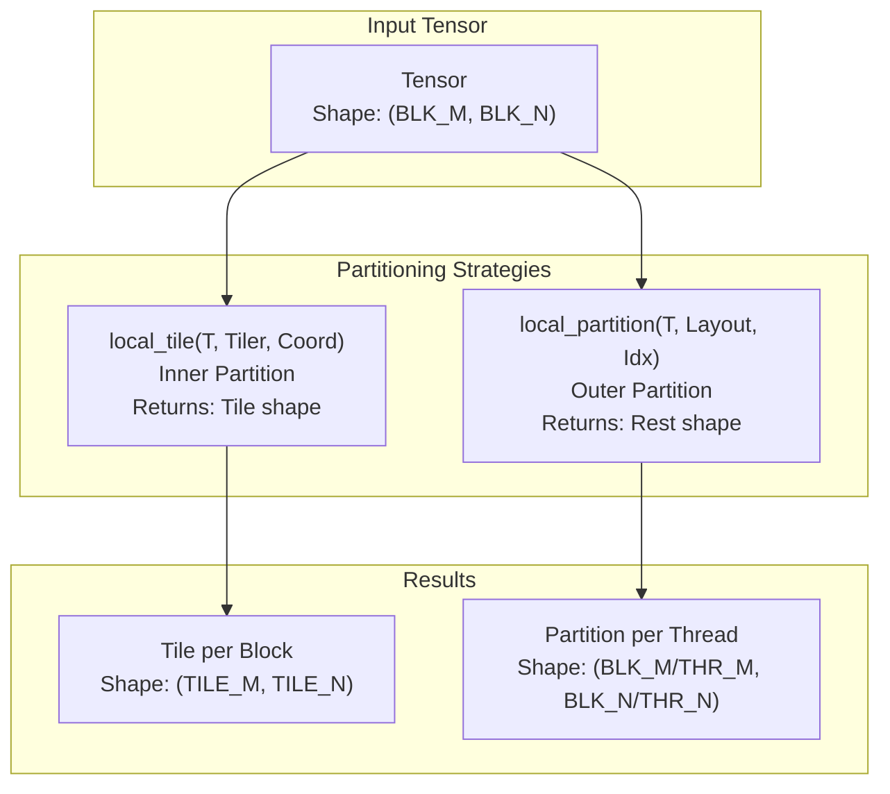

<!-- source: DeepWiki mcp.deepwiki.com · repo NVIDIA/cutlass · page 2.2 Tensor Container and Operations · fetched 2026-10-26 -->

# Tensor Container and Operations

<details>
<summary>Relevant source files</summary>

The following files were used as context for generating this wiki page:

- [include/cute/algorithm/copy.hpp](include/cute/algorithm/copy.hpp)
- [include/cute/arch/copy.hpp](include/cute/arch/copy.hpp)
- [include/cute/atom/copy_atom.hpp](include/cute/atom/copy_atom.hpp)
- [include/cute/atom/copy_traits.hpp](include/cute/atom/copy_traits.hpp)
- [include/cute/container/tuple.hpp](include/cute/container/tuple.hpp)
- [include/cute/layout.hpp](include/cute/layout.hpp)
- [include/cute/numeric/arithmetic_tuple.hpp](include/cute/numeric/arithmetic_tuple.hpp)
- [include/cute/swizzle_layout.hpp](include/cute/swizzle_layout.hpp)
- [include/cute/tensor.hpp](include/cute/tensor.hpp)
- [include/cute/tensor_impl.hpp](include/cute/tensor_impl.hpp)
- [include/cutlass/detail/helper_macros.hpp](include/cutlass/detail/helper_macros.hpp)
- [include/cutlass/epilogue/collective/sm90_epilogue_tma_warpspecialized.hpp](include/cutlass/epilogue/collective/sm90_epilogue_tma_warpspecialized.hpp)
- [include/cutlass/functional.h](include/cutlass/functional.h)
- [include/cutlass/gemm/collective/sm120_blockscaled_sparse_mma_tma.hpp](include/cutlass/gemm/collective/sm120_blockscaled_sparse_mma_tma.hpp)
- [include/cutlass/wmma_array.h](include/cutlass/wmma_array.h)
- [media/docs/cpp/cute/02_layout_algebra.md](media/docs/cpp/cute/02_layout_algebra.md)
- [media/docs/cpp/cute/03_tensor.md](media/docs/cpp/cute/03_tensor.md)
- [media/docs/cpp/cute/0t_mma_atom.md](media/docs/cpp/cute/0t_mma_atom.md)
- [media/docs/cpp/cute/0x_gemm_tutorial.md](media/docs/cpp/cute/0x_gemm_tutorial.md)
- [test/unit/core/functional.cu](test/unit/core/functional.cu)
- [test/unit/layout/tensor.cu](test/unit/layout/tensor.cu)
- [test/unit/layout/tensor_nhwc.cu](test/unit/layout/tensor_nhwc.cu)

</details>


## Purpose and Scope

This page documents the `Tensor` abstraction in CuTe, which represents multidimensional arrays by combining an `Engine` (data storage) with a `Layout` (indexing function). `Tensor` serves as the primary container for manipulating data in CUTLASS kernels, providing operations for creation, access, tiling, slicing, and partitioning across threads and threadblocks.

For information about the `Layout` algebra that underpins tensor indexing, see [Layout Algebra](2.1). For information about how tensors are used with MMA instructions, see [MMA Atoms and TiledMMA](2.3). For information about tensor movement operations, see [Copy Atoms and TMA](2.4).

## Tensor Structure

A `Tensor` is defined by two template parameters: `Engine` and `Layout` [include/cute/tensor_impl.hpp:135-137](). The `Engine` provides an iterator to data (in global memory, shared memory, or registers), while the `Layout` defines the logical coordinate space and maps coordinates to memory offsets.

Title: Tensor Data Access Pattern


Sources: [media/docs/cpp/cute/03_tensor.md:1-11](), [include/cute/tensor_impl.hpp:135-152]()

### Core Components

The fundamental operation of a `Tensor` is element access, implemented by composing the engine's data pointer with the layout's coordinate mapping [media/docs/cpp/cute/03_tensor.md:9-11]().

```cpp
// include/cute/tensor_impl.hpp:196-200
template <class Coord>
CUTE_HOST_DEVICE constexpr
decltype(auto)
operator[](Coord const& coord) const {
  return data()[layout()(coord)];
}
```

This separation allows concerns of data storage to be handled by the `Engine` while indexing logic is encapsulated in the `Layout`.

Sources: [include/cute/tensor_impl.hpp:196-200](), [media/docs/cpp/cute/03_tensor.md:186-192]()

## Engine Types

The `Engine` concept provides a minimal interface for accessing data through an iterator [include/cute/tensor_impl.hpp:62-68](). CuTe defines three primary engine types:

| Engine Type | Ownership | Use Case | Implementation |
|-------------|-----------|----------|----------------|
| `ArrayEngine<T,N>` | Owning | Static allocation (registers, stack) | [include/cute/tensor_impl.hpp:70-84]() |
| `ViewEngine<Iter>` | Non-owning | Mutable view of existing memory | [include/cute/tensor_impl.hpp:106-117]() |
| `ConstViewEngine<Iter>` | Non-owning | Read-only view of existing memory | [include/cute/tensor_impl.hpp:119-129]() |

`ArrayEngine` uses `array_aligned` or `array_subbyte` depending on the bit-width of type `T` to ensure correct memory alignment [include/cute/tensor_impl.hpp:73-75](). CuTe also provides a specialized `ArrayEngine` for `sparse_elem<S,T>` to support block-scaled or sparse tensor core operations [include/cute/tensor_impl.hpp:89-104]().

Sources: [include/cute/tensor_impl.hpp:70-129](), [media/docs/cpp/cute/03_tensor.md:42-56](), [include/cutlass/gemm/collective/sm120_blockscaled_sparse_mma_tma.hpp:89-104]()

### Tagged Iterators

CuTe uses tagged pointers to identify memory spaces, enabling dispatch to optimized instructions and verifying memory safety [media/docs/cpp/cute/03_tensor.md:57-68]().

Title: Memory Space Tagging System


Sources: [media/docs/cpp/cute/03_tensor.md:57-74](), [include/cute/tensor_impl.hpp:47-48]()

## Tensor Creation

### Non-Owning Tensors

Non-owning tensors are views over existing memory, created with `make_tensor(iterator, layout)` [media/docs/cpp/cute/03_tensor.md:95-98]().

```cpp
float* A = ...;

// Untagged pointer
Tensor tensor_8 = make_tensor(A, make_layout(Int<8>{}));

// Global memory (static layout)
Tensor gmem_8 = make_tensor(make_gmem_ptr(A), Int<8>{});

// Shared memory (dynamic layout)
__shared__ float smem[32];
Tensor smem_4x8 = make_tensor(make_smem_ptr(smem), 
                              make_shape(4, 8));
```

Non-owning tensors can have static or dynamic layouts. When copied, they perform a shallow copy of the metadata [media/docs/cpp/cute/03_tensor.md:83-85]().

Sources: [media/docs/cpp/cute/03_tensor.md:94-127]()

### Owning Tensors

Owning tensors allocate storage (analogous to `std::array<T,N>`), created with `make_tensor<T>(layout)` [media/docs/cpp/cute/03_tensor.md:144-148]().

```cpp
// Register memory (static layouts only)
Tensor rmem_4x8_col = make_tensor<float>(Shape<_4,_8>{});
Tensor rmem_4x8_row = make_tensor<float>(Shape<_4,_8>{}, LayoutRight{});

// Make a tensor with same shape as another
Tensor rmem_like = make_tensor_like(rmem_4x8_col);
```

Owning tensors require static shapes and strides for compile-time memory allocation [media/docs/cpp/cute/03_tensor.md:149-152](). When copied, they perform a deep copy of the element data [media/docs/cpp/cute/03_tensor.md:79-81]().

Sources: [media/docs/cpp/cute/03_tensor.md:144-176](), [include/cute/tensor_impl.hpp:70-84]()

Title: Tensor Creation and Copy Semantics


Sources: [media/docs/cpp/cute/03_tensor.md:76-92]()

## Hierarchical Operations

`Tensor` provides a hierarchical interface similar to `Layout` for introspection [media/docs/cpp/cute/03_tensor.md:27-40]():

| Operation | Description | Implementation |
|-----------|-------------|----------------|
| `rank<I...>(tensor)` | Rank of the I-th mode | [include/cute/tensor_impl.hpp:158]() |
| `depth<I...>(tensor)` | Depth of the I-th mode | [media/docs/cpp/cute/03_tensor.md:31]() |
| `shape<I...>(tensor)` | Shape of the I-th mode | [media/docs/cpp/cute/03_tensor.md:33]() |
| `size<I...>(tensor)` | Size of the I-th mode | [media/docs/cpp/cute/03_tensor.md:35]() |
| `layout<I...>(tensor)` | Layout of the I-th mode | [media/docs/cpp/cute/03_tensor.md:37]() |
| `tensor<I...>(tensor)` | Subtensor at the I-th mode | [include/cute/tensor_impl.hpp:161]() |
| `.data()` | Iterator to underlying data | [include/cute/tensor_impl.hpp:180]() |

Sources: [media/docs/cpp/cute/03_tensor.md:13-40](), [include/cute/tensor_impl.hpp:158-188]()

## Accessing Tensor Elements

Tensors support coordinate-based element access through `operator[]` and variadic `operator()` [media/docs/cpp/cute/03_tensor.md:21-25]():

```cpp
Tensor A = make_tensor<float>(Shape<Shape<_4,_5>,Int<13>>{},
                              Stride<Stride<_12,_1>,_64>{});

// Access via operator[] with coordinate tuples
A[make_coord(make_coord(2,3),5)]

// Access via variadic operator()
A(make_coord(2,3), 5)
A(2, 3, 5)  // Equivalent using implicit make_coord
```

Element access is implemented by retrieving the iterator from the engine and offsetting it using the result of the layout's coordinate-to-index mapping [include/cute/tensor_impl.hpp:196-200]().

Sources: [media/docs/cpp/cute/03_tensor.md:178-216](), [include/cute/tensor_impl.hpp:196-224]()

## Tiling and Partitioning Operations

Layout algebra operations apply directly to tensors, transforming the layout while preserving the underlying engine [media/docs/cpp/cute/03_tensor.md:220-222]().

| Operation | Description | Result Shape |
|-----------|-------------|--------------|
| `composition(T, Tiler)` | Extract subtensor according to tiler | `Tiler` shape |
| `logical_divide(T, Tiler)` | Split into tile and rest modes | `((Tile),(Rest))` |
| `zipped_divide(T, Tiler)` | Group tile modes and rest modes | `((Tile),(Rest))` |
| `tiled_divide(T, Tiler)` | Flatten tile, separate rest | `((Tile),Rest...)` |
| `flat_divide(T, Tiler)` | Fully flatten result | `(Tile...,Rest...)` |

Title: Tensor Division Operations


Sources: [media/docs/cpp/cute/03_tensor.md:220-233](), [media/docs/cpp/cute/02_layout_algebra.md:381-583]()

### Partitioning Strategies

Inner partitioning (`local_tile`) extracts a single tile for a specific agent, retaining tile modes [media/docs/cpp/cute/03_tensor.md:282-286](). Outer partitioning (`local_partition`) assigns elements within a tile to specific agents, retaining rest modes [media/docs/cpp/cute/03_tensor.md:299-302]().

Title: Tensor Partitioning Logic


Sources: [media/docs/cpp/cute/03_tensor.md:277-332](), [media/docs/cpp/cute/0x_gemm_tutorial.md:282-344]()

## Slicing Operations

Slicing a tensor specifies coordinates for some modes while retaining others using the underscore (`_`) placeholder [media/docs/cpp/cute/03_tensor.md:236-240]().

```cpp
// Slice mode-0 at coordinate 2, keep mode-1
Tensor B = A(2,_);  

// Mixed slicing
Tensor E = A(make_coord(_,1), make_coord(0,_,1));
```

Slicing is implemented by `operator()` when passed an `Underscore` or a tuple containing an `Underscore` [include/cute/layout.hpp:168-170](). This invokes the `slice` function which calculates a new pointer offset and a reduced layout.

Sources: [media/docs/cpp/cute/03_tensor.md:236-275](), [include/cute/layout.hpp:164-175]()

---

**Copyright**

Copyright (c) 2017 - 2026 NVIDIA CORPORATION & AFFILIATES. All rights reserved.
SPDX-License-Identifier: BSD-3-Clause

---

