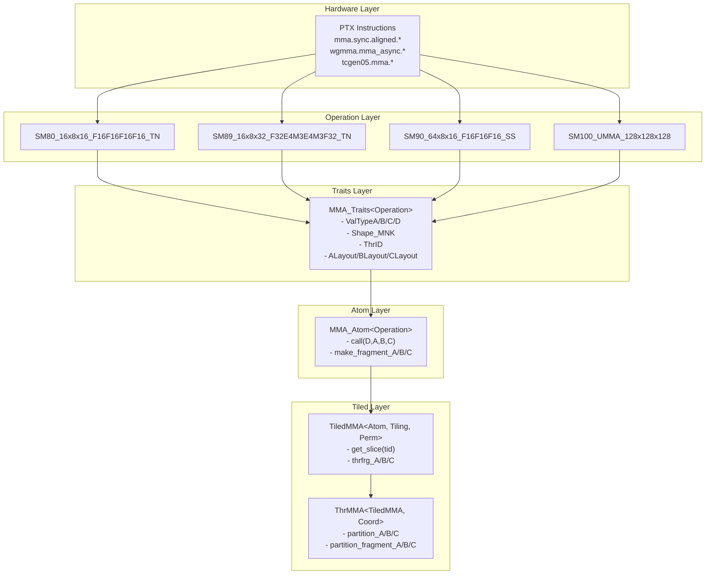
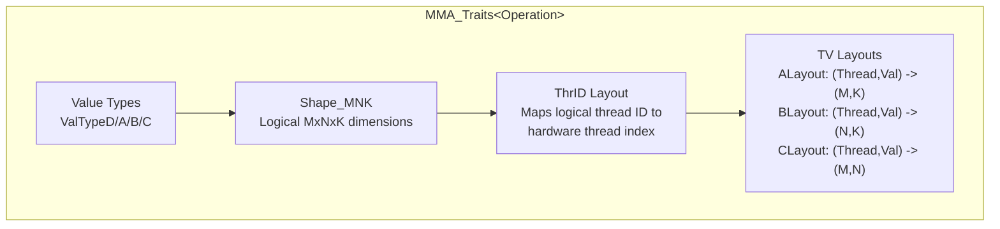
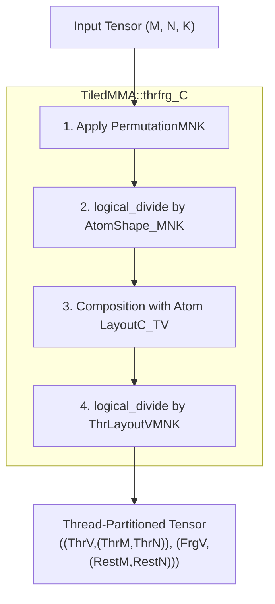

<!-- source: DeepWiki mcp.deepwiki.com · repo NVIDIA/cutlass · page 2.3 MMA Atoms and TiledMMA · fetched 2026-10-26 -->

# MMA Atoms and TiledMMA

<details>
<summary>Relevant source files</summary>

The following files were used as context for generating this wiki page:

- [include/cute/arch/mma_sm80.hpp](include/cute/arch/mma_sm80.hpp)
- [include/cute/arch/mma_sm89.hpp](include/cute/arch/mma_sm89.hpp)
- [include/cute/arch/mma_sm90.hpp](include/cute/arch/mma_sm90.hpp)
- [include/cute/arch/mma_sm90_gmma.hpp](include/cute/arch/mma_sm90_gmma.hpp)
- [include/cute/arch/mma_sm90_gmma_ext.hpp](include/cute/arch/mma_sm90_gmma_ext.hpp)
- [include/cute/arch/mma_sm90_gmma_sparse.hpp](include/cute/arch/mma_sm90_gmma_sparse.hpp)
- [include/cute/arch/mma_sm90_gmma_sparse_ext.hpp](include/cute/arch/mma_sm90_gmma_sparse_ext.hpp)
- [include/cute/atom/mma_atom.hpp](include/cute/atom/mma_atom.hpp)
- [include/cute/atom/mma_traits_sm80.hpp](include/cute/atom/mma_traits_sm80.hpp)
- [include/cute/atom/mma_traits_sm89.hpp](include/cute/atom/mma_traits_sm89.hpp)
- [include/cute/atom/mma_traits_sm90_gmma.hpp](include/cute/atom/mma_traits_sm90_gmma.hpp)
- [include/cute/atom/mma_traits_sm90_gmma_ext.hpp](include/cute/atom/mma_traits_sm90_gmma_ext.hpp)
- [include/cute/atom/mma_traits_sm90_gmma_sparse.hpp](include/cute/atom/mma_traits_sm90_gmma_sparse.hpp)
- [include/cute/atom/mma_traits_sm90_gmma_sparse_ext.hpp](include/cute/atom/mma_traits_sm90_gmma_sparse_ext.hpp)
- [include/cute/container/array_subbyte.hpp](include/cute/container/array_subbyte.hpp)
- [include/cute/numeric/integral_constant.hpp](include/cute/numeric/integral_constant.hpp)
- [test/unit/cute/ampere/cooperative_gemm.cu](test/unit/cute/ampere/cooperative_gemm.cu)

</details>


## Purpose and Scope

This document describes the MMA (Matrix Multiply-Accumulate) abstraction layer in CuTe, which wraps hardware tensor core instructions into composable C++ objects. MMA Atoms encapsulate architecture-specific matrix multiplication operations, while TiledMMA provides utilities for tiling and distributing these atoms across thread groups.

For information about Layout algebra and tensor manipulation, see [2.1 Layout Algebra](). For tensor containers and operations, see [2.2 Tensor Container and Operations](). For copy operations and data movement, see [2.4 Copy Atoms and TMA Operations]().

## Architecture Overview

The MMA abstraction is built in three layers: Operation structs that wrap PTX instructions, `MMA_Traits` that define metadata, and `MMA_Atom`/`TiledMMA` classes that provide high-level interfaces.

### MMA Abstraction Hierarchy



Sources: [include/cute/atom/mma_atom.hpp:41-54](), [include/cute/atom/mma_atom.hpp:198-210](), [include/cute/arch/mma_sm80.hpp:92-120](), [include/cute/arch/mma_sm90_gmma.hpp:133-172]()

## Operation Structs

Operation structs are minimal wrappers around PTX MMA instructions. They define register types and provide a static `fma` function that executes the hardware instruction.

### Operation Struct Components

Each Operation struct contains:

| Component | Purpose | Example |
|-----------|---------|---------|
| `DRegisters` | Output register array type | `uint32_t[2]` [include/cute/arch/mma_sm80.hpp:94]() |
| `ARegisters` | A-matrix register array type | `uint32_t[4]` [include/cute/arch/mma_sm80.hpp:95]() |
| `BRegisters` | B-matrix register array type | `uint32_t[2]` [include/cute/arch/mma_sm80.hpp:96]() |
| `CRegisters` | Accumulator register array type | `uint32_t[2]` [include/cute/arch/mma_sm80.hpp:97]() |
| `fma` | Static device function wrapping PTX | Calls `asm volatile(...)` [include/cute/arch/mma_sm80.hpp:105-116]() |

### Naming Convention

Operation struct names encode the instruction specification:
`SM{ARCH}_{M}x{N}x{K}_{TypeD}{TypeA}{TypeB}{TypeC}_{Layout}`

For example, `SM89_16x8x32_F32E4M3E4M3F32_TN`:
- `SM89`: Ada architecture (compute capability 8.9) [include/cute/arch/mma_sm89.hpp:64]()
- `16x8x32`: M=16, N=8, K=32 dimensions
- `F32E4M3E4M3F32`: D=float, A=E4M3, B=E4M3, C=float [include/cute/arch/mma_sm89.hpp:66-69]()
- `TN`: A is transposed (K-major), B is not transposed (N-major)

Sources: [include/cute/arch/mma_sm89.hpp:64-91](), [include/cute/arch/mma_sm80.hpp:92-121]()

## MMA_Traits Specializations

`MMA_Traits` specializations define the logical metadata for each Operation. They describe the value types, operation shape, thread organization, and thread-value layouts.

### MMA_Traits Members



Sources: [include/cute/atom/mma_traits.hpp:42-65](), [include/cute/atom/mma_traits_sm80.hpp:78-92]()

### Thread-Value (TV) Layouts

The `ALayout`, `BLayout`, and `CLayout` members define how threads and values map to matrix coordinates. These are Layout objects with shape `(NumThreads, NumValues)` that map to `(M,K)`, `(N,K)`, or `(M,N)` coordinates respectively.

#### Example: Ampere SM80 Traits

For the `SM80_16x8x16_F16F16F16F16_TN` operation:
- `Shape_MNK = Shape<_16,_8,_16>` [include/cute/atom/mma_traits_sm80.hpp:86]()
- `ThrID = Layout<_32>` (Standard 32-thread warp) [include/cute/atom/mma_traits_sm80.hpp:87]()
- `ALayout`: Maps 32 threads and 8 values to 16x16 coordinates [include/cute/atom/mma_traits_sm80.hpp:87-88]()

Sources: [include/cute/atom/mma_traits_sm80.hpp:78-92]()

## MMA_Atom Class

The `MMA_Atom` class combines an Operation struct with its `MMA_Traits` to provide a complete interface for matrix multiply-accumulate operations.

### Key Methods

#### call Method
The `call` method executes the underlying MMA operation on rank-1 tensors by calling `mma_unpack` [include/cute/atom/mma_atom.hpp:104]().

```cpp
template <class TD, class DLayout, class TA, class ALayout, ...>
CUTE_HOST_DEVICE constexpr void
call(Tensor<TD, DLayout> & D, Tensor<TA, ALayout> const& A, ...) const
```
Sources: [include/cute/atom/mma_atom.hpp:88-105]()

#### Fragment Construction
`make_fragment_A/B/C` construct register tensors appropriate for the MMA operation. If the fragment type is a view (common in GMMA/UMMA), it forwards the tensor; otherwise, it creates a new tensor with a fragment layout [include/cute/atom/mma_atom.hpp:154-165]().

Sources: [include/cute/atom/mma_atom.hpp:129-172]()

## TiledMMA Class

`TiledMMA` replicates and tiles `MMA_Atom`s across multiple threads to create larger matrix multiply operations.

### Thread Layout VMNK
The `TiledMMA` computes a hierarchical thread layout `ThrLayoutVMNK` by combining the atom's thread ID with the tiling layout using `tiled_product` [include/cute/atom/mma_atom.hpp:229]().

- **Mode 0 (V)**: Threads within a single atom.
- **Mode 1 (M)**: Atom tiles in M dimension.
- **Mode 2 (N)**: Atom tiles in N dimension.
- **Mode 3 (K)**: Atom tiles in K dimension.

Sources: [include/cute/atom/mma_atom.hpp:208-236]()

### Tiled Partitioning Logic



Sources: [include/cute/atom/mma_atom.hpp:332-353](), [include/cute/atom/mma_atom.hpp:249-270]()

## ThrMMA: Per-Thread View

`ThrMMA` represents a single thread's view of a `TiledMMA`. It is obtained by calling `get_slice(thr_idx)` [include/cute/atom/mma_atom.hpp:510]().

### Partitioning and Fragments
- `partition_A/B/C`: Extracts the thread's data from a larger tensor [include/cute/atom/mma_atom.hpp:465-481]().
- `partition_fragment_A/B/C`: Partitions the tensor and then calls `make_fragment_A/B/C` to create the register-backed fragment [include/cute/atom/mma_atom.hpp:492-508]().

Sources: [include/cute/atom/mma_atom.hpp:459-520]()

## SM90 Hopper and Modern Abstractions

Modern architectures introduce asynchronous, warpgroup-level instructions.

### WGMMA (SM90 GMMA)
- **Async Execution**: Instructions are non-blocking. Requires `warpgroup_arrive()` [include/cute/arch/mma_sm90_gmma.hpp:49](), `warpgroup_commit_batch()` [include/cute/arch/mma_sm90_gmma.hpp:76](), and `warpgroup_wait<N>()` [include/cute/arch/mma_sm90_gmma.hpp:62]().
- **Shared Memory Access**: Operands are often accessed via 64-bit descriptors [include/cute/arch/mma_sm90_gmma.hpp:147-148]().
- **Layout Atoms**: CuTe provides specialized swizzled layouts like `Layout_K_SW128_Atom` to maximize throughput [include/cute/atom/mma_traits_sm90_gmma.hpp:104]().
- **Sparse Support**: Specialized traits like `MMA_Traits<SM90::GMMA::SPARSE::GMMA_64x24x32_F16F16F16_SS<...>>` handle metadata for structured sparsity [include/cute/atom/mma_traits_sm90_gmma_sparse_ext.hpp:40-59]().

Sources: [include/cute/arch/mma_sm90_gmma.hpp:45-84](), [include/cute/atom/mma_traits_sm90_gmma.hpp:71-104](), [include/cute/atom/mma_traits_sm90_gmma_sparse_ext.hpp:40-59]()

## Architecture-Specific Atoms Table

| Architecture | Example Atom | Dimension | Data Types |
|--------------|--------------|-----------|------------|
| **SM80 (Ampere)** | `SM80_16x8x16_F16F16F16F16_TN` | 16x8x16 | F16 += F16 * F16 |
| **SM89 (Ada)** | `SM89_16x8x32_F32E4M3E4M3F32_TN` | 16x8x32 | F32 += E4M3 * E4M3 |
| **SM90 (Hopper)** | `SM90_64x8x16_F16F16F16_SS` | 64x8x16 | F16 += F16 * F16 (Smem/Smem) |
| **SM90 Sparse** | `GMMA_64x24x32_F16F16F16_SS` | 64x24x32 | Sparse F16 |

Sources: [include/cute/arch/mma_sm80.hpp:92](), [include/cute/arch/mma_sm89.hpp:64](), [include/cute/arch/mma_sm90_gmma.hpp:139](), [include/cute/atom/mma_traits_sm90_gmma_sparse_ext.hpp:40]()

## Summary of Usage in Code

```cpp
// 1. Define the TiledMMA
using MMA_Op = SM80_16x8x16_F16F16F16F16_TN;
TiledMMA tiled_mma = TiledMMA<
    MMA_Atom<MMA_Op>, 
    Layout<Shape<_2,_2,_1>> // 2x2 tiling
>{};

// 2. Get thread slice
auto thr_mma = tiled_mma.get_slice(threadIdx.x);

// 3. Partition and create fragments
auto tC = thr_mma.partition_fragment_C(gC); // gC is a global tensor
auto tA = thr_mma.partition_fragment_A(gA);
auto tB = thr_mma.partition_fragment_B(gB);

// 4. Call MMA
thr_mma.call(tA, tB, tC); 
```

Sources: [test/unit/cute/ampere/cooperative_gemm.cu:47-51](), [include/cute/atom/mma_atom.hpp:510-520](), [include/cute/atom/mma_atom.hpp:92-97]()

---

