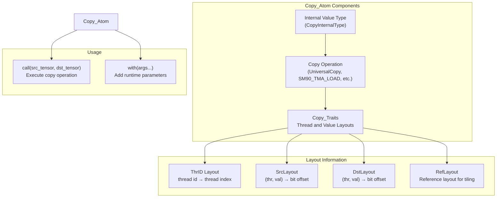
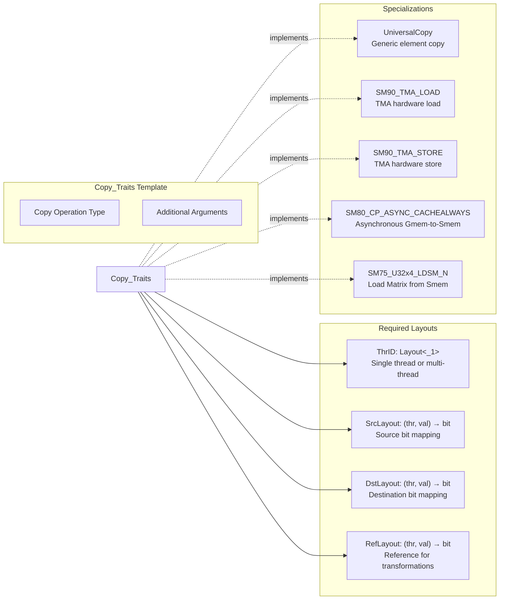
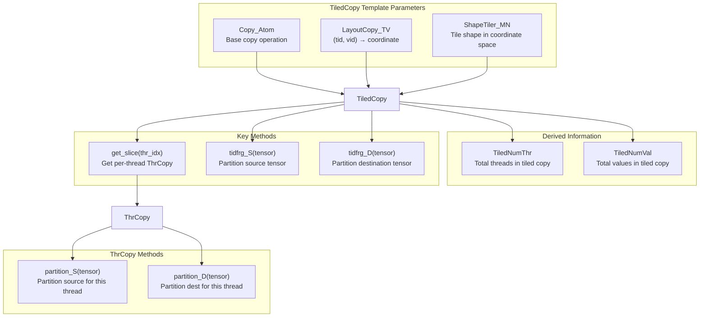
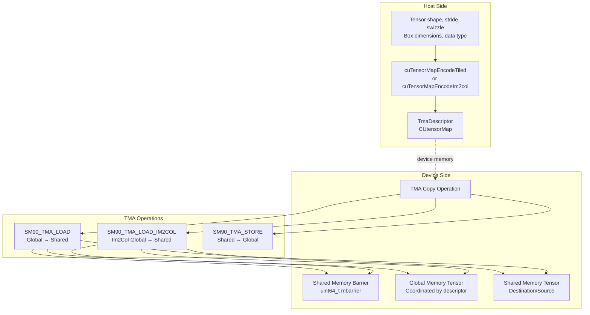

<!-- source: DeepWiki mcp.deepwiki.com · repo NVIDIA/cutlass · page 2.4 Copy Atoms and TMA Operations · fetched 2026-10-26 -->

# Copy Atoms and TMA Operations

<details>
<summary>Relevant source files</summary>

The following files were used as context for generating this wiki page:

- [CMakeLists.txt](CMakeLists.txt)
- [include/cute/arch/copy_sm75.hpp](include/cute/arch/copy_sm75.hpp)
- [include/cute/arch/copy_sm80.hpp](include/cute/arch/copy_sm80.hpp)
- [include/cute/arch/copy_sm90_desc.hpp](include/cute/arch/copy_sm90_desc.hpp)
- [include/cute/arch/util.hpp](include/cute/arch/util.hpp)
- [include/cute/atom/copy_traits_sm75.hpp](include/cute/atom/copy_traits_sm75.hpp)
- [include/cute/atom/copy_traits_sm90_im2col.hpp](include/cute/atom/copy_traits_sm90_im2col.hpp)
- [include/cute/atom/copy_traits_sm90_tma.hpp](include/cute/atom/copy_traits_sm90_tma.hpp)
- [include/cute/atom/copy_traits_sm90_tma_swizzle.hpp](include/cute/atom/copy_traits_sm90_tma_swizzle.hpp)
- [include/cutlass/arch/grid_dependency_control.h](include/cutlass/arch/grid_dependency_control.h)
- [include/cutlass/arch/memory_sm75.h](include/cutlass/arch/memory_sm75.h)
- [include/cutlass/cuda_host_adapter.hpp](include/cutlass/cuda_host_adapter.hpp)
- [include/cutlass/epilogue/collective/detail.hpp](include/cutlass/epilogue/collective/detail.hpp)
- [include/cutlass/epilogue/collective/sm90_epilogue_array_tma_warpspecialized.hpp](include/cutlass/epilogue/collective/sm90_epilogue_array_tma_warpspecialized.hpp)
- [include/cutlass/gemm/collective/sm100_mma_warpspecialized_blockwise_scaling.hpp](include/cutlass/gemm/collective/sm100_mma_warpspecialized_blockwise_scaling.hpp)
- [include/cutlass/gemm/collective/sm90_mma_array_tma_gmma_ss_warpspecialized.hpp](include/cutlass/gemm/collective/sm90_mma_array_tma_gmma_ss_warpspecialized.hpp)
- [include/cutlass/gemm/kernel/gemm_universal.hpp](include/cutlass/gemm/kernel/gemm_universal.hpp)
- [test/unit/CMakeLists.txt](test/unit/CMakeLists.txt)
- [test/unit/conv/device/conv2d_problems.h](test/unit/conv/device/conv2d_problems.h)
- [test/unit/cute/turing/CMakeLists.txt](test/unit/cute/turing/CMakeLists.txt)
- [test/unit/cute/turing/movm.cu](test/unit/cute/turing/movm.cu)

</details>


## Purpose and Scope

This document describes CuTe's abstractions for data movement operations, including `Copy_Atom` for encapsulating individual copy operations, `TiledCopy` for distributing copies across threads, and Tensor Memory Accelerator (TMA) operations available on SM90+ architectures. This page covers implementation details for `Copy_Traits`, TMA load/store operations, im2col transformations, asynchronous data movement, and tensor map encoding.

## Copy_Atom Structure

`Copy_Atom` encapsulates a single data movement operation with its thread and value layout semantics. It combines a copy operation (e.g., `UniversalCopy`, `SM90_TMA_LOAD`) with type information and layout mappings.



**Sources:** [include/cute/atom/copy_atom.hpp:44-176]()

### Basic Copy_Atom Definition

A `Copy_Atom` is parameterized by a copy operation and an internal value type:

```cpp
template <class CopyOperation, class CopyInternalType>
struct Copy_Atom : Copy_Traits<CopyOperation, CopyInternalType>
```
[include/cute/atom/copy_atom.hpp:47-49]()

The atom contains:
- **ThrID**: Maps logical thread IDs to thread indices. [include/cute/atom/copy_atom.hpp:58]()
- **ValLayoutSrc/Dst**: Maps `(thread, value)` coordinates to bit offsets in source/destination. [include/cute/atom/copy_atom.hpp:65-66]()
- **ValLayoutRef**: Reference layout for composing with `TiledCopy`. [include/cute/atom/copy_atom.hpp:67]()
- **NumValSrc/Dst**: Number of values per thread in source/destination. [include/cute/atom/copy_atom.hpp:73-74]()

**Sources:** [include/cute/atom/copy_atom.hpp:47-76]()

## Copy_Traits

`Copy_Traits` defines the abstract layout semantics for a copy operation, independent of the actual tensor being copied. Traits specify how threads and values map to bits in memory.

### Copy_Traits Structure



**Sources:** [include/cute/atom/copy_traits.hpp:40-93](), [include/cute/arch/copy_sm80.hpp:47-70](), [include/cute/arch/copy_sm75.hpp:121-139]()

## TiledCopy

`TiledCopy` distributes a `Copy_Atom` across multiple threads and values, enabling parallel data movement across a thread block. It extends a `Copy_Atom` with tiling information.

### TiledCopy Structure



**Sources:** [include/cute/atom/copy_atom.hpp:182-355]()

## Tensor Memory Accelerator (TMA)

The Tensor Memory Accelerator is a hardware unit on SM90+ GPUs that performs asynchronous data transfers between global memory and shared memory. TMA operations use descriptors created on the host to describe memory layouts and transfer patterns.

### TMA Architecture Overview



**Sources:** [include/cute/atom/copy_traits_sm90_tma.hpp:50-58](), [include/cute/atom/copy_traits_sm90_im2col.hpp:108-170](), [include/cutlass/cuda_host_adapter.hpp:151-153]()

## TMA Descriptors and Encoding

TMA descriptors (`TmaDescriptor` or `CUtensorMap`) are opaque structures created on the host that encode memory layout information. [include/cute/arch/copy_sm90_desc.hpp:114]()

### Descriptor Encoding Functions
The `CudaHostAdapter` provides wrappers for the CUDA Driver API to encode these descriptors:
- **`cuTensorMapEncodeTiled`**: Encodes a tensor map for tiled memory access. [include/cutlass/cuda_host_adapter.hpp:152]()
- **`cuTensorMapEncodeIm2col`**: Encodes a tensor map specifically for image-to-column transformations. [include/cutlass/cuda_host_adapter.hpp:153]()

### Im2Col Transformations
`SM90_TMA_LOAD_IM2COL` handles the hardware-accelerated image-to-column loading. [include/cute/atom/copy_traits_sm90_im2col.hpp:106]() It interprets the TMA coordinate as `(c, ([w,h,d]), n, ([s,r,t]))`. [include/cute/atom/copy_traits_sm90_im2col.hpp:73-75]()

## Asynchronous Data Movement

### SM80 CP.ASYNC
For SM80 (Ampere) architectures, CuTe provides `SM80_CP_ASYNC` traits to utilize the `cp.async` instruction for moving data from global to shared memory.
- **`SM80_CP_ASYNC_CACHEALWAYS`**: Uses `cp.async.ca` for caching at all levels. [include/cute/arch/copy_sm80.hpp:47-70]()
- **`SM80_CP_ASYNC_CACHEGLOBAL`**: Uses `cp.async.cg` for caching at the global level. [include/cute/arch/copy_sm80.hpp:74-97]()

### Synchronization and Barriers
SM90 TMA operations rely on `mbarrier` for synchronization. [include/cute/arch/copy_sm90_desc.hpp:56-59]()
- **`initialize_barrier`**: Initializes a 64-bit user-managed barrier in shared memory. [include/cute/arch/copy_sm90_desc.hpp:62-73]()
- **`set_barrier_transaction_bytes`**: Sets the expected transaction size in bytes for the barrier. [include/cute/arch/copy_sm90_desc.hpp:76-87]()
- **`wait_barrier`**: Blocks until the barrier phase bit flips. [include/cute/arch/copy_sm90_desc.hpp:90-110]()

## Blackwell SM100 TMA and Blockwise Scaling
The SM100 architecture introduces enhanced TMA capabilities, particularly for blockwise scaling operations where scale factors are loaded alongside tensor data.
- **`MainloopSm100TmaUmmaWarpSpecializedBlockwiseScaling`**: A dispatch policy for SM100 kernels that use blockwise scaling. [include/cutlass/gemm/collective/sm100_mma_warpspecialized_blockwise_scaling.hpp:82-87]()
- **`ScaleConfig`**: Defines the granularity of scaling across M, N, and K dimensions. [include/cutlass/gemm/collective/sm100_mma_warpspecialized_blockwise_scaling.hpp:147-151]()

## Key Classes and Functions

| Entity | File Location | Description |
|--------|---------------|-------------|
| `Copy_Atom` | [include/cute/atom/copy_atom.hpp:44-176]() | Base copy atom template |
| `SM90_TMA_LOAD` | [include/cute/atom/copy_traits_sm90_tma.hpp:98]() | Non-executable TMA load trait |
| `SM90_TMA_LOAD_IM2COL` | [include/cute/atom/copy_traits_sm90_im2col.hpp:106]() | Im2Col TMA load trait |
| `AuxTmaParams` | [include/cute/atom/copy_traits_sm90_tma.hpp:52-63]() | Strides and swizzles for TMA coord mapping |
| `TMA_LOAD_Unpack` | [include/cute/atom/copy_traits_sm90_tma.hpp:67-92]() | Unpacks TMA arguments for execution |
| `cp_async_fence` | [include/cute/arch/copy_sm80.hpp:162-169]() | Issues `cp.async.commit_group` |
| `cp_async_wait` | [include/cute/arch/copy_sm80.hpp:174-186]() | Issues `cp.async.wait_group` or `wait_all` |
| `SM75_U32x4_LDSM_N` | [include/cute/arch/copy_sm75.hpp:121-139]() | LDMatrix instruction for SM75+ |
| `CudaHostLaunchAttributes` | [include/cutlass/cuda_host_adapter.hpp:168-175]() | Manages `CUlaunchAttribute` for kernel launches |

**Sources:** [include/cute/atom/copy_atom.hpp](), [include/cute/atom/copy_traits_sm90_tma.hpp](), [include/cute/arch/copy_sm80.hpp](), [include/cute/arch/copy_sm90_desc.hpp](), [include/cute/arch/copy_sm75.hpp](), [include/cutlass/cuda_host_adapter.hpp](), [include/cutlass/gemm/collective/sm100_mma_warpspecialized_blockwise_scaling.hpp]()

---

