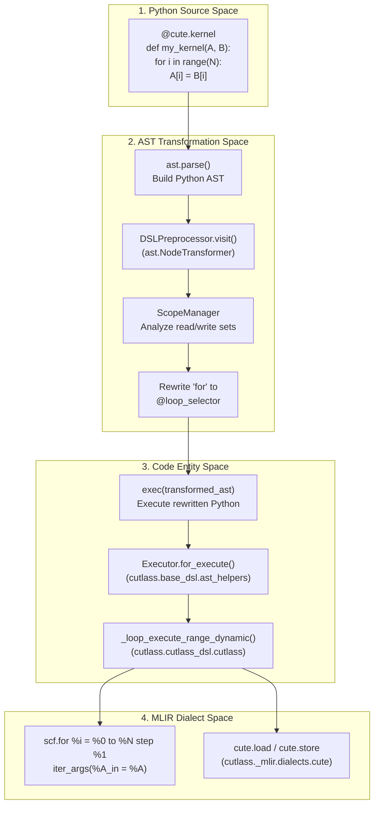
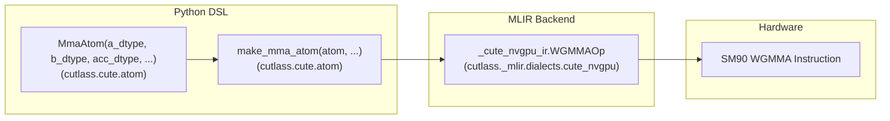

<!-- source: DeepWiki mcp.deepwiki.com · repo NVIDIA/cutlass · page 3.1 CuTe DSL Kernel Authoring · fetched 2026-10-26 -->

# CuTe DSL Kernel Authoring

<details>
<summary>Relevant source files</summary>

The following files were used as context for generating this wiki page:

- [CHANGELOG.md](CHANGELOG.md)
- [README.md](README.md)
- [include/cutlass/epilogue/dispatch_policy.hpp](include/cutlass/epilogue/dispatch_policy.hpp)
- [include/cutlass/version.h](include/cutlass/version.h)
- [python/CuTeDSL/cutlass/__init__.py](python/CuTeDSL/cutlass/__init__.py)
- [python/CuTeDSL/cutlass/base_dsl/ast_helpers.py](python/CuTeDSL/cutlass/base_dsl/ast_helpers.py)
- [python/CuTeDSL/cutlass/base_dsl/ast_preprocessor.py](python/CuTeDSL/cutlass/base_dsl/ast_preprocessor.py)
- [python/CuTeDSL/cutlass/base_dsl/env_manager.py](python/CuTeDSL/cutlass/base_dsl/env_manager.py)
- [python/CuTeDSL/cutlass/base_dsl/runtime/cuda.py](python/CuTeDSL/cutlass/base_dsl/runtime/cuda.py)
- [python/CuTeDSL/cutlass/base_dsl/utils/logger.py](python/CuTeDSL/cutlass/base_dsl/utils/logger.py)
- [python/CuTeDSL/cutlass/cute/__init__.py](python/CuTeDSL/cutlass/cute/__init__.py)
- [python/CuTeDSL/cutlass/cute/arch/__init__.py](python/CuTeDSL/cutlass/cute/arch/__init__.py)
- [python/CuTeDSL/cutlass/cute/arch/clc.py](python/CuTeDSL/cutlass/cute/arch/clc.py)
- [python/CuTeDSL/cutlass/cute/arch/nvvm_wrappers.py](python/CuTeDSL/cutlass/cute/arch/nvvm_wrappers.py)
- [python/CuTeDSL/cutlass/cute/core.py](python/CuTeDSL/cutlass/cute/core.py)
- [python/CuTeDSL/cutlass/cute/nvgpu/warpgroup/mma.py](python/CuTeDSL/cutlass/cute/nvgpu/warpgroup/mma.py)
- [python/CuTeDSL/cutlass/cute/tensor.py](python/CuTeDSL/cutlass/cute/tensor.py)
- [python/CuTeDSL/cutlass/cute/typing.py](python/CuTeDSL/cutlass/cute/typing.py)
- [python/CuTeDSL/cutlass/cutlass_dsl/__init__.py](python/CuTeDSL/cutlass/cutlass_dsl/__init__.py)
- [python/CuTeDSL/cutlass/jax/primitive.py](python/CuTeDSL/cutlass/jax/primitive.py)
- [python/CuTeDSL/requirements-cu13.txt](python/CuTeDSL/requirements-cu13.txt)
- [python/CuTeDSL/requirements.txt](python/CuTeDSL/requirements.txt)
- [python/cutlass_cppgen/__init__.py](python/cutlass_cppgen/__init__.py)
- [python/setup_cutlass.py](python/setup_cutlass.py)
- [python/setup_library.py](python/setup_library.py)
- [python/setup_pycute.py](python/setup_pycute.py)
- [test/examples/CuTeDSL/test_for_control_flow.py](test/examples/CuTeDSL/test_for_control_flow.py)

</details>


## Purpose and Scope

This page documents the CuTe DSL kernel authoring system, focusing on how Python control flow and CuTe abstractions are transformed into MLIR IR for GPU execution. The system enables writing high-performance CUDA kernels directly in Python using `@cute.jit` and `@cute.kernel` decorators [python/CuTeDSL/cutlass/cute/__init__.py:229-230](). The core of the system consists of:

1.  **DSLPreprocessor**: An AST transformer that rewrites Python `for`, `if`, and `while` statements into a format that can generate MLIR control flow [python/CuTeDSL/cutlass/base_dsl/ast_preprocessor.py:13-33]().
2.  **CuTe Python API**: A set of Python classes and functions that mirror the CuTe C++ library, including Layouts, Tensors, and MMA Atoms [python/CuTeDSL/cutlass/cute/core.py:91-176]().
3.  **MLIR Generation**: A backend that translates the transformed Python code into MLIR dialects like `cute`, `nvgpu`, and `scf` [python/CuTeDSL/cutlass/cute/core.py:33-43]().

The pipeline allows developers to leverage CuTe's layout algebra and hardware-accelerated atoms (like WGMMA on SM90) with the productivity of Python, while maintaining the performance of hand-written C++ kernels [README.md:28-34]().

**Sources**: [README.md:28-34](), [python/CuTeDSL/cutlass/cute/__init__.py:229-230](), [python/CuTeDSL/cutlass/base_dsl/ast_preprocessor.py:13-33](), [python/CuTeDSL/cutlass/cute/core.py:91-176]()

## AST Preprocessing Pipeline

### Transformation Flow

The kernel authoring process begins with the `@cute.kernel` decorator. This triggers the `DSLPreprocessor`, which parses the Python function's source code and rewrites its Abstract Syntax Tree (AST).

**Diagram: Python AST to MLIR Transformation Pipeline**



**Sources**: [python/CuTeDSL/cutlass/base_dsl/ast_preprocessor.py:13-33](), [python/CuTeDSL/cutlass/base_dsl/ast_helpers.py:35-47]()

### DSLPreprocessor Implementation

The `DSLPreprocessor` class (extending `ast.NodeTransformer`) is responsible for identifying Python constructs that map to GPU hardware or MLIR operations.

*   **For Loops**: Rewrites `for` loops using `range`, `range_dynamic`, or `range_constexpr` [python/CuTeDSL/cutlass/base_dsl/ast_preprocessor.py:19-20]().
*   **Conditionals**: Rewrites `if-elif-else` into `@if_selector` calls [python/CuTeDSL/cutlass/base_dsl/ast_preprocessor.py:21-22]().
*   **Variable Tracking**: Uses `ScopeManager` to identify symbols classified as read-write or write so they can be passed as `iter_args` in MLIR `scf.for` or results of `scf.if` [python/CuTeDSL/cutlass/base_dsl/ast_preprocessor.py:27-28]().
*   **Struct Support**: Handles `@cute.struct` instances across dynamic control flow by implementing the `DynamicExpression` protocol, allowing them to be flattened/unflattened across branch boundaries [python/CuTeDSL/cutlass/cute/core.py:95]().

**Sources**: [python/CuTeDSL/cutlass/base_dsl/ast_preprocessor.py:13-33](), [python/CuTeDSL/cutlass/cute/core.py:95]()

## Core CuTe DSL Abstractions

### Layouts and Tensors

The Python DSL provides a `Tensor` abstraction that wraps MLIR values. These are manipulated using CuTe core functions.

| Function | Description | Source |
| :--- | :--- | :--- |
| `make_layout` | Creates a CuTe Layout (Shape, Stride) | [python/CuTeDSL/cutlass/cute/core.py:135]() |
| `make_tensor` | Creates a Tensor from a Pointer and Layout | [python/CuTeDSL/cutlass/cute/core.py:163]() |
| `recast_ptr` | Changes the element type of a pointer | [python/CuTeDSL/cutlass/cute/core.py:149]() |
| `local_tile` | Partitions a tensor into tiles | [python/CuTeDSL/cutlass/cute/core.py:169]() |
| `coalesce` | Coalesces the modes of a layout | [python/CuTeDSL/cutlass/cute/core.py:142]() |

**Sources**: [python/CuTeDSL/cutlass/cute/core.py:135-169](), [python/CuTeDSL/cutlass/cute/tensor.py:1-20]()

### MMA Atoms and TiledMMA

For hardware acceleration, the DSL exposes MMA atoms. `MmaAtom` handles mapping to hardware instructions like WGMMA on SM90 [python/CuTeDSL/cutlass/cute/atom.py:182]().

**Diagram: MMA Operation mapping**



**Sources**: [python/CuTeDSL/cutlass/cute/atom.py:180-204](), [python/CuTeDSL/cutlass/cute/nvgpu/warpgroup/mma.py:1-20]()

## Kernel Authoring Example

A typical CuTe DSL kernel uses `cute.arch` for thread indexing and hardware intrinsics.

```python
import cutlass.cute as cute

@cute.kernel
def vector_add(A: cute.Tensor, B: cute.Tensor, C: cute.Tensor):
    # Use architecture-specific thread indexing
    tidx = cute.arch.thread_idx_x() # [python/CuTeDSL/cutlass/cute/arch/nvvm_wrappers.py:37]()
    
    # Standard Python indexing is transformed to cute.load/store
    if tidx < cute.size(A):
        C[tidx] = A[tidx] + B[tidx]
```

### Architecture-Specific Wrappers

The DSL provides direct access to PTX special registers and instructions via `cute.arch`. The `_NvvmAutoConvertProxy` class automatically converts DSL objects to MLIR values for these calls [python/CuTeDSL/cutlass/cute/arch/nvvm_wrappers.py:66-86]().

| Function | PTX / Description | Source |
| :--- | :--- | :--- |
| `lane_id()` | Returns the lane ID within a warp | [python/CuTeDSL/cutlass/cute/arch/nvvm_wrappers.py:58]() |
| `warp_id()` | Returns the warp ID within a block | [python/CuTeDSL/cutlass/cute/arch/nvvm_wrappers.py:58]() |
| `bar_sync()` | Barrier synchronization for a specified barrier ID | [python/CuTeDSL/cutlass/cute/arch/nvvm_wrappers.py:154]() |
| `make_warp_uniform` | Elects one thread in a warp to be uniform | [python/CuTeDSL/cutlass/cute/arch/elect.py:35]() |
| `issue_clc_query` | Cluster Launch Control (CLC) try_cancel instruction | [python/CuTeDSL/cutlass/cute/arch/clc.py:23]() |

**Sources**: [python/CuTeDSL/cutlass/cute/arch/nvvm_wrappers.py:66-154](), [python/CuTeDSL/cutlass/cute/arch/clc.py:23](), [python/CuTeDSL/cutlass/cute/arch/elect.py:35]()

## Compilation and Runtime Workflow

### The JIT Pipeline

Compilation involves transforming the Python AST to MLIR and then to executable binaries.

1.  **Preprocessing**: The `DSLPreprocessor` rewrites the AST [python/CuTeDSL/cutlass/base_dsl/ast_preprocessor.py:13-33]().
2.  **MLIR Generation**: The `Executor` and `cutlass_dsl` generate MLIR operations [python/CuTeDSL/cutlass/base_dsl/ast_helpers.py:35-47]().
3.  **Compilation**: `cute.compile` and `cute.compile_to` provide control over the compilation stages, from Python AST to PTX/CUBIN [python/CuTeDSL/cutlass/cute/__init__.py:232-233]().

### Hardware and Library Setup

The system manages library versions and CUDA environment initialization.

*   **Version Management**: The package version is defined in `cutlass/version.h` [include/cutlass/version.h:41-43]() and mirrored in Python setup scripts [python/setup_pycute.py:39]().
*   **CUDA Context**: `initialize_cuda_context` ensures the Python CUDA version is compatible with NVCC [python/cutlass_cppgen/__init__.py:183-184]().
*   **NVCC Path**: The system attempts to detect `CUDA_INSTALL_PATH` based on the location of `nvcc` [python/cutlass_cppgen/__init__.py:39-51]().

**Sources**: [include/cutlass/version.h:41-43](), [python/setup_pycute.py:39](), [python/cutlass_cppgen/__init__.py:39-184](), [python/CuTeDSL/cutlass/cute/__init__.py:232-233]()

---

