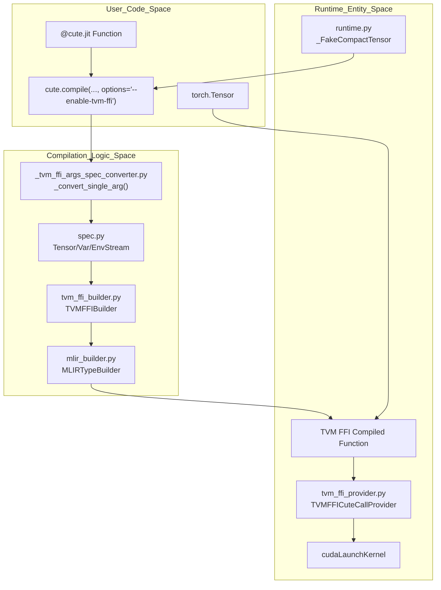
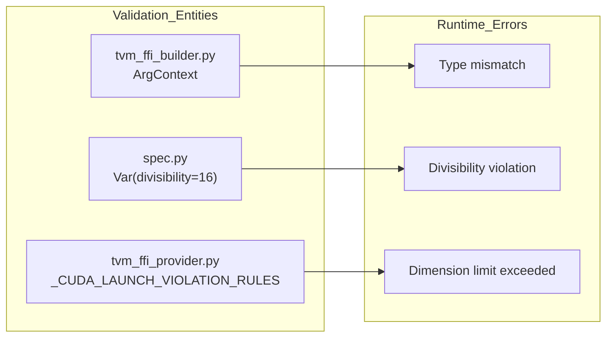

<!-- source: DeepWiki mcp.deepwiki.com · repo NVIDIA/cutlass · page 3.2 TVM FFI Integration · fetched 2026-10-26 -->

# TVM FFI Integration

<details>
<summary>Relevant source files</summary>

The following files were used as context for generating this wiki page:

- [examples/python/CuTeDSL/dsl_tutorials/call_bypass_dlpack.py](examples/python/CuTeDSL/dsl_tutorials/call_bypass_dlpack.py)
- [examples/python/CuTeDSL/dsl_tutorials/call_from_jit.py](examples/python/CuTeDSL/dsl_tutorials/call_from_jit.py)
- [examples/python/CuTeDSL/dsl_tutorials/tvm_ffi/ampere_gemm_with_fake_tensor.py](examples/python/CuTeDSL/dsl_tutorials/tvm_ffi/ampere_gemm_with_fake_tensor.py)
- [media/docs/pythonDSL/guides/tvm_ffi_compilation.rst](media/docs/pythonDSL/guides/tvm_ffi_compilation.rst)
- [python/CuTeDSL/cutlass/base_dsl/tvm_ffi_builder/mlir_builder.py](python/CuTeDSL/cutlass/base_dsl/tvm_ffi_builder/mlir_builder.py)
- [python/CuTeDSL/cutlass/cutlass_dsl/tvm_ffi_provider.py](python/CuTeDSL/cutlass/cutlass_dsl/tvm_ffi_provider.py)

</details>


## Purpose and Scope

This document describes the TVM FFI (Foreign Function Interface) integration in CUTLASS CuTe DSL, which provides an optimized calling path for JIT-compiled kernels with reduced host-side overhead and zero-copy interoperability with machine learning frameworks like PyTorch and JAX.

For information about JIT caching mechanisms, see [JIT Compilation and Caching](3.3). For general CuTe DSL kernel authoring, see [CuTe DSL Kernel Authoring](3.1).

## Overview

Apache TVM FFI is an open ABI and FFI for machine learning systems [media/docs/pythonDSL/guides/tvm_ffi_compilation.rst:7-8](). The CUTLASS integration leverages TVM FFI to:

- **Minimize host-side overhead**: Eliminate explicit DLPack conversions in critical execution paths, which can otherwise become a bottleneck for latency-sensitive applications [media/docs/pythonDSL/guides/tvm_ffi_compilation.rst:49-53]().
- **Enable zero-copy data transfer**: Direct use of `torch.Tensor` objects and JAX arrays as arguments without manual wrapping [media/docs/pythonDSL/guides/tvm_ffi_compilation.rst:157-160]().
- **Support environment stream handling**: Automatic integration with framework stream contexts (e.g., implicitly passing the current PyTorch stream) [media/docs/pythonDSL/guides/tvm_ffi_compilation.rst:61-61]().
- **Provide fast compiled validation**: Type and constraint checking at compiled speed, relying on compiled argument validation instead of slower Python-side attribute validation [media/docs/pythonDSL/guides/tvm_ffi_compilation.rst:62-63]().

Sources: [media/docs/pythonDSL/guides/tvm_ffi_compilation.rst:7-21](), [media/docs/pythonDSL/guides/tvm_ffi_compilation.rst:49-65]()

## System Architecture

The TVM FFI integration bridges the high-level Python DSL with low-level MLIR/LLVM code generation to create highly efficient entry points.

**TVM FFI Pipeline Architecture**



Sources: [python/CuTeDSL/cutlass/cute/runtime.py:411-520](), [python/CuTeDSL/cutlass/base_dsl/tvm_ffi_builder/tvm_ffi_builder.py:177-212](), [python/CuTeDSL/cutlass/cutlass_dsl/tvm_ffi_provider.py:19-43]()

## Enabling TVM FFI

TVM FFI can be enabled through two primary methods:

### Method 1: Compilation Option
Pass the `--enable-tvm-ffi` flag to `cute.compile()`. The object returned will be a Python function specific to TVM FFI [media/docs/pythonDSL/guides/tvm_ffi_compilation.rst:30-44]().

```python
# Example compilation with FFI enabled
compiled_add = cute.compile(add, a_torch, b_torch, options="--enable-tvm-ffi")
```

### Method 2: Environment Variable
Enable TVM FFI globally for all JIT compilations by setting `CUTE_DSL_ENABLE_TVM_FFI=1` [media/docs/pythonDSL/guides/tvm_ffi_compilation.rst:46-47]().

Sources: [media/docs/pythonDSL/guides/tvm_ffi_compilation.rst:23-48]()

## Compilation with Fake Tensors

To distinguish between the compilation phase and runtime, CuTe DSL provides "fake tensors". These placeholders mimic the interface of real tensors (shape, type, layout) but do not hold data or allow indexing [media/docs/pythonDSL/guides/tvm_ffi_compilation.rst:75-76]().

### Fake Object Reference

| Class | Purpose | Source |
|-------|---------|--------|
| `_FakeTensor` | Placeholder for generic tensors | [python/CuTeDSL/cutlass/cute/runtime.py:411]() |
| `_FakeCompactTensor` | Placeholder for tensors with compact layouts | [python/CuTeDSL/cutlass/cute/runtime.py:465]() |
| `_FakeStream` | Placeholder for CUDA streams | [python/CuTeDSL/cutlass/cute/runtime.py:520]() |

**Fake Tensor Usage Example**
```python
def example_add_one():
    n = cute.sym_int()
    # Create placeholders for compilation
    a_cute = cute.runtime.make_fake_compact_tensor(cute.Float32, (n,))
    b_cute = cute.runtime.make_fake_compact_tensor(cute.Float32, (n,))
    
    # Compile once
    compiled_add_one = cute.compile(add_one, a_cute, b_cute, options="--enable-tvm-ffi")
    
    # Run multiple times with real torch tensors
    a_torch = torch.arange(10, dtype=torch.float32, device="cuda")
    b_torch = torch.empty(10, dtype=torch.float32, device="cuda")
    compiled_add_one(a_torch, b_torch)
```
[media/docs/pythonDSL/guides/tvm_ffi_compilation.rst:102-114]()

Sources: [python/CuTeDSL/cutlass/cute/runtime.py:411-549](), [media/docs/pythonDSL/guides/tvm_ffi_compilation.rst:70-130]()

## Argument Conversion and Validation

The integration uses `_tvm_ffi_args_spec_converter` to transform CuTe Python types into TVM FFI specifications.

### Fast Compiled Validation
When a TVM FFI-compiled function is called, it performs fast checks for:
1. **Shape constraints**: Ensuring dynamic shapes match symbolic integer constraints (e.g., divisibility) [examples/python/CuTeDSL/dsl_tutorials/tvm_ffi/ampere_gemm_with_fake_tensor.py:158-185]().
2. **Type alignment**: Verifying data types and memory alignment [examples/python/CuTeDSL/dsl_tutorials/tvm_ffi/ampere_gemm_with_fake_tensor.py:82-91]().

**Validation Logic Mapping**



Sources: [python/CuTeDSL/cutlass/base_dsl/tvm_ffi_builder/tvm_ffi_builder.py:30-86](), [python/CuTeDSL/cutlass/cutlass_dsl/tvm_ffi_provider.py:169-211](), [examples/python/CuTeDSL/dsl_tutorials/tvm_ffi/ampere_gemm_with_fake_tensor.py:154-186]()

## Environment Stream Handling

A significant feature of the TVM FFI integration is the ability to work with framework streams (like PyTorch streams) implicitly.

- **`use_tvm_ffi_env_stream=True`**: When set in `make_fake_stream()`, the compiled function will automatically query the environment's current stream at runtime [media/docs/pythonDSL/guides/tvm_ffi_compilation.rst:215-225]().
- **Zero-overhead context**: This avoids the need to manually extract and pass stream pointers from PyTorch to CuTe kernels.

Sources: [media/docs/pythonDSL/guides/tvm_ffi_compilation.rst:210-246](), [python/CuTeDSL/cutlass/cute/runtime.py:520-530]()

## Implementation Details

### MLIR Type Builder
The `MLIRTypeBuilder` class in `mlir_builder.py` provides the foundation for generating the FFI entry points, handling LLVM struct types for `TVMFFIAny` and `TVMFFIObject` [python/CuTeDSL/cutlass/base_dsl/tvm_ffi_builder/mlir_builder.py:21-127]().

### TVM FFI Type Indexes
The integration uses a specific set of type indexes to identify arguments at runtime:
- `kTVMFFIInt` (1)
- `kTVMFFIBool` (2)
- `kTVMFFIDLTensorPtr` (7)
- `kTVMFFITensor` (70)

Sources: [python/CuTeDSL/cutlass/base_dsl/tvm_ffi_builder/tvm_ffi_builder.py:147-175](), [python/CuTeDSL/cutlass/base_dsl/tvm_ffi_builder/mlir_builder.py:129-145]()

---

