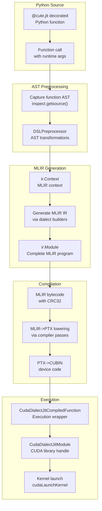
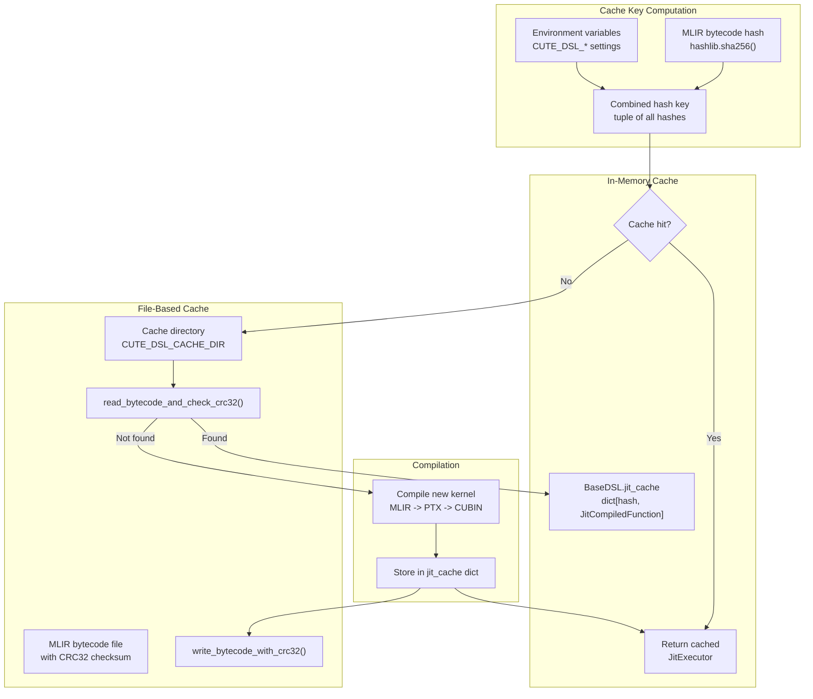

<!-- source: DeepWiki mcp.deepwiki.com · repo NVIDIA/cutlass · page 3.3 JIT Compilation and Caching · fetched 2026-10-26 -->

# JIT Compilation and Caching

Relevant source files

The following files were used as context for generating this wiki page:

- [python/CuTeDSL/cutlass/base_dsl/compiler.py](python/CuTeDSL/cutlass/base_dsl/compiler.py)
- [python/CuTeDSL/cutlass/base_dsl/dsl.py](python/CuTeDSL/cutlass/base_dsl/dsl.py)
- [python/CuTeDSL/cutlass/base_dsl/tvm_ffi_builder/tvm_ffi_builder.py](python/CuTeDSL/cutlass/base_dsl/tvm_ffi_builder/tvm_ffi_builder.py)
- [python/CuTeDSL/cutlass/cute/_tvm_ffi_args_spec_converter.py](python/CuTeDSL/cutlass/cute/_tvm_ffi_args_spec_converter.py)
- [python/CuTeDSL/cutlass/cute/arch/mbar.py](python/CuTeDSL/cutlass/cute/arch/mbar.py)
- [python/CuTeDSL/cutlass/cute/nvgpu/tcgen05/copy.py](python/CuTeDSL/cutlass/cute/nvgpu/tcgen05/copy.py)
- [python/CuTeDSL/cutlass/cute/nvgpu/tcgen05/mma.py](python/CuTeDSL/cutlass/cute/nvgpu/tcgen05/mma.py)
- [python/CuTeDSL/cutlass/cute/runtime.py](python/CuTeDSL/cutlass/cute/runtime.py)
- [python/CuTeDSL/cutlass/cute/testing.py](python/CuTeDSL/cutlass/cute/testing.py)
- [python/CuTeDSL/cutlass/cutlass_dsl/cuda_jit_executor.py](python/CuTeDSL/cutlass/cutlass_dsl/cuda_jit_executor.py)

## Purpose and Scope

This document describes the Just-In-Time (JIT) compilation pipeline and caching mechanisms in CuTe DSL. It covers how Python code decorated with `@cute.jit` or `@cute.kernel` is transformed into executable GPU kernels, how compiled artifacts are cached to avoid recompilation, and how cache behavior can be controlled via environment variables and explicit compilation.

For information about TVM FFI integration which provides optimized calling conventions and reduced host overhead, see [TVM FFI Integration](#3.2). For runtime tensor representations used during compilation, see [Runtime Tensor Representation](#3.4).

## JIT Compilation Pipeline

### Overview

The JIT compilation pipeline transforms Python DSL code into executable GPU kernels through multiple stages: AST preprocessing, MLIR IR generation, PTX/CUBIN compilation, and JIT executor creation.

**JIT Compilation Pipeline Stages**

Sources: `[python/CuTeDSL/cutlass/base_dsl/dsl.py:273-364]()`, `[python/CuTeDSL/cutlass/base_dsl/ast_preprocessor.py:13-33]()`, `[python/CuTeDSL/cutlass/cutlass_dsl/cuda_jit_executor.py:74-107]()`

### AST Preprocessing

When a function decorated with `@cute.jit` or `@cute.kernel` is first invoked, the DSL captures the function's source code and applies AST transformations. The `DSLPreprocessor` class performs these transformations to support DSL-specific syntax like dynamic control flow.

The preprocessing stage includes:
- **Control flow transformations**: Rewriting `for` and `if` statements to use `loop_selector` and `if_selector` `[python/CuTeDSL/cutlass/base_dsl/ast_preprocessor.py:13-33]()`.
- **Variable scoping**: Identifying read-only, read-write, and active variables to generate correct MLIR `yield` operations `[python/CuTeDSL/cutlass/base_dsl/ast_preprocessor.py:24-29]()`.
- **Symbol Management**: Tracking symbols across nested scopes to handle loop-carried variables and conditional assignments `[python/CuTeDSL/cutlass/base_dsl/ast_preprocessor.py:141-152]()`.

Sources: `[python/CuTeDSL/cutlass/base_dsl/ast_preprocessor.py:13-33]()`, `[python/CuTeDSL/cutlass/base_dsl/ast_helpers.py:197-238]()`

### MLIR IR Generation

The preprocessed Python AST is transformed into MLIR (Multi-Level Intermediate Representation) through dialect-specific builders. The process creates an `ir.Module` containing operations from:
- `func` dialect for function definitions `[python/CuTeDSL/cutlass/base_dsl/dsl.py:103-103]()`.
- `cute` dialect for layout algebra and tensor operations `[python/CuTeDSL/cutlass/cute/runtime.py:21-22]()`.
- `cute_nvgpu` dialect for hardware-specific atoms like `tcgen05` `[python/CuTeDSL/cutlass/cute/nvgpu/tcgen05/mma.py:21-22]()`.

Sources: `[python/CuTeDSL/cutlass/base_dsl/dsl.py:273-364]()`, `[python/CuTeDSL/cutlass/cute/runtime.py:20-22]()`, `[python/CuTeDSL/cutlass/cute/nvgpu/tcgen05/mma.py:20-22]()`

### PTX and CUBIN Generation

The MLIR module undergoes compilation passes to generate PTX assembly and CUBIN device code. The target GPU architecture is determined by `detect_gpu_arch` which queries compute capability via `get_compute_capability_major_minor` `[python/CuTeDSL/cutlass/base_dsl/env_manager.py:167-190]()`.

The `Compiler` class manages the compilation pipeline:
- **Pass Management**: `pm.run(module.operation)` executes the lowering passes `[python/CuTeDSL/cutlass/base_dsl/compiler.py:144-144]()`.
- **Error Handling**: `CompilerDiagnosticError` captures and formats NVVM errors and IR context for debugging `[python/CuTeDSL/cutlass/base_dsl/compiler.py:44-71]()`.
- **Verification**: Optional IR verification can be enabled via `pm.enable_verifier(enable_verifier)` `[python/CuTeDSL/cutlass/base_dsl/compiler.py:138-138]()`.

Sources: `[python/CuTeDSL/cutlass/base_dsl/env_manager.py:167-190]()`, `[python/CuTeDSL/cutlass/base_dsl/compiler.py:72-184]()`

### JIT Executor Creation

The `CudaDialectJitCompiledFunction` manages the lifecycle of the compiled kernel and handles the interaction with the CUDA driver/runtime.

| Component | Class | Purpose |
|-----------|-------|---------|
| Compiled Function | `CudaDialectJitCompiledFunction` | Holds the IR module and C-API function handle `[python/CuTeDSL/cutlass/cutlass_dsl/cuda_jit_executor.py:77-117]()`. |
| CUDA Module | `CudaDialectJitModule` | Manages `cudaLibrary_t` handles and provides an `unload` method for resource cleanup `[python/CuTeDSL/cutlass/cutlass_dsl/cuda_jit_executor.py:44-58]()`. |
| Initialization | `_mlir_<prefix>_cuda_init` | Symbol looked up from JIT engine to initialize the CUDA library `[python/CuTeDSL/cutlass/cutlass_dsl/cuda_jit_executor.py:150-154]()`. |

Sources: `[python/CuTeDSL/cutlass/cutlass_dsl/cuda_jit_executor.py:41-168]()`

## Caching System Architecture

**Cache System Data Flow**

Sources: `[python/CuTeDSL/cutlass/base_dsl/cache_helpers.py:1-274]()`, `[python/CuTeDSL/cutlass/base_dsl/dsl.py:320-322]()`

### In-Memory Cache

The `BaseDSL` class maintains a `jit_cache` to avoid redundant MLIR generation and compilation within the same process. This is implemented using a dictionary keyed by the computed hash of the function and its specialization parameters `[python/CuTeDSL/cutlass/base_dsl/dsl.py:320-322]()`.

### File-Based Cache

Compiled MLIR bytecode is persisted to disk to speed up subsequent process launches.

**Bytecode Serialization:**
The system uses `write_bytecode_with_crc32` to save the IR module. It appends a 4-byte CRC32 checksum to the bytecode to ensure data integrity during storage and retrieval `[python/CuTeDSL/cutlass/base_dsl/cache_helpers.py:162-185]()`.

**Integrity Verification:**
During loading, `read_bytecode_and_check_crc32` calculates the checksum of the read data and compares it against the stored value. If they mismatch, a `DSLRuntimeError` is raised to prevent execution of corrupted kernels `[python/CuTeDSL/cutlass/base_dsl/cache_helpers.py:188-216]()`.

Sources: `[python/CuTeDSL/cutlass/base_dsl/cache_helpers.py:162-216]()`

### Cache Directory Management

The cache location is determined by `get_default_file_dump_root` `[python/CuTeDSL/cutlass/base_dsl/cache_helpers.py:40-69]()`.

1. **Explicit**: Defined by the `CUTE_DSL_CACHE_DIR` environment variable `[python/CuTeDSL/cutlass/base_dsl/env_manager.py:33-33]()`.
2. **Default**: A directory named `cutlass_python_cache` in the system temporary path `[python/CuTeDSL/cutlass/base_dsl/cache_helpers.py:53-53]()`.

Sources: `[python/CuTeDSL/cutlass/base_dsl/cache_helpers.py:40-69]()`, `[python/CuTeDSL/cutlass/base_dsl/env_manager.py:22-33]()`

## TVM FFI Compilation Pipeline

When TVM FFI is enabled, the pipeline uses an optimized calling path defined in `tvm_ffi_builder.py`.

### Argument Conversion

The `_tvm_ffi_args_spec_converter.py` module translates Python/CuTe types into TVM FFI specifications:
- **Tensors**: Converted to `spec.Tensor` with dynamic shape/stride variable mapping managed by `ConverterContext` `[python/CuTeDSL/cutlass/cute/_tvm_ffi_args_spec_converter.py:234-240]()`.
- **Scalars**: Mapped to `spec.Var` using the `NumericToTVMFFIDtype` map which covers types from `Boolean` to `Float64` `[python/CuTeDSL/cutlass/cute/_tvm_ffi_args_spec_converter.py:62-87]()`.
- **Symbolic Integers**: Handled via `SymIntId` to ensure consistent variable reuse across the kernel signature `[python/CuTeDSL/cutlass/cute/_tvm_ffi_args_spec_converter.py:154-166]()`.

### MLIR Builder for TVM FFI

The `TVMFFIBuilder` (inheriting from `MLIRBuilder`) generates the LLVM-level glue code required for the FFI `[python/CuTeDSL/cutlass/base_dsl/tvm_ffi_builder/tvm_ffi_builder.py:28-29]()`. It handles parameter decoding and error message context via `ArgContext` `[python/CuTeDSL/cutlass/base_dsl/tvm_ffi_builder/tvm_ffi_builder.py:84-143]()`.

Sources: `[python/CuTeDSL/cutlass/cute/_tvm_ffi_args_spec_converter.py:59-240]()`, `[python/CuTeDSL/cutlass/base_dsl/tvm_ffi_builder/tvm_ffi_builder.py:28-143]()`

## Runtime Tensor and Fake Objects

During JIT compilation, "Fake" objects are used to represent tensor properties without requiring physical memory allocation.

| Class | Purpose |
|-------|---------|
| `_Tensor` | Runtime wrapper for DLPack-compatible tensors, supporting lazy `DLTensorWrapper` loading `[python/CuTeDSL/cutlass/cute/runtime.py:163-205]()`. |
| `_Pointer` | Runtime representation of a pointer with alignment and address space tracking `[python/CuTeDSL/cutlass/cute/runtime.py:54-98]()`. |
| `_FakeStream` | Represents a CUDA stream during compilation to handle stream-aware operations in the DSL `[python/CuTeDSL/cutlass/cute/runtime.py:29-32]()`. |
| `_CompileTimeAssertion` | Tracks assertion results during JIT execution by storing them in a `Boolean` tensor `[python/CuTeDSL/cutlass/cute/testing.py:80-116]()`. |

Sources: `[python/CuTeDSL/cutlass/cute/runtime.py:49-205]()`, `[python/CuTeDSL/cutlass/cute/testing.py:80-140]()`

## Environment Variables Reference

| Variable | Default | Description |
|----------|---------|-------------|
| `CUTE_DSL_CACHE_DIR` | `/tmp/...` | Path for file-based JIT cache `[python/CuTeDSL/cutlass/base_dsl/env_manager.py:33-33]()`. |
| `CUTE_DSL_ARCH` | Auto | Overrides GPU architecture detection (e.g., `sm_90a`, `sm_100a`) `[python/CuTeDSL/cutlass/base_dsl/env_manager.py:167-190]()`. |
| `CUTE_DSL_KEEP` | None | Comma-separated list of artifacts to keep (e.g., `ir,ptx,cubin,all`) `[python/CuTeDSL/cutlass/base_dsl/env_manager.py:43-80]()`. |
| `CUTE_DSL_DUMP_SASS` | `0` | If set, dumps SASS assembly for the compiled kernels `[python/CuTeDSL/cutlass/base_dsl/env_manager.py:57-57]()`. |

Sources: `[python/CuTeDSL/cutlass/base_dsl/env_manager.py:33-190]()`

---

