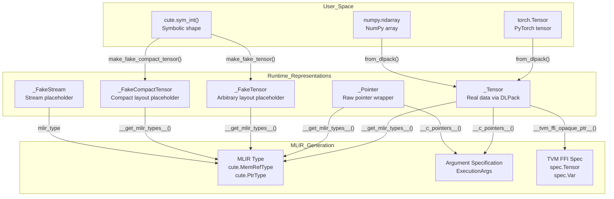
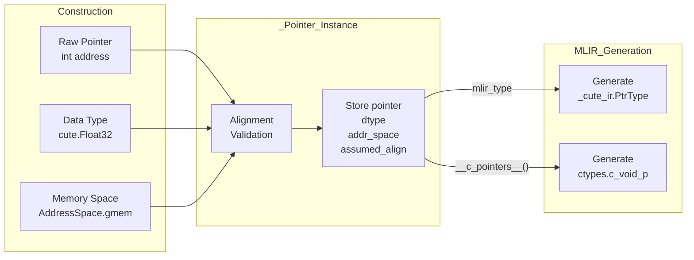
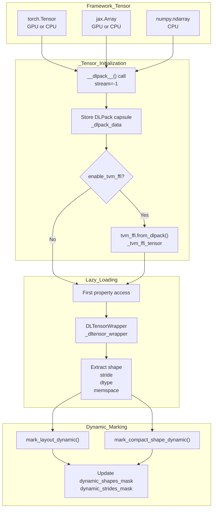
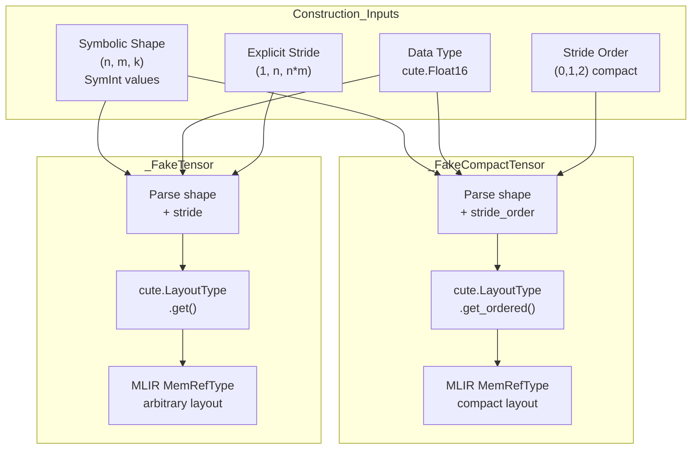
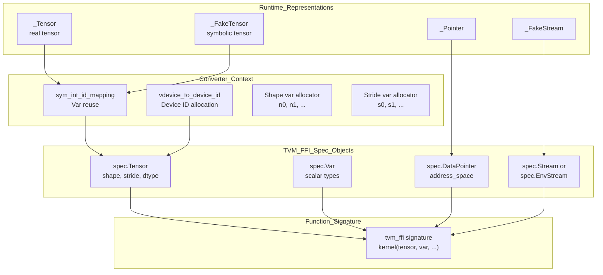

<!-- source: DeepWiki mcp.deepwiki.com · repo NVIDIA/cutlass · page 3.4 Runtime Tensor Representation · fetched 2026-10-26 -->

# Runtime Tensor Representation

<details>
<summary>Relevant source files</summary>

The following files were used as context for generating this wiki page:

- [python/CuTeDSL/cutlass/base_dsl/dsl.py](python/CuTeDSL/cutlass/base_dsl/dsl.py)
- [python/CuTeDSL/cutlass/base_dsl/tvm_ffi_builder/tvm_ffi_builder.py](python/CuTeDSL/cutlass/base_dsl/tvm_ffi_builder/tvm_ffi_builder.py)
- [python/CuTeDSL/cutlass/base_dsl/utils/tree_utils.py](python/CuTeDSL/cutlass/base_dsl/utils/tree_utils.py)
- [python/CuTeDSL/cutlass/cute/_tvm_ffi_args_spec_converter.py](python/CuTeDSL/cutlass/cute/_tvm_ffi_args_spec_converter.py)
- [python/CuTeDSL/cutlass/cute/runtime.py](python/CuTeDSL/cutlass/cute/runtime.py)
- [python/CuTeDSL/cutlass/cutlass_dsl/cuda_jit_executor.py](python/CuTeDSL/cutlass/cutlass_dsl/cuda_jit_executor.py)
- [test/examples/CuTeDSL/test_dataclasses.py](test/examples/CuTeDSL/test_dataclasses.py)

</details>


## Purpose and Scope

This page describes the runtime representation classes that bridge Python objects (tensors, pointers, streams) to MLIR types for JIT compilation in CuTe DSL. These classes enable both execution with real data and compilation with symbolic shape information.

For general JIT compilation concepts, see **3.3 JIT Compilation and Caching**. For details on TVM FFI integration, see **3.2 TVM FFI Integration**. For tensor type abstractions in the DSL type system, see **1.1 Core Concepts and Terminology**.

## Overview

The runtime tensor representation system provides two distinct operational modes:

1.  **Execution Mode**: Classes that wrap actual data from frameworks (PyTorch, JAX, NumPy) via DLPack protocol.
2.  **Compilation Mode**: Classes that hold only shape, type, and layout information without requiring real data.

This separation enables zero-copy interoperability with ML frameworks through DLPack, compilation with symbolic shapes before runtime, and efficient argument marshaling for both CUDA Runtime API and TVM FFI paths.

Title: Runtime Representation System Architecture

Sources: [python/CuTeDSL/cutlass/cute/runtime.py:54-800](), [python/CuTeDSL/cutlass/base_dsl/dsl.py:153-206]()

## Common Protocols

All runtime representation classes implement standard protocols for integration with the JIT compilation system:

| Protocol Method | Purpose | Return Type |
| :--- | :--- | :--- |
| `__get_mlir_types__()` | Generate MLIR type representation | `list[ir.Type]` |
| `__c_pointers__()` | Generate C ABI pointer array | `list[int]` |
| `__new_from_mlir_values__()` | Construct from MLIR values | Python object |
| `mlir_type` (property) | Single MLIR type | `ir.Type` |

For TVM FFI enabled paths:
| Protocol Method | Purpose | Return Type |
| :--- | :--- | :--- |
| `__tvm_ffi_opaque_ptr__()` | Return opaque pointer | `object` |

Sources: [python/CuTeDSL/cutlass/cute/runtime.py:103-123](), [python/CuTeDSL/cutlass/base_dsl/dsl.py:83-90]()

## _Pointer Class

The `_Pointer` class wraps raw pointer values with type and memory space information [python/CuTeDSL/cutlass/cute/runtime.py:54-73]().

**Key Attributes:**
*   `_pointer`: Underlying pointer value (integer address) [python/CuTeDSL/cutlass/cute/runtime.py:82-82]().
*   `_dtype`: Element type (`Type[Numeric]`) [python/CuTeDSL/cutlass/cute/runtime.py:83-83]().
*   `_addr_space`: Memory space (`AddressSpace`) [python/CuTeDSL/cutlass/cute/runtime.py:84-84]().
*   `_assumed_align`: Alignment in bytes [python/CuTeDSL/cutlass/cute/runtime.py:89-89]().

**Construction:**
```python
_Pointer(
    pointer: int,
    dtype: Type[Numeric],
    mem_space: AddressSpace = AddressSpace.generic,
    assumed_align: Optional[int] = None,
)
```
The class validates pointer alignment on construction [python/CuTeDSL/cutlass/cute/runtime.py:95-97]() and generates the appropriate `_cute_ir.PtrType` MLIR representation [python/CuTeDSL/cutlass/cute/runtime.py:118-123]().

Title: _Pointer Class Data Flow

Sources: [python/CuTeDSL/cutlass/cute/runtime.py:75-161]()

## _Tensor Class

The `_Tensor` class wraps real tensor data from frameworks via the DLPack protocol [python/CuTeDSL/cutlass/cute/runtime.py:163-188](). It provides lazy loading of DLTensor information to minimize overhead in the critical execution path [python/CuTeDSL/cutlass/cute/runtime.py:202-208]().

**Key Features:**
*   Zero-copy integration via `__dlpack__` protocol [python/CuTeDSL/cutlass/cute/runtime.py:185-187]().
*   Lazy DLTensor wrapper loading for performance [python/CuTeDSL/cutlass/cute/runtime.py:208-212]().
*   Support for TVM FFI through `_tvm_ffi_tensor` [python/CuTeDSL/cutlass/cute/runtime.py:178-179]().

Title: _Tensor Initialization and Lazy Loading Flow

Sources: [python/CuTeDSL/cutlass/cute/runtime.py:163-238]()

### Dynamic Layout Marking

The `_Tensor` class supports marking layouts as dynamic for symbolic compilation:

*   **`mark_layout_dynamic(leading_dim=None)`**: Marks the layout as dynamic while optionally setting the stride at `leading_dim` to 1 [python/CuTeDSL/cutlass/cute/runtime.py:240-261]().
*   **`mark_compact_shape_dynamic(mode, stride_order=None, divisibility=1)`**: Marks compact shapes with stride ordering information [python/CuTeDSL/cutlass/cute/runtime.py:270-302]().

Sources: [python/CuTeDSL/cutlass/cute/runtime.py:240-302]()

## Fake Tensor Classes

Fake tensor classes enable compilation without requiring actual data by holding only type, shape, and layout information.

### _FakeCompactTensor Class

The `_FakeCompactTensor` represents a tensor with compact layout specified by stride ordering [python/CuTeDSL/cutlass/cute/runtime.py:411-430]().

**Key Features:**
*   Compact layout defined by `stride_order` tuple [python/CuTeDSL/cutlass/cute/runtime.py:422-422]().
*   Support for `SymInt` symbolic dimensions [python/CuTeDSL/cutlass/cute/runtime.py:420-420]().
*   Provides `__get_mlir_types__` for generating `MemRefType` [python/CuTeDSL/cutlass/cute/runtime.py:456-463]().

Sources: [python/CuTeDSL/cutlass/cute/runtime.py:411-493]()

### _FakeTensor Class

The `_FakeTensor` provides flexibility with explicit shape and stride specification [python/CuTeDSL/cutlass/cute/runtime.py:495-512]().

**Key Features:**
*   Explicit stride specification for non-compact layouts [python/CuTeDSL/cutlass/cute/runtime.py:506-506]().
*   Full symbolic shape/stride support with `SymInt` [python/CuTeDSL/cutlass/cute/runtime.py:504-506]().

Sources: [python/CuTeDSL/cutlass/cute/runtime.py:495-664]()

Title: Fake Tensor Construction and MLIR Generation

Sources: [python/CuTeDSL/cutlass/cute/runtime.py:411-664]()

## _FakeStream Class

The `_FakeStream` class serves as a placeholder for CUDA stream arguments during compilation [python/CuTeDSL/cutlass/cute/runtime.py:666-672]().

**Key Features:**
*   `use_tvm_ffi_env_stream`: Boolean flag indicating if the stream should be retrieved from the TVM FFI environment [python/CuTeDSL/cutlass/cute/runtime.py:672-672]().
*   `mlir_type`: Returns the `cute.StreamType` [python/CuTeDSL/cutlass/cute/runtime.py:679-681]().

Sources: [python/CuTeDSL/cutlass/cute/runtime.py:666-692]()

## Argument Marshaling and TVM FFI

The DSL converts runtime representations to `spec.Param` objects for TVM FFI function signature generation. The `ConverterContext` manages variable allocation and reuse for symbolic integers (`SymInt`) [python/CuTeDSL/cutlass/cute/_tvm_ffi_args_spec_converter.py:167-203]().

Title: TVM FFI Argument Conversion Pipeline

Sources: [python/CuTeDSL/cutlass/cute/_tvm_ffi_args_spec_converter.py:167-224](), [python/CuTeDSL/cutlass/base_dsl/tvm_ffi_builder/tvm_ffi_builder.py:84-143]()

## Construction Helper Functions

The `runtime` module provides convenience functions for creating runtime representation objects:

*   **`from_dlpack()`**: Constructs `_Tensor` from any DLPack-compatible object [python/CuTeDSL/cutlass/cute/runtime.py:694-716]().
*   **`make_fake_compact_tensor()`**: Constructs `_FakeCompactTensor` for compilation [python/CuTeDSL/cutlass/cute/runtime.py:719-749]().
*   **`make_fake_tensor()`**: Constructs `_FakeTensor` with explicit strides [python/CuTeDSL/cutlass/cute/runtime.py:752-780]().
*   **`make_fake_stream()`**: Constructs `_FakeStream` for stream placeholders [python/CuTeDSL/cutlass/cute/runtime.py:783-800]().

Sources: [python/CuTeDSL/cutlass/cute/runtime.py:694-800]()

---

