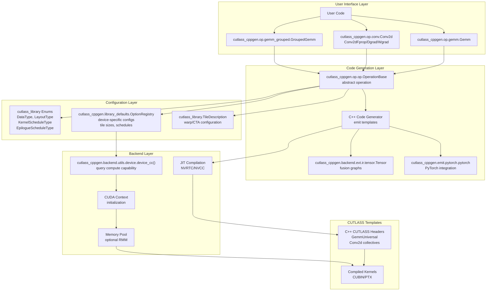
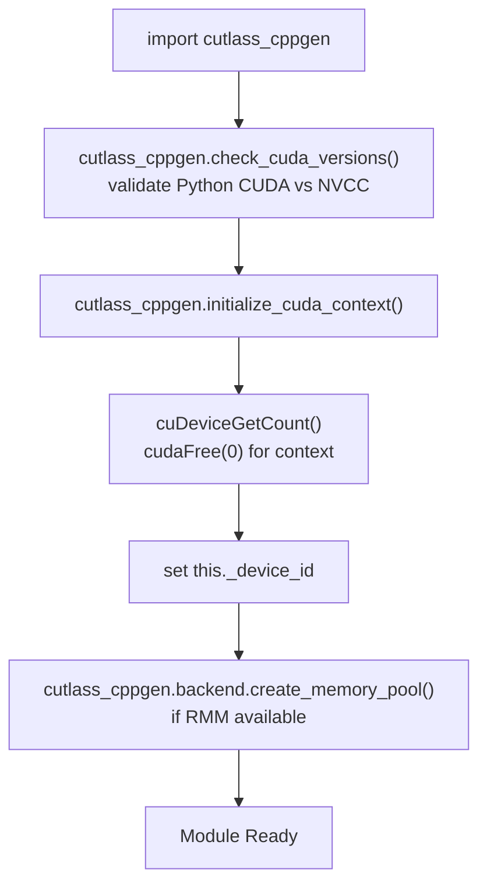
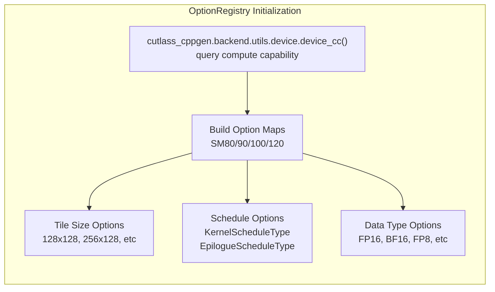
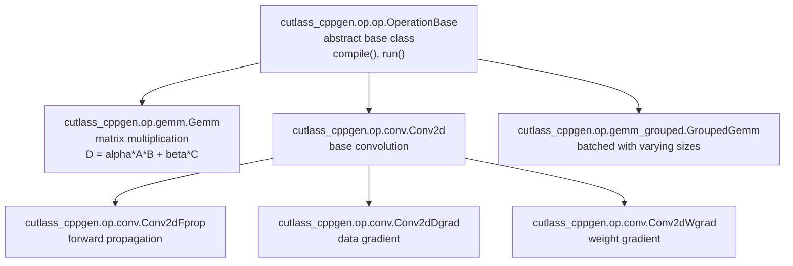

<!-- source: DeepWiki mcp.deepwiki.com · repo NVIDIA/cutlass · page 3.5 cutlass_cppgen API Reference · fetched 2026-10-26 -->

# cutlass_cppgen API Reference

Relevant source files

The following files were used as context for generating this wiki page:

- [CHANGELOG.md](CHANGELOG.md)
- [README.md](README.md)
- [examples/python/CuTeDSL/cute_ext/blackwell/dense_gemm.py](examples/python/CuTeDSL/cute_ext/blackwell/dense_gemm.py)
- [include/cutlass/epilogue/collective/builders/sm100_builder.inl](include/cutlass/epilogue/collective/builders/sm100_builder.inl)
- [include/cutlass/epilogue/collective/builders/sm120_builder.inl](include/cutlass/epilogue/collective/builders/sm120_builder.inl)
- [include/cutlass/epilogue/collective/sm100_epilogue_array_nosmem.hpp](include/cutlass/epilogue/collective/sm100_epilogue_array_nosmem.hpp)
- [include/cutlass/epilogue/collective/sm100_epilogue_nosmem.hpp](include/cutlass/epilogue/collective/sm100_epilogue_nosmem.hpp)
- [include/cutlass/float8.h](include/cutlass/float8.h)
- [include/cutlass/gemm/collective/builders/sm120_blockscaled_mma_builder.inl](include/cutlass/gemm/collective/builders/sm120_blockscaled_mma_builder.inl)
- [include/cutlass/gemm/collective/builders/sm120_common.inl](include/cutlass/gemm/collective/builders/sm120_common.inl)
- [include/cutlass/version.h](include/cutlass/version.h)
- [python/CuTeDSL/cutlass/base_dsl/env_manager.py](python/CuTeDSL/cutlass/base_dsl/env_manager.py)
- [python/CuTeDSL/cutlass/base_dsl/runtime/cuda.py](python/CuTeDSL/cutlass/base_dsl/runtime/cuda.py)
- [python/CuTeDSL/cutlass/cute/__init__.py](python/CuTeDSL/cutlass/cute/__init__.py)
- [python/CuTeDSL/cutlass/cute/arch/nvvm_wrappers.py](python/CuTeDSL/cutlass/cute/arch/nvvm_wrappers.py)
- [python/CuTeDSL/cutlass/cute/core.py](python/CuTeDSL/cutlass/cute/core.py)
- [python/CuTeDSL/cutlass/cute/nvgpu/cpasync/copy.py](python/CuTeDSL/cutlass/cute/nvgpu/cpasync/copy.py)
- [python/CuTeDSL/cutlass/jax/primitive.py](python/CuTeDSL/cutlass/jax/primitive.py)
- [python/CuTeDSL/requirements-cu13.txt](python/CuTeDSL/requirements-cu13.txt)
- [python/CuTeDSL/requirements.txt](python/CuTeDSL/requirements.txt)
- [python/cutlass_cppgen/__init__.py](python/cutlass_cppgen/__init__.py)
- [python/cutlass_library/generator.py](python/cutlass_library/generator.py)
- [python/setup_cutlass.py](python/setup_cutlass.py)
- [python/setup_library.py](python/setup_library.py)
- [python/setup_pycute.py](python/setup_pycute.py)

## Purpose and Scope

The `cutlass_cppgen` API provides a Python interface for generating and executing CUTLASS GEMM and convolution kernels through template-based code generation and JIT compilation. This API allows users to configure kernel parameters, generate optimized C++ template instantiations, and execute them without manually writing CUDA code.

This page documents the initialization, configuration, and operation classes of `cutlass_cppgen`. For direct Python kernel authoring using CuTe abstractions, see [CuTe DSL Kernel Authoring (3.1)](). For systematic enumeration of operation variants, see [Operation Enumeration and Code Generation (3.6)]().

**Key Characteristics:**
- Template-based code generation from Python specifications.
- JIT compilation via NVRTC or NVCC.
- Device-specific optimization through `OptionRegistry` [python/cutlass_cppgen/__init__.py:122-134]().
- Support for GEMM, convolution, and grouped GEMM operations [python/cutlass_cppgen/__init__.py:140-142]().
- Optional RMM memory pool integration (Python 3.9+) [python/cutlass_cppgen/__init__.py:101-109]().
- Support for latest Blackwell (SM100/SM120) architectures and data types including FP4, MXFP8, and UE8M0 [CHANGELOG.md:32-33](), [python/cutlass_library/generator.py:103-115]().

Sources: [python/cutlass_cppgen/__init__.py:1-214](), [README.md:28-40](), [CHANGELOG.md:32-33](), [python/cutlass_library/generator.py:103-115]()

---

## API Architecture

The `cutlass_cppgen` module is organized into several key subsystems that handle configuration, code generation, and execution.

**cutlass_cppgen System Architecture**

**Architecture Overview**

The API follows a layered design where user-facing operation classes (`Gemm`, `Conv2d`, `GroupedGemm`) inherit from `OperationBase` [python/cutlass_cppgen/__init__.py:140-143]() and leverage configuration from `OptionRegistry` [python/cutlass_cppgen/__init__.py:122-134]() to generate C++ template code. The code generator emits CUTLASS template instantiations, which are then JIT-compiled and executed on the GPU.

Sources: [python/cutlass_cppgen/__init__.py:86-145](), [python/setup_cutlass.py:52-74]()

---

## Initialization and Environment

### Module Initialization

The `cutlass_cppgen` module performs lazy initialization to avoid unnecessary overhead when imported.

**Initialization Sequence**

**Initialization Sequence Details**

1. **Version Validation**: Ensures Python `cuda-python` version matches or exceeds NVCC version [python/cutlass_cppgen/__init__.py:166-182]().
2. **Device Context**: Initializes CUDA context via `cudaFree(0)` or RMM [python/cutlass_cppgen/__init__.py:183-213]().
3. **Device Selection**: Uses `CUTLASS_CUDA_DEVICE_ID` environment variable or defaults to device 0 [python/cutlass_cppgen/__init__.py:195-200]().
4. **Memory Pool**: Optionally creates RMM memory pool (1GB initial, 4GB max) [python/cutlass_cppgen/__init__.py:149-156]().

Sources: [python/cutlass_cppgen/__init__.py:166-213]()

### Environment Variables

| Variable | Purpose | Default |
|----------|---------|---------|
| `CUTLASS_PATH` | Path to CUTLASS source directory | `cutlass_library.source_path` [python/cutlass_cppgen/__init__.py:54]() |
| `CUDA_INSTALL_PATH` | CUDA toolkit installation path | Auto-detected from `nvcc` location [python/cutlass_cppgen/__init__.py:81]() |
| `CUTLASS_CUDA_DEVICE_ID` | Target CUDA device ID | `0` [python/cutlass_cppgen/__init__.py:195-200]() |

**CUDA Install Path Detection**

The module automatically detects the CUDA installation path by querying the location of `nvcc` using the `which` utility [python/cutlass_cppgen/__init__.py:39-51]().

Sources: [python/cutlass_cppgen/__init__.py:39-82]()

### Key Module Functions

| Function | Return Type | Description |
|----------|-------------|-------------|
| `cuda_install_path()` | `str` | Returns CUDA toolkit installation path (lazy evaluation) [python/cutlass_cppgen/__init__.py:73-82]() |
| `nvcc_version()` | `str` | Returns NVCC version string (e.g., "12.8") [python/cutlass_cppgen/__init__.py:60-70]() |
| `device_id()` | `int` | Returns current CUDA device ID after context init [python/cutlass_cppgen/__init__.py:214]() |
| `get_option_registry()` | `OptionRegistry` | Returns device-specific configuration registry (lazy init) [python/cutlass_cppgen/__init__.py:126-134]() |
| `get_memory_pool()` | RMM pool or `None` | Returns RMM memory pool if available [python/cutlass_cppgen/__init__.py:149-156]() |
| `set_log_level(level)` | `None` | Sets logging level (default: `logging.ERROR`) [python/cutlass_cppgen/__init__.py:111-120]() |
| `initialize_cuda_context()` | `None` | Explicitly initializes CUDA context [python/cutlass_cppgen/__init__.py:183-213]() |

Sources: [python/cutlass_cppgen/__init__.py:59-214]()

---

## Configuration System

### OptionRegistry

The `OptionRegistry` maintains a mapping from compute capability to valid kernel configurations, including tile sizes, schedules, and data type combinations.

**OptionRegistry Initialization**

**OptionRegistry Usage**

The registry is initialized once per session and caches valid configurations for the detected GPU architecture [python/cutlass_cppgen/__init__.py:126-134]().

Sources: [python/cutlass_cppgen/__init__.py:122-134]()

### Enumeration Types

The API imports enumeration types from `cutlass_library` for type-safe configuration [python/cutlass_cppgen/__init__.py:86-95]():

| Enumeration | Purpose | Example Values |
|-------------|---------|----------------|
| `DataType` | Input/output data types | `f16`, `bf16`, `f32`, `e4m3`, `f4` [python/cutlass_cppgen/__init__.py:87]() |
| `LayoutType` | Matrix memory layouts | `RowMajor`, `ColumnMajor`, `TensorNHWC` [python/cutlass_cppgen/__init__.py:91]() |
| `OpcodeClass` | Instruction type | `Simt`, `TensorOp`, `WmmaTensorOp` [python/cutlass_cppgen/__init__.py:92]() |
| `KernelScheduleType` | Mainloop schedule | `ScheduleAuto`, `Multistage`, `Cooperative` [python/cutlass_cppgen/__init__.py:89]() |
| `EpilogueScheduleType` | Epilogue schedule | `ScheduleAuto`, `NoSmemWarpSpecialized` [python/cutlass_cppgen/__init__.py:88]() |
| `TileSchedulerType` | CTA scheduling | `Default`, `Persistent`, `StreamK` [python/cutlass_cppgen/__init__.py:94]() |
| `MathOperation` | Accumulator behavior | `multiply_add`, `multiply_add_fast_bf16` [python/cutlass_cppgen/__init__.py:90]() |

Sources: [python/cutlass_cppgen/__init__.py:86-95]()

---

## Operation Classes

### Operation Class Hierarchy

**Operation Inheritance**

**Common Operation Interface**

All operation classes inherit from `OperationBase` and provide:
- Configuration through constructor parameters.
- `compile()` method for JIT compilation.
- `run()` method for kernel execution.
- Support for epilogue fusion via EVT [python/cutlass_cppgen/__init__.py:144]().

Sources: [python/cutlass_cppgen/__init__.py:140-144]()

### Gemm Operation

The `Gemm` class provides general matrix multiplication with configurable data types, layouts, and epilogue operations [python/cutlass_cppgen/__init__.py:140]().

**Key Parameters:**

| Parameter | Type | Description |
|-----------|------|-------------|
| `A`, `B`, `C`, `D` | `DataType` | Input/Output data types |
| `element_accumulator`| `DataType` | Accumulator data type (default: `f32`) |
| `layout` | `LayoutType` | Layouts for A, B, C |
| `tile_description` | `TileDescription` | CTA and warp tile configuration |
| `kernel_schedule` | `KernelScheduleType`| Mainloop schedule type |
| `epilogue_schedule`| `EpilogueScheduleType`| Epilogue schedule type |

Sources: [python/cutlass_cppgen/__init__.py:140](), [python/cutlass_cppgen/__init__.py:86-95]()

### Convolution Operations

The convolution API provides three variants corresponding to forward propagation, data gradient, and weight gradient computations [python/cutlass_cppgen/__init__.py:141]().

- **Conv2dFprop**: Computes output activations from input activations and filters.
- **Conv2dDgrad**: Computes input activation gradients from output gradients and filters.
- **Conv2dWgrad**: Computes filter gradients from input activations and output gradients.

Sources: [python/cutlass_cppgen/__init__.py:141]()

### GroupedGemm Operation

The `GroupedGemm` class handles batched GEMM operations where each problem in the batch can have different dimensions [python/cutlass_cppgen/__init__.py:142](). It supports variable M, N, K dimensions across problems and utilizes a problem visitor pattern for work distribution.

Sources: [python/cutlass_cppgen/__init__.py:142]()

---

## Memory Management

### RMM Integration

The `cutlass_cppgen` module optionally integrates with [RAPIDS Memory Manager (RMM)](https://github.com/rapidsai/rmm) for efficient memory pool allocation [python/cutlass_cppgen/__init__.py:101-109]().

- **Initial pool size**: 2^30 bytes (1 GB) [python/cutlass_cppgen/__init__.py:155]().
- **Maximum pool size**: 2^32 bytes (4 GB) [python/cutlass_cppgen/__init__.py:155]().
- **Python version requirement**: 3.9+ [python/cutlass_cppgen/__init__.py:101]().

Sources: [python/cutlass_cppgen/__init__.py:100-156]()

### CUDA Context Management

The module manages CUDA context initialization through lazy evaluation. If RMM is available, memory pool creation initializes the context [python/cutlass_cppgen/__init__.py:189-193](). Otherwise, it calls `cudaFree(0)` to trigger runtime API initialization [python/cutlass_cppgen/__init__.py:202]().

Sources: [python/cutlass_cppgen/__init__.py:183-213]()

---

## Code Generation and Execution Flow

### End-to-End Workflow

**Workflow Phases:**

1. **Configuration**: Query device-specific options and select kernel parameters.
2. **Code Generation**: Emit C++ template instantiation with CUTLASS headers.
3. **Compilation**: JIT compile via NVRTC/NVCC with caching.
4. **Execution**: Allocate memory, launch kernel, retrieve results.

**Compilation Cache**: The API uses SQLite-based persistent caching (cache file: `compiled_cache.db`) to avoid recompilation [python/cutlass_cppgen/__init__.py:84]().

Sources: [python/cutlass_cppgen/__init__.py:84]()

---

## Package Structure

### Module Organization

The `cutlass_cppgen` package is organized into the following submodules [python/setup_cutlass.py:57-64]():

- **op/**: High-level operation classes (`Gemm`, `Conv2d`, `GroupedGemm`).
- **backend/**: Device queries, memory management, EVT IR.
- **emit/**: Framework-specific tensor handling (PyTorch integration via `pytorch.py`).
- **utils/**: Utilities such as lazy module loading.

Sources: [python/cutlass_cppgen/__init__.py:122-145](), [python/setup_cutlass.py:52-74]()

---

## Logging and Debugging

### Log Level Configuration

The module provides configurable logging through the standard Python `logging` module [python/cutlass_cppgen/__init__.py:111-120]().

- **Default Behavior**: Log level is set to `logging.ERROR` [python/cutlass_cppgen/__init__.py:120]().
- **Function**: `set_log_level(level: int)` [python/cutlass_cppgen/__init__.py:111]().

### CUDA Version Validation

The module performs version checking during initialization to ensure Python `cuda-python` version matches or exceeds the NVCC version [python/cutlass_cppgen/__init__.py:166-182](). This prevents runtime errors due to missing CUDA features when JIT-compiling kernels.

Sources: [python/cutlass_cppgen/__init__.py:166-182]()

---

