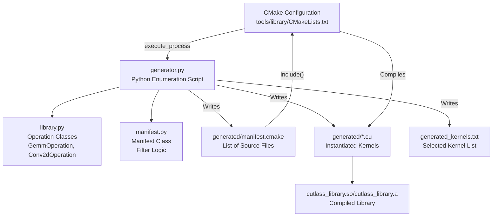
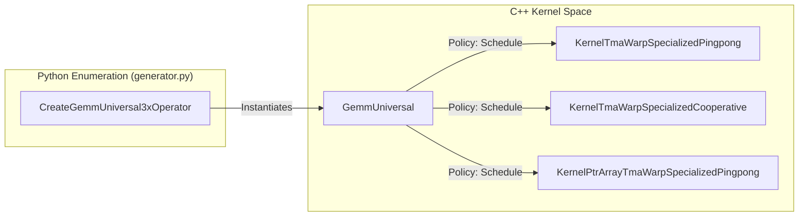

<!-- source: DeepWiki mcp.deepwiki.com · repo NVIDIA/cutlass · page 3.6 Operation Enumeration and Code Generation · fetched 2026-10-26 -->

# Operation Enumeration and Code Generation

Relevant source files

The following files were used as context for generating this wiki page:

- [examples/79_blackwell_geforce_gemm/CMakeLists.txt](examples/79_blackwell_geforce_gemm/CMakeLists.txt)
- [examples/80_blackwell_geforce_sparse_gemm/CMakeLists.txt](examples/80_blackwell_geforce_sparse_gemm/CMakeLists.txt)
- [examples/87_blackwell_geforce_gemm_blockwise/CMakeLists.txt](examples/87_blackwell_geforce_gemm_blockwise/CMakeLists.txt)
- [examples/python/CuTeDSL/cute_ext/blackwell/dense_gemm.py](examples/python/CuTeDSL/cute_ext/blackwell/dense_gemm.py)
- [include/cutlass/epilogue/collective/builders/sm100_builder.inl](include/cutlass/epilogue/collective/builders/sm100_builder.inl)
- [include/cutlass/epilogue/collective/builders/sm120_builder.inl](include/cutlass/epilogue/collective/builders/sm120_builder.inl)
- [include/cutlass/epilogue/collective/sm100_epilogue_array_nosmem.hpp](include/cutlass/epilogue/collective/sm100_epilogue_array_nosmem.hpp)
- [include/cutlass/epilogue/collective/sm100_epilogue_nosmem.hpp](include/cutlass/epilogue/collective/sm100_epilogue_nosmem.hpp)
- [include/cutlass/float8.h](include/cutlass/float8.h)
- [include/cutlass/gemm/collective/builders/sm120_blockscaled_mma_builder.inl](include/cutlass/gemm/collective/builders/sm120_blockscaled_mma_builder.inl)
- [include/cutlass/gemm/collective/builders/sm120_common.inl](include/cutlass/gemm/collective/builders/sm120_common.inl)
- [include/cutlass/gemm/collective/builders/sm1xx_common.inl](include/cutlass/gemm/collective/builders/sm1xx_common.inl)
- [python/CuTeDSL/cutlass/cute/nvgpu/cpasync/copy.py](python/CuTeDSL/cutlass/cute/nvgpu/cpasync/copy.py)
- [python/cutlass_library/generator.py](python/cutlass_library/generator.py)
- [python/cutlass_library/library.py](python/cutlass_library/library.py)
- [tools/library/src/grouped_gemm_operation_3x.hpp](tools/library/src/grouped_gemm_operation_3x.hpp)

## Purpose and Scope

This document describes the kernel code generation system that creates the CUTLASS library. The system uses Python scripts to enumerate thousands of kernel variants by combining different parameter configurations (data types, tile sizes, architectures, layouts) and generates C++ instantiation code that CMake compiles into static or shared libraries.

This page focuses on:
- The Python-based operation enumeration functions that create kernel specifications.
- The manifest generation process that produces compilation targets.
- CMake integration that invokes the generator and compiles the results.
- Filtering mechanisms that control which kernels are instantiated.

For information about the Python APIs that let users generate C++ code programmatically, see [3.5 cutlass_cppgen API Reference](). For details on numeric type conversions used within kernels, see [8.1 Numeric Type System and Conversions]().

---

## Generation Pipeline Overview

The kernel generation system operates as a multi-stage pipeline that bridges Python enumeration logic to compiled CUDA libraries.

Title: Kernel Generation Pipeline

The pipeline consists of:

1.  **CMake Invocation**: CMake executes `generator.py` with configuration parameters specifying target architectures, operation types, and filtering criteria.
2.  **Python Enumeration**: Generator script iterates through parameter combinations, creating operation descriptors using classes from `library.py` [python/cutlass_library/generator.py:91-99]().
3.  **Manifest Creation**: Selected operations are written to `manifest.cmake` with paths to generated source files.
4.  **Code Generation**: C++ instantiation code is emitted to `generated/*.cu` files.
5.  **Compilation**: CMake includes the manifest and compiles all generated kernels into the library.

**Sources:** [python/cutlass_library/generator.py:91-99](), [python/cutlass_library/library.py:58-63]()

---

## Operation Enumeration Functions

The generator provides factory functions that enumerate kernel variants by iterating over parameter combinations. Each function targets a specific operation class (GEMM, Convolution, etc.) and produces multiple `Operation` objects.

### GEMM Operation Creation

#### CreateGemmOperator

The `CreateGemmOperator` function creates legacy 2.x API GEMM kernels:

*   **Inputs**:
    *   `layouts`: List of (LayoutA, LayoutB, LayoutC) tuples.
    *   `tile_descriptions`: List of `TileDescription` objects specifying threadblock/warp/instruction shapes.
    *   `data_type`: Tuple of (element_a, element_b, element_c, element_epilogue) [python/cutlass_library/generator.py:142-149]().
    *   `alignment_constraints`: List of alignment values (can be int or tuple for A/B/C).
*   **Process**:
    *   Iterates over all combinations of layouts, tiles, alignments, and complex transforms [python/cutlass_library/generator.py:158-161]().
    *   Creates `TensorDescription` objects for operands A, B, C with specified types and alignments.
    *   Constructs `GemmOperation` with `GemmKind.Universal` mode.
*   **Filtering**: If `manifest.kernel_filter == ''`, only generates the largest tile and largest alignment to reduce kernel count [python/cutlass_library/generator.py:154-156]().

**Sources:** [python/cutlass_library/generator.py:142-166]()

#### CreateGemmUniversal3xOperator

The `CreateGemmUniversal3xOperator` function creates modern 3.x API kernels with additional features:

*   **3.x API Differences**:
    *   Layouts include alignment: `[(layout, alignment)]` instead of separate alignment list.
    *   Data types specified as dictionaries: `{"a_type": ..., "b_type": ..., "acc_type": ...}`.
    *   Kernel and epilogue schedules: `[[KernelScheduleType, EpilogueScheduleType]]`.
    *   Tile schedulers: `[TileSchedulerType.Default, TileSchedulerType.StreamK, ...]`.
*   **Mixed-Precision and Block-Scaled Support**:
    *   If `"sf_type"` is present in the data\_types dictionary, the generator includes scale factor types for block-scaled operands [python/cutlass_library/generator.py:221-226]().
    *   For Blackwell (SM100/SM120), specialized builders like `CollectiveBuilder` with `arch::OpClassBlockScaledTensorOp` are used [include/cutlass/gemm/collective/builders/sm120_blockscaled_mma_builder.inl:53-81]().

**Sources:** [python/cutlass_library/generator.py:221-226](), [include/cutlass/gemm/collective/builders/sm120_blockscaled_mma_builder.inl:53-81]()

---

## Architecture-Specific Code Generation (SM90/SM120)

For modern architectures (SM90+), the generation pipeline targets `GemmUniversal` templates specialized for Warp-Specialization and TMA (Tensor Memory Accelerator).

### Warp-Specialized Kernels
The pipeline generates instantiations for `GemmUniversal` using specific dispatch policies:
*   **Pingpong**: `KernelTmaWarpSpecializedPingpong` is selected for overlapping TMA loads with compute via a ping-pong buffer strategy [include/cutlass/gemm/collective/builders/sm120_blockscaled_mma_builder.inl:70]().
*   **Cooperative**: `KernelTmaWarpSpecializedCooperative` is selected for scenarios where warps cooperate on the same tile [include/cutlass/gemm/collective/builders/sm120_blockscaled_mma_builder.inl:71]().

### Pointer-Array and Grouped GEMM
Specialized kernels for array-of-pointers or grouped GEMM are enumerated using:
*   `KernelPtrArrayTmaWarpSpecializedPingpong` [include/cutlass/gemm/collective/builders/sm120_blockscaled_mma_builder.inl:72]().
*   `KernelPtrArrayTmaWarpSpecializedCooperative` [include/cutlass/gemm/collective/builders/sm120_blockscaled_mma_builder.inl:73]().

### Block-Scaled Support (SM120)
For SM120, the generator targets collective mainloops that manage complex scale factor (SF) layouts and hardware-specific instructions:
*   **Instruction Selection**: The `CollectiveBuilder` selects hardware instructions such as `MXF4F6F8` based on input types [include/cutlass/gemm/collective/builders/sm120_blockscaled_mma_builder.inl:107-113]().
*   **Smem Copy Selectors**: Architecture-specific shared memory copy atoms like `SM100_SU6_DU8x16_x4_LDSM_N` are selected based on element size and tile shapes [include/cutlass/gemm/collective/builders/sm120_common.inl:55-70]().
*   **Epilogue Builders**: Epilogue dispatch policies for SM120, such as `Sm120TmaWarpSpecialized`, are selected to manage shared memory reuse and TMA store delays [include/cutlass/epilogue/collective/builders/sm120_builder.inl:78-114]().

Title: Code Entity Mapping for WS Kernels

**Sources:** [include/cutlass/gemm/collective/builders/sm120_blockscaled_mma_builder.inl:70-113](), [include/cutlass/gemm/collective/builders/sm120_common.inl:55-70](), [include/cutlass/epilogue/collective/builders/sm120_builder.inl:78-114]()

---

## Library Operation Classes

The `cutlass_library` contains C++ classes that wrap the generated kernels to provide a uniform runtime interface.

### GemmOperation3xBase
This class provides the foundation for 3.x GEMM operations, mapping C++ template parameters to the library's runtime descriptors [tools/library/src/grouped_gemm_operation_3x.hpp:48-49]().

### GroupedGemmOperation3xBase
Extends the base operation to support grouped GEMM. It manages device-side buffers for problem strides and handles the transition from static template types to runtime problem counts:
*   **Device Buffers**: Manages `strideA_device`, `strideB_device`, `strideC_device`, and `strideD_device` [tools/library/src/grouped_gemm_operation_3x.hpp:85-88]().
*   **Stride Initialization**: The `initialize_strides()` function prepares problem metadata by copying host-side strides to the device [tools/library/src/grouped_gemm_operation_3x.hpp:100-150]().

**Sources:** [tools/library/src/grouped_gemm_operation_3x.hpp:48-150]()

---

## Data Types and Alignment

The enumeration process is heavily dependent on `DataType` tags defined in the library module [python/cutlass_library/library.py:69-116]().

| Category | Data Type Tags | C++ Equivalent |
| :--- | :--- | :--- |
| Floating Point | `f16`, `bf16`, `f32`, `f64` | `cutlass::half_t`, `float`, `double` |
| Integer | `s8`, `s32`, `u8`, `u32` | `int8_t`, `int32_t`, `uint8_t` |
| Sub-byte | `e4m3`, `e5m2` | `cutlass::float_e4m3_t`, `cutlass::float_e5m2_t` |
| Block-Scaled | `ue8m0`, `ue4m3` | `cutlass::float_ue8m0_t`, `cutlass::float_ue4m3_t` |

**Sources:** [python/cutlass_library/library.py:183-212](), [include/cutlass/float8.h:198-207]()

---

