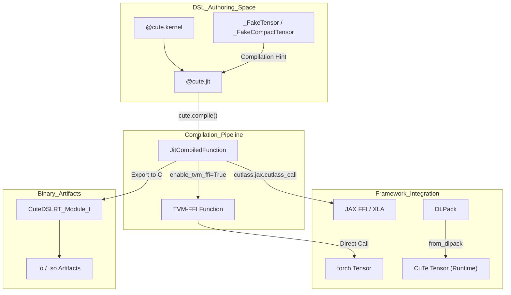
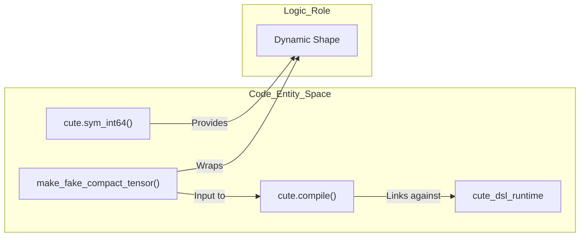

<!-- source: DeepWiki mcp.deepwiki.com · repo NVIDIA/cutlass · page 3.7 AOT Export and Framework Integration · fetched 2026-10-26 -->

# AOT Export and Framework Integration

<details>
<summary>Relevant source files</summary>

The following files were used as context for generating this wiki page:

- [examples/python/CuTeDSL/cute/blackwell/kernel/attention/mla/mla_decode_fp16.py](examples/python/CuTeDSL/cute/blackwell/kernel/attention/mla/mla_decode_fp16.py)
- [examples/python/CuTeDSL/cute/blackwell/kernel/attention/mla/mla_decode_fp8.py](examples/python/CuTeDSL/cute/blackwell/kernel/attention/mla/mla_decode_fp8.py)
- [examples/python/CuTeDSL/cute/blackwell/kernel/attention/mla/mla_helpers.py](examples/python/CuTeDSL/cute/blackwell/kernel/attention/mla/mla_helpers.py)
- [examples/python/CuTeDSL/cute/blackwell/tutorial/tutorial_gemm/fp16_gemm_0.py](examples/python/CuTeDSL/cute/blackwell/tutorial/tutorial_gemm/fp16_gemm_0.py)
- [examples/python/CuTeDSL/cute/blackwell/tutorial/tutorial_gemm/fp16_gemm_1.py](examples/python/CuTeDSL/cute/blackwell/tutorial/tutorial_gemm/fp16_gemm_1.py)
- [examples/python/CuTeDSL/cute/blackwell/tutorial/tutorial_gemm/fp16_gemm_2.py](examples/python/CuTeDSL/cute/blackwell/tutorial/tutorial_gemm/fp16_gemm_2.py)
- [examples/python/CuTeDSL/cute/blackwell/tutorial/tutorial_gemm/fp16_gemm_3.py](examples/python/CuTeDSL/cute/blackwell/tutorial/tutorial_gemm/fp16_gemm_3.py)
- [examples/python/CuTeDSL/cute_ext/blackwell/dense_gemm_2sm.py](examples/python/CuTeDSL/cute_ext/blackwell/dense_gemm_2sm.py)
- [examples/python/CuTeDSL/dsl_tutorials/dataclass_immutable.py](examples/python/CuTeDSL/dsl_tutorials/dataclass_immutable.py)
- [examples/python/CuTeDSL/dsl_tutorials/export/run_with_dynamic_loading.cpp](examples/python/CuTeDSL/dsl_tutorials/export/run_with_dynamic_loading.cpp)
- [examples/python/CuTeDSL/dsl_tutorials/export/run_with_static_linking.cpp](examples/python/CuTeDSL/dsl_tutorials/export/run_with_static_linking.cpp)
- [examples/python/CuTeDSL/dsl_tutorials/ffi/tensor.cpp](examples/python/CuTeDSL/dsl_tutorials/ffi/tensor.cpp)
- [python/CuTeDSL/cutlass/jax/__init__.py](python/CuTeDSL/cutlass/jax/__init__.py)
- [python/CuTeDSL/cutlass/jax/ffi.py](python/CuTeDSL/cutlass/jax/ffi.py)

</details>


The Ahead-of-Time (AOT) export and framework integration capabilities in CUTLASS (specifically within the CuTe Python DSL) enable developers to compile high-performance kernels into standalone artifacts. These artifacts can be seamlessly integrated into machine learning frameworks like PyTorch and JAX, minimizing host-side overhead and leveraging optimized calling conventions such as Apache TVM FFI and JAX FFI.

## Overview of Integration Strategies

CUTLASS provides multiple pathways for integrating CuTe DSL kernels into production environments:

1.  **Apache TVM FFI Integration**: Provides an open ABI for fast kernel invocation and direct support for DLPack-compatible tensors (e.g., `torch.Tensor`) [examples/python/CuTeDSL/dsl_tutorials/dataclass_immutable.py:112-115]().
2.  **JAX FFI Integration**: Uses the `cutlass.jax` module to register kernels as JAX FFI targets, allowing them to participate in JAX's JIT and serialization pipelines with support for stateful FFI calls (V2) [python/CuTeDSL/cutlass/jax/ffi.py:44-56]().
3.  **C-Header and Shared Library Export**: Kernels can be exported to C headers and object files for integration into native C++ applications via the `CuteDSLRuntime` [examples/python/CuTeDSL/dsl_tutorials/export/run_with_dynamic_loading.cpp:45-46]().

### Data Flow and System Entities

The following diagram illustrates the relationship between the Python DSL entities and the runtime/export layers.

**CuTe DSL to Framework Integration Flow**

**Sources:** [examples/python/CuTeDSL/dsl_tutorials/dataclass_immutable.py:108-115](), [python/CuTeDSL/cutlass/jax/ffi.py:168-176](), [examples/python/CuTeDSL/dsl_tutorials/export/run_with_dynamic_loading.cpp:145-152]()

## TVM FFI Integration

Apache TVM FFI is utilized to reduce the CPU host overhead associated with eager kernel invocation. This is particularly critical for latency-sensitive applications where Python-side attribute validation can become a bottleneck.

### Key Features
*   **Direct Tensor Passing**: TVM FFI-compiled functions accept framework tensors (e.g., `torch.Tensor`) directly, relying on the `cute_dsl_runtime` to handle underlying memory pointers [examples/python/CuTeDSL/dsl_tutorials/dataclass_immutable.py:118-122]().
*   **Frozen Dataclasses**: Tensors and static parameters can be grouped into `frozen=True` dataclasses for clean parameter passing from `@cute.jit` to `@cute.kernel` [examples/python/CuTeDSL/dsl_tutorials/dataclass_immutable.py:57-71]().
*   **Reduced Overhead**: By bypassing the standard Python `ctypes` or `pybind11` call overhead, kernels achieve faster dispatch.

**Sources:** [examples/python/CuTeDSL/dsl_tutorials/dataclass_immutable.py:37-41](), [examples/python/CuTeDSL/dsl_tutorials/dataclass_immutable.py:57-71]()

## JAX FFI Integration

Integration with JAX is managed through the `cutlass.jax` module, which supports both V1 (stateless) and V2 (stateful) JAX FFI versions [python/CuTeDSL/cutlass/jax/ffi.py:32-56]().

### JAX FFI Target Registration
The `cute_dsl_runtime` library provides specific entry points for JAX:
*   `CuteDSLRT_NvJaxCutlassCallExecute_v2`: The main execution handler for JAX FFI V2 [python/CuTeDSL/cutlass/jax/ffi.py:47-47]().
*   `CuteDSLRT_NvJaxCutlassCallPrepare_v2`: Handles setup and validation before execution [python/CuTeDSL/cutlass/jax/ffi.py:49-49]().

The registration process maps these C++ symbols to JAX custom call targets via `jax.ffi.register_ffi_target` [python/CuTeDSL/cutlass/jax/ffi.py:165-176]().

**Sources:** [python/CuTeDSL/cutlass/jax/ffi.py:32-56](), [python/CuTeDSL/cutlass/jax/ffi.py:165-176](), [python/CuTeDSL/cutlass/jax/__init__.py:51-73]()

## AOT Export to C/C++

CuTe DSL kernels can be exported as standalone object files (`.o`) or shared libraries (`.so`), accompanied by C headers that define the necessary argument structures.

### Runtime API (`CuteDSLRuntime.h`)
The C++ runtime provides an opaque interface for loading and executing exported modules:
*   `CuteDSLRT_Module_Create_From_Bytes`: Loads a kernel from a buffer of object file bytes [examples/python/CuTeDSL/dsl_tutorials/export/run_with_dynamic_loading.cpp:145-148]().
*   `CuteDSLRT_Function_Run`: Invokes the loaded kernel with a list of argument pointers [examples/python/CuTeDSL/dsl_tutorials/export/run_with_dynamic_loading.cpp:157-157]().

### Argument Mapping
Exported kernels generate C structs for tensors, capturing dynamic shapes and strides:
```cpp
typedef struct {
  void *data;
  int32_t dynamic_shapes[2];
  int64_t dynamic_strides[1];
} print_tensor_Tensor_a_t;
```
**Sources:** [examples/python/CuTeDSL/dsl_tutorials/export/run_with_dynamic_loading.cpp:70-74](), [examples/python/CuTeDSL/dsl_tutorials/export/run_with_dynamic_loading.cpp:145-165](), [examples/python/CuTeDSL/dsl_tutorials/export/run_with_static_linking.cpp:68-72]()

## AOT Compilation with Fake Tensors

To support AOT export without requiring GPU memory allocation during compilation, CUTLASS provides "Fake Tensors" (`make_fake_compact_tensor`). These act as placeholders that encode metadata (shape, stride, data type) and support symbolic dimensions via `cute.sym_int64()` [examples/python/CuTeDSL/dsl_tutorials/dataclass_immutable.py:107-110]().

**Entity Association: Compilation to Code**

**Sources:** [examples/python/CuTeDSL/dsl_tutorials/dataclass_immutable.py:107-115](), [python/CuTeDSL/cutlass/jax/ffi.py:95-132]()

## Runtime Representation and DLPack

The `from_dlpack` function serves as the primary bridge between framework tensors (Torch, JAX) and the CuTe runtime. It allows tensors to be marked with dynamic layouts or specific alignments required by hardware instructions like TMA [examples/python/CuTeDSL/cute_ext/blackwell/dense_gemm_2sm.py:93-101]().

| Class / Function | Purpose |
| :--- | :--- |
| `from_dlpack` | Converts framework tensors to CuTe runtime tensors [cutlass/cute/runtime/__init__.py](). |
| `mark_layout_dynamic` | Flags specific dimensions (e.g., leading dimension) as dynamic for the compiler [examples/python/CuTeDSL/cute_ext/blackwell/dense_gemm_2sm.py:93-95](). |
| `CuteDSLRT_Module_t` | C-compatible handle for a compiled CuTe module [examples/python/CuTeDSL/dsl_tutorials/export/run_with_dynamic_loading.cpp:141-141](). |
| `register_ffi` | Registers CUTLASS kernels as JAX FFI targets [python/CuTeDSL/cutlass/jax/ffi.py:193-215](). |

**Sources:** [examples/python/CuTeDSL/cute_ext/blackwell/dense_gemm_2sm.py:93-101](), [python/CuTeDSL/cutlass/jax/ffi.py:193-215](), [examples/python/CuTeDSL/dsl_tutorials/export/run_with_dynamic_loading.cpp:141-165]()

---

