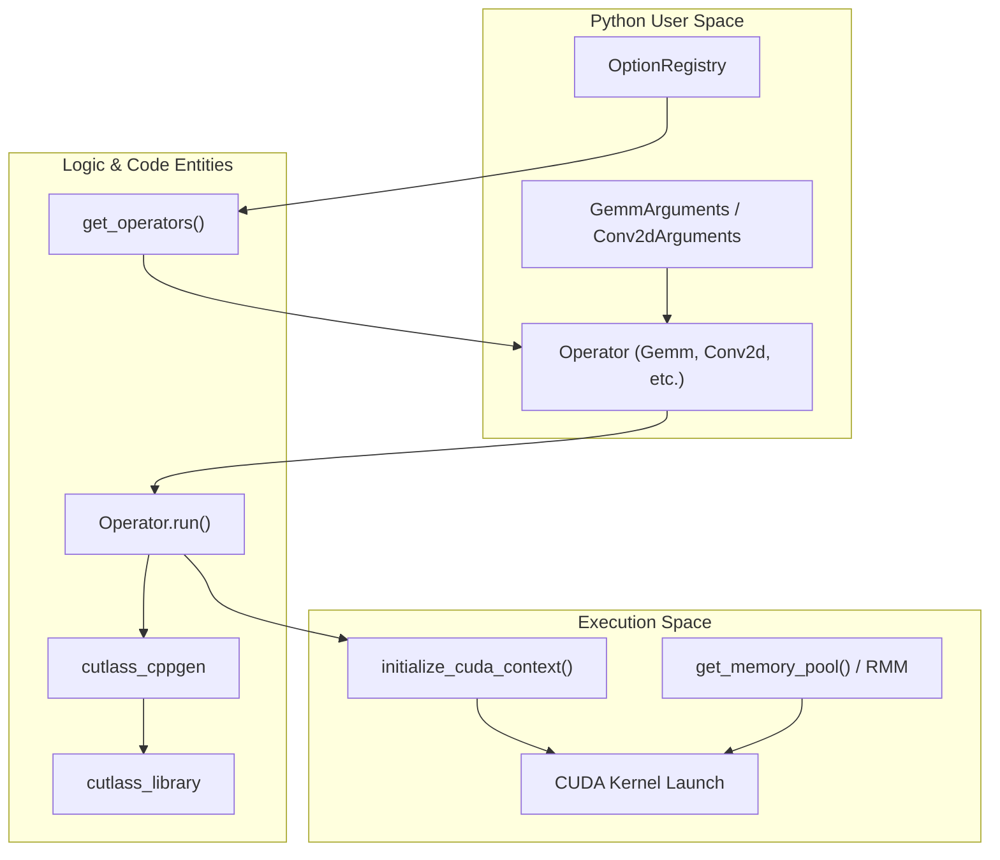
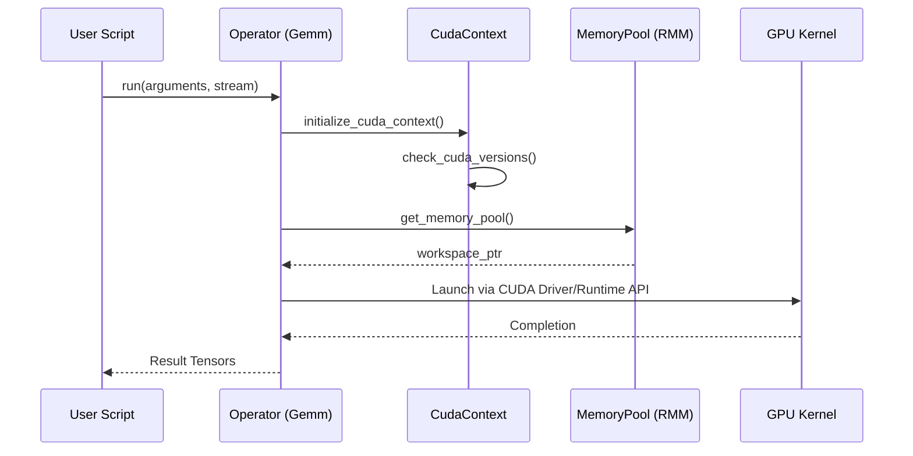

<!-- source: DeepWiki mcp.deepwiki.com · repo NVIDIA/cutlass · page 3.8 CUTLASS Operator API · fetched 2026-10-26 -->

# CUTLASS Operator API

Relevant source files

The following files were used as context for generating this wiki page:

- [CHANGELOG.md](CHANGELOG.md)
- [README.md](README.md)
- [include/cutlass/version.h](include/cutlass/version.h)
- [media/docs/operators/overview.rst](media/docs/operators/overview.rst)
- [media/docs/operators/tutorials/index.rst](media/docs/operators/tutorials/index.rst)
- [python/CuTeDSL/cutlass/base_dsl/env_manager.py](python/CuTeDSL/cutlass/base_dsl/env_manager.py)
- [python/CuTeDSL/cutlass/base_dsl/runtime/cuda.py](python/CuTeDSL/cutlass/base_dsl/runtime/cuda.py)
- [python/CuTeDSL/cutlass/cute/__init__.py](python/CuTeDSL/cutlass/cute/__init__.py)
- [python/CuTeDSL/cutlass/cute/arch/nvvm_wrappers.py](python/CuTeDSL/cutlass/cute/arch/nvvm_wrappers.py)
- [python/CuTeDSL/cutlass/cute/core.py](python/CuTeDSL/cutlass/cute/core.py)
- [python/CuTeDSL/cutlass/jax/primitive.py](python/CuTeDSL/cutlass/jax/primitive.py)
- [python/CuTeDSL/requirements-cu13.txt](python/CuTeDSL/requirements-cu13.txt)
- [python/CuTeDSL/requirements.txt](python/CuTeDSL/requirements.txt)
- [python/cutlass_cppgen/__init__.py](python/cutlass_cppgen/__init__.py)
- [python/setup_cutlass.py](python/setup_cutlass.py)
- [python/setup_library.py](python/setup_library.py)
- [python/setup_pycute.py](python/setup_pycute.py)

The **CUTLASS Operator API** is a high-level Python interface (currently in public beta) designed to provide a kernel-agnostic way to find, inspect, and execute optimized CUTLASS kernels. It abstracts away the complexities of C++ template instantiation and manual kernel configuration, allowing users to interact with CUTLASS through a unified Pythonic interface.

Sources: [README.md:63-67](), [README.md:40-40]()

## System Architecture and Code Entities

The Operator API bridges the gap between high-level Python problem descriptions and the low-level C++ or DSL kernel implementations. It utilizes a registry-based system to match user requirements (data types, layouts, hardware targets) with available kernel implementations.

### Entity Relationship Diagram
This diagram shows how high-level Python entities map to the underlying execution and generation logic.

Sources: [python/cutlass_cppgen/__init__.py:122-156](), [python/cutlass_cppgen/__init__.py:138-144]()

## Key Components

### 1. Operation Registry and Discovery
The `OptionRegistry` is the central component for discovering available kernels. It queries the `cutlass_library` to find operations that match specific hardware capabilities (Compute Capability).

*   **`get_option_registry()`**: A helper method for on-demand initialization of the options registry, avoiding overhead during initial import. [python/cutlass_cppgen/__init__.py:126-134]()
*   **`device_cc()`**: Detects the Compute Capability of the current GPU to filter compatible operators. [python/cutlass_cppgen/__init__.py:123-123]()

### 2. Operator Classes
The API provides specialized classes for different linear algebra operations. These classes inherit from `OperationBase`.

| Class | Purpose | Source |
| :--- | :--- | :--- |
| `Gemm` | Standard General Matrix Multiply | [python/cutlass_cppgen/__init__.py:140-140]() |
| `Conv2d` | 2D Convolution (Fprop, Dgrad, Wgrad) | [python/cutlass_cppgen/__init__.py:141-141]() |
| `GroupedGemm` | GEMM with multiple varying problem sizes | [python/cutlass_cppgen/__init__.py:142-142]() |
| `OperationBase` | Base class for all CUTLASS Python operators | [python/cutlass_cppgen/__init__.py:143-143]() |

### 3. Argument Management
Operations are configured using argument structures that mirror the C++ `Arguments` structs.
*   **Data Types**: Handled via `DataType` (e.g., F16, BF16, E4M3, E5M2, FP4). [python/cutlass_cppgen/__init__.py:87-87](), [README.md:73-74]()
*   **Layouts**: Defined via `LayoutType` (RowMajor, ColumnMajor). [python/cutlass_cppgen/__init__.py:91-91]()

Sources: [python/cutlass_cppgen/__init__.py:86-95]()

## Execution Flow

The `Operator.run()` method handles the end-to-end execution of a kernel.

### Execution Sequence Diagram

Sources: [python/cutlass_cppgen/__init__.py:149-156](), [python/cutlass_cppgen/__init__.py:183-190]()

### Memory Management
The Operator API integrates with **RMM (Reallocating Memory Manager)** for efficient device memory allocation.
*   **`get_memory_pool()`**: Initializes a pool (defaulting to 1GiB initial, 4GiB max) if RMM is available. [python/cutlass_cppgen/__init__.py:149-156]()
*   **Workspace**: Many CUTLASS kernels (like StreamK or Grouped GEMM) require temporary device workspace, which the API manages automatically.

### Architecture Portability
The API ensures that kernels are matched to the specific `GPUArch`. For example, it supports specialized features like:
*   **SM90 (Hopper)**: TMA (Tensor Memory Accelerator) and WGMMA instructions. [README.md:97-98]()
*   **SM100 (Blackwell)**: Support for FP4 data types and enhanced TMA. [README.md:91-94](), [README.md:73-74]()

## Custom Epilogue Fusions
As of CUTLASS 4.7, the Operator API supports advanced epilogue fusion enhancements:
*   **Scalar Reductions**: Ability to perform reductions to a scalar value directly in the epilogue. [README.md:65-65](), [CHANGELOG.md:24-24]()
*   **Data Movement Strategy**: Users can specify the movement strategy (e.g., TMA vs. CP.ASYNC) for each operand being loaded or stored. [README.md:66-66](), [CHANGELOG.md:25-25]()

Sources: [README.md:63-67](), [CHANGELOG.md:22-26]()

## Integration with Frameworks
The Operator API is designed to work seamlessly with deep learning frameworks:
*   **PyTorch**: Uses `cutlass_cppgen.emit.pytorch` to generate wrappers. [python/cutlass_cppgen/__init__.py:139-139]()
*   **JAX**: Supported via FFI (Foreign Function Interface) registration. [CHANGELOG.md:52-52]()

Sources: [python/cutlass_cppgen/__init__.py:139-145](), [CHANGELOG.md:52-52]()

---

