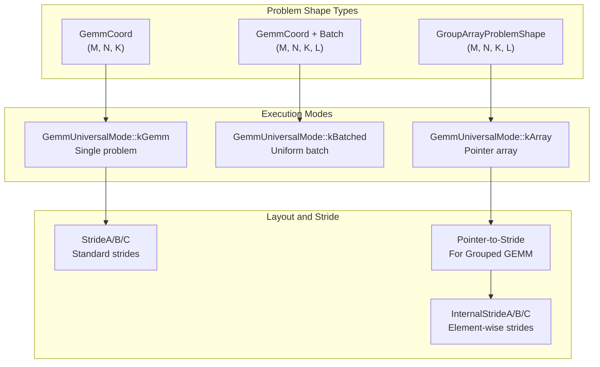

<!-- source: DeepWiki mcp.deepwiki.com · repo NVIDIA/cutlass · page 4 GEMM Operations · fetched 2026-10-26 -->

# GEMM Operations

<details>
<summary>Relevant source files</summary>

The following files were used as context for generating this wiki page:

- [include/cutlass/gemm/collective/builders/sm120_array_mma_builder.inl](include/cutlass/gemm/collective/builders/sm120_array_mma_builder.inl)
- [include/cutlass/gemm/collective/builders/sm120_mma_builder.inl](include/cutlass/gemm/collective/builders/sm120_mma_builder.inl)
- [include/cutlass/gemm/collective/collective_builder.hpp](include/cutlass/gemm/collective/collective_builder.hpp)
- [include/cutlass/gemm/collective/collective_mma.hpp](include/cutlass/gemm/collective/collective_mma.hpp)
- [include/cutlass/gemm/collective/sm120_blockscaled_mma_array_tma.hpp](include/cutlass/gemm/collective/sm120_blockscaled_mma_array_tma.hpp)
- [include/cutlass/gemm/collective/sm120_blockscaled_mma_tma.hpp](include/cutlass/gemm/collective/sm120_blockscaled_mma_tma.hpp)
- [include/cutlass/gemm/collective/sm120_mma_array_tma.hpp](include/cutlass/gemm/collective/sm120_mma_array_tma.hpp)
- [include/cutlass/gemm/collective/sm120_mma_array_tma_blockwise_scaling.hpp](include/cutlass/gemm/collective/sm120_mma_array_tma_blockwise_scaling.hpp)
- [include/cutlass/gemm/collective/sm120_mma_tma.hpp](include/cutlass/gemm/collective/sm120_mma_tma.hpp)
- [include/cutlass/gemm/collective/sm120_mma_tma_blockwise_scaling.hpp](include/cutlass/gemm/collective/sm120_mma_tma_blockwise_scaling.hpp)
- [include/cutlass/gemm/kernel/sm90_gemm_array_tma_warpspecialized_cooperative.hpp](include/cutlass/gemm/kernel/sm90_gemm_array_tma_warpspecialized_cooperative.hpp)
- [include/cutlass/gemm/kernel/sm90_gemm_array_tma_warpspecialized_pingpong.hpp](include/cutlass/gemm/kernel/sm90_gemm_array_tma_warpspecialized_pingpong.hpp)
- [include/cutlass/gemm/kernel/sm90_gemm_tma_warpspecialized_cooperative.hpp](include/cutlass/gemm/kernel/sm90_gemm_tma_warpspecialized_cooperative.hpp)
- [include/cutlass/gemm/kernel/sm90_gemm_tma_warpspecialized_pingpong.hpp](include/cutlass/gemm/kernel/sm90_gemm_tma_warpspecialized_pingpong.hpp)
- [include/cutlass/gemm/kernel/tile_scheduler_params.h](include/cutlass/gemm/kernel/tile_scheduler_params.h)
- [test/unit/gemm/device/sm120_tensorop_gemm/CMakeLists.txt](test/unit/gemm/device/sm120_tensorop_gemm/CMakeLists.txt)
- [test/unit/gemm/device/sm120_tensorop_gemm/sm120_gemm_f8_f8_f32_tensor_op_group_gemm.cu](test/unit/gemm/device/sm120_tensorop_gemm/sm120_gemm_f8_f8_f32_tensor_op_group_gemm.cu)

</details>


## Purpose and Scope

This page documents the General Matrix Multiply (GEMM) operations in CUTLASS, which form the core computational kernel for matrix multiplication: `D = α(A × B) + βC`. GEMM kernels implement highly optimized GPU code across multiple architectures (SM70-SM120+) with support for various problem types, data layouts, and scheduling strategies.

For fused multi-head attention operations that build on GEMM primitives, see [Fused Multi-Head Attention (FMHA)](#6). For the underlying CuTe abstractions used to construct GEMM kernels, see [CuTe Core Abstractions](#2). For collective components that compose into complete GEMM implementations, see [Collective Components](#5).

**Scope**: This page covers GEMM kernel architecture, execution modes, warp specialization patterns, and integration with hardware features like TMA, WGMMA, and UMMA. Child pages provide detailed documentation on specific aspects of GEMM implementations.

---

## GemmUniversal Kernel Template

The `GemmUniversal` kernel template serves as the primary interface for all GEMM operations in CUTLASS. In 3.x and 4.x, it is parameterized by problem shape, collective components, and tile scheduler [include/cutlass/gemm/kernel/sm90_gemm_tma_warpspecialized_cooperative.hpp:59-72]().

```cpp
template <
  class ProblemShape_,
  class CollectiveMainloop_,
  class CollectiveEpilogue_,
  class TileScheduler_
>
class GemmUniversal;
```
[include/cutlass/gemm/kernel/sm90_gemm_tma_warpspecialized_pingpong.hpp:59-70]()

### GemmUniversalAdapter
The `GemmUniversalAdapter` is a stateful, reusable handle that manages the lifetime of the underlying `kernel::Params` struct and exposes APIs to create it from host-facing arguments. It supports both 2.x and 3.x API kernel types by specializing the implementation.

### Core Structures

**Arguments Structure** (Host-side):
- `GemmUniversalMode mode`: Execution mode (Gemm, Batched, Array, Grouped).
- `GemmCoord problem_size`: Problem dimensions (M, N, K).
- `int batch_count`: Number of GEMM operations to perform.
- `EpilogueOutputOp::Params epilogue`: Epilogue parameters like alpha and beta.

**Params Structure** (Device-side):
- Converted from `Arguments` to handle the underlying hardware parameters.
- Contains TMA descriptors (for SM90+), workspace pointers, and scheduler parameters [include/cutlass/gemm/kernel/sm90_gemm_tma_warpspecialized_pingpong.hpp:116-120]().

### Execution Modes

| Mode | Description |
|------|-------------|
| `kGemm` | Single matrix multiplication. |
| `kBatched` | Batch of identically-shaped problems with constant strides between batches. |
| `kArray` | Array of pointers to different matrices, allowing for disjoint memory [include/cutlass/gemm/kernel/sm90_gemm_array_tma_warpspecialized_cooperative.hpp:65-71](). |
| `kGrouped` | Different problem shapes per group, often used for MoE or irregular workloads [include/cutlass/gemm/kernel/sm90_gemm_array_tma_warpspecialized_cooperative.hpp:127](). |

Sources: [include/cutlass/gemm/kernel/sm90_gemm_array_tma_warpspecialized_cooperative.hpp:59-155](), [include/cutlass/gemm/kernel/sm90_gemm_tma_warpspecialized_pingpong.hpp:59-120]()

---

## Problem Shape Hierarchy



### Specialized Problem Types
- **Pointer-Array/Grouped GEMM**: Supports matrices where pointers to A, B, C, and D are provided as arrays, and problem shapes can vary per group [include/cutlass/gemm/kernel/sm90_gemm_array_tma_warpspecialized_cooperative.hpp:127-146]().
- **Blockwise Scaling**: Targets SM100/SM120 architectures where inputs are scaled by block factors (e.g., MX formats) [include/cutlass/gemm/collective/sm120_mma_tma_blockwise_scaling.hpp:75-90]().

Sources: [include/cutlass/gemm/kernel/sm90_gemm_array_tma_warpspecialized_cooperative.hpp:88-90](), [include/cutlass/gemm/collective/sm120_mma_array_tma_blockwise_scaling.hpp:135-144]()

---

## Architecture Support Matrix

| Architecture | Implementation Style | Key Features |
|--------------|----------------|--------------|
| **SM70-SM80** | Threadblock-scoped Iterators | Shared memory async copy (SM80), SIMT and Tensor Cores [include/cutlass/gemm/collective/collective_mma.hpp:38-40]() |
| **SM90 (Hopper)** | Warp-Specialized Collective | TMA, WGMMA, Thread block clusters [include/cutlass/gemm/kernel/sm90_gemm_tma_warpspecialized_cooperative.hpp:98-110]() |
| **SM100+ (Blackwell)** | Warp-Specialized Collective | Enhanced TMA, block scaling, UMMA, tcgen05.mma [include/cutlass/gemm/collective/sm120_mma_tma.hpp:75-90]() |

### SM120 (Blackwell) Collective MMA
The `CollectiveMma` for SM120 introduces support for `UMMA` (Unified MMA) and blockwise scaling. It uses `PipelineTmaAsync` for mainloop coordination [include/cutlass/gemm/collective/sm120_mma_tma.hpp:127-128]().

- **Collective Builder**: Automates the selection of `TiledMma`, `SmemLayout`, and `DispatchPolicy` based on architecture and data types [include/cutlass/gemm/collective/builders/sm120_mma_builder.inl:54-78]().
- **Schedules**: Supports `KernelTmaWarpSpecializedCooperativeSm120` and `KernelTmaWarpSpecializedPingpongSm120` [include/cutlass/gemm/collective/builders/sm120_mma_builder.inl:136-138]().

Sources: [include/cutlass/gemm/collective/collective_mma.hpp:74-88](), [include/cutlass/gemm/collective/builders/sm120_mma_builder.inl:80-115](), [include/cutlass/gemm/collective/sm120_mma_array_tma.hpp:75-90]()

---

## Warp Specialization and Scheduling

Modern GEMM kernels (SM90+) separate the roles of warps to maximize throughput and hide latency.

### Warp Roles
- **Scheduler Warp**: Manages tile distribution across the grid [include/cutlass/gemm/kernel/sm90_gemm_tma_warpspecialized_cooperative.hpp:115]().
- **Load Warps (Producers)**: Responsible for data movement from global memory to shared memory via TMA [include/cutlass/gemm/kernel/sm90_gemm_tma_warpspecialized_cooperative.hpp:117]().
- **MMA Warps (Consumers)**: Responsible for math operations (WGMMA/UMMA) [include/cutlass/gemm/kernel/sm90_gemm_tma_warpspecialized_cooperative.hpp:116]().

### Scheduling Strategies
- **Pingpong**: Alternates between two sets of shared memory buffers to overlap load and math [include/cutlass/gemm/kernel/sm90_gemm_tma_warpspecialized_pingpong.hpp:69-70]().
- **Cooperative**: MMA warps cooperate on processing tiles, typically offering better resource utilization for specific tile shapes [include/cutlass/gemm/kernel/sm90_gemm_tma_warpspecialized_cooperative.hpp:65-66]().
- **StreamK**: A grid-level decomposition strategy that balances work across SMs for irregular problem sizes.

Sources: [include/cutlass/gemm/kernel/sm90_gemm_tma_warpspecialized_cooperative.hpp:115-128](), [include/cutlass/gemm/kernel/sm90_gemm_tma_warpspecialized_pingpong.hpp:128-135]()

---

## Summary of GEMM Variants

| Variant | Purpose | Reference Entity |
|---------|---------|------------------|
| **Universal** | Standard GEMM interface | `GemmUniversal` [include/cutlass/gemm/kernel/gemm_universal_decl.h:48]() |
| **Array/Grouped** | Disjoint matrices / varying shapes | `KernelPtrArrayTmaWarpSpecializedCooperative` [include/cutlass/gemm/kernel/sm90_gemm_array_tma_warpspecialized_cooperative.hpp:70]() |
| **Blockwise Scaling** | MX/Block-scaled data types | `MainloopSm120TmaWarpSpecializedBlockwiseScaling` [include/cutlass/gemm/collective/sm120_mma_tma_blockwise_scaling.hpp:76]() |
| **Sparse** | Structured 2:4 sparsity | `CollectiveMma` (Sparse variants) [include/cutlass/gemm/collective/collective_mma.hpp:47-48]() |

For detailed technical guides, refer to the child pages:
- [Universal GEMM Kernel Architecture](#4.1) — Detailed breakdown of `GemmUniversal`.
- [SM90 TMA Warp-Specialized GEMM](#4.2) — Deep dive into Hopper-specific optimizations.
- [StreamK Work Decomposition and Scheduling](#4.3) — Advanced load balancing strategies.
- [Grouped and Batched GEMM](#4.4) — Managing multiple GEMM problems in a single kernel.
- [Sparse GEMM and Block Sparsity](#4.5) — Hardware-accelerated sparse matrix operations.
- [CuTe DSL GEMM Examples and Tutorials](#4.6) — Writing GEMMs using the Python interface.

---

