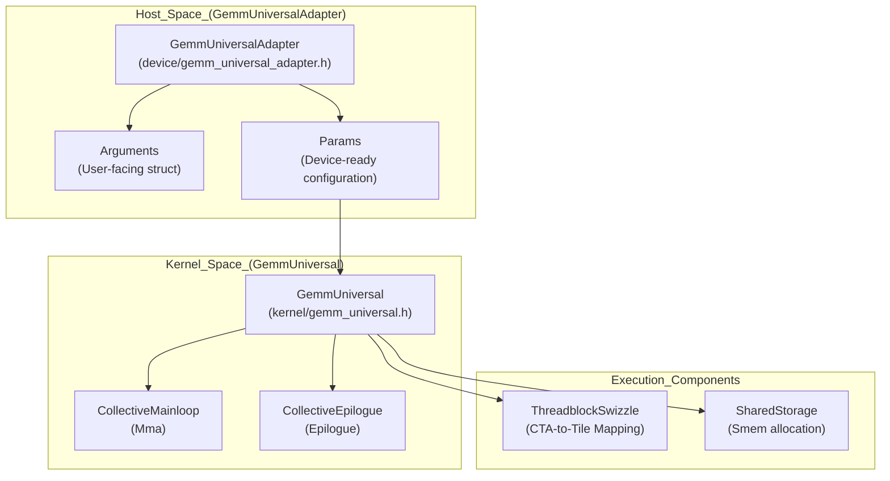
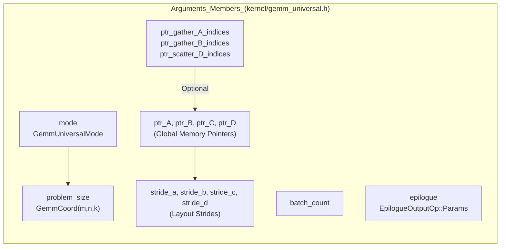
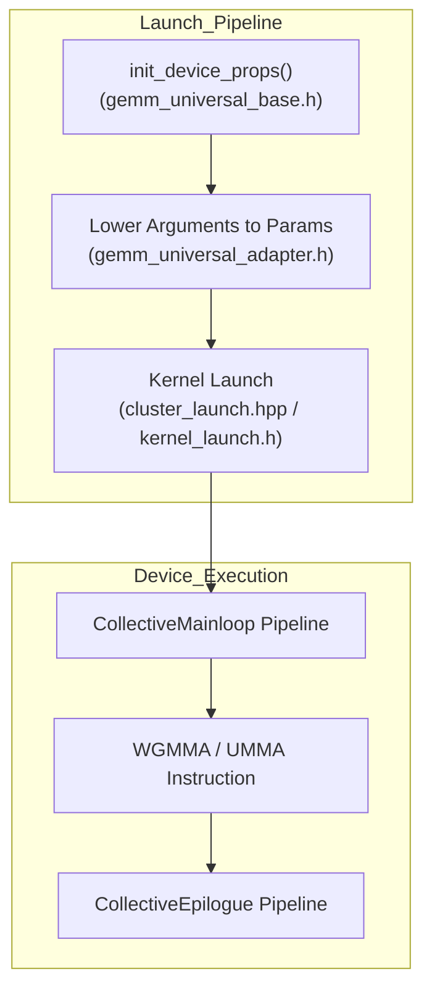

<!-- source: DeepWiki mcp.deepwiki.com · repo NVIDIA/cutlass · page 4.1 Universal GEMM Kernel Architecture · fetched 2026-10-26 -->

# Universal GEMM Kernel Architecture

Relevant source files

The following files were used as context for generating this wiki page:

- [examples/18_ampere_fp64_tensorop_affine2_gemm/ampere_fp64_tensorop_affine2_gemm.cu](examples/18_ampere_fp64_tensorop_affine2_gemm/ampere_fp64_tensorop_affine2_gemm.cu)
- [examples/24_gemm_grouped/gemm_grouped.cu](examples/24_gemm_grouped/gemm_grouped.cu)
- [examples/36_gather_scatter_fusion/gather_scatter_fusion.cu](examples/36_gather_scatter_fusion/gather_scatter_fusion.cu)
- [examples/38_syr2k_grouped/syr2k_grouped.cu](examples/38_syr2k_grouped/syr2k_grouped.cu)
- [examples/65_distributed_gemm/65_distributed_gemm.cu](examples/65_distributed_gemm/65_distributed_gemm.cu)
- [examples/82_blackwell_distributed_gemm/82_blackwell_distributed_gemm.cu](examples/82_blackwell_distributed_gemm/82_blackwell_distributed_gemm.cu)
- [include/cutlass/conv/device/conv_universal_adapter.hpp](include/cutlass/conv/device/conv_universal_adapter.hpp)
- [include/cutlass/coord.h](include/cutlass/coord.h)
- [include/cutlass/experimental/distributed/device/dist_gemm_universal_wrapper.hpp](include/cutlass/experimental/distributed/device/dist_gemm_universal_wrapper.hpp)
- [include/cutlass/gemm/device/gemm_grouped.h](include/cutlass/gemm/device/gemm_grouped.h)
- [include/cutlass/gemm/device/gemm_universal_adapter.h](include/cutlass/gemm/device/gemm_universal_adapter.h)
- [include/cutlass/gemm/device/gemm_universal_base.h](include/cutlass/gemm/device/gemm_universal_base.h)
- [include/cutlass/gemm/kernel/gemm_layernorm_mainloop_fusion.h](include/cutlass/gemm/kernel/gemm_layernorm_mainloop_fusion.h)
- [include/cutlass/gemm/kernel/gemm_planar_complex.h](include/cutlass/gemm/kernel/gemm_planar_complex.h)
- [include/cutlass/gemm/kernel/gemm_planar_complex_array.h](include/cutlass/gemm/kernel/gemm_planar_complex_array.h)
- [include/cutlass/gemm/kernel/gemm_universal.h](include/cutlass/gemm/kernel/gemm_universal.h)
- [include/cutlass/gemm/kernel/gemm_with_fused_epilogue.h](include/cutlass/gemm/kernel/gemm_with_fused_epilogue.h)
- [include/cutlass/tensor_ref.h](include/cutlass/tensor_ref.h)
- [test/unit/gemm/device/testbed_grouped.h](test/unit/gemm/device/testbed_grouped.h)

## Purpose and Scope

The Universal GEMM architecture provides a unified interface for matrix multiplication operations across different execution modes (single, batched, array) and scheduling strategies (data-parallel, StreamK). The kernel template composes mainloop, epilogue, and threadblock scheduling components into a single, flexible GEMM implementation.

In CUTLASS 3.x and 4.x, this architecture is represented by the `GemmUniversalAdapter`, which provides a stateful, reusable handle around kernels of type `cutlass::gemm::kernel::GemmUniversal`. It manages the lifetime of `kernel::Params` and exposes host-facing APIs to lower `Arguments` into device-side parameters.

**Sources:** [include/cutlass/gemm/device/gemm_universal_adapter.h:69-82](), [include/cutlass/gemm/device/gemm_universal_base.h:31-34]()

---

## Kernel Template Structure

The Universal GEMM kernel is defined by the `GemmUniversal` template. It uses SFINAE to dispatch between CUTLASS 2.x and 3.x/4.x APIs based on the `Mma_` template argument.

### Code Entity Relationship
The following diagram illustrates how the `GemmUniversalAdapter` bridges host-side configuration to the device-side kernel execution.

**Key Type Definitions:**

| Type | Description | Source Location |
|------|-------------|----------------|
| `ElementA` / `ElementB` | Input matrix element types | [include/cutlass/gemm/kernel/gemm_universal.h:81-83]() |
| `ElementC` / `ElementD` | Output/source matrix element types | [include/cutlass/gemm/kernel/gemm_universal.h:85-86]() |
| `ThreadblockShape` | Tile dimensions (M×N×K) | [include/cutlass/gemm/kernel/gemm_universal.h:93]() |
| `SharedStorage` | Static shared memory requirement | [include/cutlass/gemm/device/gemm_universal_base.h:108-108]() |

**Sources:** [include/cutlass/gemm/kernel/gemm_universal.h:60-108](), [include/cutlass/gemm/device/gemm_universal_adapter.h:123-144]()

---

## Arguments and Params

The architecture uses a two-stage configuration process: `Arguments` (host-side) and `Params` (device-side).

### Arguments Structure
The `Arguments` struct encapsulates all user-specified parameters. It inherits from `UniversalArgumentsBase` to handle problem dimensions and batch factors.

**Key Parameters:**

| Parameter | Type | Purpose |
|-----------|------|---------|
| `mode` | `GemmUniversalMode` | Operation mode: `kGemm`, `kBatched`, or `kArray` |
| `problem_size` | `GemmCoord` | Matrix dimensions (M, N, K) |
| `batch_count` | `int` | Number of GEMM operations or split-K factor |
| `ptr_gather_A_indices` | `int const *` | Indices for gather fusion (A matrix) | [include/cutlass/gemm/kernel/gemm_universal.h:142-142]() |

**Sources:** [include/cutlass/gemm/kernel/gemm_universal.h:115-186](), [examples/36_gather_scatter_fusion/gather_scatter_fusion.cu:32-35]()

---

## Execution Modes

The Universal GEMM kernel supports multiple execution modes via the `GemmUniversalMode` enumeration. This allows the same kernel to handle standard GEMM, batched GEMM, and pointer-array GEMM.

### Mode Pointer Logic

| Mode | Pointer Arithmetic | Use Case |
|------|---------------------|----------|
| **kGemm** | Direct pointers: `ptr_A` | Single large matrix multiply. |
| **kBatched** | Strided: `ptr_A + i * batch_stride_A` | Batched GEMM where batches are at regular intervals. |
| **kArray** | Indirect: `((ElementA **)ptr_A)[i]` | Batched GEMM where each batch is at an arbitrary address. |

**Sources:** [include/cutlass/gemm/kernel/gemm_universal.h:159-177](), [include/cutlass/gemm/device/gemm_universal_base.h:33-34]()

---

## Workspace Management

The `GemmUniversalBase` and `GemmUniversalAdapter` manage device-side workspace requirements, particularly for StreamK and synchronization.

**Initialization and Device Properties:**
Before launching, the architecture queries device attributes to determine SM count and occupancy, which informs load balancing.
- `init_device_props()`: Configures SM count and occupancy [include/cutlass/gemm/device/gemm_universal_base.h:129-152]().
- `cudaFuncSetAttribute()`: Used to configure extended dynamic shared memory if `kSharedStorageSize` exceeds 48KB [include/cutlass/gemm/device/gemm_universal_base.h:157-163]().

**Sources:** [include/cutlass/gemm/device/gemm_universal_base.h:112-181]()

---

## Grouped and Distributed GEMM

The Universal architecture extends to specialized variants:

### Grouped GEMM
Used when a batch of GEMM operations has distinct problem sizes. Pointers, leading dimensions, and problem sizes are passed as arrays in Global Memory.
- **Classes:** `GemmGrouped` [include/cutlass/gemm/device/gemm_grouped.h:49-53](), `BaseGrouped`.
- **Logic:** Uses a `GroupProblemVisitor` to schedule work across different problem sizes within a single kernel launch. This is often modeled using a `GemmUniversalAdapter` that specialized for grouped execution [include/cutlass/gemm/device/gemm_universal_adapter.h:790-800]().

**Sources:** [include/cutlass/gemm/device/gemm_grouped.h:49-53](), [examples/24_gemm_grouped/gemm_grouped.cu:35-41](), [include/cutlass/gemm/device/gemm_universal_adapter.h:790-800]()

### Distributed GEMM (Experimental)
Supports Tensor Parallel GEMMs across multiple GPUs using NVLink.
- **Wrapper:** `DistributedGemmUniversalAdapter` [include/cutlass/experimental/distributed/device/dist_gemm_universal_wrapper.hpp:53-56]().
- **Schedules:** `AllGather1D_TilingCD_RotatingA`, `ReduceScatter1D_TilingA_RotatingC` [examples/82_blackwell_distributed_gemm/82_blackwell_distributed_gemm.cu:149-150]().
- **Coordination:** Manages barriers (`ElementBarrier`) and buffer spaces across the `TP` (Tensor Parallel) size [include/cutlass/experimental/distributed/device/dist_gemm_universal_wrapper.hpp:111-118]().

**Sources:** [include/cutlass/experimental/distributed/device/dist_gemm_universal_wrapper.hpp:52-133](), [examples/65_distributed_gemm/65_distributed_gemm.cu:138-149](), [examples/82_blackwell_distributed_gemm/82_blackwell_distributed_gemm.cu:132-150]()

---

## Data Flow and Execution

The `GemmUniversalAdapter` facilitates the launch through architecture-specific dispatch policies. For SM90 (Hopper) and SM100 (Blackwell), it leverages the `ClusterShape` and TMA (Tensor Memory Accelerator).

**Sources:** [include/cutlass/gemm/device/gemm_universal_adapter.h:47-51](), [include/cutlass/gemm/device/gemm_universal_base.h:129-132](), [include/cutlass/conv/device/conv_universal_adapter.hpp:38-41]()

---

