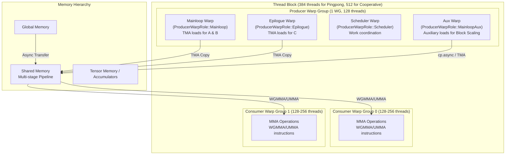
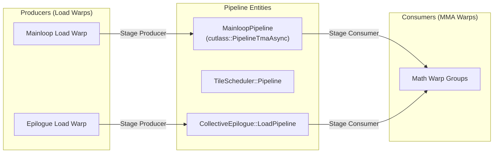

<!-- source: DeepWiki mcp.deepwiki.com · repo NVIDIA/cutlass · page 4.2 SM90 TMA Warp-Specialized GEMM · fetched 2026-10-26 -->

# SM90 TMA Warp-Specialized GEMM

<details>
<summary>Relevant source files</summary>

The following files were used as context for generating this wiki page:

- [examples/67_hopper_fp8_warp_specialized_gemm_with_blockwise_scaling/67_hopper_fp8_warp_specialized_gemm_with_blockwise_scaling.cu](examples/67_hopper_fp8_warp_specialized_gemm_with_blockwise_scaling/67_hopper_fp8_warp_specialized_gemm_with_blockwise_scaling.cu)
- [examples/67_hopper_fp8_warp_specialized_gemm_with_blockwise_scaling/67_hopper_fp8_warp_specialized_gemm_with_groupwise_scaling.cu](examples/67_hopper_fp8_warp_specialized_gemm_with_blockwise_scaling/67_hopper_fp8_warp_specialized_gemm_with_groupwise_scaling.cu)
- [examples/67_hopper_fp8_warp_specialized_gemm_with_blockwise_scaling/CMakeLists.txt](examples/67_hopper_fp8_warp_specialized_gemm_with_blockwise_scaling/CMakeLists.txt)
- [include/cute/arch/cluster_sm90.hpp](include/cute/arch/cluster_sm90.hpp)
- [include/cutlass/gemm/collective/builders/sm90_gmma_builder.inl](include/cutlass/gemm/collective/builders/sm90_gmma_builder.inl)
- [include/cutlass/gemm/collective/fp8_accumulation.hpp](include/cutlass/gemm/collective/fp8_accumulation.hpp)
- [include/cutlass/gemm/collective/sm120_blockscaled_mma_array_tma.hpp](include/cutlass/gemm/collective/sm120_blockscaled_mma_array_tma.hpp)
- [include/cutlass/gemm/collective/sm120_blockscaled_mma_tma.hpp](include/cutlass/gemm/collective/sm120_blockscaled_mma_tma.hpp)
- [include/cutlass/gemm/collective/sm120_mma_array_tma_blockwise_scaling.hpp](include/cutlass/gemm/collective/sm120_mma_array_tma_blockwise_scaling.hpp)
- [include/cutlass/gemm/collective/sm120_mma_tma.hpp](include/cutlass/gemm/collective/sm120_mma_tma.hpp)
- [include/cutlass/gemm/collective/sm120_mma_tma_blockwise_scaling.hpp](include/cutlass/gemm/collective/sm120_mma_tma_blockwise_scaling.hpp)
- [include/cutlass/gemm/collective/sm90_mma_tma_gmma_rs_warpspecialized.hpp](include/cutlass/gemm/collective/sm90_mma_tma_gmma_rs_warpspecialized.hpp)
- [include/cutlass/gemm/collective/sm90_mma_tma_gmma_ss_warpspecialized.hpp](include/cutlass/gemm/collective/sm90_mma_tma_gmma_ss_warpspecialized.hpp)
- [include/cutlass/gemm/collective/sm90_mma_tma_gmma_ss_warpspecialized_fp8.hpp](include/cutlass/gemm/collective/sm90_mma_tma_gmma_ss_warpspecialized_fp8.hpp)
- [include/cutlass/gemm/collective/sm90_mma_tma_gmma_ss_warpspecialized_fp8_blockwise_scaling.hpp](include/cutlass/gemm/collective/sm90_mma_tma_gmma_ss_warpspecialized_fp8_blockwise_scaling.hpp)
- [include/cutlass/gemm/dispatch_policy.hpp](include/cutlass/gemm/dispatch_policy.hpp)
- [include/cutlass/gemm/kernel/sm90_gemm_array_tma_warpspecialized_cooperative.hpp](include/cutlass/gemm/kernel/sm90_gemm_array_tma_warpspecialized_cooperative.hpp)
- [include/cutlass/gemm/kernel/sm90_gemm_array_tma_warpspecialized_pingpong.hpp](include/cutlass/gemm/kernel/sm90_gemm_array_tma_warpspecialized_pingpong.hpp)
- [include/cutlass/gemm/kernel/sm90_gemm_tma_warpspecialized_cooperative.hpp](include/cutlass/gemm/kernel/sm90_gemm_tma_warpspecialized_cooperative.hpp)
- [include/cutlass/gemm/kernel/sm90_gemm_tma_warpspecialized_pingpong.hpp](include/cutlass/gemm/kernel/sm90_gemm_tma_warpspecialized_pingpong.hpp)
- [include/cutlass/gemm/kernel/tile_scheduler_params.h](include/cutlass/gemm/kernel/tile_scheduler_params.h)
- [include/cutlass/pipeline/sm90_pipeline.hpp](include/cutlass/pipeline/sm90_pipeline.hpp)
- [test/unit/gemm/device/gemm_testbed_3x.hpp](test/unit/gemm/device/gemm_testbed_3x.hpp)
- [tools/profiler/src/options.cu](tools/profiler/src/options.cu)

</details>


## Purpose and Scope

This document describes the SM90 (Hopper architecture) and SM120 (Blackwell architecture) GEMM kernel implementations that leverage **Tensor Memory Accelerator (TMA)** hardware and **warp specialization** for high-performance matrix multiplication. These kernels represent CUTLASS 3.x's approach to exploiting modern architectural features for optimal GEMM performance.

**Scope**: This page covers the warp-specialized TMA-based GEMM kernels for SM90. For GEMM operations on earlier architectures (SM70-SM80), see [SM80 Ampere and Earlier Architectures](#7.4). For StreamK scheduling strategies, see [StreamK Work Decomposition and Scheduling](#4.3).

**Key Features**:
- Warp specialization with distinct Producer and Consumer warp groups.
- Asynchronous TMA loads for efficient data movement.
- Multi-stage pipeline with support for deep buffering (2-7+ stages).
- Two primary scheduling variants: **Pingpong** and **Cooperative**.
- Support for standard GEMM, Ptr-Array GEMM, and Grouped GEMM.
- Advanced support for **Blockwise Scaling** (MX formats) on SM90 and SM120.

---

## Architectural Overview

SM90/SM120 warp-specialized GEMM kernels divide a threadblock's warps into specialized groups, each performing distinct roles to maximize hardware utilization and hide memory latency.

### Warp Group Specialization



**Sources**: [include/cutlass/gemm/kernel/sm90_gemm_tma_warpspecialized_pingpong.hpp:128-135](), [include/cutlass/gemm/kernel/sm90_gemm_tma_warpspecialized_cooperative.hpp:115-125](), [include/cutlass/gemm/dispatch_policy.hpp:98-105](), [include/cutlass/gemm/collective/sm120_mma_tma_blockwise_scaling.hpp:133-134]()

### Thread Block Configuration

| Configuration | Pingpong Schedule | Cooperative Schedule |
|--------------|-------------------|----------------------|
| **Total Threads** | 384 | 512 |
| **Producer Threads** | 128 (1 warp group) | 128 (1 warp group) |
| **Consumer Threads** | 256 (2 warp groups, 128 each) | 384 (2 warp groups, 192 or 256 each) |
| **MMA Thread Count** | 128 per consumer WG | 256 or 384 total |
| **Register Requirement (MMA)** | ~232-240 (adjustable) | ~232-240 (adjustable) |

**Sources**: [include/cutlass/gemm/kernel/sm90_gemm_tma_warpspecialized_pingpong.hpp:128-140](), [include/cutlass/gemm/kernel/sm90_gemm_tma_warpspecialized_cooperative.hpp:115-125]()

---

## Kernel Variants

SM90/SM120 TMA warp-specialized GEMM provides primary scheduling variants optimized for different tile sizes and problem types.

### Variant Comparison

| Feature | Pingpong Schedule | Cooperative Schedule |
|---------|-------------------|---------------------|
| **Schedule Tag** | `KernelTmaWarpSpecializedPingpong` | `KernelTmaWarpSpecializedCooperative` |
| **MMA Threads** | 128 (single warp group MMA) | 256 (two warp groups MMA together) |
| **Work Distribution** | Consumer WGs alternate tiles | Both consumer WGs collaborate on same tile |
| **File (Standard)** | `sm90_gemm_tma_warpspecialized_pingpong.hpp` | `sm90_gemm_tma_warpspecialized_cooperative.hpp` |
| **File (Ptr-Array)** | `sm90_gemm_array_tma_warpspecialized_pingpong.hpp` | `sm90_gemm_array_tma_warpspecialized_cooperative.hpp` |

**Sources**: [include/cutlass/gemm/kernel/sm90_gemm_tma_warpspecialized_pingpong.hpp:69](), [include/cutlass/gemm/kernel/sm90_gemm_tma_warpspecialized_cooperative.hpp:65](), [include/cutlass/gemm/kernel/sm90_gemm_array_tma_warpspecialized_pingpong.hpp:70](), [include/cutlass/gemm/kernel/sm90_gemm_array_tma_warpspecialized_cooperative.hpp:70]()

### Ptr-Array and Grouped GEMM
These variants support dynamic problem shapes and multiple matrices. They utilize a `GroupScheduler` or specialized `TileScheduler` to handle work distribution across groups.
- **Grouped Scheduler Pipeline**: Benefit from a larger number of stages (e.g., `TileSchedulerStages = 8`).

**Sources**: [include/cutlass/gemm/kernel/sm90_gemm_array_tma_warpspecialized_pingpong.hpp:148-161](), [include/cutlass/gemm/kernel/sm90_gemm_array_tma_warpspecialized_cooperative.hpp:148-161]()

---

## GemmUniversal Kernel Template

The `GemmUniversal` class template is the primary entry point, specialized via SFINAE based on the dispatch policy's schedule.

### Key Type Aliases

```cpp
// include/cutlass/gemm/kernel/sm90_gemm_tma_warpspecialized_pingpong.hpp
using CollectiveMainloop = CollectiveMainloop_;
using TileShape = typename CollectiveMainloop::TileShape;
using TiledMma  = typename CollectiveMainloop::TiledMma;
using ElementAccumulator = typename CollectiveMainloop::ElementAccumulator;

using CollectiveEpilogue = CollectiveEpilogue_;
using TileScheduler = typename detail::TileSchedulerSelector<...>::Scheduler;
```

**Sources**: [include/cutlass/gemm/kernel/sm90_gemm_tma_warpspecialized_pingpong.hpp:81-114]()

---

## Blockwise Scaling (MX Formats)

SM90 and SM120 introduce specialized support for block-scaled GEMM (e.g., FP8/FP4 with shared exponents).

### Scaling Configuration and CollectiveMma
The `CollectiveMma` specialized for blockwise scaling (e.g., `MainloopSm120TmaWarpSpecializedBlockwiseScaling`) manages both the primary TMA data movement and the scale factor (SF) loads.

| Property | SM90 Blockwise FP8 | SM120 Blockwise Scaling |
|----------|-------------------|-------------------------|
| **Policy** | `MainloopSm90TmaGmmaWarpSpecializedBlockwiseFP8` | `MainloopSm120TmaWarpSpecializedBlockwiseScaling` |
| **Scale Granularity** | `ScaleGranularityM/N/K` | `ScaleGranularityM/N/K` |
| **Auxiliary Loads** | Handled by Warp 3 of Producer WG | Handled by Warp 3 of Producer WG |
| **Instruction** | WGMMA (Hopper) | UMMA (Blackwell) |

**Sources**: [include/cutlass/gemm/collective/sm90_mma_tma_gmma_ss_warpspecialized_fp8_blockwise_scaling.hpp:78-105](), [include/cutlass/gemm/collective/sm120_mma_tma_blockwise_scaling.hpp:76-114](), [include/cutlass/gemm/collective/sm120_mma_tma_blockwise_scaling.hpp:127-133]()

### Collective Builder for Blockwise Scaling
The `CollectiveBuilder` for SM120 (`Sm120_blockscaled_mma_builder.inl`) automatically selects the correct UMMA instruction (e.g., `MXF4F6F8`) and calculates permutation tile shapes for optimal layout.

**Sources**: [include/cutlass/gemm/collective/builders/sm120_blockscaled_mma_builder.inl:53-114]()

---

## Pipeline Architecture

SM90 kernels utilize asynchronous pipelines to overlap data movement with computation.

### Pipeline Hierarchy



**Sources**: [include/cutlass/gemm/kernel/sm90_gemm_tma_warpspecialized_pingpong.hpp:118-123](), [include/cutlass/gemm/kernel/sm90_gemm_tma_warpspecialized_pingpong.hpp:378-383](), [include/cutlass/gemm/collective/sm120_mma_tma_blockwise_scaling.hpp:127-130]()

### Shared Memory and Stage Calculation
The number of pipeline stages is either manually specified or calculated based on shared memory capacity.

```cpp
// include/cutlass/gemm/collective/builders/sm90_gmma_builder.inl
template<int capacity_bytes_, class ElementA, class ElementB, class TileShapeMNK, ...>
constexpr int compute_stage_count_or_override(StageCountAutoCarveout<carveout_bytes_> stage_count) {
    // stage_bytes = round_up(A_bits*M*K + B_bits*N*K) + mainloop_pipeline_bytes
    // stages = (capacity - carveout) / stage_bytes
}
```

**Sources**: [include/cutlass/gemm/collective/builders/sm90_gmma_builder.inl:69-85](), [include/cutlass/gemm/collective/builders/sm90_gmma_builder.inl:88-107]()

---

## Register Pressure and Performance

Due to the high register requirements of WGMMA/UMMA and complex epilogues, kernels often adjust register counts.

- **Heavy Register Pressure Detection**: For SM120 blockscaled kernels, register requirements are monitored. If `RegsPerThread >= 128` (on SM120) or `232` (on SM90), the kernel may trigger specific optimization paths or reconfiguration.
- **Register Reconfiguration**: The kernel uses `cutlass::arch::warpgroup_reg_dealloc` and `warpgroup_reg_alloc` (implicitly via architectural tags) to manage the transition between producer and consumer roles.

**Sources**: [include/cutlass/gemm/kernel/sm90_gemm_tma_warpspecialized_cooperative.hpp:141-151](), [include/cutlass/gemm/kernel/sm90_gemm_tma_warpspecialized_pingpong.hpp:143-146]()

---

## Summary of Dispatch Policies

| Policy Tag | Architecture | Schedule | Features |
|------------|--------------|----------|----------|
| `KernelTmaWarpSpecializedPingpong` | SM90 | Pingpong | TMA, WS, Standard GEMM |
| `KernelTmaWarpSpecializedCooperative` | SM90 | Cooperative | TMA, WS, Standard GEMM |
| `KernelPtrArrayTmaWarpSpecializedPingpong` | SM90 | Pingpong | TMA, WS, Ptr-Array/Grouped |
| `MainloopSm90TmaGmmaWarpSpecializedBlockwiseFP8` | SM90 | WS | Blockwise Scaling FP8 |
| `MainloopSm120TmaWarpSpecializedBlockwiseScaling` | SM120 | WS | Blackwell Blockwise Scaling |

**Sources**: [include/cutlass/gemm/dispatch_policy.hpp:119-143](), [include/cutlass/gemm/collective/sm120_mma_tma_blockwise_scaling.hpp:76-78]()

---

