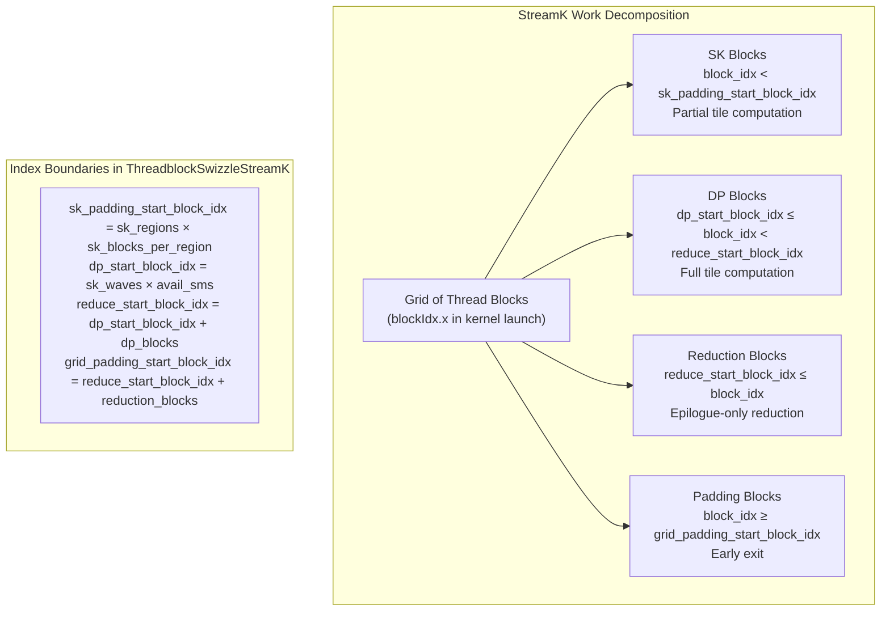
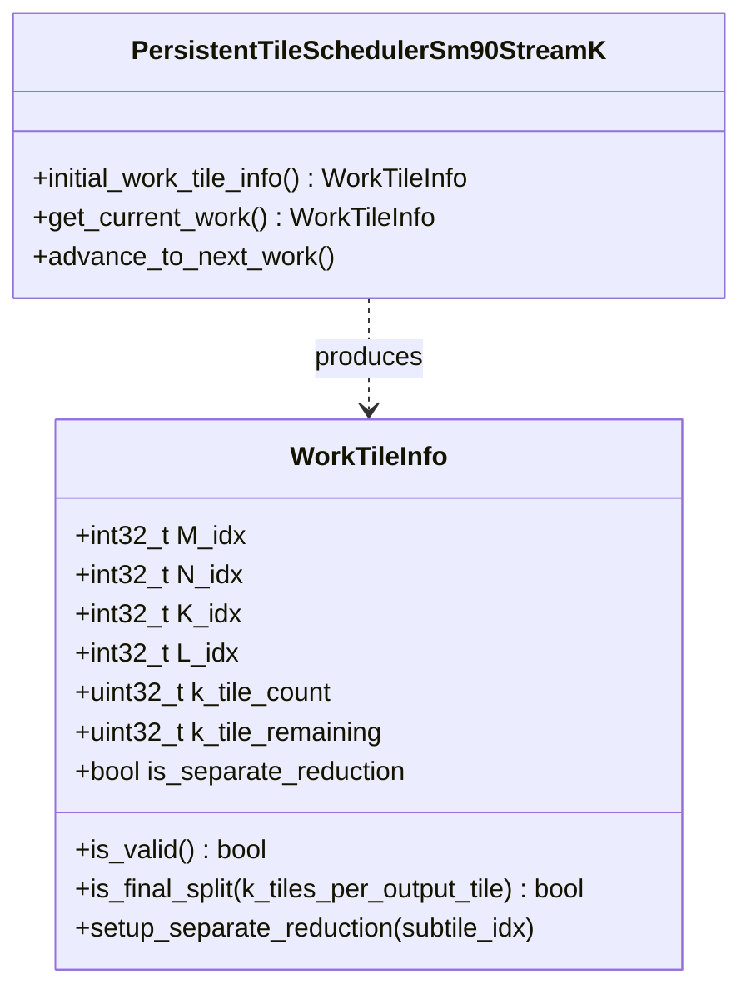
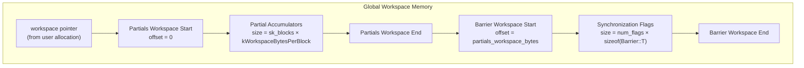
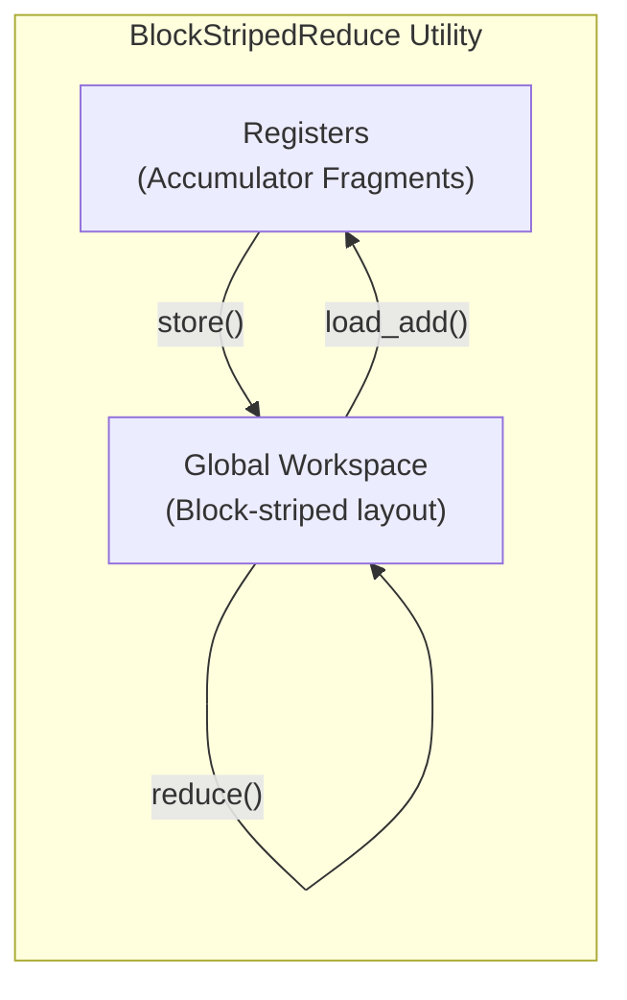

<!-- source: DeepWiki mcp.deepwiki.com · repo NVIDIA/cutlass · page 4.3 StreamK Work Decomposition and Scheduling · fetched 2026-10-26 -->

# StreamK Work Decomposition and Scheduling

<details>
<summary>Relevant source files</summary>

The following files were used as context for generating this wiki page:

- [examples/47_ampere_gemm_universal_streamk/CMakeLists.txt](examples/47_ampere_gemm_universal_streamk/CMakeLists.txt)
- [examples/47_ampere_gemm_universal_streamk/ampere_gemm_universal_streamk.cu](examples/47_ampere_gemm_universal_streamk/ampere_gemm_universal_streamk.cu)
- [examples/47_ampere_gemm_universal_streamk/ampere_gemm_universal_streamk_broadcast.cu](examples/47_ampere_gemm_universal_streamk/ampere_gemm_universal_streamk_broadcast.cu)
- [examples/common/helper.h](examples/common/helper.h)
- [include/cutlass/barrier.h](include/cutlass/barrier.h)
- [include/cutlass/block_striped.h](include/cutlass/block_striped.h)
- [include/cutlass/epilogue/threadblock/default_epilogue_with_broadcast.h](include/cutlass/epilogue/threadblock/default_epilogue_with_broadcast.h)
- [include/cutlass/epilogue/threadblock/epilogue.h](include/cutlass/epilogue/threadblock/epilogue.h)
- [include/cutlass/epilogue/threadblock/epilogue_base_streamk.h](include/cutlass/epilogue/threadblock/epilogue_base_streamk.h)
- [include/cutlass/epilogue/threadblock/epilogue_streamk_with_broadcast.h](include/cutlass/epilogue/threadblock/epilogue_streamk_with_broadcast.h)
- [include/cutlass/epilogue/threadblock/epilogue_with_broadcast.h](include/cutlass/epilogue/threadblock/epilogue_with_broadcast.h)
- [include/cutlass/epilogue/threadblock/interleaved_epilogue.h](include/cutlass/epilogue/threadblock/interleaved_epilogue.h)
- [include/cutlass/gemm/device/gemm_universal_streamk_with_broadcast.h](include/cutlass/gemm/device/gemm_universal_streamk_with_broadcast.h)
- [include/cutlass/gemm/kernel/default_gemm_streamk_with_broadcast.h](include/cutlass/gemm/kernel/default_gemm_streamk_with_broadcast.h)
- [include/cutlass/gemm/kernel/gemm_streamk_with_fused_epilogue.h](include/cutlass/gemm/kernel/gemm_streamk_with_fused_epilogue.h)
- [include/cutlass/gemm/kernel/gemm_universal_streamk.h](include/cutlass/gemm/kernel/gemm_universal_streamk.h)
- [include/cutlass/gemm/kernel/grouped_problem_visitor.h](include/cutlass/gemm/kernel/grouped_problem_visitor.h)
- [include/cutlass/gemm/kernel/sm90_tile_scheduler_stream_k.hpp](include/cutlass/gemm/kernel/sm90_tile_scheduler_stream_k.hpp)
- [include/cutlass/gemm/kernel/static_tile_scheduler.hpp](include/cutlass/gemm/kernel/static_tile_scheduler.hpp)
- [include/cutlass/gemm/threadblock/threadblock_swizzle_streamk.h](include/cutlass/gemm/threadblock/threadblock_swizzle_streamk.h)
- [test/unit/conv/device/conv2d_testbed.h](test/unit/conv/device/conv2d_testbed.h)
- [test/unit/conv/device/conv2d_testbed_interleaved.h](test/unit/conv/device/conv2d_testbed_interleaved.h)
- [test/unit/conv/device/conv2d_with_reduction_testbed.h](test/unit/conv/device/conv2d_with_reduction_testbed.h)
- [test/unit/conv/device/conv3d_testbed.h](test/unit/conv/device/conv3d_testbed.h)
- [tools/util/include/cutlass/util/reference/host/gemm_complex.h](tools/util/include/cutlass/util/reference/host/gemm_complex.h)

</details>


## Purpose and Scope

This document describes the StreamK work decomposition and scheduling algorithm used in CUTLASS GEMM kernels to achieve load balancing across thread blocks (CTAs). StreamK enables efficient execution of GEMM operations with irregular problem sizes by dynamically distributing work tiles across streaming multiprocessors (SMs).

For information about the overall GEMM kernel architecture, see [Universal GEMM Kernel Architecture](#4.1). For SM90-specific TMA-based warp-specialized GEMM implementations, see [SM90 TMA Warp-Specialized GEMM](#4.2). For epilogue operations and reduction strategies, see [Collective Epilogue and Output Pipeline](#5.2).

**Sources:** [include/cutlass/gemm/kernel/gemm_universal_streamk.h:1-240]()

---

## Overview of StreamK Algorithm

StreamK (Stream-K decomposition) is a work scheduling strategy that addresses load imbalance in traditional data-parallel GEMM execution. In standard data-parallel scheduling, each thread block computes a complete output tile by iterating through the entire K dimension. This can lead to poor SM utilization when:

1. The number of output tiles is not a multiple of the number of SMs.
2. Problem sizes result in uneven work distribution.
3. The final wave of thread blocks leaves SMs idle.

StreamK solves this by decomposing the GEMM computation into smaller work units that can be distributed across available SMs. The algorithm partitions tiles along the K dimension, allowing multiple thread blocks to collaborate on a single output tile.

**Key characteristics:**

- **Fine-grained work decomposition**: Tiles are split into K-dimension iterations that can be distributed across blocks.
- **Hybrid scheduling**: Combines StreamK blocks (partial tile computation) with data-parallel blocks (full tile computation).
- **Dynamic load balancing**: Work distribution adapts to available SM count and problem size.
- **Cross-block reduction**: Partial results from multiple blocks are combined through shared global workspace using atomic or separate reduction strategies.

**Sources:** [include/cutlass/gemm/kernel/gemm_universal_streamk.h:56-61](), [include/cutlass/gemm/kernel/gemm_universal_streamk.h:118-240](), [examples/47_ampere_gemm_universal_streamk/ampere_gemm_universal_streamk.cu:32-91]()

---

## Work Decomposition Model

### Block Types

StreamK decomposes the grid of thread blocks into several categories based on their role in the computation. The `ThreadblockSwizzleStreamK` class manages these boundaries.



**SK Blocks (StreamK Blocks)**: Thread blocks that compute a subset of iterations along the K dimension for one or more output tiles. These blocks perform partial matrix multiplication and store intermediate accumulators in global workspace. An SK block may:
- Start at an arbitrary K-iteration within a tile.
- End at an arbitrary K-iteration within a tile.
- Span multiple tiles if its iteration range crosses tile boundaries.

**DP Blocks (Data-Parallel Blocks)**: Thread blocks that compute complete output tiles from K=0 to K=problem_size.k(). These behave like traditional data-parallel GEMM blocks and directly execute the epilogue to write final results. DP blocks are allocated after StreamK work is distributed.

**Reduction Blocks**: Thread blocks dedicated to performing epilogue reduction on tiles computed by multiple SK blocks. Only used when `ReductionStrategy == kMixed` (separate reduction mode). These blocks wait for SK blocks to complete, aggregate partial accumulators, and execute the epilogue.

**Sources:** [include/cutlass/gemm/kernel/gemm_universal_streamk.h:1010-1053](), [include/cutlass/gemm/threadblock/threadblock_swizzle_streamk.h:74-85](), [include/cutlass/gemm/threadblock/threadblock_swizzle_streamk.h:131-159]()

### Iteration Range Assignment

The `ThreadblockSwizzleStreamK` determines the mapping of thread blocks to work units. It calculates boundaries to ensure that every MAC-iteration of the GEMM volume is covered exactly once.

| Parameter | Description |
|-----------|-------------|
| `sk_tiles` | Number of output tiles assigned to StreamK decomposition |
| `sk_waves` | Number of waves of StreamK blocks |
| `sk_blocks_per_region` | Number of SK blocks per region (splitting factor) |
| `sk_regions` | Number of StreamK regions |
| `dp_blocks` | Number of data-parallel blocks |
| `iters_per_tile()` | K-iterations per output tile (problem_size.k / ThreadblockShape::kK) |

**Sources:** [include/cutlass/gemm/threadblock/threadblock_swizzle_streamk.h:138-160](), [include/cutlass/gemm/threadblock/threadblock_swizzle_streamk.h:180-205]()

---

## Tile Work Descriptor

The `WorkTileInfo` structure describes the work assigned to a thread block for a specific tile. In the SM90 StreamK scheduler, this structure is refined to support persistent scheduling and separate reduction units.



**Field descriptions (SM90):**

- `M_idx`, `N_idx`, `L_idx`: Coordinates of the output tile in the GEMM grid.
- `K_idx`: Starting K-tile index for this work unit.
- `k_tile_count`: Number of K-tiles (iterations) to compute. For StreamK, this can span multiple output tiles.
- `is_separate_reduction`: Flag indicating this work unit is a dedicated reduction/epilogue unit.

**Sources:** [include/cutlass/gemm/kernel/sm90_tile_scheduler_stream_k.hpp:91-154](), [include/cutlass/gemm/kernel/static_tile_scheduler.hpp:55-84]()

---

## Scheduling Parameters and Heuristics

### Arguments Structure

The `Arguments` structure in `GemmUniversalStreamk` and the SM90 variant configures scheduling behavior:

```cpp
struct Arguments {
    int splits = 1;                // Splitting factor (1 defaults to StreamK, >1 forces Split-K)
    int max_swizzle_size = 1;
    RasterOrderOptions raster_order = RasterOrderOptions::Heuristic;
    ReductionMode reduction_mode = ReductionMode::Deterministic;
    DecompositionMode decomposition_mode = DecompositionMode::Heuristic;
};
```

**Heuristics for SM80 (Ampere):**
- `kDpEfficiencyThreshold = 0.92f`: If data-parallel wave-quantization efficiency is above 92%, the scheduler prefers standard DP to avoid StreamK overhead.
- `kMinItersPerSkBlock = 2`: Minimum number of MAC-iterations per StreamK block to ensure sufficient work per CTA.
- `kFixupStartupIterEquiv = 10`: Cost-equivalent number of SM-iterations for fixup I/O overhead.

**Sources:** [include/cutlass/gemm/threadblock/threadblock_swizzle_streamk.h:94-112](), [include/cutlass/gemm/kernel/sm90_tile_scheduler_stream_k.hpp:156-200]()

---

## Workspace Management

StreamK requires global memory workspace for cross-block coordination, specifically for storing partial accumulators and synchronization barriers.

### Workspace Layout



### Partials and Barrier Storage

- **Partials Workspace**: Stores intermediate accumulator tiles. Each thread block's workspace is calculated as `kWorkspaceBytesPerBlock = max(kThreadCount * sizeof(AccumulatorTile), Epilogue::kWorkspaceBytesPerBlock)`.
- **Barrier Workspace**: Stores `int` flags for synchronization. In `kMixed` reduction mode, the number of flags is typically `max(sk_blocks, reduction_blocks)`.
- **Initialization**: Barriers must be zero-initialized before kernel launch (e.g., via `cudaMemsetAsync`).

**Sources:** [include/cutlass/gemm/kernel/gemm_universal_streamk.h:104-108](), [include/cutlass/barrier.h:79-90]()

---

## Reduction Strategies

StreamK supports multiple reduction strategies to combine partial results:

### 1. Atomic Reduction (`kAtomic`)
Non-deterministic reduction of SK-block partials using atomic aggregation in L2.
- **Mechanism**: The first block to reach a tile initializes the workspace. Subsequent blocks use atomic add operations to aggregate their partials. The final block to arrive reads the total and performs the epilogue.
- **Source**: [include/cutlass/gemm/threadblock/threadblock_swizzle_streamk.h:79-80]()

### 2. Mixed Reduction (`kMixed`)
Deterministic reduction employing either dedicated reduction waves or turnstile-ordered aggregation.
- **Dedicated Reduction Waves**: For scenarios with many SK-blocks per tile, separate "Reduction Blocks" are launched to aggregate results.
- **Turnstile Aggregation**: For few SK-blocks per tile, ordered atomic aggregation ensures determinism.
- **Source**: [include/cutlass/gemm/threadblock/threadblock_swizzle_streamk.h:82-87]()

### 3. Separate Reduction
Used in SM90 kernels where the scheduler explicitly creates `is_separate_reduction` work units.
- **Mechanism**: Computation blocks (`k_tile_count > 0`) store results to workspace. Separate reduction units (`k_tile_count == 0`) are then scheduled to load these partials, reduce them, and execute the final epilogue.
- **Source:** [include/cutlass/gemm/kernel/sm90_tile_scheduler_stream_k.hpp:132-141]()

---

## Implementation Detail: Block-Striped Reduction

The `BlockStripedReduce` utility handles the data movement between registers (accumulator fragments) and the global partials workspace.



**Key Functions:**
- `store(ptr, frag, thread_idx)`: Writes a thread's fragment to the workspace.
- `reduce(ptr, frag, thread_idx)`: Performs atomic reduction (e.g., `atomicAdd`) from a thread's fragment into the workspace.
- `load_add(ptr, frag, thread_idx)`: Loads from workspace and adds to the local fragment.

**Sources:** [include/cutlass/block_striped.h:206-263](), [include/cutlass/gemm/kernel/gemm_universal_streamk.h:110-114]()

---

## Related Classes and Files

| Component | File Path | Role |
|-----------|-----------|------|
| `GemmUniversalStreamk` | `include/cutlass/gemm/kernel/gemm_universal_streamk.h` | Main kernel template for StreamK. |
| `PersistentTileSchedulerSm90StreamK` | `include/cutlass/gemm/kernel/sm90_tile_scheduler_stream_k.hpp` | SM90 specific persistent scheduler. |
| `ThreadblockSwizzleStreamK` | `include/cutlass/gemm/threadblock/threadblock_swizzle_streamk.h` | Logic for mapping CTA indices to StreamK iterations. |
| `BlockStripedReduce` | `include/cutlass/block_striped.h` | Data movement utilities for partials workspace. |
| `EpilogueBaseStreamK` | `include/cutlass/epilogue/threadblock/epilogue_base_streamk.h` | Base class for epilogues supporting StreamK reduction. |

**Sources:** [include/cutlass/gemm/kernel/gemm_universal_streamk.h:61-72](), [include/cutlass/gemm/kernel/sm90_tile_scheduler_stream_k.hpp:45-49](), [include/cutlass/gemm/threadblock/threadblock_swizzle_streamk.h:62-66]()

---

