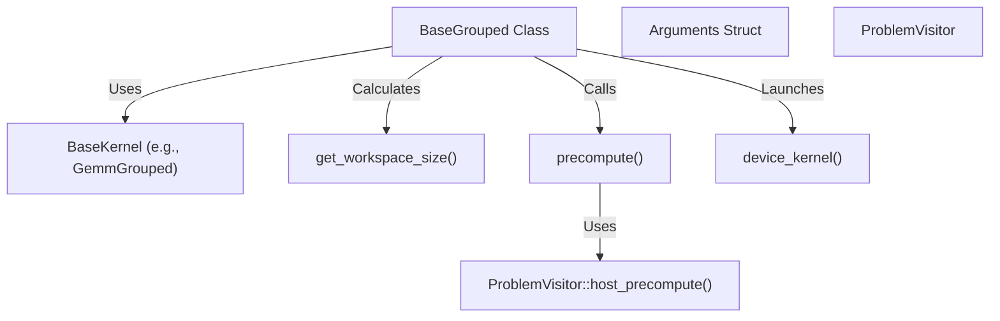
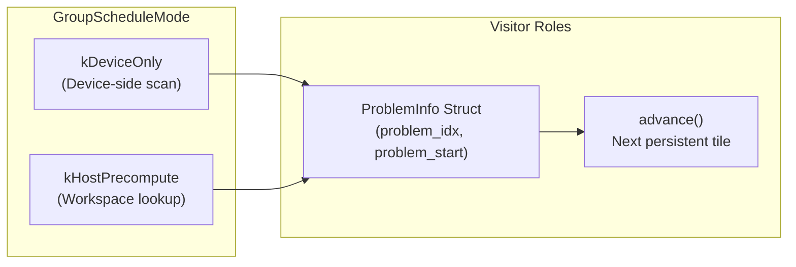
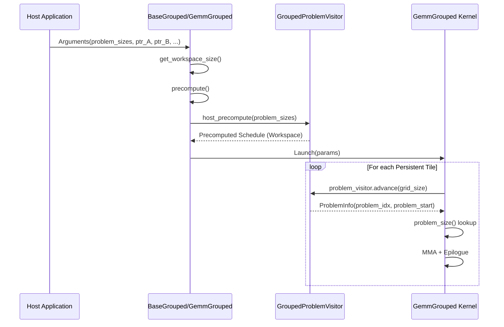

<!-- source: DeepWiki mcp.deepwiki.com · repo NVIDIA/cutlass · page 4.4 Grouped and Batched GEMM · fetched 2026-10-26 -->

# Grouped and Batched GEMM

Relevant source files

The following files were used as context for generating this wiki page:

- [examples/python/CuTeDSL/cute/hopper/kernel/grouped_gemm/grouped_gemm.py](examples/python/CuTeDSL/cute/hopper/kernel/grouped_gemm/grouped_gemm.py)
- [include/cutlass/block_striped.h](include/cutlass/block_striped.h)
- [include/cutlass/epilogue/threadblock/epilogue.h](include/cutlass/epilogue/threadblock/epilogue.h)
- [include/cutlass/epilogue/threadblock/epilogue_base_streamk.h](include/cutlass/epilogue/threadblock/epilogue_base_streamk.h)
- [include/cutlass/epilogue/threadblock/interleaved_epilogue.h](include/cutlass/epilogue/threadblock/interleaved_epilogue.h)
- [include/cutlass/gemm/device/base_grouped.h](include/cutlass/gemm/device/base_grouped.h)
- [include/cutlass/gemm/kernel/gemm_universal_streamk.h](include/cutlass/gemm/kernel/gemm_universal_streamk.h)
- [include/cutlass/gemm/kernel/grouped_problem_visitor.h](include/cutlass/gemm/kernel/grouped_problem_visitor.h)
- [include/cutlass/gemm/threadblock/threadblock_swizzle_streamk.h](include/cutlass/gemm/threadblock/threadblock_swizzle_streamk.h)
- [tools/util/include/cutlass/util/reference/host/gemm_complex.h](tools/util/include/cutlass/util/reference/host/gemm_complex.h)

## Purpose and Scope

This document describes CUTLASS support for executing multiple GEMM operations in a single kernel launch, covering both **batched GEMM** (multiple operations with identical shapes but different data) and **grouped GEMM** (multiple operations with varying shapes). These features enable efficient computation of scenarios common in deep learning workloads, such as multi-head attention, mixture-of-experts, and other batched linear algebra operations.

For information about the universal GEMM kernel interface and standard (non-batched) operations, see [Universal GEMM Kernel Architecture](4.1). For StreamK work decomposition across problem dimensions, see [StreamK Work Decomposition and Scheduling](4.3).

## Batched vs Grouped GEMM

CUTLASS distinguishes between three execution modes for handling multiple GEMM problems:

| Mode | Problem Shapes | Data Access | GemmUniversalMode |
|------|---------------|-------------|-------------------|
| **Standard Batched** | Identical (M, N, K) | Batch stride indexing | `kBatched` |
| **Pointer Array** | Identical (M, N, K) | Array of pointers | `kArray` |
| **Grouped** | Varying per problem | Array of pointers + problem descriptors | `kGrouped` |

**Batched GEMM** (Standard): All problems share the same dimensions (M, N, K) and use strided access with a batch dimension L. Each batch accesses data at offsets computed from batch strides `batch_stride_A`, `batch_stride_B`, etc. [include/cutlass/gemm/kernel/gemm_universal_streamk.h:136-139]().

**Pointer Array GEMM**: All problems share dimensions, but each batch has independent base pointers for A, B, C, and D matrices. The kernel receives arrays of pointers rather than computing offsets from strides.

**Grouped GEMM**: Each problem can have different dimensions $(M_i, N_i, K_i)$. The kernel iterates through an array of problem descriptors and handles dynamic problem sizes. This is particularly useful for workloads where padding to a uniform size would be inefficient. [include/cutlass/gemm/device/base_grouped.h:119-125]().

Sources: [include/cutlass/gemm/kernel/gemm_universal_streamk.h:125-151](), [include/cutlass/gemm/device/base_grouped.h:31-34]()

## Grouped GEMM Implementation

Grouped GEMM allows for independent problem sizes for each group. This is implemented via a specialized device-level operator and kernel structure.

### BaseGrouped Class
The `BaseGrouped` class serves as the device-level interface for grouped GEMM operations. It manages workspace allocation, precomputation of scheduling information, and kernel dispatch.

Sources: [include/cutlass/gemm/device/base_grouped.h:66-114](), [include/cutlass/gemm/device/base_grouped.h:145-153]()

### GroupedProblemVisitor
The `GroupedProblemVisitor` is responsible for mapping thread blocks to specific tiles within specific problems in the group. It supports two primary scheduling modes defined in `GroupScheduleMode` [include/cutlass/gemm/kernel/grouped_problem_visitor.h:51-56]().

1.  **Device-Only (`kDeviceOnly`)**: Thread blocks scan the problem size array on the device to find their assigned problem. This requires no extra workspace but adds a small runtime overhead for the scan. [include/cutlass/gemm/kernel/grouped_problem_visitor.h:203-207]().
2.  **Host-Precompute (`kHostPrecompute`)**: The host pre-calculates the mapping of thread blocks to problems and stores this in a workspace buffer. The kernel then performs an O(1) lookup. [include/cutlass/gemm/device/base_grouped.h:145-153]().

Sources: [include/cutlass/gemm/kernel/grouped_problem_visitor.h:51-75](), [include/cutlass/gemm/kernel/grouped_problem_visitor.h:150-152](), [include/cutlass/gemm/device/base_grouped.h:109-109]()

## Dynamic TensorMap Updates
In Hopper (SM90) and later architectures, Grouped GEMM implementations utilize CuTe DSL to manage per-group TMA tensor map updates. When the kernel crosses a group boundary, it updates the `tmaDescriptor` to reflect the new problem dimensions and strides.

### Sm90 Grouped GEMM Flow
The kernel uses a `StaticPersistentGroupTileScheduler` to determine when a warp group has finished all tiles of a specific group. Upon boundary detection, the DMA warp group performs the following:
1.  Updates the A and B tensor maps in either Global Memory (GMEM) or Shared Memory (SMEM) [examples/python/CuTeDSL/cute/hopper/kernel/grouped_gemm/grouped_gemm.py:79-87]().
2.  Uses `CpAsyncBulkTensorGlobalToSharedClusterOpWrapper` to issue TMA loads with the updated descriptors [examples/python/CuTeDSL/cute/hopper/kernel/grouped_gemm/grouped_gemm.py:113-123]().

Sources: [examples/python/CuTeDSL/cute/hopper/kernel/grouped_gemm/grouped_gemm.py:75-99](), [examples/python/CuTeDSL/cute/hopper/kernel/grouped_gemm/grouped_gemm.py:156-168]()

## Epilogue and Workspace Management

In grouped or batched scenarios, the epilogue must manage partial reductions if techniques like Stream-K are employed.

### Stream-K Epilogue
The `EpilogueBaseStreamK` provides functionality for cross-block accumulator fragment reduction. It uses a `BlockStriped` transfer utility to share `AccumulatorFragment` data via a global workspace [include/cutlass/epilogue/threadblock/epilogue_base_streamk.h:57-95]().

### Workspace Allocation
- **Grouped GEMM**: Requires workspace for the precomputed schedule if `kHostPrecompute` is used [include/cutlass/gemm/device/base_grouped.h:145-147]().
- **Stream-K**: Requires workspace for partial accumulators. The bytes per thread block are defined by `kWorkspaceBytesPerBlock` [include/cutlass/gemm/kernel/gemm_universal_streamk.h:104-107]().

Sources: [include/cutlass/epilogue/threadblock/epilogue_base_streamk.h:98-100](), [include/cutlass/epilogue/threadblock/epilogue.h:96-101](), [include/cutlass/block_striped.h:150-154]()

## Data Flow and Function Calls

The following diagram illustrates the data flow from host arguments to device kernel execution for a grouped GEMM.

Sources: [include/cutlass/gemm/device/base_grouped.h:119-153](), [include/cutlass/gemm/kernel/grouped_problem_visitor.h:150-152](), [include/cutlass/gemm/kernel/grouped_problem_visitor.h:159-165]()

---

