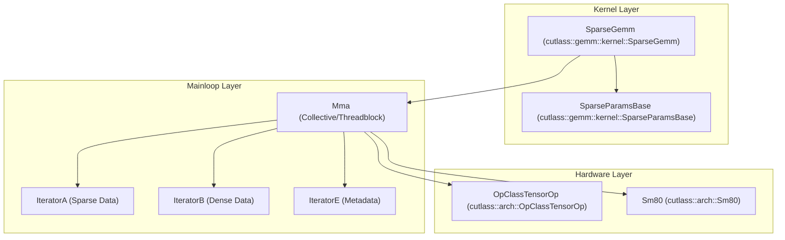

<!-- source: DeepWiki mcp.deepwiki.com · repo NVIDIA/cutlass · page 4.5 Sparse GEMM and Block Sparsity · fetched 2026-10-26 -->

# Sparse GEMM and Block Sparsity

Relevant source files

The following files were used as context for generating this wiki page:

- [examples/python/CuTeDSL/cute_ext/blackwell/dense_gemm.py](examples/python/CuTeDSL/cute_ext/blackwell/dense_gemm.py)
- [include/cutlass/arch/memory.h](include/cutlass/arch/memory.h)
- [include/cutlass/epilogue/collective/builders/sm100_builder.inl](include/cutlass/epilogue/collective/builders/sm100_builder.inl)
- [include/cutlass/epilogue/collective/builders/sm120_builder.inl](include/cutlass/epilogue/collective/builders/sm120_builder.inl)
- [include/cutlass/epilogue/collective/sm100_epilogue_array_nosmem.hpp](include/cutlass/epilogue/collective/sm100_epilogue_array_nosmem.hpp)
- [include/cutlass/epilogue/collective/sm100_epilogue_nosmem.hpp](include/cutlass/epilogue/collective/sm100_epilogue_nosmem.hpp)
- [include/cutlass/float8.h](include/cutlass/float8.h)
- [include/cutlass/gemm/collective/builders/sm120_blockscaled_mma_builder.inl](include/cutlass/gemm/collective/builders/sm120_blockscaled_mma_builder.inl)
- [include/cutlass/gemm/collective/builders/sm120_common.inl](include/cutlass/gemm/collective/builders/sm120_common.inl)
- [include/cutlass/numeric_types.h](include/cutlass/numeric_types.h)
- [include/cutlass/transform/kernel/sm90_sparse_gemm_compressor.hpp](include/cutlass/transform/kernel/sm90_sparse_gemm_compressor.hpp)
- [include/cutlass/transform/kernel/sparse_gemm_compressor.hpp](include/cutlass/transform/kernel/sparse_gemm_compressor.hpp)
- [python/CuTeDSL/cutlass/cute/nvgpu/cpasync/copy.py](python/CuTeDSL/cutlass/cute/nvgpu/cpasync/copy.py)
- [python/cutlass_library/generator.py](python/cutlass_library/generator.py)
- [test/unit/transform/CMakeLists.txt](test/unit/transform/CMakeLists.txt)
- [test/unit/transform/device/sm90_sparse_gemm_compressor_legacy.hpp](test/unit/transform/device/sm90_sparse_gemm_compressor_legacy.hpp)
- [tools/library/src/util.cu](tools/library/src/util.cu)

## Purpose and Scope

This page documents CUTLASS support for sparse GEMM operations, including **structured 2:4 sparsity** and the newer **block-scaled sparsity** patterns introduced for modern architectures. Sparse GEMM exploits zero-valued elements in input matrices to reduce computation and memory bandwidth requirements while maintaining high performance through hardware-accelerated sparse tensor core operations.

**Key Topics Covered:**
- Structured 2:4 sparsity with metadata encoding.
- Sparse GEMM kernel architecture and device-level interfaces.
- Block-scaled GEMM and MX (Microscaling) formats for SM120.
- Implementation constraints and alignment requirements.

For standard dense GEMM operations, see page 4.1. For work decomposition strategies, see page 4.3.

## Structured Sparsity (2:4 Pattern)

**2:4 structured sparsity** is a hardware-accelerated pattern where exactly 2 out of every 4 consecutive elements are non-zero. This pattern is implemented using sparse tensor core instructions (`mma.sp.sync` on SM80, `wgmma.mma_async.sp` on SM90).

**Properties:**
- **50% memory reduction** for sparse matrices (Matrix A). [examples/15_ampere_sparse_tensorop_gemm/ampere_sparse_tensorop_gemm.cu:125]()
- **2x theoretical speedup** through skipping zero computations.
- **Metadata-based encoding**: An additional matrix **E** stores the indices required by the hardware to select the correct elements from the dense Matrix B. [examples/15_ampere_sparse_tensorop_gemm/ampere_sparse_tensorop_gemm.cu:36-42]()

Sources: [examples/15_ampere_sparse_tensorop_gemm/ampere_sparse_tensorop_gemm.cu:32-42](), [include/cutlass/gemm/kernel/sparse_gemm.h:66-72]()

## Sparse GEMM Kernel Architecture

CUTLASS defines sparse GEMM kernels using the `SparseGemm` template. Unlike dense GEMM, these kernels require an additional iterator for the metadata Matrix E.

### Code Entity Relationship

The following diagram illustrates how the sparse GEMM kernel components interact.

**Key Components:**
- `SparseGemm`: The top-level kernel template that coordinates the mainloop and epilogue. [include/cutlass/gemm/kernel/sparse_gemm.h:58-60]()
- `SparseParamsBase`: A base structure for host-side parameters, including problem size and tensor references for A, B, and E. [include/cutlass/gemm/kernel/params_sparse_base.h:57-71]()
- `IteratorE`: A specialized iterator for loading metadata from Matrix E. [include/cutlass/gemm/kernel/sparse_gemm.h:82-83]()

Sources: [include/cutlass/gemm/kernel/sparse_gemm.h:52-88](), [include/cutlass/gemm/kernel/params_sparse_base.h:49-71]()

## Block-Scaled GEMM (SM120)

For Blackwell architectures (SM120), CUTLASS introduces **Block-Scaled GEMM**. This utilizes `OpClassBlockScaledTensorOp` and supports MX (Microscaling) formats where data is scaled by factors stored in separate tensors.

### SM120 Block-Scaled MMA Builder
The `CollectiveBuilder` for SM120 block-scaled operations manages the complexity of selecting the correct hardware instructions and shared memory layouts.

**Key Implementation Details:**
- **Supported Schedules**: Includes `KernelScheduleBlockScaledGemmSm120`, `KernelTmaWarpSpecializedPingpong`, and `KernelTmaWarpSpecializedCooperative`. [include/cutlass/gemm/collective/builders/sm120_blockscaled_mma_builder.inl:69-74]()
- **Layout Constraints**: Only **TN layout** (Row-Major A, Column-Major B) is supported for these operations. [include/cutlass/gemm/collective/builders/sm120_blockscaled_mma_builder.inl:99]()
- **Shared Memory Selection**: The builder uses specialized selectors like `sm120_rr_smem_selector_sparse` to choose the optimal swizzling pattern (e.g., `Layout_K_SW128_SpAtom`). [include/cutlass/gemm/collective/builders/sm120_common.inl:148-166]()

### SM120 Collective Epilogue
The SM120 epilogue for block-scaled GEMM uses `Sm120TmaWarpSpecialized` or `Sm120PtrArrayTmaWarpSpecialized` dispatch policies. [include/cutlass/epilogue/collective/builders/sm120_builder.inl:108-112]()

Sources: [include/cutlass/gemm/collective/builders/sm120_blockscaled_mma_builder.inl:53-112](), [include/cutlass/gemm/collective/builders/sm120_common.inl:145-166](), [include/cutlass/epilogue/collective/builders/sm120_builder.inl:78-114]()

## Sparse GEMM with Epilogue Visitor (EVT)

CUTLASS supports fusing complex epilogue operations with sparse GEMM using the **Visitor** pattern. This is implemented via `SparseGemmWithEpilogueVisitor`.

**Implementation Details:**
- **Mainloop**: Computes the sparse matrix product using Matrix A (sparse), Matrix B (dense), and Matrix E (metadata). [include/cutlass/gemm/kernel/sparse_gemm_with_visitor.h:168-186]()
- **Epilogue Visitor**: Uses `FusionCallbacks` to apply fused operations like bias and activations. [include/cutlass/gemm/kernel/sparse_gemm_with_visitor.h:65-72]()
- **Ampere Specialization**: `DefaultSparseGemmWithVisitor` for SM80 uses `DefaultSparseMma` to define the mainloop component. [include/cutlass/gemm/kernel/default_gemm_sparse_with_visitor.h:164-168]()

Sources: [include/cutlass/gemm/kernel/sparse_gemm_with_visitor.h:52-72](), [include/cutlass/gemm/kernel/default_gemm_sparse_with_visitor.h:158-168]()

## Implementation Constraints and Alignment

### Alignment Requirements
Sparse GEMM kernels have specific alignment requirements:
- **Matrix A (Sparse)**: Must be aligned to `Mma::IteratorA::AccessType::kElements`. [include/cutlass/gemm/kernel/sparse_gemm.h:156]()
- **Matrix E (Metadata)**: Must be aligned to `Mma::IteratorE::AccessType::kElements`. [include/cutlass/gemm/kernel/sparse_gemm.h:159]()
- **Problem Size**: The K-dimension must be a multiple of the threadblock K-tile size. [include/cutlass/gemm/kernel/sparse_gemm.h:189-191]()

### SM120 Specific Constraints
- **Tile N**: Must be at least 8. [include/cutlass/gemm/collective/builders/sm120_blockscaled_mma_builder.inl:105]()
- **Scale Factors**: For block-scaled GEMM, the scale factor types for A and B must be identical. [include/cutlass/gemm/collective/builders/sm120_blockscaled_mma_builder.inl:89]()

Sources: [include/cutlass/gemm/kernel/sparse_gemm.h:148-191](), [include/cutlass/gemm/collective/builders/sm120_blockscaled_mma_builder.inl:87-105]()

## Library Generation and Python DSL

Sparse GEMM operators can be generated via the `cutlass_library` generator or authored using the CuTe Python DSL.

- **CreateSparseGemmOperator**: A utility in the generator to instantiate sparse kernels with specific data types and alignments. [python/cutlass_library/generator.py:175-185]()
- **CuTe DSL**: Provides abstractions like `TmaCopyOp` and `CopyG2STileBaseOp` for authoring TMA-based sparse loads in Python. [python/CuTeDSL/cutlass/cute/nvgpu/cpasync/copy.py:141-160]()

Sources: [python/cutlass_library/generator.py:170-190](), [python/CuTeDSL/cutlass/cute/nvgpu/cpasync/copy.py:141-160]()

---

