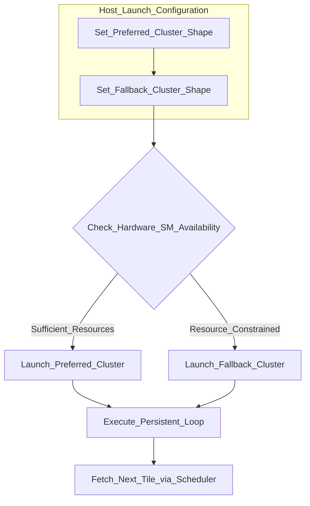
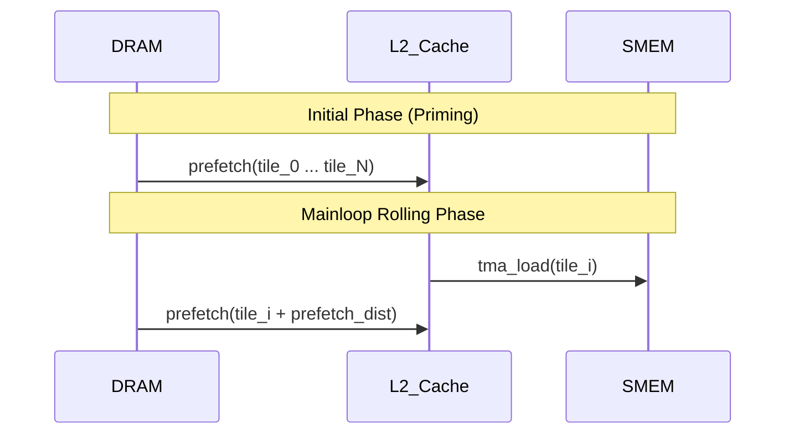
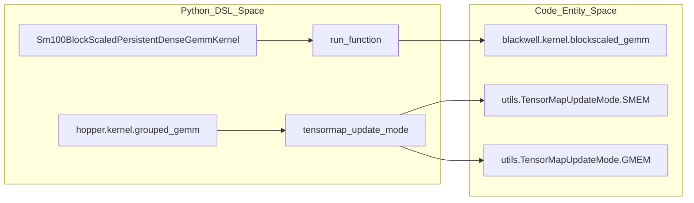

<!-- source: DeepWiki mcp.deepwiki.com · repo NVIDIA/cutlass · page 4.6 CuTe DSL GEMM Examples and Tutorials · fetched 2026-10-26 -->

# CuTe DSL GEMM Examples and Tutorials

Relevant source files

The following files were used as context for generating this wiki page:

- [examples/cute/tutorial/sgemm_1.cu](examples/cute/tutorial/sgemm_1.cu)
- [examples/cute/tutorial/sgemm_2.cu](examples/cute/tutorial/sgemm_2.cu)
- [examples/cute/tutorial/sgemm_sm70.cu](examples/cute/tutorial/sgemm_sm70.cu)
- [examples/cute/tutorial/sgemm_sm80.cu](examples/cute/tutorial/sgemm_sm80.cu)
- [examples/python/CuTeDSL/cute/blackwell/kernel/attention/mla/mla_decode_fp16.py](examples/python/CuTeDSL/cute/blackwell/kernel/attention/mla/mla_decode_fp16.py)
- [examples/python/CuTeDSL/cute/blackwell/kernel/attention/mla/mla_decode_fp8.py](examples/python/CuTeDSL/cute/blackwell/kernel/attention/mla/mla_decode_fp8.py)
- [examples/python/CuTeDSL/cute/blackwell/kernel/attention/mla/mla_helpers.py](examples/python/CuTeDSL/cute/blackwell/kernel/attention/mla/mla_helpers.py)
- [examples/python/CuTeDSL/cute/blackwell/kernel/rmsnorm/rmsnorm.py](examples/python/CuTeDSL/cute/blackwell/kernel/rmsnorm/rmsnorm.py)
- [examples/python/CuTeDSL/cute/blackwell/tutorial/tutorial_gemm/fp16_gemm_0.py](examples/python/CuTeDSL/cute/blackwell/tutorial/tutorial_gemm/fp16_gemm_0.py)
- [examples/python/CuTeDSL/cute/blackwell/tutorial/tutorial_gemm/fp16_gemm_1.py](examples/python/CuTeDSL/cute/blackwell/tutorial/tutorial_gemm/fp16_gemm_1.py)
- [examples/python/CuTeDSL/cute/blackwell/tutorial/tutorial_gemm/fp16_gemm_2.py](examples/python/CuTeDSL/cute/blackwell/tutorial/tutorial_gemm/fp16_gemm_2.py)
- [examples/python/CuTeDSL/cute/blackwell/tutorial/tutorial_gemm/fp16_gemm_3.py](examples/python/CuTeDSL/cute/blackwell/tutorial/tutorial_gemm/fp16_gemm_3.py)
- [examples/python/CuTeDSL/cute_ext/blackwell/dense_gemm_2sm.py](examples/python/CuTeDSL/cute_ext/blackwell/dense_gemm_2sm.py)
- [examples/python/CuTeDSL/dsl_tutorials/dataclass_immutable.py](examples/python/CuTeDSL/dsl_tutorials/dataclass_immutable.py)
- [examples/python/CuTeDSL/dsl_tutorials/export/run_with_dynamic_loading.cpp](examples/python/CuTeDSL/dsl_tutorials/export/run_with_dynamic_loading.cpp)
- [examples/python/CuTeDSL/dsl_tutorials/export/run_with_static_linking.cpp](examples/python/CuTeDSL/dsl_tutorials/export/run_with_static_linking.cpp)
- [examples/python/CuTeDSL/dsl_tutorials/ffi/tensor.cpp](examples/python/CuTeDSL/dsl_tutorials/ffi/tensor.cpp)
- [test/examples/CuTeDSL/conftest.py](test/examples/CuTeDSL/conftest.py)
- [test/examples/CuTeDSL/hopper/conftest.py](test/examples/CuTeDSL/hopper/conftest.py)
- [test/examples/CuTeDSL/hopper/test_dense_gemm_fp8_2xacc.py](test/examples/CuTeDSL/hopper/test_dense_gemm_fp8_2xacc.py)
- [test/examples/CuTeDSL/hopper/test_grouped_gemm.py](test/examples/CuTeDSL/hopper/test_grouped_gemm.py)
- [test/examples/CuTeDSL/sm_100a/conftest.py](test/examples/CuTeDSL/sm_100a/conftest.py)
- [test/examples/CuTeDSL/sm_100a/test_dense_blockscaled_gemm_persistent_prefetch.py](test/examples/CuTeDSL/sm_100a/test_dense_blockscaled_gemm_persistent_prefetch.py)
- [test/examples/CuTeDSL/sm_100a/test_dense_gemm_persistent_prefetch.py](test/examples/CuTeDSL/sm_100a/test_dense_gemm_persistent_prefetch.py)
- [test/examples/CuTeDSL/sm_100a/test_rmsnorm.py](test/examples/CuTeDSL/sm_100a/test_rmsnorm.py)
- [test/examples/CuTeDSL/sm_100a/test_tutorial_gemm.py](test/examples/CuTeDSL/sm_100a/test_tutorial_gemm.py)

This page provides a technical guide to implementing General Matrix Multiplication (GEMM) kernels using the CuTe Python DSL. It focuses on the Blackwell (SM100) architecture tutorial series and advanced patterns including persistent scheduling, TMA prefetch, and block-scaled execution.

## 1. Blackwell Tutorial Series (fp16_gemm_0 to 6)

The Blackwell tutorial series provides a step-by-step progression from a basic GEMM to a high-performance kernel utilizing the latest hardware features of the SM100 architecture. These tutorials are exercised through the `test_tutorial_gemm.py` suite [test/examples/CuTeDSL/sm_100a/test_tutorial_gemm.py:29-36]().

### Tutorial Overview

| Tutorial | Key Features Introduced | File Path |
| :--- | :--- | :--- |
| **fp16_gemm_0** | Basic TMA load, `tcgen05.mma`, and TMEM management. | [examples/python/CuTeDSL/cute/blackwell/tutorial/tutorial_gemm/fp16_gemm_0.py:1-1]() |
| **fp16_gemm_1** | 2CTA MMA instructions and TMA multicast (2x1 cluster). | [examples/python/CuTeDSL/cute/blackwell/tutorial/tutorial_gemm/fp16_gemm_1.py:1-1]() |
| **fp16_gemm_2** | Warp Specialization (DMA, MMA, Epilogue) and TMA Store. | [examples/python/CuTeDSL/cute/blackwell/tutorial/tutorial_gemm/fp16_gemm_2.py:1-1]() |
| **fp16_gemm_3** | Static Persistent Tile Scheduling. | [test/examples/CuTeDSL/sm_100a/test_tutorial_gemm.py:32-32]() |
| **fp16_gemm_3_1** | Dynamic Persistent Tile Scheduling. | [test/examples/CuTeDSL/sm_100a/test_tutorial_gemm.py:33-33]() |
| **fp16_gemm_4** | Preferred and Fallback Cluster shapes. | [test/examples/CuTeDSL/sm_100a/test_tutorial_gemm.py:34-34]() |
| **fp16_gemm_5** | TMA Prefetch (Initial and Rolling phases). | [test/examples/CuTeDSL/sm_100a/test_tutorial_gemm.py:35-35]() |
| **fp16_gemm_6** | Programmatic Dependent Launch (PDL). | [test/examples/CuTeDSL/sm_100a/test_tutorial_gemm.py:36-36]() |

### Implementation Details: Warp Specialization
Advanced Blackwell kernels use 2SM `tcgen05.mma` instructions where collaborating CTAs (peer CTAs) are managed by a leader CTA. Data movement is handled by specialized TMA warps while MMA warps perform computation using `tcgen05.mma.f16` instructions.

**Sources:** [test/examples/CuTeDSL/sm_100a/test_tutorial_gemm.py:29-136](), [examples/python/CuTeDSL/cute/blackwell/tutorial/tutorial_gemm/fp16_gemm_2.py:1-1]()

---

## 2. Persistent Scheduling and Dynamic Clusters

Blackwell kernels utilize persistent scheduling where CTAs stay resident on SMs and fetch new work until the problem is complete.

### Static vs. Dynamic Scheduling
*   **Static Scheduler**: Assigns tiles in a deterministic order. While simpler, it is susceptible to workload imbalance if some SM resources are unavailable.
*   **Dynamic Scheduler**: Uses hardware-assisted control to handle workload imbalance dynamically.

### Preferred Clusters
Compute Capability 10.0 (Blackwell) introduces Preferred Clusters. This allows a kernel to launch with a primary (`preferred`) cluster shape and a smaller `fallback` shape to fill idle SMs when hardware resources are constrained.

**Preferred Cluster Logic Diagram**

**Sources:** [test/examples/CuTeDSL/sm_100a/test_tutorial_gemm.py:102-136](), [test/examples/CuTeDSL/sm_100a/test_dense_gemm_persistent_prefetch.py:155-162]()

---

## 3. TMA Prefetch and Latency Hiding

TMA Prefetch brings data from DRAM into the L2 cache using hints before the actual TMA load occurs. This is critical for hiding memory latency in high-throughput GEMM kernels [test/examples/CuTeDSL/sm_100a/test_dense_gemm_persistent_prefetch.py:29-37]().

### Prefetch Phases
1.  **Initial Phase**: Before the mainloop starts, the first `prefetch_dist` tiles are prefetched to prime the L2 cache.
2.  **Rolling Phase**: Inside the mainloop, while the current tile is being loaded from L2 to SMEM, a future tile (offset by `prefetch_dist`) is prefetched from DRAM to L2 [test/examples/CuTeDSL/sm_100a/test_dense_gemm_persistent_prefetch.py:91-97]().

**TMA Prefetch Data Flow**

**Sources:** [test/examples/CuTeDSL/sm_100a/test_dense_gemm_persistent_prefetch.py:114-136](), [test/examples/CuTeDSL/sm_100a/test_dense_blockscaled_gemm_persistent_prefetch.py:30-38]()

---

## 4. Hopper and Blackwell Specific Implementations

### FP8 GEMM with 2x Accumulation
On Hopper (SM90), FP8 GEMM kernels utilize `mma_promotion_interval` to periodically promote FP8 accumulators to higher precision (e.g., FP32) to maintain numerical accuracy [test/examples/CuTeDSL/hopper/test_dense_gemm_fp8_2xacc.py:45-54]().

### Grouped GEMM
The Hopper grouped GEMM implementation supports mixed problem sizes across groups in a single kernel launch. It supports two `TensorMap` update modes:
*   **SMEM Mode**: Tensor maps are updated in shared memory for lower latency.
*   **GMEM Mode**: Tensor maps are updated in global memory [test/examples/CuTeDSL/hopper/test_grouped_gemm.py:43-51]().

**GEMM Implementation Mapping**

**Sources:** [test/examples/CuTeDSL/hopper/test_dense_gemm_fp8_2xacc.py:74-101](), [test/examples/CuTeDSL/hopper/test_grouped_gemm.py:69-80]()

---

## 5. Block-Scaled GEMM (MX Formats)

The `Sm100BlockScaledPersistentDenseGemmKernel` demonstrates GEMM using Microscaling (MX) formats like `Float8E5M2`, `Float8E4M3FN`, and `Float4E2M1FN` [test/examples/CuTeDSL/sm_100a/test_dense_blockscaled_gemm_persistent_prefetch.py:44-47]().

### Scale Factors and Vector Sizes
Block-scaled GEMM requires per-block scaling factors (`sf_dtype`). These kernels support various scale factor vector sizes (e.g., 16 or 32 elements) to balance compression and accuracy [test/examples/CuTeDSL/sm_100a/test_dense_blockscaled_gemm_persistent_prefetch.py:88-90]().

### Execution Modes
These kernels support complex cluster shapes (e.g., 2x1, 1x2, 2x2) and various memory layouts (k-major, m-major, n-major) for matrices A, B, and C [test/examples/CuTeDSL/sm_100a/test_dense_blockscaled_gemm_persistent_prefetch.py:103-112]().

**Sources:** [test/examples/CuTeDSL/sm_100a/test_dense_blockscaled_gemm_persistent_prefetch.py:44-47](), [test/examples/CuTeDSL/sm_100a/test_dense_blockscaled_gemm_persistent_prefetch.py:121-148]()

---

## 6. RMSNorm on Blackwell

The Blackwell architecture also supports high-performance normalization layers like `RMSNorm`. The implementation in `blackwell/kernel/rmsnorm/rmsnorm.py` handles various hidden dimensions (N) and batch sizes (M) [test/examples/CuTeDSL/sm_100a/test_rmsnorm.py:69-74]().

### Cluster Path for Large N
For extremely large hidden dimensions (e.g., N=32k, 64k), the kernel utilizes a cluster-based path to distribute work across multiple SMs within a cluster [test/examples/CuTeDSL/sm_100a/test_rmsnorm.py:103-112](). This is supported on SM90+ architectures [test/examples/CuTeDSL/sm_100a/test_rmsnorm.py:59-63]().

**Sources:** [test/examples/CuTeDSL/sm_100a/test_rmsnorm.py:44-48](), [test/examples/CuTeDSL/sm_100a/test_rmsnorm.py:103-123]()

---

