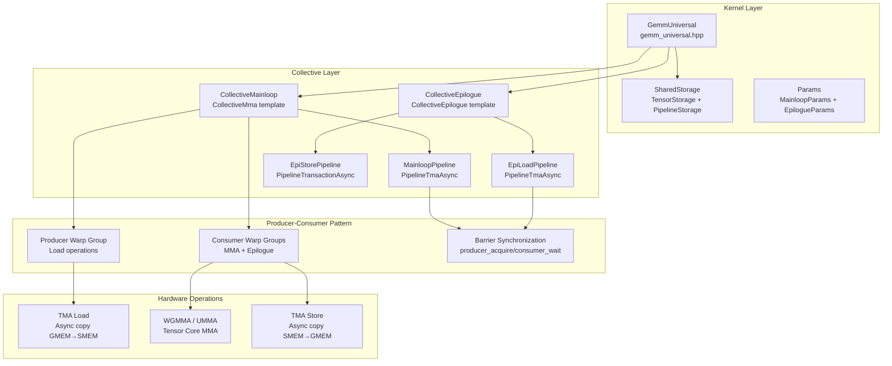
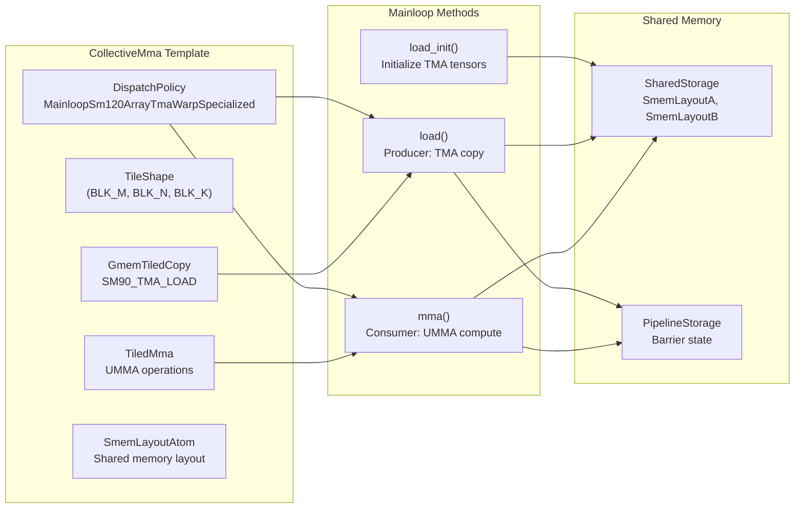
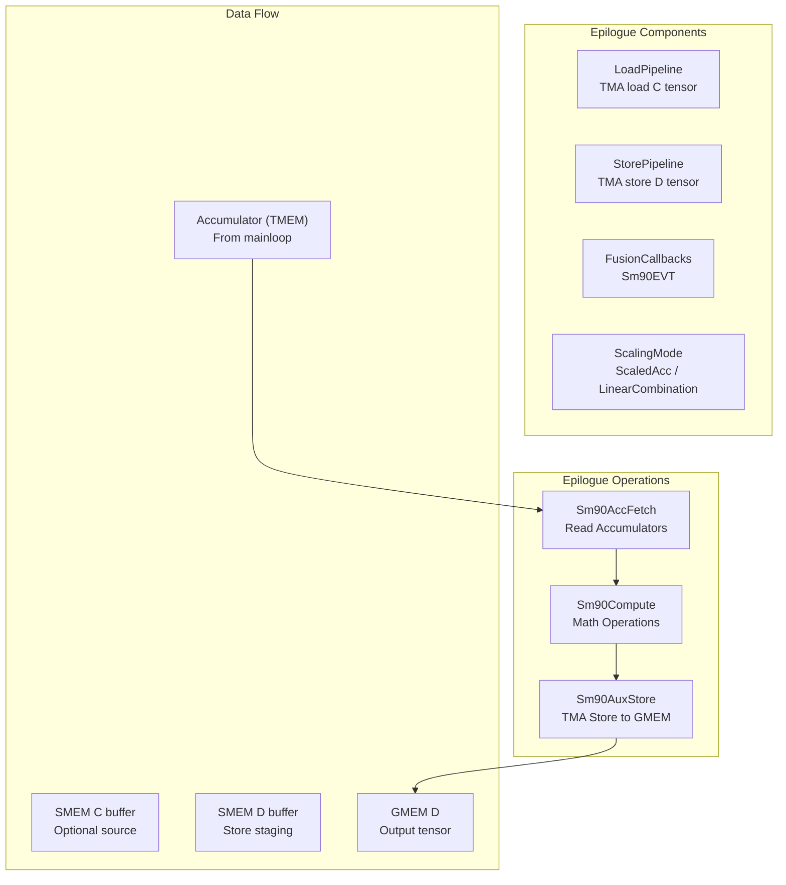
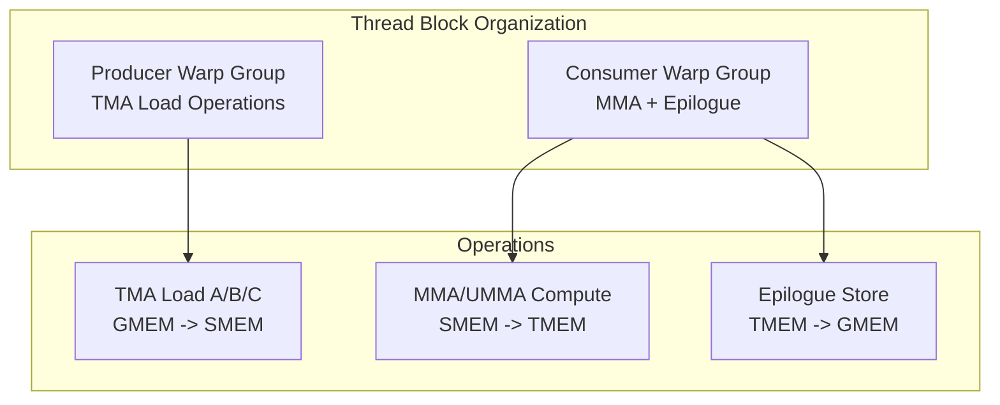

<!-- source: DeepWiki mcp.deepwiki.com · repo NVIDIA/cutlass · page 5 Collective Components · fetched 2026-10-26 -->

# Collective Components

Relevant source files

The following files were used as context for generating this wiki page:

- [include/cutlass/epilogue/collective/builders/sm90_builder.inl](include/cutlass/epilogue/collective/builders/sm90_builder.inl)
- [include/cutlass/epilogue/fusion/operations.hpp](include/cutlass/epilogue/fusion/operations.hpp)
- [include/cutlass/epilogue/fusion/sm90_callbacks_tma_warpspecialized.hpp](include/cutlass/epilogue/fusion/sm90_callbacks_tma_warpspecialized.hpp)
- [include/cutlass/epilogue/fusion/sm90_visitor_store_tma_warpspecialized.hpp](include/cutlass/epilogue/fusion/sm90_visitor_store_tma_warpspecialized.hpp)
- [include/cutlass/gemm/collective/builders/sm120_array_mma_builder.inl](include/cutlass/gemm/collective/builders/sm120_array_mma_builder.inl)
- [include/cutlass/gemm/collective/builders/sm120_mma_builder.inl](include/cutlass/gemm/collective/builders/sm120_mma_builder.inl)
- [include/cutlass/gemm/collective/collective_builder.hpp](include/cutlass/gemm/collective/collective_builder.hpp)
- [include/cutlass/gemm/collective/collective_mma.hpp](include/cutlass/gemm/collective/collective_mma.hpp)
- [include/cutlass/gemm/collective/sm120_mma_array_tma.hpp](include/cutlass/gemm/collective/sm120_mma_array_tma.hpp)
- [test/unit/gemm/device/sm120_tensorop_gemm/CMakeLists.txt](test/unit/gemm/device/sm120_tensorop_gemm/CMakeLists.txt)
- [test/unit/gemm/device/sm120_tensorop_gemm/sm120_gemm_f8_f8_f32_tensor_op_group_gemm.cu](test/unit/gemm/device/sm120_tensorop_gemm/sm120_gemm_f8_f8_f32_tensor_op_group_gemm.cu)
- [test/unit/gemm/device/sm90_gemm_f16_f16_f16_tensor_op_f32_cluster_warpspecialized_cooperative_aux_store.cu](test/unit/gemm/device/sm90_gemm_f16_f16_f16_tensor_op_f32_cluster_warpspecialized_cooperative_aux_store.cu)

## Purpose and Scope

Collective components are the fundamental building blocks of CUTLASS 3.x+ kernel implementations. They encapsulate complete data movement and computation patterns for the mainloop (matrix multiply-accumulate) and epilogue (output processing) phases of GEMM and related operations. This page explains how `CollectiveMainloop` and `CollectiveEpilogue` abstractions compose into complete kernel implementations, including their pipeline coordination mechanisms, warp specialization patterns, and shared memory management.

For information about the CuTe library primitives that collectives build upon (TiledMMA, TiledCopy, Copy Atoms, MMA Atoms), see [MMA Atoms and TiledMMA](#2.3) and [Copy Atoms and TMA Operations](#2.4). For details on specific kernel implementations using these collectives, see [GEMM Operations](#4).

## Collective Architecture Overview

The CUTLASS 3.x architecture is hierarchical, where a device-wide kernel template (like `GemmUniversal`) composes a `CollectiveMainloop` and a `CollectiveEpilogue`. These collectives interact through shared memory storage and coordinate via hardware-accelerated pipelines.

Title: Collective Architecture and Kernel Composition

Sources: [include/cutlass/gemm/collective/collective_mma.hpp:33-87](), [include/cutlass/gemm/kernel/gemm_universal.hpp:100-103](), [include/cutlass/gemm/collective/collective_builder.hpp:34-64]()

### Core Abstractions

| Component | Template Parameter | Purpose |
|-----------|-------------------|---------|
| `CollectiveMainloop` | `CollectiveMainloop_` | Encapsulates A/B tensor loading and matrix multiply-accumulate operations. |
| `CollectiveEpilogue` | `CollectiveEpilogue_` | Encapsulates C tensor loading, accumulator processing, and D tensor storing. |
| `TileScheduler` | `TileScheduler_` | Distributes work tiles across CTAs (covered in [StreamK Work Decomposition and Scheduling](#4.3)). |
| `DispatchPolicy` | Part of Collective template | Defines scheduling strategy (Pingpong, Cooperative, etc.) and hardware feature set. |

Sources: [include/cutlass/gemm/collective/collective_mma_decl.hpp:34-50](), [include/cutlass/epilogue/collective/collective_epilogue.hpp:33-50](), [include/cutlass/gemm/dispatch_policy.hpp:33-60]()

## CollectiveMainloop Structure

The `CollectiveMma` class is the primary implementation of the mainloop. It defines how data is moved from global memory to shared memory and how math instructions (like `WGMMA` on SM90 or `UMMA` on SM100/SM120) are issued.

Title: CollectiveMma Template Structure and Methods

Sources: [include/cutlass/gemm/collective/sm120_mma_array_tma.hpp:75-114](), [include/cutlass/gemm/collective/builders/sm120_mma_builder.inl:107-145](), [include/cutlass/gemm/collective/collective_mma.hpp:38-87]()

### Mainloop Pipeline Management

Collective mainloops utilize a multi-stage pipeline to overlap data movement with computation. On modern architectures (SM90, SM100, SM120), this is managed via `PipelineTmaAsync` or specialized variants.

1. **Producer Role**: Acquires a pipeline stage, issues a TMA load (e.g., `SM90_TMA_LOAD`), and signals the hardware barrier.
2. **Consumer Role**: Waits for the data to arrive in shared memory, performs the math operation (e.g., `WGMMA`), and releases the stage.

Sources: [include/cutlass/gemm/collective/sm120_mma_array_tma.hpp:121-126](), [include/cutlass/gemm/collective/builders/sm120_mma_builder.inl:128-135]()

## CollectiveEpilogue Structure

The `CollectiveEpilogue` handles the final stage of the GEMM: applying activation functions, scaling, and writing the result to global memory. Modern collectives use **Visitor Trees** (`Sm90EVT`) to represent complex fusion operations.

Title: Epilogue Pipeline and Data Flow

Sources: [include/cutlass/epilogue/fusion/sm90_callbacks_tma_warpspecialized.hpp:57-82](), [include/cutlass/epilogue/fusion/sm90_visitor_store_tma_warpspecialized.hpp:70-100](), [include/cutlass/epilogue/fusion/operations.hpp:94-120]()

### Epilogue Fusion and Coordination

The epilogue is highly configurable via specialized builders and dispatch policies. The `Sm90EVT` (Epilogue Visitor Tree) allows for fusing operations like ReLU, GELU, or bias addition directly into the store phase without redundant global memory round-trips.

For details, see [Epilogue Fusion and Activation Functions](#5.3).

Sources: [include/cutlass/epilogue/collective/builders/sm90_builder.inl:64-86](), [include/cutlass/epilogue/fusion/sm90_callbacks_tma_warpspecialized.hpp:182-186]()

## Warp Specialization and Role Assignment

Modern CUTLASS kernels use **Warp Specialization** to separate data movement and compute roles.

- **Producer Warps**: Dedicated to issuing TMA loads for A, B, and C tensors.
- **Consumer Warps**: Dedicated to executing math instructions (MMA/UMMA) and processing the epilogue.

Title: Warp Specialization Roles (SM120 Example)

Sources: [include/cutlass/gemm/collective/sm120_mma_array_tma.hpp:119-126](), [include/cutlass/epilogue/collective/builders/sm90_builder.inl:112-128](), [test/unit/gemm/device/sm120_tensorop_gemm/sm120_gemm_f8_f8_f32_tensor_op_group_gemm.cu:58-98]()

## Child Pages

For detailed documentation on specific collective behaviors, refer to the following child pages:

- [Collective Mainloop and Pipeline Management](#5.1) — Detailed look at `CollectiveMma`, pipeline stages, and TMA coordination.
- [Collective Epilogue and Output Pipeline](#5.2) — Deep dive into `CollectiveEpilogue`, TMA stores, and accumulator reduction.
- [Epilogue Fusion and Activation Functions](#5.3) — Documentation on `Sm90EVT` and fusing activation functions.
- [Tile Scheduling and Dispatch Policies](#5.4) — Explains how tiles are scheduled across the grid and the role of `TileScheduler`.

## Key Takeaways

1. **Modular Design**: Collectives isolate the "how" of data movement from the "what" of the kernel algorithm.
2. **Hardware Acceleration**: These components leverage architecture features like SM90/SM100/SM120 TMA, WGMMA, and UMMA instructions.
3. **Pipeline overlap**: Through the use of `PipelineTmaAsync`, collectives hide GMEM latency by pre-fetching data into shared memory stages.
4. **Configuration**: The behavior of collectives is determined by a `DispatchPolicy`, allowing the same kernel template to support multiple scheduling strategies (e.g., Pingpong vs. Cooperative).

Sources: [include/cutlass/gemm/collective/collective_mma.hpp:33-87](), [include/cutlass/gemm/collective/sm120_mma_array_tma.hpp:94-114](), [include/cutlass/epilogue/collective/builders/sm90_builder.inl:64-86]()

---

