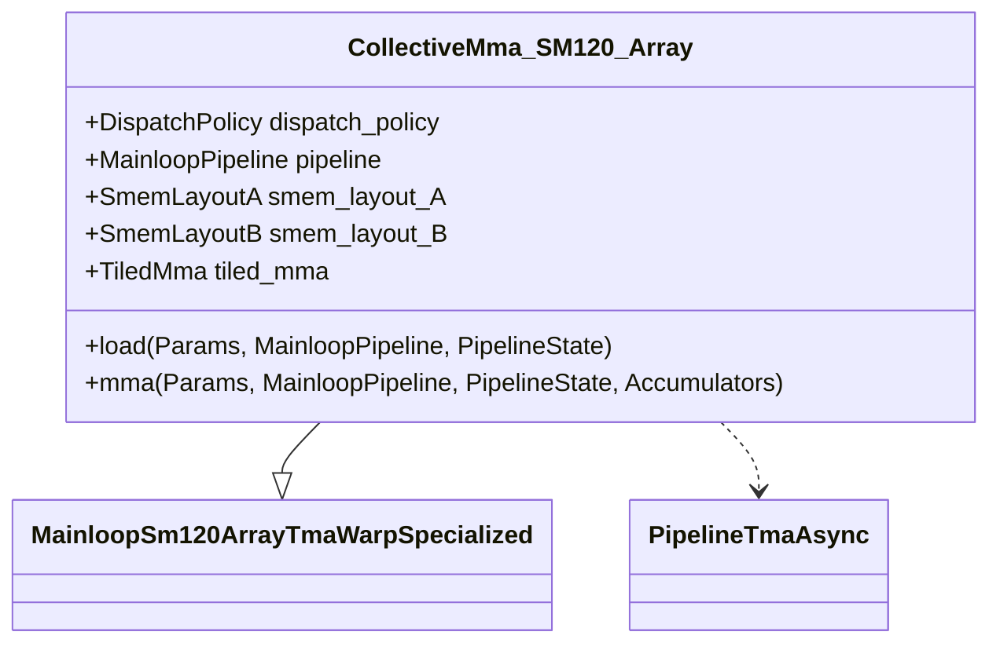

<!-- source: DeepWiki mcp.deepwiki.com · repo NVIDIA/cutlass · page 5.1 Collective Mainloop and Pipeline Management · fetched 2026-10-26 -->

# Collective Mainloop and Pipeline Management

<details>
<summary>Relevant source files</summary>

The following files were used as context for generating this wiki page:

- [examples/54_hopper_fp8_warp_specialized_gemm/54_hopper_fp8_warp_specialized_gemm.cu](examples/54_hopper_fp8_warp_specialized_gemm/54_hopper_fp8_warp_specialized_gemm.cu)
- [include/cutlass/arch/barrier.h](include/cutlass/arch/barrier.h)
- [include/cutlass/gemm/collective/builders/sm120_array_mma_builder.inl](include/cutlass/gemm/collective/builders/sm120_array_mma_builder.inl)
- [include/cutlass/gemm/collective/builders/sm120_mma_builder.inl](include/cutlass/gemm/collective/builders/sm120_mma_builder.inl)
- [include/cutlass/gemm/collective/collective_builder.hpp](include/cutlass/gemm/collective/collective_builder.hpp)
- [include/cutlass/gemm/collective/collective_builder_decl.hpp](include/cutlass/gemm/collective/collective_builder_decl.hpp)
- [include/cutlass/gemm/collective/collective_mma.hpp](include/cutlass/gemm/collective/collective_mma.hpp)
- [include/cutlass/gemm/collective/sm120_blockscaled_mma_array_tma.hpp](include/cutlass/gemm/collective/sm120_blockscaled_mma_array_tma.hpp)
- [include/cutlass/gemm/collective/sm120_blockscaled_mma_tma.hpp](include/cutlass/gemm/collective/sm120_blockscaled_mma_tma.hpp)
- [include/cutlass/gemm/collective/sm120_mma_array_tma.hpp](include/cutlass/gemm/collective/sm120_mma_array_tma.hpp)
- [include/cutlass/gemm/collective/sm120_mma_array_tma_blockwise_scaling.hpp](include/cutlass/gemm/collective/sm120_mma_array_tma_blockwise_scaling.hpp)
- [include/cutlass/gemm/collective/sm120_mma_tma.hpp](include/cutlass/gemm/collective/sm120_mma_tma.hpp)
- [include/cutlass/gemm/collective/sm120_mma_tma_blockwise_scaling.hpp](include/cutlass/gemm/collective/sm120_mma_tma_blockwise_scaling.hpp)
- [include/cutlass/gemm/kernel/sm90_gemm_array_tma_warpspecialized_cooperative.hpp](include/cutlass/gemm/kernel/sm90_gemm_array_tma_warpspecialized_cooperative.hpp)
- [include/cutlass/gemm/kernel/sm90_gemm_array_tma_warpspecialized_pingpong.hpp](include/cutlass/gemm/kernel/sm90_gemm_array_tma_warpspecialized_pingpong.hpp)
- [include/cutlass/gemm/kernel/sm90_gemm_tma_warpspecialized_cooperative.hpp](include/cutlass/gemm/kernel/sm90_gemm_tma_warpspecialized_cooperative.hpp)
- [include/cutlass/gemm/kernel/sm90_gemm_tma_warpspecialized_pingpong.hpp](include/cutlass/gemm/kernel/sm90_gemm_tma_warpspecialized_pingpong.hpp)
- [include/cutlass/gemm/kernel/tile_scheduler_params.h](include/cutlass/gemm/kernel/tile_scheduler_params.h)
- [test/unit/gemm/device/sm120_tensorop_gemm/CMakeLists.txt](test/unit/gemm/device/sm120_tensorop_gemm/CMakeLists.txt)
- [test/unit/gemm/device/sm120_tensorop_gemm/sm120_gemm_f8_f8_f32_tensor_op_group_gemm.cu](test/unit/gemm/device/sm120_tensorop_gemm/sm120_gemm_f8_f8_f32_tensor_op_group_gemm.cu)

</details>


## Purpose and Scope

This document describes the **Collective Mainloop** abstraction and the **pipeline management system** used in CUTLASS SM90+ GEMM kernels, including the latest specializations for SM100 (Blackwell) and SM120. The collective mainloop encapsulates all data movement and matrix multiply-accumulate operations for computing a GEMM tile, coordinating multiple pipelines to overlap asynchronous memory transfers with computation.

**Key topics covered:**
- `CollectiveMma` / `CollectiveMainloop` abstractions and their architecture-specific specializations.
- Multi-stage pipeline architecture for TMA-based data movement.
- Warp specialization patterns (producer/consumer roles).
- Pipeline state management and synchronization via barriers.
- Support for ptr-array (grouped GEMM) and blockwise scaling.

---

## Collective Mainloop Architecture

The collective mainloop is the core abstraction that manages the GEMM computation loop. It coordinates data loading from global memory to shared memory via TMA and consumption of that data by WGMMA (SM90) or UMMA (SM100/SM120) instructions.

### High-Level Data Flow

```mermaid
graph TB
    subgraph "Global Memory"
        [GMEM_A] --> ["Tensor A (M×K×L) or PtrArray"]
        [GMEM_B] --> ["Tensor B (N×K×L) or PtrArray"]
    end
    
    subgraph "CollectiveMainloop"
        [TMA_LOAD] --> ["TMA Load Operations<br/>Producer Warps"]
        [PIPELINE] --> ["MainloopPipeline<br/>Multi-Stage Buffering"]
        [SMEM] --> ["Shared Memory<br/>SmemLayoutA/SmemLayoutB<br/>N Stages"]
        [MMA_OP] --> ["MMA Operations<br/>(WGMMA/UMMA/tcgen05.mma)<br/>Consumer Warps"]
        [ACCUM] --> ["Accumulator Registers<br/>FP32/FP16"]
    end
    
    subgraph "Pipeline Coordination"
        [PRODUCER_STATE] --> ["PipelineState<br/>smem_pipe_write"]
        [CONSUMER_STATE] --> ["PipelineState<br/>smem_pipe_read"]
        [BARRIERS] --> ["Async Copy Barriers<br/>producer_acquire()<br/>consumer_wait()"]
    end
    
    [GMEM_A] --> [TMA_LOAD]
    [GMEM_B] --> [TMA_LOAD]
    [TMA_LOAD] --> [PIPELINE]
    [PIPELINE] --> [SMEM]
    [SMEM] --> [MMA_OP]
    [MMA_OP] --> [ACCUM]
    
    [PRODUCER_STATE] -.-> [TMA_LOAD]
    [CONSUMER_STATE] -.-> [MMA_OP]
    [BARRIERS] -.-> [PIPELINE]
```

**Sources:**
- [include/cutlass/gemm/collective/collective_mma.hpp:33-88]()
- [include/cutlass/gemm/collective/sm120_mma_array_tma.hpp:79-118]()
- [include/cutlass/gemm/collective/sm120_mma_tma_blockwise_scaling.hpp:75-115]()

---

## Pipeline Types and Infrastructure

SM90+ kernels employ multiple independent pipelines. Each pipeline manages its own set of barriers and state tracking to ensure producers do not overwrite data before consumers are finished, and consumers do not read data before it is valid.

### Pipeline Type Summary

| Pipeline | Purpose | Producer | Consumer |
|----------|---------|----------|----------|
| `PipelineTmaAsync` | Standard TMA load from GMEM to SMEM | Load Warp | MMA Warp Groups |
| `PipelineTmaUmmaAsync` | SM100+ UMMA specific pipeline | Load Warp | MMA Warp Groups |
| `EpiLoadPipeline` | Load C from GMEM to SMEM for epilogue | Load Warp | MMA Warp Groups |
| `EpiStorePipeline` | Store D to GMEM | MMA Warp Groups | TMA hardware |

### Pipeline State Management

The `PipelineState` structure tracks the current stage index and phase bit to manage circular buffers. The phase bit is flipped every time the index wraps around the total number of stages, allowing for synchronization without resetting counters.

**Key operations:**
- `producer_acquire(smem_pipe_write)`: Producer waits for a free buffer stage.
- `consumer_wait(smem_pipe_read)`: Consumer waits for data to be ready in a stage.
- `++state`: Advances the index and flips the phase if necessary.

**Sources:**
- [include/cutlass/gemm/collective/sm120_mma_array_tma.hpp:121-127]()
- [include/cutlass/gemm/collective/sm120_mma_tma_blockwise_scaling.hpp:121-125]()
- [include/cutlass/pipeline/pipeline.hpp:1-50]()

---

## Warp Specialization and Roles

CUTLASS 3.x+ uses **warp specialization** where warps are partitioned into producers (data movers) and consumers (compute engines).

### Warp Role Assignment (SM90/SM120)

```mermaid
graph TB
    subgraph "ThreadBlock"
        subgraph "Producer Warp Group"
            [W0] --> ["Warp 0: Mainloop Load<br/>(TMA A/B)"]
            [W1] --> ["Warp 1: TileScheduler"]
            [W2] --> ["Warp 2: Epilogue Load<br/>(TMA C)"]
        end
        
        subgraph "Consumer Warp Group 0"
            [WG0] --> ["Warps 4-7: WGMMA/UMMA"]
        end
        
        subgraph "Consumer Warp Group 1"
            [WG1] --> ["Warps 8-11: WGMMA/UMMA"]
        end
    end
    
    [W0] -->|"Fills SMEM"| [WG0]
    [W0] -->|"Fills SMEM"| [WG1]
```

In **Pingpong** schedules, consumer warp groups alternate processing tiles to hide latency [include/cutlass/gemm/kernel/sm90_gemm_tma_warpspecialized_pingpong.hpp:132](). In **Cooperative** schedules, multiple warp groups work together on the same tile [include/cutlass/gemm/kernel/sm90_gemm_tma_warpspecialized_cooperative.hpp:124]().

**Sources:**
- [include/cutlass/gemm/kernel/sm90_gemm_tma_warpspecialized_pingpong.hpp:128-140]()
- [include/cutlass/gemm/kernel/sm90_gemm_tma_warpspecialized_cooperative.hpp:115-128]()
- [include/cutlass/gemm/kernel/sm90_gemm_array_tma_warpspecialized_cooperative.hpp:163-170]()

---

## Collective Builder and Specializations

The `CollectiveBuilder` is a meta-programming tool that selects the correct `CollectiveMma` implementation based on the architecture (`ArchTag`), operation class, and schedule.

### SM120 Ptr-Array and Blockwise Scaling
SM120 (Blackwell) introduces specific builders for ptr-array GEMM and blockwise scaling, targeting Mixture-of-Experts (MoE) and low-precision workloads.

**Key Constraints for SM120 Builders:**
- **TN layout** (RowMajor A, ColumnMajor B) is the primary supported layout [include/cutlass/gemm/collective/builders/sm120_mma_builder.inl:88]().
- **F8F6F4 MMA** support is central to SM120 [include/cutlass/gemm/collective/builders/sm120_mma_builder.inl:80-81]().
- **Blockwise Scaling**: SM120 mainloops can handle scaling factors (SFA, SFB) loaded alongside data [include/cutlass/gemm/collective/sm120_mma_tma_blockwise_scaling.hpp:98-106]().

**Sources:**
- [include/cutlass/gemm/collective/collective_builder.hpp:55-60]()
- [include/cutlass/gemm/collective/builders/sm120_mma_builder.inl:41-78]()
- [include/cutlass/gemm/collective/sm120_mma_tma_blockwise_scaling.hpp:75-115]()

---

## Synchronization and Barriers

CUTLASS utilizes hardware-accelerated barriers starting with SM90.

### Named Barriers
Hardware provides 16 named barriers (IDs 0-15). CUTLASS reserves specific IDs for internal coordination via `ReservedNamedBarriers`:
- `EpilogueBarrier` = 1
- `TransposeBarrier` = 2
- `TransformBarrier` = 3
- `StreamkBarrier0` = 4
- `TmemAllocBarrier` = 6
- `Sm120MainloopBarrier` = 7

### TMA Transaction Synchronization
TMA hardware self-signals mbarriers upon completion. In SM120 array mainloops, the `NumProducerThreadEvents` is 1 because the TMA hardware handles the arrival signal for the operand tile [include/cutlass/gemm/collective/sm120_mma_array_tma.hpp:126](). In blockwise scaling mainloops, this increases to 33 to account for operand and scale factor tiles [include/cutlass/gemm/collective/sm120_mma_tma_blockwise_scaling.hpp:127]().

**Sources:**
- [include/cutlass/arch/barrier.h:169-180]()
- [include/cutlass/gemm/collective/sm120_mma_array_tma.hpp:126]()
- [include/cutlass/gemm/collective/sm120_mma_tma_blockwise_scaling.hpp:127-134]()

---

## Implementation Example: SM120 Array TMA

The `CollectiveMma` specialization for `MainloopSm120ArrayTmaWarpSpecialized` implements the core logic for Blackwell-based grouped GEMM.



**Key Features:**
1. **Internal Stride Types**: Handles `InternalStrideA` and `InternalStrideB` which can be pointers for grouped GEMM [include/cutlass/gemm/collective/sm120_mma_array_tma.hpp:98-102]().
2. **Pipeline Configuration**: Uses `PipelineTmaAsync` with a configurable number of stages [include/cutlass/gemm/collective/sm120_mma_array_tma.hpp:121-125]().
3. **Smem Layout**: Employs `tile_to_shape` to map the `TileShape` and `Stages` to a 3D shared memory layout [include/cutlass/gemm/collective/sm120_mma_array_tma.hpp:141-148]().

**Sources:**
- [include/cutlass/gemm/collective/sm120_mma_array_tma.hpp:75-155]()
- [include/cutlass/gemm/kernel/sm90_gemm_array_tma_warpspecialized_cooperative.hpp:97-113]()
- [test/unit/gemm/device/sm120_tensorop_gemm/CMakeLists.txt:31-49]()

---

