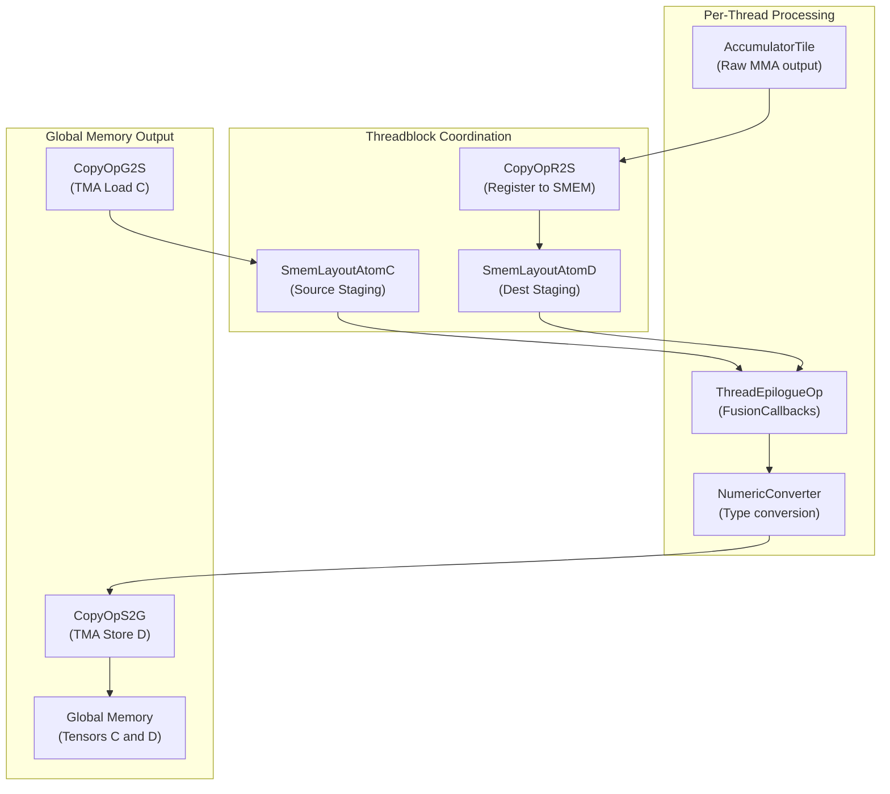
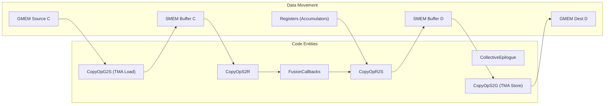
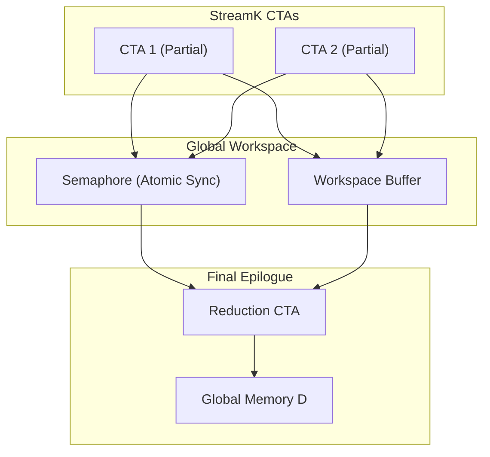

<!-- source: DeepWiki mcp.deepwiki.com · repo NVIDIA/cutlass · page 5.2 Collective Epilogue and Output Pipeline · fetched 2026-10-26 -->

# Collective Epilogue and Output Pipeline

Relevant source files

The following files were used as context for generating this wiki page:

- [include/cute/arch/copy_sm90_desc.hpp](include/cute/arch/copy_sm90_desc.hpp)
- [include/cute/atom/copy_traits_sm90_tma_swizzle.hpp](include/cute/atom/copy_traits_sm90_tma_swizzle.hpp)
- [include/cute/container/tuple.hpp](include/cute/container/tuple.hpp)
- [include/cute/layout.hpp](include/cute/layout.hpp)
- [include/cute/numeric/arithmetic_tuple.hpp](include/cute/numeric/arithmetic_tuple.hpp)
- [include/cute/tensor_impl.hpp](include/cute/tensor_impl.hpp)
- [include/cutlass/complex.h](include/cutlass/complex.h)
- [include/cutlass/conv/kernel/implicit_gemm_convolution.h](include/cutlass/conv/kernel/implicit_gemm_convolution.h)
- [include/cutlass/conv/kernel/implicit_gemm_convolution_fusion.h](include/cutlass/conv/kernel/implicit_gemm_convolution_fusion.h)
- [include/cutlass/conv/kernel/implicit_gemm_convolution_strided_dgrad.h](include/cutlass/conv/kernel/implicit_gemm_convolution_strided_dgrad.h)
- [include/cutlass/conv/kernel/implicit_gemm_convolution_with_fused_epilogue.h](include/cutlass/conv/kernel/implicit_gemm_convolution_with_fused_epilogue.h)
- [include/cutlass/detail/helper_macros.hpp](include/cutlass/detail/helper_macros.hpp)
- [include/cutlass/epilogue/collective/detail.hpp](include/cutlass/epilogue/collective/detail.hpp)
- [include/cutlass/epilogue/collective/sm90_epilogue_array_tma_warpspecialized.hpp](include/cutlass/epilogue/collective/sm90_epilogue_array_tma_warpspecialized.hpp)
- [include/cutlass/epilogue/collective/sm90_epilogue_tma_warpspecialized.hpp](include/cutlass/epilogue/collective/sm90_epilogue_tma_warpspecialized.hpp)
- [include/cutlass/epilogue/threadblock/default_epilogue_tensor_op.h](include/cutlass/epilogue/threadblock/default_epilogue_tensor_op.h)
- [include/cutlass/epilogue/threadblock/shared_load_iterator_mixed.h](include/cutlass/epilogue/threadblock/shared_load_iterator_mixed.h)
- [include/cutlass/epilogue/warp/tile_iterator_tensor_op_mixed.h](include/cutlass/epilogue/warp/tile_iterator_tensor_op_mixed.h)
- [include/cutlass/functional.h](include/cutlass/functional.h)
- [include/cutlass/gemm/collective/sm120_blockscaled_sparse_mma_tma.hpp](include/cutlass/gemm/collective/sm120_blockscaled_sparse_mma_tma.hpp)
- [include/cutlass/gemm/collective/sm90_mma_array_tma_gmma_ss_warpspecialized.hpp](include/cutlass/gemm/collective/sm90_mma_array_tma_gmma_ss_warpspecialized.hpp)
- [include/cutlass/gemm/device/rank_2k.h](include/cutlass/gemm/device/rank_2k.h)
- [include/cutlass/gemm/device/symm.h](include/cutlass/gemm/device/symm.h)
- [include/cutlass/gemm/kernel/default_gemm.h](include/cutlass/gemm/kernel/default_gemm.h)
- [include/cutlass/gemm/kernel/default_gemm_grouped.h](include/cutlass/gemm/kernel/default_gemm_grouped.h)
- [include/cutlass/gemm/kernel/gemm_universal.hpp](include/cutlass/gemm/kernel/gemm_universal.hpp)
- [include/cutlass/gemm/kernel/gemv.h](include/cutlass/gemm/kernel/gemv.h)
- [include/cutlass/gemm/threadblock/default_mma.h](include/cutlass/gemm/threadblock/default_mma.h)
- [include/cutlass/wmma_array.h](include/cutlass/wmma_array.h)
- [test/unit/core/functional.cu](test/unit/core/functional.cu)

## Purpose and Scope

The collective epilogue is responsible for transforming accumulator values from the mainloop into final output values, applying post-processing operations (linear scaling, activation functions, type conversions), and writing results to global memory. In modern CUTLASS architectures (SM90+), this is managed by `CollectiveEpilogue` using asynchronous pipelines to overlap memory movement with computation.

For mainloop and pipeline management details, see [Collective Mainloop and Pipeline Management](5.1). For activation function fusion specifics, see [Epilogue Fusion and Activation Functions](5.3).

---

## Epilogue Architecture Overview

The epilogue operates in a hierarchical fashion, transforming per-thread accumulator tiles through multiple stages before writing to global memory. In CUTLASS 3.x, this is orchestrated by the `CollectiveEpilogue` class [include/cutlass/epilogue/collective/sm90_epilogue_tma_warpspecialized.hpp:83-100]().

**Diagram: Epilogue Data Flow in SM90+ Collective Epilogue**

Sources: [include/cutlass/epilogue/collective/sm90_epilogue_tma_warpspecialized.hpp:122-139](), [include/cutlass/epilogue/collective/sm90_epilogue_array_tma_warpspecialized.hpp:137-157]()

---

## Collective Epilogue and Pipelines

In SM90 Hopper and SM100 Blackwell architectures, the epilogue uses specialized pipeline abstractions to coordinate data movement between registers, shared memory, and global memory via the Tensor Memory Accelerator (TMA).

### Pipeline Components

1.  **LoadPipeline**: Manages asynchronous TMA loads for the source tensor (C).
2.  **StorePipeline**: Coordinates asynchronous TMA stores for the destination tensor (D).
3.  **FusionCallbacks**: Encapsulates element-wise operations (activations, scaling) applied during the epilogue [include/cutlass/epilogue/collective/sm90_epilogue_tma_warpspecialized.hpp:122-122]().

### TMA Store and Load Coordination

The `CollectiveEpilogue` utilizes `CopyOpG2S` (Global to Shared) and `CopyOpS2G` (Shared to Global) to interface with the TMA hardware [include/cutlass/epilogue/collective/sm90_epilogue_tma_warpspecialized.hpp:123-124]().

**Diagram: Mapping Collective Entities to Data Flow**

Sources: [include/cutlass/epilogue/collective/sm90_epilogue_tma_warpspecialized.hpp:105-139](), [include/cute/arch/copy_sm90_desc.hpp:132-150]()

---

## Thread-Level Output Operations

### LinearCombination and Conversions

The fundamental operation in the epilogue is the conversion of accumulator types to output types, often combined with scaling. The `plus`, `minus`, and `multiplies` functors provide basic numeric operations [include/cutlass/functional.h:123-147]().

| Class | Purpose | Source |
|-------|---------|--------|
| `plus` | Basic numeric addition operator | [include/cutlass/functional.h:123-129]() |
| `multiplies` | Basic numeric multiplication operator | [include/cutlass/functional.h:141-147]() |
| `absolute_value_op` | Computes absolute value of a numeric type | [include/cutlass/functional.h:108-114]() |
| `square` | Computes the square of a value with optional conversion | [include/cutlass/functional.h:217-226]() |

### Specialized Iterators

For older architectures or specific kernels, `DefaultIteratorsTensorOp` provides the standard warp and shared memory iterators [include/cutlass/epilogue/threadblock/default_epilogue_tensor_op.h:90-114]().

-   **WarpTileIterator**: Iterates over fragments in registers [include/cutlass/epilogue/threadblock/default_epilogue_tensor_op.h:101-106]().
-   **SharedLoadIterator**: Loads data from shared memory for epilogue processing [include/cutlass/epilogue/threadblock/default_epilogue_tensor_op.h:108-111]().

Sources: [include/cutlass/epilogue/threadblock/default_epilogue_tensor_op.h:90-138](), [include/cutlass/functional.h:123-147]()

---

## StreamK Accumulator Reduction

StreamK kernels decompose the GEMM problem into tiles that may be processed by multiple CTAs. This requires a specialized epilogue that can reduce partial accumulators.

### Accumulator Reduction Flow

1.  **Partial Accumulation**: CTAs compute partial tiles and store them in a workspace.
2.  **Reduction Phase**: A final CTA loads these partial results, sums them, and then applies the standard epilogue (scaling/activation).
3.  **Coordination**: This is managed through hardware-accelerated barriers like `mbarrier` [include/cute/arch/copy_sm90_desc.hpp:62-66]().

**Diagram: StreamK Reduction Coordination**

Sources: [include/cutlass/epilogue/collective/detail.hpp:148-151](), [include/cute/arch/copy_sm90_desc.hpp:62-87]()

---

## Pointer-Array and Batched Support

For batched GEMMs and Pointer-Array kernels, the epilogue must handle multiple independent tensors. `Sm90PtrArrayTmaWarpSpecialized` provides a dispatch policy for these scenarios [include/cutlass/epilogue/collective/sm90_epilogue_array_tma_warpspecialized.hpp:85-91]().

-   **InternalStride**: Handles the logical layout of individual tensors within the array [include/cutlass/epilogue/collective/sm90_epilogue_array_tma_warpspecialized.hpp:124-127]().
-   **TMA Array Support**: Uses TMA descriptors to manage batch-wide memory movements efficiently [include/cutlass/epilogue/collective/detail.hpp:75-88]().

Sources: [include/cutlass/epilogue/collective/sm90_epilogue_array_tma_warpspecialized.hpp:112-147](), [include/cutlass/epilogue/collective/detail.hpp:75-106]()

---

## Summary of Key Epilogue Classes

| Category | Class | Purpose | Source |
|----------|-------|---------|--------|
| **Collective** | `CollectiveEpilogue` | High-level SM90/SM100 epilogue coordinator | [include/cutlass/epilogue/collective/sm90_epilogue_tma_warpspecialized.hpp:83-100]() |
| **Arithmetic** | `ArithmeticTuple` | Tuple supporting element-wise math for coordinates | [include/cute/numeric/arithmetic_tuple.hpp:44-54]() |
| **Dispatch** | `Sm90TmaWarpSpecialized` | Standard TMA-based warp-specialized policy | [include/cutlass/epilogue/collective/sm90_epilogue_tma_warpspecialized.hpp:105-105]() |
| **Barrier** | `initialize_barrier` | Initializes 64-bit `mbarrier` in shared memory | [include/cute/arch/copy_sm90_desc.hpp:62-73]() |
| **Functional** | `plus`, `multiplies` | Standard numeric operator functors | [include/cutlass/functional.h:123-147]() |

Sources: [include/cutlass/epilogue/collective/sm90_epilogue_tma_warpspecialized.hpp:105-139](), [include/cute/arch/copy_sm90_desc.hpp:132-154](), [include/cute/numeric/arithmetic_tuple.hpp:44-54]()

---

