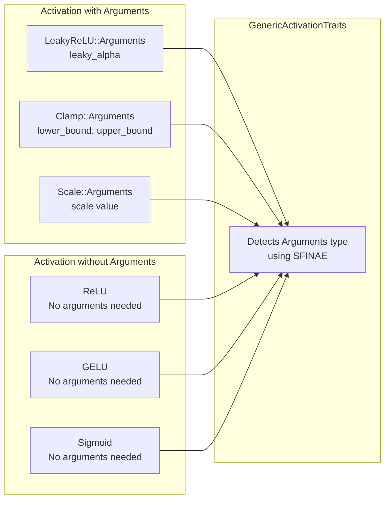
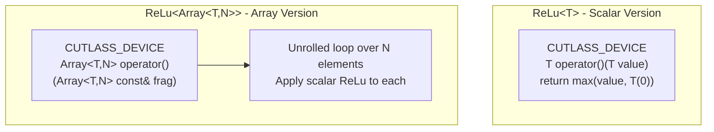
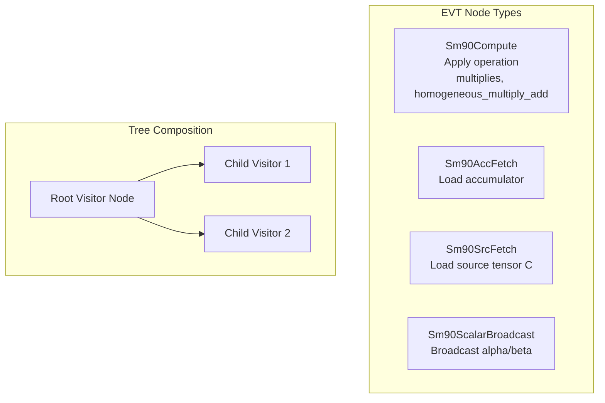
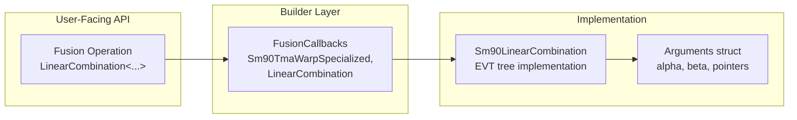

<!-- source: DeepWiki mcp.deepwiki.com · repo NVIDIA/cutlass · page 5.3 Epilogue Fusion and Activation Functions · fetched 2026-10-26 -->

# Epilogue Fusion and Activation Functions

<details>
<summary>Relevant source files</summary>

The following files were used as context for generating this wiki page:

- [examples/00_basic_gemm/basic_gemm.cu](examples/00_basic_gemm/basic_gemm.cu)
- [examples/16_ampere_tensorop_conv2dfprop/ampere_tensorop_conv2dfprop.cu](examples/16_ampere_tensorop_conv2dfprop/ampere_tensorop_conv2dfprop.cu)
- [examples/35_gemm_softmax/gemm_softmax.cu](examples/35_gemm_softmax/gemm_softmax.cu)
- [examples/35_gemm_softmax/gemm_with_softmax.h](examples/35_gemm_softmax/gemm_with_softmax.h)
- [include/cutlass/epilogue/collective/builders/sm90_builder.inl](include/cutlass/epilogue/collective/builders/sm90_builder.inl)
- [include/cutlass/epilogue/fusion/operations.hpp](include/cutlass/epilogue/fusion/operations.hpp)
- [include/cutlass/epilogue/fusion/sm90_callbacks_tma_warpspecialized.hpp](include/cutlass/epilogue/fusion/sm90_callbacks_tma_warpspecialized.hpp)
- [include/cutlass/epilogue/fusion/sm90_visitor_store_tma_warpspecialized.hpp](include/cutlass/epilogue/fusion/sm90_visitor_store_tma_warpspecialized.hpp)
- [include/cutlass/epilogue/thread/activation.h](include/cutlass/epilogue/thread/activation.h)
- [include/cutlass/epilogue/thread/linear_combination.h](include/cutlass/epilogue/thread/linear_combination.h)
- [include/cutlass/epilogue/thread/linear_combination_clamp.h](include/cutlass/epilogue/thread/linear_combination_clamp.h)
- [include/cutlass/epilogue/thread/linear_combination_gelu.h](include/cutlass/epilogue/thread/linear_combination_gelu.h)
- [include/cutlass/epilogue/thread/linear_combination_generic.h](include/cutlass/epilogue/thread/linear_combination_generic.h)
- [include/cutlass/epilogue/thread/linear_combination_hardswish.h](include/cutlass/epilogue/thread/linear_combination_hardswish.h)
- [include/cutlass/epilogue/thread/linear_combination_leaky_relu.h](include/cutlass/epilogue/thread/linear_combination_leaky_relu.h)
- [include/cutlass/epilogue/thread/linear_combination_relu.h](include/cutlass/epilogue/thread/linear_combination_relu.h)
- [include/cutlass/epilogue/thread/linear_combination_relu0.h](include/cutlass/epilogue/thread/linear_combination_relu0.h)
- [include/cutlass/epilogue/thread/linear_combination_sigmoid.h](include/cutlass/epilogue/thread/linear_combination_sigmoid.h)
- [include/cutlass/epilogue/thread/linear_combination_silu.h](include/cutlass/epilogue/thread/linear_combination_silu.h)
- [include/cutlass/fast_math.h](include/cutlass/fast_math.h)
- [test/unit/epilogue/thread/activation.cu](test/unit/epilogue/thread/activation.cu)
- [test/unit/epilogue/thread/linear_combination.cu](test/unit/epilogue/thread/linear_combination.cu)
- [test/unit/gemm/device/sm90_gemm_f16_f16_f16_tensor_op_f32_cluster_warpspecialized_cooperative_aux_store.cu](test/unit/gemm/device/sm90_gemm_f16_f16_f16_tensor_op_f32_cluster_warpspecialized_cooperative_aux_store.cu)

</details>


## Overview

The epilogue fusion system in CUTLASS enables efficient composition of linear combinations with elementwise activation functions in GEMM and convolution kernels. Rather than storing intermediate results to global memory and launching separate activation kernels, epilogue fusion applies activations directly to accumulator values before writing outputs, reducing memory traffic and improving performance.

This page covers:
- **Linear combination operations**: `D = alpha * acc + beta * C` and variants
- **Activation functions**: ReLU, GELU, Sigmoid, SiLU, Tanh, and others
- **Fusion mechanisms**: Both legacy specializations and SM90+ Epilogue Visitor Trees (EVT)

For the overall epilogue architecture, see [Collective Epilogue and Output Pipeline](#5.2). For dispatch policy configuration, see [Tile Scheduling and Dispatch Policies](#5.4).

## Linear Combination Operations

The core epilogue operation is a linear combination with optional activation:

```
D = activation(alpha * accumulator + beta * source)
```

### LinearCombinationGeneric Template

The `LinearCombinationGeneric` class provides a composable template for fusing activations with linear scaling operations.

```mermaid
graph TB
    subgraph "LinearCombinationGeneric Template"
        LCG["LinearCombinationGeneric<br/>&lt;ActivationFunctor, ElementOutput,<br/>Count, ElementAccumulator,<br/>ElementCompute, Scale, Round&gt;"]
    end
    
    subgraph "Template Parameters"
        ACT["ActivationFunctor<br/>e.g., GELU, ReLu, SiLu"]
        ELEM["ElementOutput<br/>Output element type"]
        CNT["Count<br/>Elements per operation"]
        ACC["ElementAccumulator<br/>Accumulator type"]
        COMP["ElementCompute<br/>Computation type"]
        SCALE["ScaleType::Kind<br/>Default/OnlyAlpha/NoBeta"]
        ROUND["FloatRoundStyle<br/>Rounding mode"]
    end
    
    subgraph "Runtime Parameters"
        ALPHA["alpha: ElementCompute<br/>Accumulator scale"]
        BETA["beta: ElementCompute<br/>Source scale"]
        APTR["alpha_ptr: pointer<br/>Load alpha from memory"]
        BPTR["beta_ptr: pointer<br/>Load beta from memory"]
    end
    
    subgraph "Operations"
        OP1["operator()<br/>(accumulator, source)"]
        OP2["operator()<br/>(accumulator)"]
        CHECK["is_source_needed()"]
        KPART["set_k_partition()"]
    end
    
    LCG --> ACT
    LCG --> ELEM
    LCG --> CNT
    LCG --> ACC
    LCG --> COMP
    LCG --> SCALE
    LCG --> ROUND
    
    LCG --> ALPHA
    LCG --> BETA
    LCG --> APTR
    LCG --> BPTR
    
    LCG --> OP1
    LCG --> OP2
    LCG --> CHECK
    LCG --> KPART
```



**Sources**: [include/cutlass/epilogue/thread/linear_combination_generic.h:101-259]()

The template accepts an `ActivationFunctor` template parameter that defines the activation function to apply after the linear combination. The computation flow is:

1. **Convert inputs**: Accumulator and source tensors to compute type using `NumericArrayConverter` [include/cutlass/epilogue/thread/linear_combination_generic.h:193-195]().
2. **Linear scaling**: Apply alpha/beta scaling based on `ScaleType` [include/cutlass/epilogue/thread/linear_combination_generic.h:206-224]().
3. **Activation**: Apply the activation functor (unless skipped by `skip_elementwise_`) [include/cutlass/epilogue/thread/linear_combination_generic.h:227-230]().
4. **Convert output**: Result to output element type with specified rounding [include/cutlass/epilogue/thread/linear_combination_generic.h:233-234]().

### ScaleType Control

The `ScaleType::Kind` enum controls which scaling operations are performed:

| ScaleType | Computation | Use Case |
|-----------|-------------|----------|
| `Default` | `alpha * acc + beta * C` | Standard GEMM epilogue |
| `OnlyAlphaScaling` | `alpha * acc` | No source tensor needed |
| `NoBetaScaling` | `C + alpha * acc` | Source added without scaling |
| `Nothing` | `acc` | Pass-through (no scaling) |

**Sources**: [include/cutlass/epilogue/thread/scale_type.h](), [include/cutlass/epilogue/thread/linear_combination_generic.h:160-168]()

### Activation Arguments

Some activations require runtime parameters. The `GenericActivationTraits` mechanism detects whether an activation defines an `Arguments` struct:



**Sources**: [include/cutlass/epilogue/thread/linear_combination_generic.h:52-62](), [include/cutlass/epilogue/thread/activation.h:275-289]()

## Activation Functions

CUTLASS provides a comprehensive set of activation functions in the `cutlass::epilogue::thread` namespace.

### Activation Function Catalog

| Activation | Formula | kIsHeavy | Use Case |
|------------|---------|----------|----------|
| `Identity` | `x` | false | Pass-through |
| `ReLu` | `max(x, 0)` | false | Standard rectifier |
| `LeakyReLU` | `x > 0 ? x : alpha * x` | false | Avoids dead neurons |
| `Clamp` | `min(max(x, lower), upper)` | false | Bounded output |
| `GELU` | `0.5 * x * (1 + erf(x / √2))` | true | Transformer networks |
| `GELU_taylor` | Taylor approximation of GELU | true | Faster approximation |
| `Sigmoid` | `1 / (1 + exp(-x))` | true | Binary classification |
| `SiLu` | `x * sigmoid(x)` | true | EfficientNet, YOLOv5 |
| `Tanh` | `tanh(x)` | true | Range [-1, 1] |
| `HardSwish` | `x * min(max(x + 3, 0), 6) / 6` | false | MobileNetV3 |

**Sources**: [include/cutlass/epilogue/thread/activation.h:68-906]()

### The kIsHeavy Flag

Each activation defines a `static const bool kIsHeavy` member indicating computational cost:

- **kIsHeavy = false**: Lightweight operations (comparisons, min/max)
- **kIsHeavy = true**: Expensive transcendental functions (exp, erf, tanh)

The `kIsHeavy_member_or_false` template extracts this value, defaulting to false if not specified:

**Sources**: [include/cutlass/epilogue/thread/activation.h:55-63]()

### Scalar and Array Variants

Most activations support both scalar and vectorized array operations:



**Sources**: [include/cutlass/epilogue/thread/activation.h:144-186]()

### Common Activation Implementations

#### ReLU (Rectified Linear Unit)

```cpp
template <typename T>
struct ReLu {
  static const bool kIsHeavy = false;
  
  CUTLASS_HOST_DEVICE
  T operator()(T value) const {
    constexpr bool PropagateNaN = true;
    maximum<T, PropagateNaN> mx;
    return mx(value, T(0));
  }
};
```

**Sources**: [include/cutlass/epilogue/thread/activation.h:144-163]()

#### GELU (Gaussian Error Linear Unit)

Two implementations are provided:
1. **GELU**: Uses `erff()` for accuracy.
2. **GELU_taylor**: Taylor series approximation for speed.

```cpp
template <typename T>
struct GELU_taylor {
  static const bool kIsHeavy = true;
  
  CUTLASS_HOST_DEVICE
  T operator()(T const &z) const {
    T k0 = T(0.7978845608028654);  // sqrt(2/π)
    T k1 = T(0.044715);
    return T(0.5 * z * (1 + fast_tanh(k0 * z * (1 + k1 * z * z))));
  }
};
```

**Sources**: [include/cutlass/epilogue/thread/activation.h:628-732]()

## Legacy Epilogue Fusion Specializations

Before SM90, epilogue fusion used specialized class templates that compose linear combinations with specific activations.

### Specialized Linear Combination Templates

| Class | Base Implementation |
|-------|---------------------|
| `LinearCombinationGELU` | `LinearCombinationGeneric<GELU, ...>` |
| `LinearCombinationSilu` | `LinearCombinationGeneric<SiLu, ...>` |
| `LinearCombinationSigmoid` | `LinearCombinationGeneric<Sigmoid, ...>` |
| `LinearCombinationHardSwish` | `LinearCombinationGeneric<HardSwish, ...>` |
| `LinearCombinationClamp` | Custom implementation with clamp logic |
| `LinearCombinationResidualBlock` | Complex pattern: `Unary(Binary(Binary(Act(acc+bias), res1), res2))` |

**Sources**: 
- [include/cutlass/epilogue/thread/linear_combination_gelu.h:63-64]()
- [include/cutlass/epilogue/thread/linear_combination_silu.h:63-64]()
- [include/cutlass/epilogue/thread/linear_combination_sigmoid.h:63-64]()
- [include/cutlass/epilogue/thread/linear_combination_hardswish.h:63-65]()
- [include/cutlass/epilogue/thread/linear_combination_clamp.h:79-114]()
- [include/cutlass/epilogue/thread/linear_combination_residual_block.h:50-171]()

## SM90+ Epilogue Visitor Tree (EVT)

Starting with SM90 (Hopper architecture), CUTLASS 3.x uses the Epilogue Visitor Tree (EVT) system for flexible fusion composition.

### EVT Architecture Overview



**Sources**: [include/cutlass/epilogue/fusion/sm90_callbacks_tma_warpspecialized.hpp:56-134]()

### Common EVT Patterns

#### D = alpha * acc + beta * C

Implementation:
```cpp
template<class ElementOutput, class ElementCompute, ...>
using Sm90LinearCombination =
  Sm90EVT<Sm90Compute<homogeneous_multiply_add, ElementOutput, ElementCompute, RoundStyle>,
    Sm90ScalarBroadcast<ElementScalar, Stride<_0,_0,int64_t>>, // beta
    Sm90SrcFetch<ElementSource>, // C
    Sm90EVT<Sm90Compute<multiplies, ElementCompute, ElementCompute, RoundStyle>,
      Sm90ScalarBroadcast<ElementScalar, Stride<_0,_0,int64_t>>, // alpha
      Sm90AccFetch // acc
    >
  >;
```

**Sources**: [include/cutlass/epilogue/fusion/sm90_callbacks_tma_warpspecialized.hpp:126-134]()

### FusionCallbacks Specialization

EVT nodes are wrapped in `FusionCallbacks` specializations that adapt them to the epilogue dispatch policy:



**Sources**: [include/cutlass/epilogue/fusion/sm90_callbacks_tma_warpspecialized.hpp:150-170]()

## Numeric Conversion and Rounding

The epilogue handles data type conversion from high-precision accumulators (e.g., `float`) to lower-precision output types (e.g., `half_t`, `int8_t`).

### NumericArrayConverter

The `NumericArrayConverter` template is the primary tool for these conversions, supporting various `FloatRoundStyle` modes:

| RoundStyle | Description |
|------------|-------------|
| `round_to_nearest` | Standard IEEE rounding |
| `round_toward_zero` | Truncation |
| `round_half_to_even` | Ties to even |

**Sources**: [include/cutlass/epilogue/thread/linear_combination_generic.h:110](), [include/cutlass/epilogue/thread/linear_combination_clamp.h:77-78]()

### Clamping Logic

For integer outputs, the `LinearCombinationClamp` class ensures results stay within the representable range of the target type to prevent overflow wrapping.

**Sources**: [include/cutlass/epilogue/thread/linear_combination_clamp.h:188-210]()

## Performance Considerations

### Heavy vs Lightweight Activations
The computational cost of activation functions affects epilogue scheduling. Lightweight operations like `ReLU` or `Clamp` (`kIsHeavy = false`) are often computed inline with memory operations, while heavy transcendental functions like `GELU` or `Sigmoid` (`kIsHeavy = true`) may benefit from dedicated warp groups or specialized pipelines.

**Sources**: [include/cutlass/epilogue/thread/activation.h:55-70](), [include/cutlass/epilogue/thread/linear_combination_generic.h:111]()

### Fast Approximations
CUTLASS provides fast approximations for complex functions:
- **`GELU_taylor`**: Uses a tanh-based approximation for faster execution than standard `erf` [include/cutlass/epilogue/thread/activation.h:628-648]().
- **`fast_tanh`**: Optimized hyperbolic tangent implementation [include/cutlass/epilogue/thread/activation.h:640]().

**Sources**: [include/cutlass/epilogue/thread/activation.h:628-732]()

---

