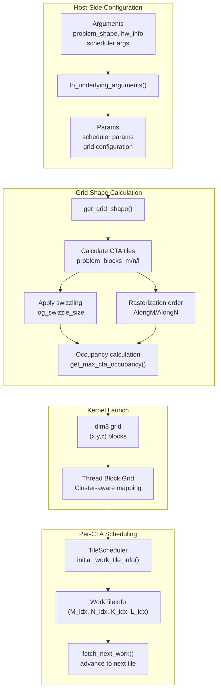
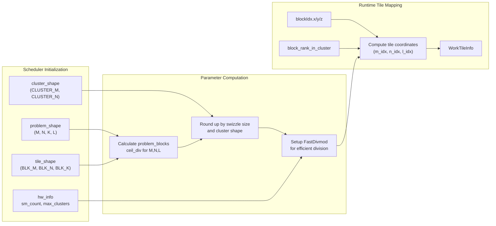
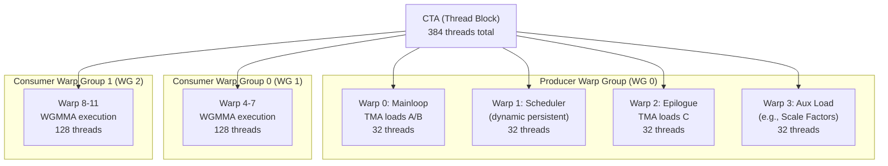

<!-- source: DeepWiki mcp.deepwiki.com · repo NVIDIA/cutlass · page 5.4 Tile Scheduling and Dispatch Policies · fetched 2026-10-26 -->

# Tile Scheduling and Dispatch Policies

Relevant source files

The following files were used as context for generating this wiki page:

- [examples/67_hopper_fp8_warp_specialized_gemm_with_blockwise_scaling/67_hopper_fp8_warp_specialized_gemm_with_blockwise_scaling.cu](examples/67_hopper_fp8_warp_specialized_gemm_with_blockwise_scaling/67_hopper_fp8_warp_specialized_gemm_with_blockwise_scaling.cu)
- [examples/67_hopper_fp8_warp_specialized_gemm_with_blockwise_scaling/67_hopper_fp8_warp_specialized_gemm_with_groupwise_scaling.cu](examples/67_hopper_fp8_warp_specialized_gemm_with_blockwise_scaling/67_hopper_fp8_warp_specialized_gemm_with_groupwise_scaling.cu)
- [examples/67_hopper_fp8_warp_specialized_gemm_with_blockwise_scaling/CMakeLists.txt](examples/67_hopper_fp8_warp_specialized_gemm_with_blockwise_scaling/CMakeLists.txt)
- [include/cutlass/block_striped.h](include/cutlass/block_striped.h)
- [include/cutlass/epilogue/threadblock/epilogue.h](include/cutlass/epilogue/threadblock/epilogue.h)
- [include/cutlass/epilogue/threadblock/epilogue_base_streamk.h](include/cutlass/epilogue/threadblock/epilogue_base_streamk.h)
- [include/cutlass/epilogue/threadblock/interleaved_epilogue.h](include/cutlass/epilogue/threadblock/interleaved_epilogue.h)
- [include/cutlass/gemm/collective/builders/sm90_gmma_builder.inl](include/cutlass/gemm/collective/builders/sm90_gmma_builder.inl)
- [include/cutlass/gemm/collective/fp8_accumulation.hpp](include/cutlass/gemm/collective/fp8_accumulation.hpp)
- [include/cutlass/gemm/collective/sm90_mma_tma_gmma_ss_warpspecialized_fp8_blockwise_scaling.hpp](include/cutlass/gemm/collective/sm90_mma_tma_gmma_ss_warpspecialized_fp8_blockwise_scaling.hpp)
- [include/cutlass/gemm/dispatch_policy.hpp](include/cutlass/gemm/dispatch_policy.hpp)
- [include/cutlass/gemm/kernel/gemm_universal_streamk.h](include/cutlass/gemm/kernel/gemm_universal_streamk.h)
- [include/cutlass/gemm/kernel/grouped_problem_visitor.h](include/cutlass/gemm/kernel/grouped_problem_visitor.h)
- [include/cutlass/gemm/kernel/sm90_tile_scheduler_stream_k.hpp](include/cutlass/gemm/kernel/sm90_tile_scheduler_stream_k.hpp)
- [include/cutlass/gemm/kernel/static_tile_scheduler.hpp](include/cutlass/gemm/kernel/static_tile_scheduler.hpp)
- [include/cutlass/gemm/threadblock/threadblock_swizzle_streamk.h](include/cutlass/gemm/threadblock/threadblock_swizzle_streamk.h)
- [test/unit/conv/device/conv2d_testbed.h](test/unit/conv/device/conv2d_testbed.h)
- [test/unit/conv/device/conv2d_testbed_interleaved.h](test/unit/conv/device/conv2d_testbed_interleaved.h)
- [test/unit/conv/device/conv2d_with_reduction_testbed.h](test/unit/conv/device/conv2d_with_reduction_testbed.h)
- [test/unit/conv/device/conv3d_testbed.h](test/unit/conv/device/conv3d_testbed.h)
- [tools/util/include/cutlass/util/reference/host/gemm_complex.h](tools/util/include/cutlass/util/reference/host/gemm_complex.h)

## Purpose and Scope

This document describes the tile scheduling and dispatch policy systems in CUTLASS kernels for SM90+ architectures. These systems determine how work tiles are distributed across thread blocks, how thread blocks are organized in the GPU grid, and how warps within a thread block are specialized for different roles.

For information about StreamK decomposition specifically, see [4.3](). For collective mainloop and epilogue implementations, see [5.1]() and [5.2](). For FMHA pipeline coordination, see [6.4]().

## Overview

Tile scheduling in CUTLASS involves two primary components:

1.  **Tile Schedulers**: Manage work distribution across thread blocks, computing which output tiles each CTA processes.
2.  **Dispatch Policies**: Define warp specialization patterns (e.g., Pingpong vs. Cooperative) and pipeline configurations within each thread block.

These systems work together to maximize GPU utilization through persistent kernels, optimized memory access patterns, and overlapped computation and data movement.

### Tile Scheduling and Launch Flow

Title: Tile Scheduling and Dispatch Workflow

**Sources**: [include/cutlass/gemm/kernel/tile_scheduler_params.h:86-384](), [include/cutlass/gemm/kernel/sm90_tile_scheduler_stream_k.hpp:156-200]()

## Tile Scheduler Types

CUTLASS provides several tile scheduler implementations for different use cases:

| Scheduler Type | Description | Use Case |
| :--- | :--- | :--- |
| `PersistentTileSchedulerSm90` | Basic persistent scheduler with static work distribution. | Standard GEMM, batched GEMM. |
| `PersistentTileSchedulerSm90StreamK` | StreamK variant with dynamic load balancing across SMs. | Irregular problem sizes, load balancing. |
| `GroupedProblemVisitor` | Per-group scheduling for grouped GEMM. | Dynamic problem shapes per group. |
| `StaticTileScheduler` | Non-persistent scheduler mapping 1:1 CTA to tile. | Simple GEMM, low-occupancy cases. |

### PersistentTileSchedulerSm90

The base persistent scheduler computes a mapping from block IDs to output tiles using fast divmod operations. It supports swizzling to improve L2 locality.

**Key Parameters**:
*   `divmod_batch_`: Division by batch size (L dimension).
*   `blocks_per_problem_`: Total number of CTAs needed for the problem.
*   `log_swizzle_size_`: Log2 of swizzle size for L2 locality.
*   `raster_order_`: Iteration order (Heuristic, AlongM, or AlongN).

### PersistentTileSchedulerSm90StreamK

The StreamK scheduler extends the base scheduler with dynamic work decomposition for load balancing across irregular K dimensions. It splits the problem into "Stream-K units" that can be distributed across SMs.

**Key Components**:
*   `WorkTileInfo`: Tracks `M_idx`, `N_idx`, `K_idx`, and `L_idx`, along with `k_tile_count` for the current unit of work [include/cutlass/gemm/kernel/sm90_tile_scheduler_stream_k.hpp:91-105]().
*   `ReductionMode`: Defines how partial results are combined (Deterministic, Mixed, or Atomic) [include/cutlass/gemm/kernel/sm90_tile_scheduler_stream_k.hpp:88-88]().
*   `DecompositionMode`: Defines the strategy for splitting (Heuristic, DataParallel, SplitK, or StreamK) [include/cutlass/gemm/kernel/sm90_tile_scheduler_stream_k.hpp:89-89]().

Title: Persistent Tile Scheduler Data Flow

**Sources**: [include/cutlass/gemm/kernel/tile_scheduler_params.h:87-177](), [include/cutlass/gemm/kernel/sm90_tile_scheduler_stream_k.hpp:49-154]()

## Dispatch Policy Types

Dispatch policies define the warp specialization pattern and pipeline configuration. These are typically passed as `KernelSchedule` tags to collective builders.

### KernelTmaWarpSpecialized Pingpong vs Cooperative

The `KernelTmaWarpSpecializedPingpong` and `KernelTmaWarpSpecializedCooperative` policies represent the primary SM90 execution strategies [include/cutlass/gemm/dispatch_policy.hpp:119-124]().

**Pingpong Characteristics**:
*   **Warp Groups**: 1 Producer (Load WG) + 2 Consumers (MMA WG0, MMA WG1).
*   **Pattern**: Consumer0 and Consumer1 process alternating tiles (ping-pong) to hide latency.
*   **Pipeline Stages**: Typically 4-7 stages.

**Cooperative Characteristics**:
*   **Pattern**: Consumer0 and Consumer1 **cooperate** on the **same tile**.
*   **Tile Size Requirement**: Usually requires M dimension ≥ 128 to provide enough work for both warp groups.
*   **Throughput**: Higher compute throughput per tile, beneficial for large tile shapes.

### FP8 and Blockwise Scaling Policies

Specialized policies exist for FP8 and block-scaled GEMM to handle auxiliary data movement:
*   `KernelTmaWarpSpecializedCooperativeFP8Blockwise`: For Hopper FP8 with blockwise scaling [include/cutlass/gemm/dispatch_policy.hpp:130-130]().
*   `MainloopSm90TmaGmmaWarpSpecializedBlockwiseFP8`: Collective MMA policy that handles loading scale factors along with A/B matrices [include/cutlass/gemm/collective/sm90_mma_tma_gmma_ss_warpspecialized_fp8_blockwise_scaling.hpp:78-92]().

In blockwise scaling, the scheduler must account for additional shared memory capacity needed for scale factors. The function `compute_stage_count_with_blockwise_scale` calculates the available pipeline stages by subtracting the carveout for scales from total shared memory [include/cutlass/gemm/collective/builders/sm90_gmma_builder.inl:88-107]().

**Sources**: [include/cutlass/gemm/dispatch_policy.hpp:112-144](), [include/cutlass/gemm/collective/sm90_mma_tma_gmma_ss_warpspecialized_fp8_blockwise_scaling.hpp:96-116](), [include/cutlass/gemm/collective/builders/sm90_gmma_builder.inl:88-107]()

## Grid Shape Calculation and Rasterization

The grid shape determines how many thread blocks to launch. CUTLASS uses heuristics to balance between occupancy and problem size.

### Grid Shape Computation

1.  **Calculate CTA counts**: `cta_m = ceil(M / BLK_M)`, `cta_n = ceil(N / BLK_N)`, `cta_l = L`.
2.  **Apply Swizzling**: Groups adjacent CTAs (e.g., 2x2, 4x4) to improve L2 cache hit rates for A and B operands [include/cutlass/gemm/kernel/tile_scheduler_params.h:312-327]().
3.  **Determine Rasterization Order**:
    *   `RasterOrder::AlongN`: Column-major over tiles. Selected when `tiles_n > tiles_m`.
    *   `RasterOrder::AlongM`: Row-major over tiles. Selected when `tiles_m >= tiles_n`.
4.  **Occupancy Limiting**: The grid size may be truncated based on `max_active_clusters` or hardware limits to ensure the kernel remains persistent [include/cutlass/gemm/kernel/tile_scheduler_params.h:210-309]().

### Swizzle Heuristics

| `log_swizzle_size` | Swizzle Size | Condition |
| :--- | :--- | :--- |
| 3 | 8x8 tiles | `max_swizzle >= 8` and sufficient CTA dimensions. |
| 2 | 4x4 tiles | `max_swizzle >= 4` and sufficient CTA dimensions. |
| 1 | 2x2 tiles | `max_swizzle >= 2`. |
| 0 | No swizzle | Default. |

**Sources**: [include/cutlass/gemm/kernel/tile_scheduler_params.h:312-327](), [include/cutlass/gemm/kernel/static_tile_scheduler.hpp:113-124]()

## Warp Specialization and Thread Roles

In SM90+ warp-specialized kernels, threads are organized into warp groups (128 threads each) with distinct roles.

Title: SM90 Warp Group Roles and Thread Mapping

### Register Management

To optimize register file usage, CUTLASS deallocates registers for warp groups that don't need the full 255-register file.
*   **Producer WGs**: Typically limited to ~40 registers to allow higher occupancy.
*   **Consumer WGs**: Allocated ~232 registers for accumulator storage and WGMMA operations.
*   **Auxiliary Roles**: In blockwise scaling, an additional producer role handles auxiliary scale factor loads [include/cutlass/gemm/dispatch_policy.hpp:99-103]().

**Sources**: [include/cutlass/gemm/collective/sm90_mma_tma_gmma_ss_warpspecialized_fp8_blockwise_scaling.hpp:146-147](), [include/cutlass/gemm/dispatch_policy.hpp:99-103]()

## Stream-K Dispatch and Reduction

The `PersistentTileSchedulerSm90StreamK` handles work decomposition for Stream-K.

*   **Work Decomposition**: Problem is split into units of work that may cover partial K-tiles.
*   **Reduction Strategy**:
    *   `Deterministic`: Ensures bit-accurate results across runs.
    *   `Atomic`: Uses hardware atomics for performance [include/cutlass/gemm/kernel/sm90_tile_scheduler_stream_k.hpp:88-88]().
*   **Separate Reduction**: Certain work units are designated as `is_separate_reduction`, which perform epilogue-only tasks for tiles with split-K accumulation [include/cutlass/gemm/kernel/sm90_tile_scheduler_stream_k.hpp:105-128]().

**Sources**: [include/cutlass/gemm/kernel/sm90_tile_scheduler_stream_k.hpp:87-105](), [include/cutlass/gemm/kernel/sm90_tile_scheduler_stream_k.hpp:132-142]()

---

