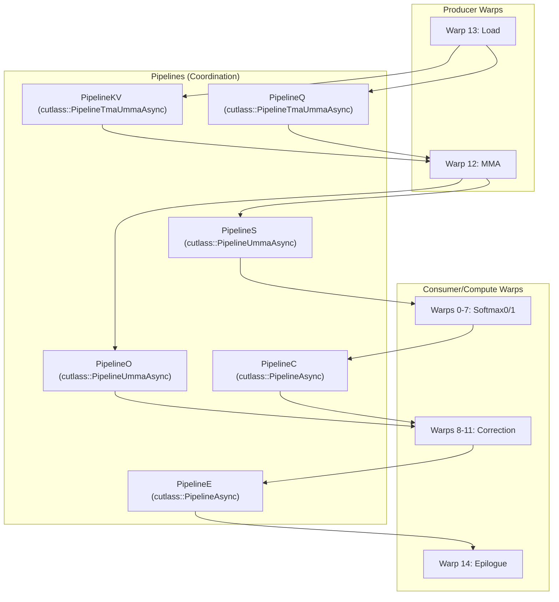

<!-- source: DeepWiki mcp.deepwiki.com · repo NVIDIA/cutlass · page 6 Fused Multi-Head Attention (FMHA) · fetched 2026-10-26 -->

# Fused Multi-Head Attention (FMHA)

<details>
<summary>Relevant source files</summary>

The following files were used as context for generating this wiki page:

- [examples/77_blackwell_fmha/77_blackwell_fmha.cu](examples/77_blackwell_fmha/77_blackwell_fmha.cu)
- [examples/77_blackwell_fmha/77_blackwell_fmha_gen.cu](examples/77_blackwell_fmha/77_blackwell_fmha_gen.cu)
- [examples/77_blackwell_fmha/77_blackwell_mla.cu](examples/77_blackwell_fmha/77_blackwell_mla.cu)
- [examples/77_blackwell_fmha/CMakeLists.txt](examples/77_blackwell_fmha/CMakeLists.txt)
- [examples/77_blackwell_fmha/collective/fmha_fusion.hpp](examples/77_blackwell_fmha/collective/fmha_fusion.hpp)
- [examples/77_blackwell_fmha/collective/sm100_fmha_fwd_epilogue_tma_warpspecialized.hpp](examples/77_blackwell_fmha/collective/sm100_fmha_fwd_epilogue_tma_warpspecialized.hpp)
- [examples/77_blackwell_fmha/collective/sm100_fmha_fwd_mainloop_tma_warpspecialized.hpp](examples/77_blackwell_fmha/collective/sm100_fmha_fwd_mainloop_tma_warpspecialized.hpp)
- [examples/77_blackwell_fmha/kernel/sm100_fmha_fwd_kernel_tma_warpspecialized.hpp](examples/77_blackwell_fmha/kernel/sm100_fmha_fwd_kernel_tma_warpspecialized.hpp)
- [examples/77_blackwell_fmha/kernel/sm100_fmha_mla_reduction.hpp](examples/77_blackwell_fmha/kernel/sm100_fmha_mla_reduction.hpp)
- [examples/77_blackwell_fmha/reference/fmha_fwd_reference.hpp](examples/77_blackwell_fmha/reference/fmha_fwd_reference.hpp)
- [examples/77_blackwell_fmha/reference/reference_abs_error.hpp](examples/77_blackwell_fmha/reference/reference_abs_error.hpp)
- [examples/python/CuTeDSL/cute/blackwell/kernel/attention/fmha/fmha.py](examples/python/CuTeDSL/cute/blackwell/kernel/attention/fmha/fmha.py)
- [examples/python/CuTeDSL/helpers/fmha_helpers.py](examples/python/CuTeDSL/helpers/fmha_helpers.py)

</details>


This page documents the Fused Multi-Head Attention (FMHA) kernels implemented for NVIDIA's Blackwell (SM100/SM103) and Hopper (SM90) architectures. These kernels fuse the computation of `softmax(Q@K^T)@V` into a single, highly optimized GPU kernel with support for various attention patterns including causal masking, variable sequence lengths, and specialized inference optimizations.

**Scope**: This page covers the forward pass, backward pass, and generation-phase FMHA implementations, as well as the Multi-Head Latent Attention (MLA) variant and State Space Decomposition (SSD) operations.

## Overview

FMHA implementations in CUTLASS target the attention operation commonly used in transformer models:

```
Attention(Q, K, V) = softmax(Q @ K^T / sqrt(d)) @ V
```

The key optimization is fusing the entire operation into a single kernel that avoids materializing the large intermediate attention matrix `S = Q @ K^T` to global memory. Instead, the kernel computes attention scores in tiles and applies online softmax correction to accumulate the final output incrementally.

**Key Features**:
- **Warp Specialization**: Different warp groups handle Load, MMA (matrix multiply), Softmax, Correction, and Epilogue operations concurrently [examples/77_blackwell_fmha/kernel/sm100_fmha_fwd_kernel_tma_warpspecialized.hpp:51-72]().
- **TMA Integration**: Uses Tensor Memory Accelerator for efficient asynchronous data movement [examples/77_blackwell_fmha/collective/sm100_fmha_fwd_mainloop_tma_warpspecialized.hpp:145-155]().
- **Pipeline Coordination**: Multiple producer-consumer pipelines (`PipelineQ`, `PipelineKV`, `PipelineS`, `PipelineC`, `PipelineO`, `PipelineE`) orchestrate data flow [examples/77_blackwell_fmha/collective/sm100_fmha_fwd_mainloop_tma_warpspecialized.hpp:145-168]().
- **Masking Support**: Causal masking (qbegin/qend variants) and residual masking for variable sequence lengths [examples/77_blackwell_fmha/collective/fmha_fusion.hpp:83-210]().
- **Precision Options**: FP8 (E4M3) and FP16 data types with FP32 accumulation [examples/77_blackwell_fmha/77_blackwell_fmha.cu:48-62]().
- **Architecture Specifics**: Support for SM100 Blackwell and SM90 Hopper architectures [examples/77_blackwell_fmha/77_blackwell_fmha.cu:31-33]().

**Sources**: [examples/77_blackwell_fmha/77_blackwell_fmha.cu:31-68](), [examples/77_blackwell_fmha/kernel/sm100_fmha_fwd_kernel_tma_warpspecialized.hpp:1-45]()

## FMHA Forward Pass Implementation

The forward pass implementation for SM100 uses a sophisticated warp-specialized architecture. The `Sm100FmhaFwdKernelTmaWarpspecialized` template coordinates different warp groups to perform tiled matrix multiplication and online softmax.

**Key Components**:
- **Warp Roles**: Defined by `Sm100FmhaCtxKernelWarpspecializedSchedule`, mapping 16 warps to roles like `Load`, `MMA`, `Softmax`, `Correction`, and `Epilogue` [examples/77_blackwell_fmha/kernel/sm100_fmha_fwd_kernel_tma_warpspecialized.hpp:51-72]().
- **Online Softmax**: Uses the `Correction` warp group to adjust partial sums and max values as new K/V tiles are processed, ensuring numerical stability without storing the full attention matrix [examples/77_blackwell_fmha/kernel/sm100_fmha_fwd_kernel_tma_warpspecialized.hpp:56-56]().
- **Shared Storage**: Managed by `SharedStorage` which unions or structs `TensorStorage` for mainloop and epilogue to optimize SMEM usage [examples/77_blackwell_fmha/kernel/sm100_fmha_fwd_kernel_tma_warpspecialized.hpp:167-185]().

For details, see [FMHA Forward Pass Implementation](#6.1).

**Sources**: [examples/77_blackwell_fmha/kernel/sm100_fmha_fwd_kernel_tma_warpspecialized.hpp:51-87](), [examples/77_blackwell_fmha/kernel/sm100_fmha_fwd_kernel_tma_warpspecialized.hpp:135-185]()

## FMHA Masking and Variable Length Support

CUTLASS provides flexible masking strategies to support various model requirements. These are implemented in `fmha_fusion.hpp`.

**Masking Strategies**:
- **Causal Masking**: Implemented via `CausalMask<kIsQBegin>`, supporting both `qbegin` and `qend` alignments (critical for inference where Q length is 1) [examples/77_blackwell_fmha/collective/fmha_fusion.hpp:190-210]().
- **Residual Masking**: Handled by `ResidualMask` to manage cases where sequence lengths do not align with tile boundaries [examples/77_blackwell_fmha/collective/fmha_fusion.hpp:83-133]().
- **Variable Length**: Supported through the `VariableLength` struct, which uses cumulative sequence length pointers to handle batches with heterogeneous sequence lengths [examples/77_blackwell_fmha/77_blackwell_fmha.cu:51-56]().

For details, see [FMHA Masking and Variable Length Support](#6.2).

**Sources**: [examples/77_blackwell_fmha/collective/fmha_fusion.hpp:41-81](), [examples/77_blackwell_fmha/collective/fmha_fusion.hpp:190-210]()

## Multi-Head Latent Attention (MLA)

MLA is an optimization for inference that reduces KV cache memory footprint by projecting keys and values into a lower-dimensional latent space.

**MLA Features**:
- **Latent Dimensions**: Separates dimensions into latent and ROPE (Rotary Positional Embedding) components [examples/77_blackwell_fmha/77_blackwell_mla.cu:74-82]().
- **Paging Support**: Integrated KV cache paging to handle fragmented memory in inference servers [examples/77_blackwell_fmha/77_blackwell_mla.cu:79-82]().
- **Generation Phase**: Specialized for low-latency decoding where the query length is 1 [examples/77_blackwell_fmha/77_blackwell_fmha_gen.cu:31-48]().
- **Reduction**: Uses `Sm100FmhaMlaReductionKernel` for handling split-KV reduction across multiple CTAs [examples/77_blackwell_fmha/kernel/sm100_fmha_mla_reduction.hpp:49-71]().

For details, see [Multi-Head Latent Attention (MLA)](#6.3).

**Sources**: [examples/77_blackwell_fmha/77_blackwell_mla.cu:31-53](), [examples/77_blackwell_fmha/kernel/sm100_fmha_mla_reduction.hpp:49-102]()

## FMHA Pipeline Coordination and Warp Specialization

The SM100 FMHA implementation relies on a multi-pipeline architecture to manage data movement between SMEM, TMEM, and Registers.

### System Pipeline Architecture


**Pipeline Roles**:
- `PipelineQ`/`PipelineKV`: Coordinate TMA loads into SMEM for the MMA warp [examples/77_blackwell_fmha/collective/sm100_fmha_fwd_mainloop_tma_warpspecialized.hpp:145-154]().
- `PipelineS`: Transfers attention scores (S) from MMA to Softmax warps in TMEM [examples/77_blackwell_fmha/collective/sm100_fmha_fwd_mainloop_tma_warpspecialized.hpp:159-159]().
- `PipelineC`: Transfers softmax statistics (max, sum) to the Correction warp [examples/77_blackwell_fmha/collective/sm100_fmha_fwd_mainloop_tma_warpspecialized.hpp:162-162]().
- `PipelineO`: Transfers partial PV results to the Correction warp [examples/77_blackwell_fmha/collective/sm100_fmha_fwd_mainloop_tma_warpspecialized.hpp:165-165]().

For details, see [FMHA Pipeline Coordination and Warp Specialization](#6.4).

**Sources**: [examples/77_blackwell_fmha/collective/sm100_fmha_fwd_mainloop_tma_warpspecialized.hpp:145-169](), [examples/77_blackwell_fmha/kernel/sm100_fmha_fwd_kernel_tma_warpspecialized.hpp:51-72]()

## Hopper FMHA and State Space Decomposition (SSD)

While Blackwell introduces new TMA and TMEM optimizations, CUTLASS also provides robust support for Hopper (SM90).

**Key Hopper Features**:
- **GQA/MQA Support**: Efficient handling of Grouped Query Attention and Multi-Query Attention through stride manipulation where KV strides in the head dimension can be zero [examples/77_blackwell_fmha/77_blackwell_fmha.cu:35-43]().
- **State Space Decomposition (SSD)**: Kernels for Mamba2-style models (SSD) are implemented for both Hopper and Blackwell architectures (Examples 111/112).
- **FP8 Support**: Support for E4M3 with FP32 compute using specialized tiling [examples/77_blackwell_fmha/77_blackwell_fmha.cu:61-62]().

For details, see [Hopper FMHA and State Space Decomposition](#6.5).

**Sources**: [examples/77_blackwell_fmha/77_blackwell_fmha.cu:35-43](), [examples/77_blackwell_fmha/77_blackwell_fmha.cu:61-62]()

## Summary of Implementation Files

| Component | Architecture | Implementation File |
|-----------|--------------|---------------------|
| Forward FMHA | SM100 | `kernel/sm100_fmha_fwd_kernel_tma_warpspecialized.hpp` [examples/77_blackwell_fmha/kernel/sm100_fmha_fwd_kernel_tma_warpspecialized.hpp:135]() |
| Backward FMHA | SM100 | `examples/77_blackwell_fmha/77_blackwell_fmha_bwd.cu` [examples/77_blackwell_fmha/CMakeLists.txt:35]() |
| MLA Inference | SM100 | `device/sm100_mla.hpp` [examples/77_blackwell_fmha/77_blackwell_mla.cu:51]() |
| Generation FMHA | SM100 | `kernel/sm100_fmha_gen_kernel_warpspecialized.hpp` [examples/77_blackwell_fmha/77_blackwell_fmha_gen.cu:72]() |
| Forward Epilogue | SM100 | `collective/sm100_fmha_fwd_epilogue_tma_warpspecialized.hpp` [examples/77_blackwell_fmha/collective/sm100_fmha_fwd_epilogue_tma_warpspecialized.hpp:48]() |

**Sources**: [examples/77_blackwell_fmha/kernel/sm100_fmha_fwd_kernel_tma_warpspecialized.hpp:91](), [examples/77_blackwell_fmha/CMakeLists.txt:30-40]()

---

