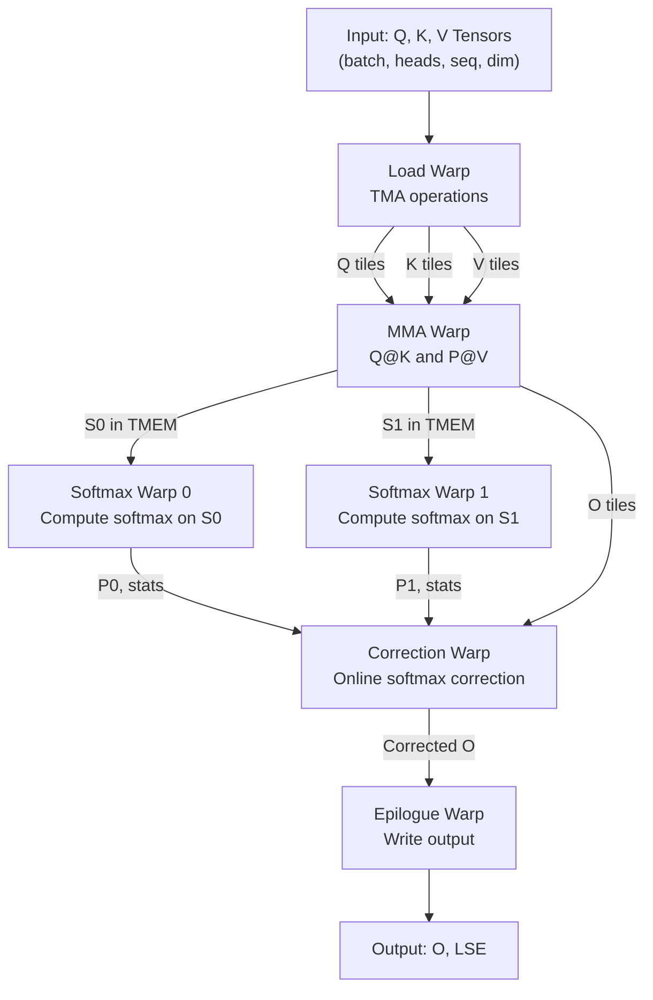
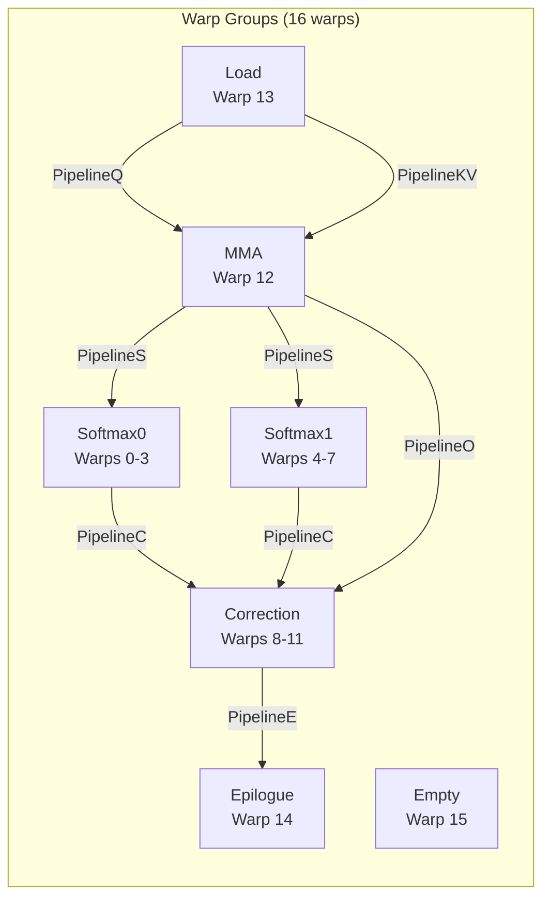
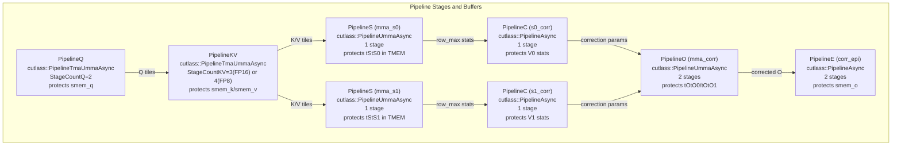
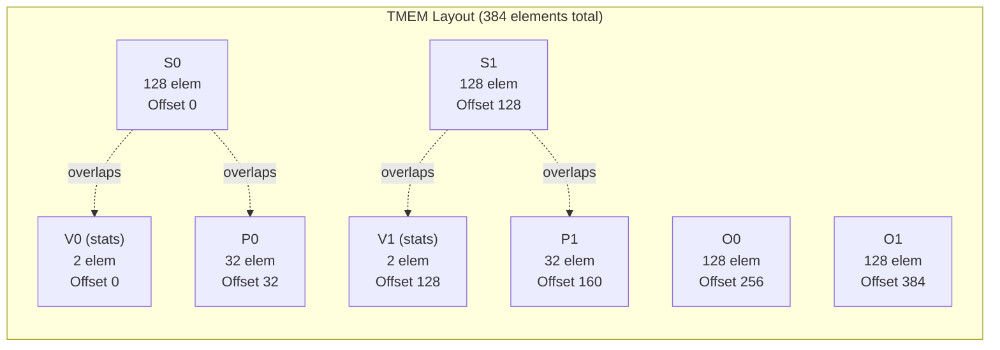
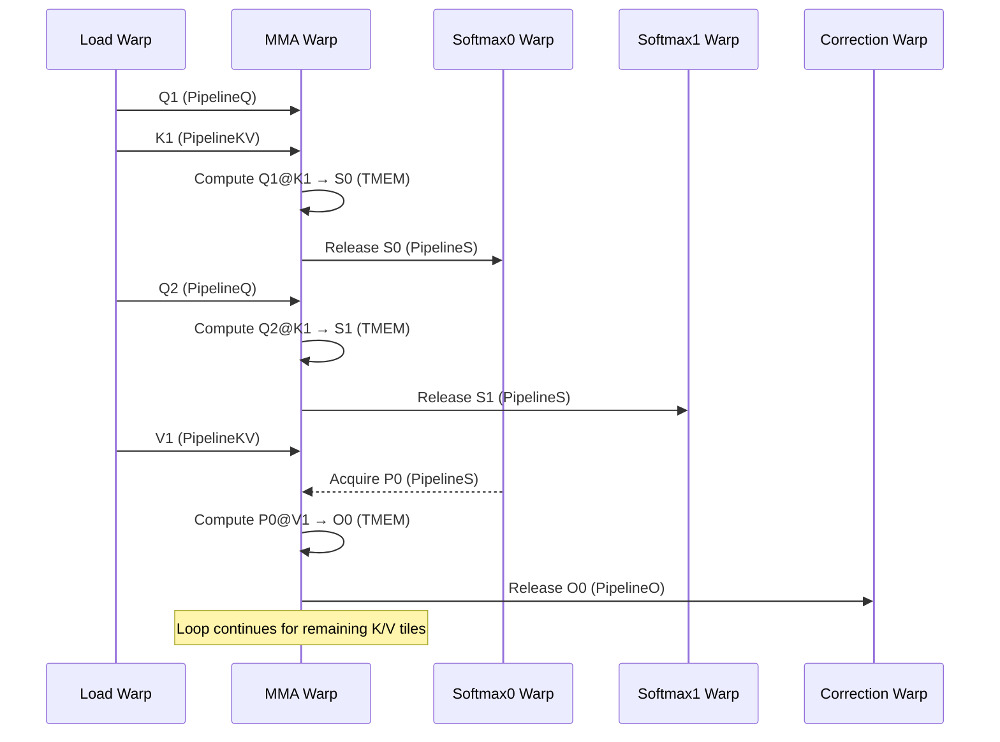
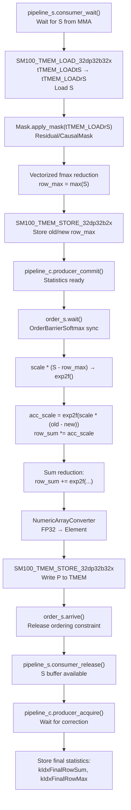
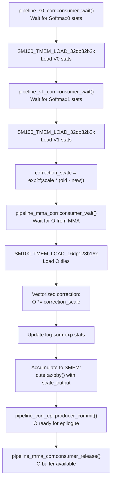
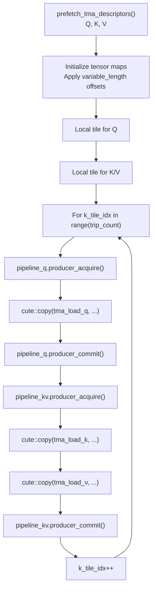
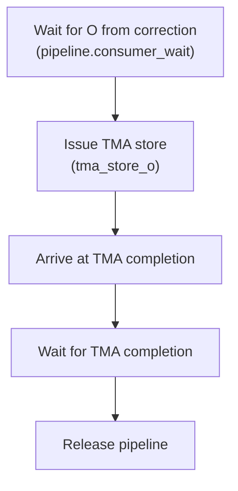

<!-- source: DeepWiki mcp.deepwiki.com · repo NVIDIA/cutlass · page 6.1 FMHA Forward Pass Implementation · fetched 2026-10-26 -->

# FMHA Forward Pass Implementation

<details>
<summary>Relevant source files</summary>

The following files were used as context for generating this wiki page:

- [examples/77_blackwell_fmha/77_blackwell_fmha.cu](examples/77_blackwell_fmha/77_blackwell_fmha.cu)
- [examples/77_blackwell_fmha/77_blackwell_fmha_gen.cu](examples/77_blackwell_fmha/77_blackwell_fmha_gen.cu)
- [examples/77_blackwell_fmha/77_blackwell_mla.cu](examples/77_blackwell_fmha/77_blackwell_mla.cu)
- [examples/77_blackwell_fmha/CMakeLists.txt](examples/77_blackwell_fmha/CMakeLists.txt)
- [examples/77_blackwell_fmha/collective/fmha_fusion.hpp](examples/77_blackwell_fmha/collective/fmha_fusion.hpp)
- [examples/77_blackwell_fmha/collective/sm100_fmha_fwd_epilogue_tma_warpspecialized.hpp](examples/77_blackwell_fmha/collective/sm100_fmha_fwd_epilogue_tma_warpspecialized.hpp)
- [examples/77_blackwell_fmha/collective/sm100_fmha_fwd_mainloop_tma_warpspecialized.hpp](examples/77_blackwell_fmha/collective/sm100_fmha_fwd_mainloop_tma_warpspecialized.hpp)
- [examples/77_blackwell_fmha/kernel/sm100_fmha_fwd_kernel_tma_warpspecialized.hpp](examples/77_blackwell_fmha/kernel/sm100_fmha_fwd_kernel_tma_warpspecialized.hpp)
- [examples/77_blackwell_fmha/kernel/sm100_fmha_mla_reduction.hpp](examples/77_blackwell_fmha/kernel/sm100_fmha_mla_reduction.hpp)
- [examples/77_blackwell_fmha/reference/fmha_fwd_reference.hpp](examples/77_blackwell_fmha/reference/fmha_fwd_reference.hpp)
- [examples/77_blackwell_fmha/reference/reference_abs_error.hpp](examples/77_blackwell_fmha/reference/reference_abs_error.hpp)
- [examples/python/CuTeDSL/cute/blackwell/kernel/attention/fmha/fmha.py](examples/python/CuTeDSL/cute/blackwell/kernel/attention/fmha/fmha.py)
- [examples/python/CuTeDSL/helpers/fmha_helpers.py](examples/python/CuTeDSL/helpers/fmha_helpers.py)

</details>


## Purpose and Scope

This page documents the implementation of the Fused Multi-Head Attention (FMHA) forward pass for NVIDIA Blackwell SM100 architecture. The implementation uses warp specialization, Tensor Memory Accelerator (TMA), and Tensor Memory (TMEM) to achieve high performance for attention computation.

For information about FMHA backward pass, see [FMHA Masking and Variable Length Support](#6.2). For MLA (Multi-Head Latent Attention) operations, see [Multi-Head Latent Attention (MLA)](#6.3). For general collective components, see [Collective Components](#5).

## High-Level Architecture

The FMHA forward pass implements the attention computation: `O = softmax(Q @ K^T) @ V`. The implementation is optimized for SM100 using warp specialization, where different warp groups handle specific tasks concurrently.

### Computation Flow



**Sources:** [examples/77_blackwell_fmha/kernel/sm100_fmha_fwd_kernel_tma_warpspecialized.hpp:51-87](), [examples/77_blackwell_fmha/77_blackwell_fmha.cu:31-100](), [examples/python/CuTeDSL/cute/blackwell/kernel/attention/fmha/fmha.py:65-75]()

## Kernel Architecture

### Warp Role Assignment

The `Sm100FmhaFwdKernelTmaWarpspecialized` kernel uses 16 warps with specialized roles defined by `Sm100FmhaCtxKernelWarpspecializedSchedule`:

| Warp Group | Warp Indices | Role | Responsibility |
|------------|--------------|------|----------------|
| Softmax0 | 0-3 | `WarpRole::Softmax0` | Softmax computation for first half of Q tile |
| Softmax1 | 4-7 | `WarpRole::Softmax1` | Softmax computation for second half of Q tile |
| Correction | 8-11 | `WarpRole::Correction` | Online softmax correction and accumulation |
| MMA | 12 | `WarpRole::MMA` | Matrix multiply-accumulate operations |
| Load | 13 | `WarpRole::Load` | TMA load operations for Q, K, V |
| Epilogue | 14 | `WarpRole::Epilogue` | TMA store operations for output |
| Empty | 15 | `WarpRole::Empty` | Unused |



**Sources:** [examples/77_blackwell_fmha/kernel/sm100_fmha_fwd_kernel_tma_warpspecialized.hpp:51-87](), [examples/77_blackwell_fmha/kernel/sm100_fmha_fwd_kernel_tma_warpspecialized.hpp:135-165](), [examples/77_blackwell_fmha/kernel/sm100_fmha_fwd_kernel_tma_warpspecialized.hpp:63-72]()

### Register Allocation

Warp-specific register allocations optimize resource usage:

| Warp Role | Registers | Notes |
|-----------|-----------|-------|
| Softmax | 192 | High register pressure due to exponential computation |
| Correction | 96 | Moderate for accumulation and scaling |
| MMA/Load/Epilogue | 32 | Lower requirements for pipelined operations |
| Empty | 24 | Minimal allocation |

**Sources:** [examples/77_blackwell_fmha/kernel/sm100_fmha_fwd_kernel_tma_warpspecialized.hpp:79-86](), [examples/77_blackwell_fmha/kernel/sm100_fmha_fwd_kernel_tma_warpspecialized.hpp:119-123]()

## Mainloop Collective Structure

The `Sm100FmhaFwdMainloopTmaWarpspecialized` class implements the core computation loop with template parameters:

```cpp
template<
  class Element_,          // Input data type (e.g., float_e4m3_t, half_t)
  class ElementQK_,        // Q@K accumulator type (float)
  class ElementPV_,        // P@V accumulator type (float)
  class TileShape_,        // Tile dimensions (M, N, K)
  class StrideQ_,          // Q tensor strides
  class StrideK_,          // K tensor strides
  class StrideV_,          // V tensor strides
  class Mask_,             // Masking strategy
  class ThreadShape        // Softmax warp layout
>
struct Sm100FmhaFwdMainloopTmaWarpspecialized
```

### Tile Configuration

The mainloop uses multiple tile shapes for different operations:

- **TileShapeQK**: Tile for Q@K computation (divided by ThreadShape) [examples/77_blackwell_fmha/collective/sm100_fmha_fwd_mainloop_tma_warpspecialized.hpp:86-86]()
- **TileShapePV**: Tile for P@V computation (transpose of TileShapeQK dimensions 0,2,1) [examples/77_blackwell_fmha/collective/sm100_fmha_fwd_mainloop_tma_warpspecialized.hpp:88-88]()

**Sources:** [examples/77_blackwell_fmha/collective/sm100_fmha_fwd_mainloop_tma_warpspecialized.hpp:48-89]()

### Pipeline Configuration

FMHA Forward Pass Pipeline Architecture



**Pipeline Type Definitions:**
- `PipelineTmaUmmaAsync<StageCount, AtomThrShape>`: Producer/consumer pipeline with TMA transaction tracking and UMMA synchronization [examples/77_blackwell_fmha/collective/sm100_fmha_fwd_mainloop_tma_warpspecialized.hpp:145-154]()
- `PipelineUmmaAsync<StageCount>`: TMEM-based pipeline for tensor core accumulator synchronization [examples/77_blackwell_fmha/collective/sm100_fmha_fwd_mainloop_tma_warpspecialized.hpp:159-165]()
- `PipelineAsync<StageCount>`: Generic async pipeline for general warp-to-warp communication [examples/77_blackwell_fmha/collective/sm100_fmha_fwd_mainloop_tma_warpspecialized.hpp:162-168]()
- `OrderedSequenceBarrier<stages=1, groups=2>`: Synchronizes execution order between Softmax0 and Softmax1 warps [examples/77_blackwell_fmha/collective/sm100_fmha_fwd_mainloop_tma_warpspecialized.hpp:170-171]()

**Sources:** [examples/77_blackwell_fmha/collective/sm100_fmha_fwd_mainloop_tma_warpspecialized.hpp:145-177]()

## Memory Hierarchy and TMEM Allocation

### Shared Memory Layout

The `TensorStorage` structure uses a union to reuse memory between K and V:

```cpp
struct TensorStorage {
    cute::array_aligned<Element, cosize_v<SmemLayoutQ>> smem_q;
    union {
        cute::array_aligned<Element, cosize_v<SmemLayoutK>> smem_k;
        cute::array_aligned<Element, cosize_v<SmemLayoutV>> smem_v;
    };
};
```

**Sources:** [examples/77_blackwell_fmha/collective/sm100_fmha_fwd_mainloop_tma_warpspecialized.hpp:113-119]()

### TMEM Allocation Strategy

The implementation uses Tensor Memory (TMEM) for intermediate results with a carefully planned layout:



The `TmemAllocation` enum defines these offsets:

| Buffer | Offset | Size | Purpose |
|--------|--------|------|---------|
| S0 | 0 | 128 | Attention scores for softmax warp 0 |
| S1 | 128 | 128 | Attention scores for softmax warp 1 |
| P0 | 32 | 32 | Softmax output for warp 0 (overlaps S0) |
| P1 | 160 | 32 | Softmax output for warp 1 (overlaps S1) |
| V0 | 0 | 2 | Statistics storage (overlaps S0) |
| V1 | 128 | 2 | Statistics storage (overlaps S1) |
| O0 | 256 | 128 | Output accumulator 0 |
| O1 | 384 | 128 | Output accumulator 1 |

**Sources:** [examples/77_blackwell_fmha/collective/sm100_fmha_fwd_mainloop_tma_warpspecialized.hpp:121-134]()

## Warp-Specialized Execution

### MMA Warp Flow

The MMA warp orchestrates matrix multiplications and manages pipelines:



**Sources:** [examples/77_blackwell_fmha/collective/sm100_fmha_fwd_mainloop_tma_warpspecialized.hpp:257-511]()

### Softmax Warp Flow

The softmax warps perform online softmax with statistics tracking. This involves vectorized reductions and TMEM stores for statistics.

Softmax Warp Execution Flow



**Sources:** [examples/77_blackwell_fmha/collective/sm100_fmha_fwd_mainloop_tma_warpspecialized.hpp:513-703](), [examples/77_blackwell_fmha/collective/sm100_fmha_fwd_mainloop_tma_warpspecialized.hpp:137-142]()

### Correction Warp Flow

The correction warp merges partial outputs across K tiles using online correction factors:

Correction Warp Execution Flow



**Sources:** [examples/77_blackwell_fmha/collective/sm100_fmha_fwd_mainloop_tma_warpspecialized.hpp:705-913](), [examples/77_blackwell_fmha/collective/sm100_fmha_fwd_mainloop_tma_warpspecialized.hpp:781-797]()

### Load Warp Flow

The load warp uses TMA to asynchronously stream tiles into SMEM. It manages `PipelineQ` and `PipelineKV`.

Load Warp TMA Pipeline



**Sources:** [examples/77_blackwell_fmha/collective/sm100_fmha_load_tma_warpspecialized.hpp:46-329](), [examples/77_blackwell_fmha/collective/sm100_fmha_fwd_mainloop_tma_warpspecialized.hpp:242-255]()

### Epilogue Warp Flow

The epilogue warp writes the final output and log-sum-exp statistics using TMA stores.



**Sources:** [examples/77_blackwell_fmha/collective/sm100_fmha_fwd_epilogue_tma_warpspecialized.hpp:152-230]()

## Masking and Variable Length Support

### Masking Strategies

The implementation supports multiple masking strategies defined in `fmha_fusion.hpp`:

| Strategy | Implementation | Purpose |
|----------|----------------|---------|
| `NoMask` | [examples/77_blackwell_fmha/collective/fmha_fusion.hpp:41-81]() | Standard attention without masking |
| `ResidualMask` | [examples/77_blackwell_fmha/collective/fmha_fusion.hpp:83-133]() | Handles sequence lengths not divisible by tile size |
| `CausalMask` | [examples/77_blackwell_fmha/collective/fmha_fusion.hpp:190-314]() | Lower-triangular masking for autoregressive models |

### Variable Length Support

Variable sequence length is handled through the `VariableLength` structure and `apply_variable_length` helpers, which adjust tensor maps and offsets based on cumulative sequence length pointers. The `fmha_reference_kernel` also demonstrates how variable length is applied per batch [examples/77_blackwell_fmha/reference/fmha_fwd_reference.hpp:66-78]().

**Sources:** [examples/77_blackwell_fmha/collective/fmha_fusion.hpp:316-382](), [examples/77_blackwell_fmha/77_blackwell_fmha.cu:51-57](), [examples/77_blackwell_fmha/reference/fmha_fwd_reference.hpp:66-78]()

## Key Classes and Files

| Component | File Path | Key Classes |
|-----------|-----------|-------------|
| Kernel | [examples/77_blackwell_fmha/kernel/sm100_fmha_fwd_kernel_tma_warpspecialized.hpp]() | `Sm100FmhaFwdKernelTmaWarpspecialized` |
| Mainloop | [examples/77_blackwell_fmha/collective/sm100_fmha_fwd_mainloop_tma_warpspecialized.hpp]() | `Sm100FmhaFwdMainloopTmaWarpspecialized` |
| Epilogue | [examples/77_blackwell_fmha/collective/sm100_fmha_fwd_epilogue_tma_warpspecialized.hpp]() | `Sm100FmhaFwdEpilogueTmaWarpspecialized` |
| Masking | [examples/77_blackwell_fmha/collective/fmha_fusion.hpp]() | `NoMask`, `ResidualMask`, `CausalMask` |
| Reference | [examples/77_blackwell_fmha/reference/fmha_fwd_reference.hpp]() | `fmha_reference_kernel` |
| MLA Kernel | [examples/77_blackwell_fmha/kernel/sm100_fmha_mla_reduction.hpp]() | `Sm100FmhaMlaReductionKernel` |
| Python DSL | [examples/python/CuTeDSL/cute/blackwell/kernel/attention/fmha/fmha.py]() | `BlackwellFusedMultiHeadAttentionForward` |

**Sources:** [examples/77_blackwell_fmha/kernel/sm100_fmha_fwd_kernel_tma_warpspecialized.hpp:135-135](), [examples/77_blackwell_fmha/collective/sm100_fmha_fwd_mainloop_tma_warpspecialized.hpp:65-65](), [examples/77_blackwell_fmha/collective/sm100_fmha_fwd_epilogue_tma_warpspecialized.hpp:48-48](), [examples/77_blackwell_fmha/collective/fmha_fusion.hpp:41-191](), [examples/77_blackwell_fmha/reference/fmha_fwd_reference.hpp:47-47](), [examples/77_blackwell_fmha/kernel/sm100_fmha_mla_reduction.hpp:49-49](), [examples/python/CuTeDSL/cute/blackwell/kernel/attention/fmha/fmha.py:117-117]()

---

