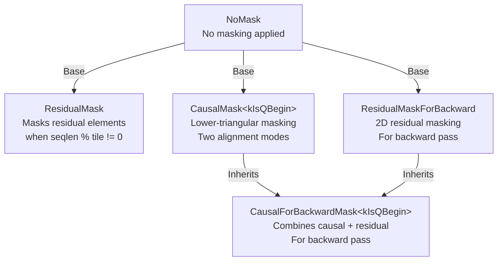
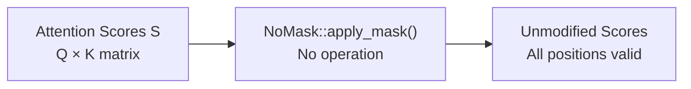
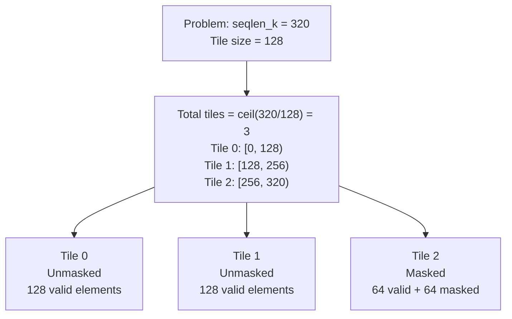
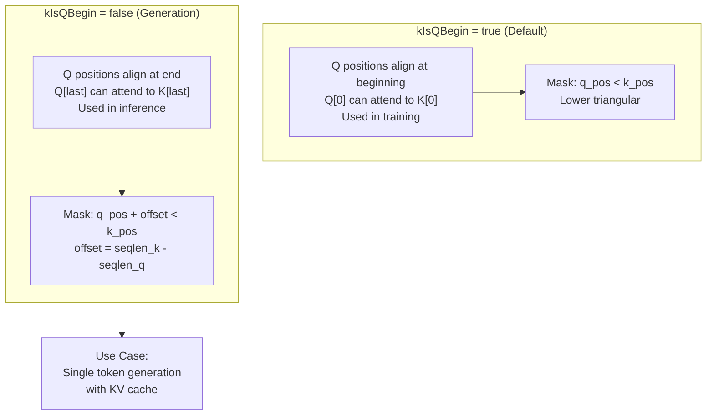
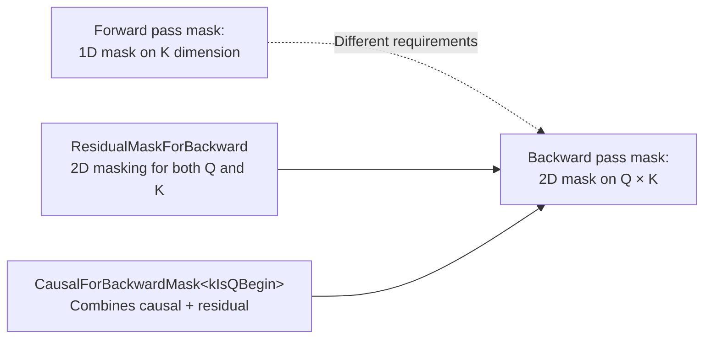
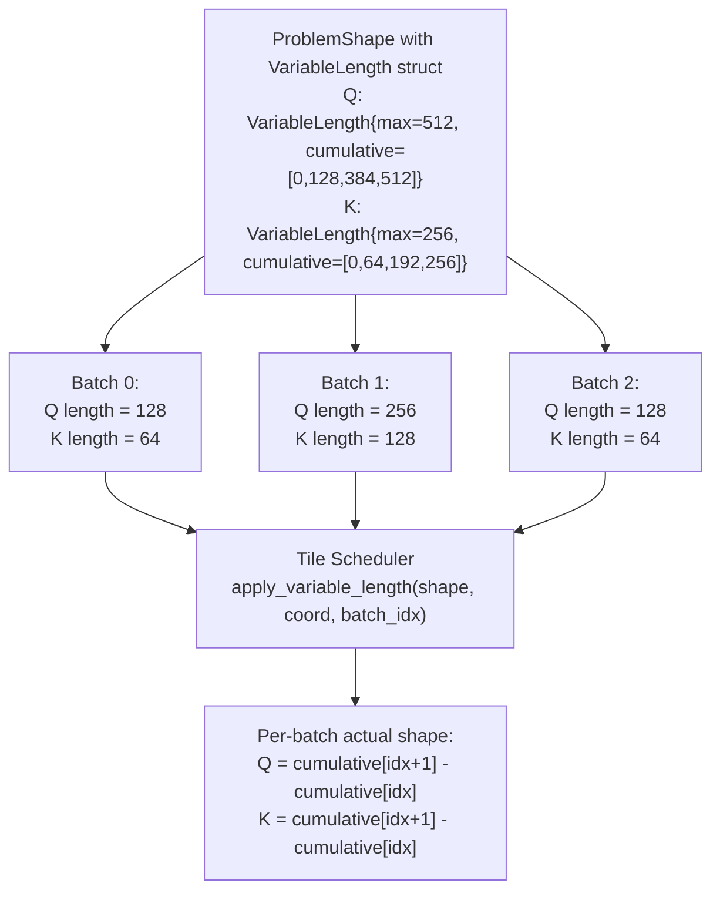
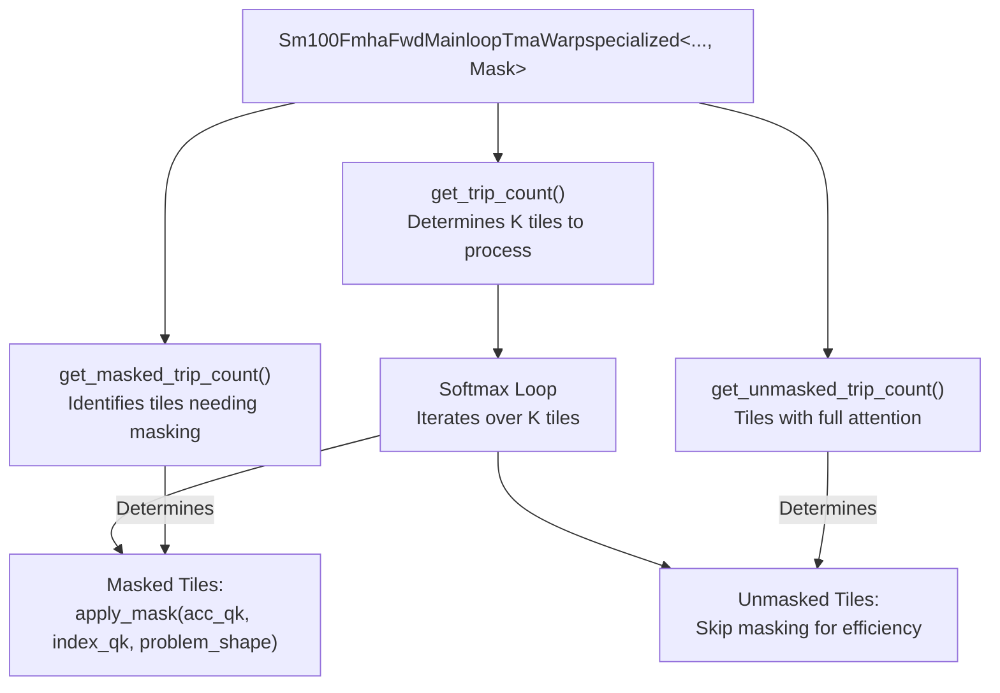
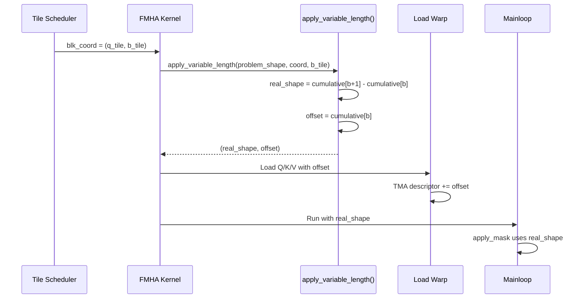
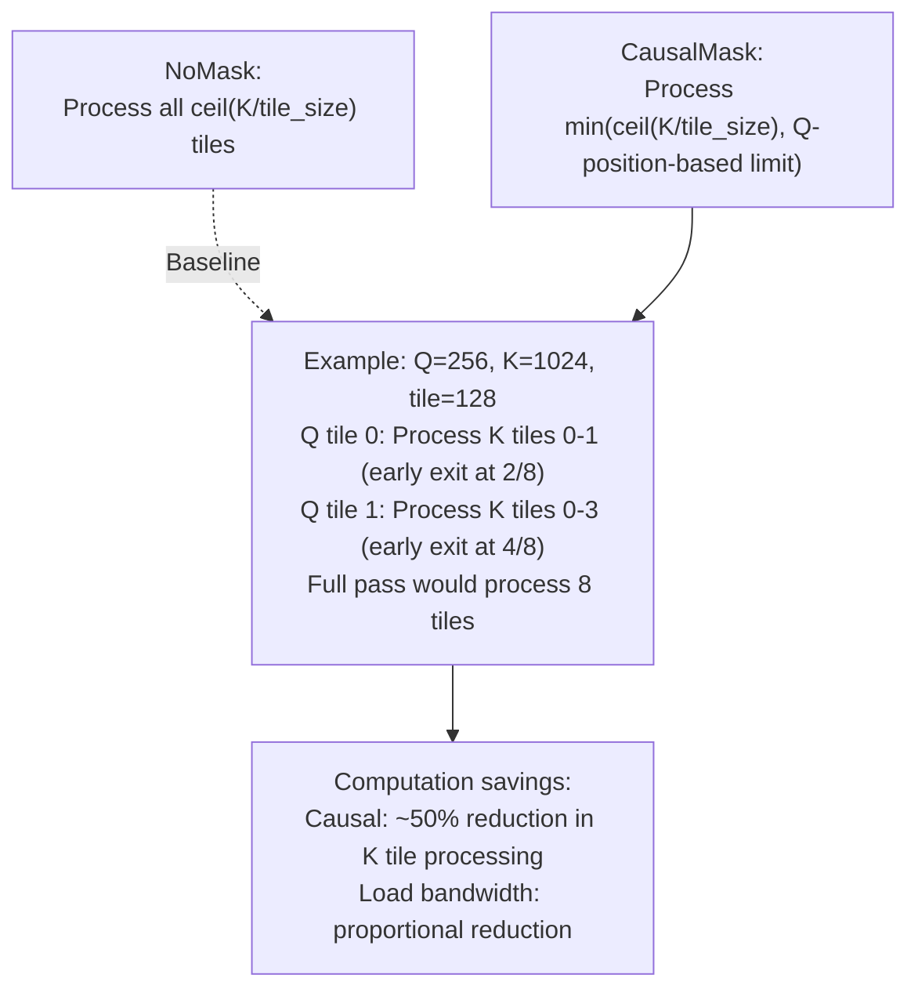

<!-- source: DeepWiki mcp.deepwiki.com · repo NVIDIA/cutlass · page 6.2 FMHA Masking and Variable Length Support · fetched 2026-10-26 -->

# FMHA Masking and Variable Length Support

<details>
<summary>Relevant source files</summary>

The following files were used as context for generating this wiki page:

- [examples/41_fused_multi_head_attention/default_fmha_grouped.h](examples/41_fused_multi_head_attention/default_fmha_grouped.h)
- [examples/41_fused_multi_head_attention/fmha_backward_test.py](examples/41_fused_multi_head_attention/fmha_backward_test.py)
- [examples/41_fused_multi_head_attention/fmha_grouped.h](examples/41_fused_multi_head_attention/fmha_grouped.h)
- [examples/41_fused_multi_head_attention/fused_multi_head_attention_backward.cu](examples/41_fused_multi_head_attention/fused_multi_head_attention_backward.cu)
- [examples/41_fused_multi_head_attention/fused_multihead_attention_fixed_seqlen.cu](examples/41_fused_multi_head_attention/fused_multihead_attention_fixed_seqlen.cu)
- [examples/41_fused_multi_head_attention/fused_multihead_attention_variable_seqlen.cu](examples/41_fused_multi_head_attention/fused_multihead_attention_variable_seqlen.cu)
- [examples/41_fused_multi_head_attention/gemm/custom_mma_multistage.h](examples/41_fused_multi_head_attention/gemm/custom_mma_multistage.h)
- [examples/41_fused_multi_head_attention/gemm/custom_mma_pipelined.h](examples/41_fused_multi_head_attention/gemm/custom_mma_pipelined.h)
- [examples/41_fused_multi_head_attention/gemm/mma_from_smem.h](examples/41_fused_multi_head_attention/gemm/mma_from_smem.h)
- [examples/41_fused_multi_head_attention/gemm_kernel_utils.h](examples/41_fused_multi_head_attention/gemm_kernel_utils.h)
- [examples/41_fused_multi_head_attention/iterators/default_warp_iterator_from_smem.h](examples/41_fused_multi_head_attention/iterators/default_warp_iterator_from_smem.h)
- [examples/41_fused_multi_head_attention/iterators/transpose_warp_iterator.h](examples/41_fused_multi_head_attention/iterators/transpose_warp_iterator.h)
- [examples/41_fused_multi_head_attention/iterators/warp_iterator_from_smem.h](examples/41_fused_multi_head_attention/iterators/warp_iterator_from_smem.h)
- [examples/41_fused_multi_head_attention/kernel_backward.h](examples/41_fused_multi_head_attention/kernel_backward.h)
- [examples/41_fused_multi_head_attention/kernel_forward.h](examples/41_fused_multi_head_attention/kernel_forward.h)
- [examples/41_fused_multi_head_attention/transform/tile_smem_loader.h](examples/41_fused_multi_head_attention/transform/tile_smem_loader.h)
- [examples/77_blackwell_fmha/77_blackwell_fmha.cu](examples/77_blackwell_fmha/77_blackwell_fmha.cu)
- [examples/77_blackwell_fmha/77_blackwell_fmha_gen.cu](examples/77_blackwell_fmha/77_blackwell_fmha_gen.cu)
- [examples/77_blackwell_fmha/77_blackwell_mla.cu](examples/77_blackwell_fmha/77_blackwell_mla.cu)
- [examples/77_blackwell_fmha/CMakeLists.txt](examples/77_blackwell_fmha/CMakeLists.txt)
- [examples/77_blackwell_fmha/collective/fmha_fusion.hpp](examples/77_blackwell_fmha/collective/fmha_fusion.hpp)
- [examples/77_blackwell_fmha/collective/sm100_fmha_fwd_epilogue_tma_warpspecialized.hpp](examples/77_blackwell_fmha/collective/sm100_fmha_fwd_epilogue_tma_warpspecialized.hpp)
- [examples/77_blackwell_fmha/collective/sm100_fmha_fwd_mainloop_tma_warpspecialized.hpp](examples/77_blackwell_fmha/collective/sm100_fmha_fwd_mainloop_tma_warpspecialized.hpp)
- [examples/77_blackwell_fmha/kernel/sm100_fmha_fwd_kernel_tma_warpspecialized.hpp](examples/77_blackwell_fmha/kernel/sm100_fmha_fwd_kernel_tma_warpspecialized.hpp)
- [examples/77_blackwell_fmha/kernel/sm100_fmha_mla_reduction.hpp](examples/77_blackwell_fmha/kernel/sm100_fmha_mla_reduction.hpp)
- [examples/77_blackwell_fmha/reference/fmha_fwd_reference.hpp](examples/77_blackwell_fmha/reference/fmha_fwd_reference.hpp)
- [examples/77_blackwell_fmha/reference/reference_abs_error.hpp](examples/77_blackwell_fmha/reference/reference_abs_error.hpp)

</details>


## Purpose and Scope

This page documents the masking strategies and variable sequence length support for Fused Multi-Head Attention (FMHA) kernels on NVIDIA Blackwell SM100/SM103 architecture. Masking enables causal attention patterns and handling of padded sequences, while variable length support allows efficient batching of sequences with different lengths without padding overhead.

For the forward pass implementation, see [FMHA Forward Pass Implementation](#6.1). For Multi-Head Latent Attention (MLA) operations, see [Multi-Head Latent Attention (MLA)](#6.3). For memory hierarchy and pipeline details, see [FMHA Pipeline Coordination and Warp Specialization](#6.4).

Masking is critical for:
- **Causal attention**: Preventing tokens from attending to future positions (autoregressive models) [examples/77_blackwell_fmha/collective/fmha_fusion.hpp:187-190]().
- **Padding management**: Masking out invalid sequence positions [examples/77_blackwell_fmha/collective/fmha_fusion.hpp:120-124]().
- **Variable length batching**: Supporting different sequence lengths per batch element without padding waste [examples/77_blackwell_fmha/77_blackwell_fmha.cu:51-56]().

## Mask Type Hierarchy

CUTLASS FMHA implements masking through a compile-time policy interface where mask classes define trip count computation and element-wise masking operations:



**Diagram: Mask class inheritance hierarchy**

All mask types implement three key methods:
- `get_trip_count()`: Returns total K tiles to process [examples/77_blackwell_fmha/collective/fmha_fusion.hpp:44-50]().
- `get_masked_trip_count()`: Returns K tiles requiring masking [examples/77_blackwell_fmha/collective/fmha_fusion.hpp:52-60]().
- `get_unmasked_trip_count()`: Returns K tiles without masking (optimization) [examples/77_blackwell_fmha/collective/fmha_fusion.hpp:62-70]().
- `apply_mask()`: Applies element-wise masking to attention scores [examples/77_blackwell_fmha/collective/fmha_fusion.hpp:72-80]().

Sources: [examples/77_blackwell_fmha/collective/fmha_fusion.hpp:41-314]()

## NoMask: Baseline Attention

The `NoMask` class implements full attention with no masking applied.



**Diagram: NoMask applies no modifications to attention scores**

### Implementation

```cpp
// From fmha_fusion.hpp lines 41-81
struct NoMask {
  template<class BlkCoord, class TileShape, class ProblemSize>
  CUTLASS_DEVICE int get_trip_count(
      BlkCoord const& blk_coord,
      TileShape const& tile_shape,
      ProblemSize const& problem_size) {
    return ceil_div(get<1>(problem_size), get<1>(tile_shape));
  }
  
  template<class BlkCoord, class TileShape, class ProblemSize>
  CUTLASS_DEVICE int get_masked_trip_count(...) {
    return 0;  // No tiles require masking
  }
  
  template<class AccQK, class IndexQK, class ProblemSize>
  CUTLASS_DEVICE void apply_mask(
      AccQK& acc_qk,
      IndexQK const& index_qk,
      ProblemSize const& problem_size) {
    return;  // No-op
  }
};
```

**Key characteristics:**
- All K tiles are processed as unmasked [examples/77_blackwell_fmha/collective/fmha_fusion.hpp:69-70]().
- `get_masked_trip_count()` returns 0 [examples/77_blackwell_fmha/collective/fmha_fusion.hpp:59-60]().
- `apply_mask()` is a no-op [examples/77_blackwell_fmha/collective/fmha_fusion.hpp:79-80]().

Sources: [examples/77_blackwell_fmha/collective/fmha_fusion.hpp:41-81]()

## ResidualMask: Handling Non-Aligned Sequences

The `ResidualMask` class masks out elements when sequence length does not evenly divide the tile size, preventing softmax computation on invalid positions.



**Diagram: ResidualMask handles the last tile when seqlen_k % tile_size != 0**

### Implementation

```cpp
// From fmha_fusion.hpp lines 83-133
struct ResidualMask : NoMask {
  using Base = NoMask;
  
  template <class BlkCoord, class TileShape, class ProblemSize>
  CUTLASS_DEVICE int get_masked_trip_count(...) {
    if (get<1>(problem_size) % get<1>(tile_shape) != 0) {
      return 1;  // Last tile requires masking
    }
    return 0;
  }
  
  template<class AccQK, class IndexQK, class ProblemSize>
  CUTLASS_DEVICE void apply_mask(
      AccQK& acc_qk,
      IndexQK const& index_qk,
      ProblemSize const& problem_size) {
    CUTLASS_PRAGMA_UNROLL
    for (int i = 0; i < size(acc_qk); i++) {
      auto pos = index_qk(i);
      if (get<1>(pos) >= get<1>(problem_size)) {
        acc_qk(i) = -INFINITY;  // Mask invalid K positions
      }
    }
  }
};
```

**Masking behavior:**
- Sets attention scores to `-INFINITY` for positions beyond `seqlen_k` [examples/77_blackwell_fmha/collective/fmha_fusion.hpp:128-130]().
- Ensures softmax produces 0 probability for masked positions.
- Only the last tile (if residual) requires element-wise checking [examples/77_blackwell_fmha/collective/fmha_fusion.hpp:93-96]().

Sources: [examples/77_blackwell_fmha/collective/fmha_fusion.hpp:83-133]()

## CausalMask: Autoregressive Attention

The `CausalMask<kIsQBegin>` class implements lower-triangular masking for autoregressive models, with two alignment modes for handling sequences of different lengths.



**Diagram: CausalMask alignment modes for different use cases**

### Implementation

```cpp
// From fmha_fusion.hpp lines 187-277
template<bool kIsQBegin = true>
struct CausalMask : NoMask {
  static constexpr bool IsQBegin = kIsQBegin;
  
  template<class BlkCoord, class TileShape, class ProblemSize>
  CUTLASS_DEVICE int get_trip_count(...) {
    int max_blocks_k = Base::get_trip_count(...);
    
    if constexpr (IsQBegin) {
      // Q at beginning: limit K tiles by Q position
      int max_blocks_q = ceil_div((get<0>(blk_coord) + 1) * get<0>(tile_shape), 
                                   get<1>(tile_shape));
      return std::min(max_blocks_k, max_blocks_q);
    } else {
      // Q at end: account for offset
      const int offset_q = get<1>(problem_size) - get<0>(problem_size);
      int max_blocks_q = ceil_div((get<0>(blk_coord) + 1) * get<0>(tile_shape) + offset_q,
                                   get<1>(tile_shape));
      return std::min(max_blocks_k, max_blocks_q);
    }
  }
  
  template<class AccQK, class IndexQK, class ProblemSize>
  CUTLASS_DEVICE void apply_mask(...) {
    if constexpr (IsQBegin) {
      for (int i = 0; i < size(acc_qk); i++) {
        auto pos = index_qk(i);
        if ((get<0>(pos) < get<1>(pos)) || 
            (get<1>(pos) >= get<1>(problem_size))) {
          acc_qk(i) = -INFINITY;
        }
      }
    } else {
      const auto offset_q = get<1>(problem_size) - get<0>(problem_size);
      for (int i = 0; i < size(acc_qk); i++) {
        auto pos = index_qk(i);
        if ((get<0>(pos) + offset_q < get<1>(pos)) || 
            (get<1>(pos) >= get<1>(problem_size))) {
          acc_qk(i) = -INFINITY;
        }
      }
    }
  }
};
```

**Key features:**
- **Early exit optimization**: `get_trip_count()` limits K tiles based on causal constraint [examples/77_blackwell_fmha/collective/fmha_fusion.hpp:206-215]().
- **Alignment modes**: `kIsQBegin` controls whether Q aligns at start or end of K [examples/77_blackwell_fmha/collective/fmha_fusion.hpp:190-195]().
- **Residual handling**: Combines causal mask with sequence length check [examples/77_blackwell_fmha/collective/fmha_fusion.hpp:251-255]().

Sources: [examples/77_blackwell_fmha/collective/fmha_fusion.hpp:187-277]()

## Backward Pass Masking Variants

The backward pass requires specialized masking that handles both Q and K dimensions.



**Diagram: Backward pass requires 2D masking logic**

### ResidualMaskForBackward Implementation

```cpp
// From fmha_fusion.hpp lines 135-185
struct ResidualMaskForBackward : NoMask {
  template<class AccQK, class IndexQK, class ProblemSize>
  CUTLASS_DEVICE void apply_mask(
      AccQK& acc_qk,
      IndexQK const& index_qk,
      ProblemSize const& problem_size) {
    CUTLASS_PRAGMA_UNROLL
    for (int i = 0; i < size(acc_qk); i++) {
      auto pos = index_qk(i);
      // Check both Q and K dimensions
      if (! elem_less(pos, select<0,1>(problem_size))) {
        acc_qk(i) = -INFINITY;
      }
    }
  }
};
```

The key difference: `elem_less(pos, select<0,1>(problem_size))` checks both coordinates against problem bounds [examples/77_blackwell_fmha/collective/fmha_fusion.hpp:179-181]().

### CausalForBackwardMask Implementation

```cpp
// From fmha_fusion.hpp lines 279-314
template<bool kIsQBegin = true>
struct CausalForBackwardMask : CausalMask<kIsQBegin>, ResidualMaskForBackward {
  template<class AccQK, class IndexQK, class ProblemSize>
  CUTLASS_DEVICE void apply_mask(...) {
    int offset_q = 0;
    if constexpr (!kIsQBegin) {
      offset_q = get<1>(problem_size) - get<0>(problem_size);
    }
    
    for (int i = 0; i < size(acc_qk); i++) {
      auto pos = index_qk(i);
      bool masked = (get<0>(pos) + offset_q < get<1>(pos)) || 
                    !elem_less(pos, problem_size);
      if (masked) {
        acc_qk(i) = -INFINITY;
      }
    }
  }
};
```

**Combines:**
- Causal masking: `get<0>(pos) + offset_q < get<1>(pos)` [examples/77_blackwell_fmha/collective/fmha_fusion.hpp:305]().
- 2D residual masking: `!elem_less(pos, problem_size)` [examples/77_blackwell_fmha/collective/fmha_fusion.hpp:306]().

Sources: [examples/77_blackwell_fmha/collective/fmha_fusion.hpp:135-314]()

## VariableLength: Batching Different Sequence Lengths

The `VariableLength` struct enables efficient batching of sequences with different lengths without padding waste.



**Diagram: VariableLength enables per-batch sequence length specification**

### VariableLength Structure

```cpp
// From fmha_fusion.hpp lines 316-328
struct VariableLength {
  int max_length;                  // Maximum length across all batches
  int* cumulative_length = nullptr; // [B+1] array of cumulative offsets
  int total_length = -1;           // Sum of all sequence lengths
  
  CUTE_HOST_DEVICE operator int() const {
    return max_length;  // Used for tile shape calculations
  }
};
```

### Type Trait for Detection

```cpp
// From fmha_fusion.hpp lines 326-328
template<class T> struct is_variable_length_impl : std::false_type {};
template<> struct is_variable_length_impl<VariableLength> : std::true_type {};
template<class T> constexpr bool is_variable_length_v = 
    is_variable_length_impl<remove_cvref_t<T>>::value;
```

### Coordinate Transformation

The `apply_variable_length` function transforms global problem shape and coordinates to per-batch values:

```cpp
// From fmha_fusion.hpp lines 344-358
template<class Shape, class Coord, class Idx>
CUTE_HOST_DEVICE constexpr auto
apply_variable_length(Shape const& shape, Coord const& coord, Idx const& idx) {
  auto new_shape = transform_leaf(shape, [&](auto const& s) {
    if constexpr (is_variable_length_v<decltype(s)>) {
      return s.cumulative_length[idx+1] - s.cumulative_length[idx];
    } else {
      return s;
    }
  });
  
  auto new_coord = transform_leaf(shape, coord, [&](auto const& s, auto const& c) {
    if constexpr (is_variable_length_v<decltype(s)>) {
      return cute::make_tuple(c, s.cumulative_length[idx]);
    } else {
      return c;
    }
  });
  
  return cute::make_tuple(new_shape, new_coord);
}
```

**Returns:**
- `new_shape`: Actual sequence length for this batch [examples/77_blackwell_fmha/collective/fmha_fusion.hpp:346-352]().
- `new_coord`: Tuple of (tile_index, global_offset) for addressing [examples/77_blackwell_fmha/collective/fmha_fusion.hpp:354-360]().

Sources: [examples/77_blackwell_fmha/collective/fmha_fusion.hpp:316-396]()

## Integration with FMHA Kernels

Masks are integrated into the FMHA mainloop through template parameters and applied at multiple stages.



**Diagram: Mask integration in FMHA mainloop execution**

### Mask Application in Softmax

In the softmax computation, the mask is applied before exponential and normalization:

```cpp
// From sm100_fmha_fwd_mainloop_tma_warpspecialized.hpp
// ... inside the mainloop execution ...
if constexpr (need_apply_mask) {
  Mask{}.apply_mask(tTMEM_LOADrS, tTMEM_LOADcS, problem_shape);
}
```

Sources: [examples/77_blackwell_fmha/collective/sm100_fmha_fwd_mainloop_tma_warpspecialized.hpp:74](), [examples/77_blackwell_fmha/reference/fmha_fwd_reference.hpp:123-124]()

### Mask Selection in Kernel

The mask type is selected at kernel instantiation based on command-line options in the Blackwell examples:

```cpp
// From 77_blackwell_fmha.cu
// Determine mask type from options
if (options.causal) {
    if (options.causal_q_begin) {
        // Use CausalMask<true>
    } else {
        // Use CausalMask<false>
    }
} else if (options.residual) {
    // Use ResidualMask
} else {
    // Use NoMask
}
```

Sources: [examples/77_blackwell_fmha/77_blackwell_fmha.cu:128-131](), [examples/77_blackwell_fmha/77_blackwell_fmha.cu:268-289]()

## VariableLength Integration in Kernels

Variable length sequences require special handling for data addressing and masking.



**Diagram: VariableLength sequence handling in FMHA execution**

### Kernel Batch Transformation

The `Sm100FmhaFwdKernelTmaWarpspecialized` kernel applies variable length transformations per tile:

```cpp
// In operator() kernel body (conceptual):
auto blk_coord = tile_scheduler.get_block_coord();
auto [logical_problem_shape, logical_coord] = apply_variable_length(
    params.problem_shape, blk_coord, get<2,1>(blk_coord));
```

Sources: [examples/77_blackwell_fmha/reference/fmha_fwd_reference.hpp:78-79](), [examples/77_blackwell_fmha/kernel/sm100_fmha_fwd_kernel_tma_warpspecialized.hpp:135-138]()

### TMA Descriptor Offset

For variable length, the TMA store descriptors are adjusted to handle the packed sequence layout:

```cpp
// From sm100_fmha_fwd_epilogue_tma_warpspecialized.hpp
if constexpr (is_variable_length_v<tuple_element_t<0, ProblemShape>>) {
  auto cumulative_length_q = get<0>(problem_shape).cumulative_length;
  if (cumulative_length_q != nullptr) {
      int max_length_q = get<0>(problem_shape).max_length;
      // offset ptr by the amount we add back in later
      ptr_O -= max_length_q * get<0>(dO);
  }
}
```

Sources: [examples/77_blackwell_fmha/collective/sm100_fmha_fwd_epilogue_tma_warpspecialized.hpp:117-127]()

## Test Configuration Matrix

The CUTLASS Blackwell examples include comprehensive test coverage for different masking and variable length scenarios:

| Test Name | Mask Type | Causal Type | VarLen | Head Dim |
|-----------|-----------|-------------|--------|----------|
| TEST_BASIC | no | - | No | 128 |
| TEST_CAUSAL_00 | causal | default | No | 128 |
| TEST_CAUSAL_01 | causal | qend | No | 128 |
| TEST_VARLEN | residual | - | Yes | 128 |
| TEST_VARLEN_06 | causal,residual | - | Yes | 128 |
| TEST_VARLEN_15 | causal | qbegin | Yes | 128 |
| TEST_VARLEN_18 | causal | qend | Yes | 128 |

Sources: [examples/77_blackwell_fmha/CMakeLists.txt:41-70]()

## Performance Considerations

### Mask Impact on Trip Count

The mask's `get_trip_count()` method enables early termination for causal attention:



**Diagram: Causal masking reduces computation through early exit**

Sources: [examples/77_blackwell_fmha/collective/fmha_fusion.hpp:198-215]()

### Masked vs Unmasked Tile Paths

The kernel optimizes by separating masked and unmasked tiles to avoid conditional logic in the main compute loop:

```cpp
// From fmha_fusion.hpp
template<class BlkCoord, class TileShape, class ProblemSize>
CUTLASS_DEVICE int get_unmasked_trip_count(...) {
    // Returns number of tiles that are completely inside the sequence bounds
}
```

Sources: [examples/77_blackwell_fmha/collective/fmha_fusion.hpp:101-111](), [examples/77_blackwell_fmha/collective/fmha_fusion.hpp:226-236]()

## Related Components

- **Forward Pass**: [FMHA Forward Pass Implementation](#6.1) uses masking in softmax computation.
- **MLA**: [Multi-Head Latent Attention (MLA)](#6.3) supports masking and variable length for inference.
- **Pipeline Coordination**: [FMHA Pipeline Coordination and Warp Specialization](#6.4) shows how masking integrates with warp roles.
- **Blackwell Architecture**: [SM100 Blackwell Architecture](#7.2) provides the hardware foundation for these kernels.

---

