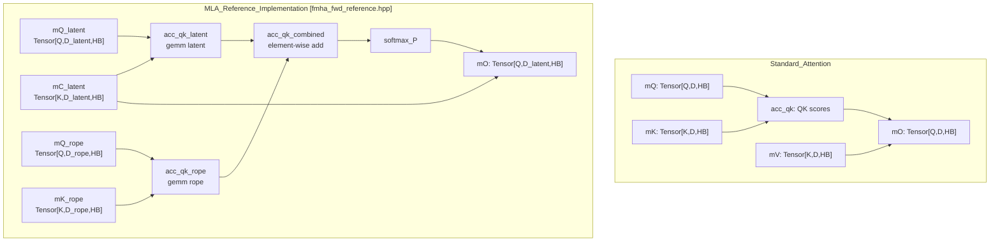
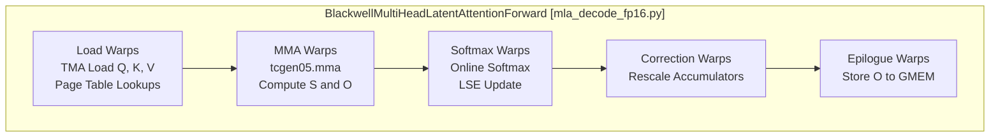

<!-- source: DeepWiki mcp.deepwiki.com · repo NVIDIA/cutlass · page 6.3 Multi-Head Latent Attention (MLA) · fetched 2026-10-26 -->

# Multi-Head Latent Attention (MLA)

<details>
<summary>Relevant source files</summary>

The following files were used as context for generating this wiki page:

- [examples/77_blackwell_fmha/77_blackwell_fmha.cu](examples/77_blackwell_fmha/77_blackwell_fmha.cu)
- [examples/77_blackwell_fmha/77_blackwell_fmha_gen.cu](examples/77_blackwell_fmha/77_blackwell_fmha_gen.cu)
- [examples/77_blackwell_fmha/77_blackwell_mla.cu](examples/77_blackwell_fmha/77_blackwell_mla.cu)
- [examples/77_blackwell_fmha/CMakeLists.txt](examples/77_blackwell_fmha/CMakeLists.txt)
- [examples/77_blackwell_fmha/collective/fmha_fusion.hpp](examples/77_blackwell_fmha/collective/fmha_fusion.hpp)
- [examples/77_blackwell_fmha/collective/sm100_fmha_fwd_epilogue_tma_warpspecialized.hpp](examples/77_blackwell_fmha/collective/sm100_fmha_fwd_epilogue_tma_warpspecialized.hpp)
- [examples/77_blackwell_fmha/collective/sm100_fmha_fwd_mainloop_tma_warpspecialized.hpp](examples/77_blackwell_fmha/collective/sm100_fmha_fwd_mainloop_tma_warpspecialized.hpp)
- [examples/77_blackwell_fmha/kernel/sm100_fmha_fwd_kernel_tma_warpspecialized.hpp](examples/77_blackwell_fmha/kernel/sm100_fmha_fwd_kernel_tma_warpspecialized.hpp)
- [examples/77_blackwell_fmha/kernel/sm100_fmha_mla_reduction.hpp](examples/77_blackwell_fmha/kernel/sm100_fmha_mla_reduction.hpp)
- [examples/77_blackwell_fmha/reference/fmha_fwd_reference.hpp](examples/77_blackwell_fmha/reference/fmha_fwd_reference.hpp)
- [examples/77_blackwell_fmha/reference/reference_abs_error.hpp](examples/77_blackwell_fmha/reference/reference_abs_error.hpp)
- [examples/python/CuTeDSL/cute/blackwell/kernel/attention/mla/mla_decode_fp16.py](examples/python/CuTeDSL/cute/blackwell/kernel/attention/mla/mla_decode_fp16.py)
- [examples/python/CuTeDSL/cute/blackwell/kernel/attention/mla/mla_decode_fp8.py](examples/python/CuTeDSL/cute/blackwell/kernel/attention/mla/mla_decode_fp8.py)
- [examples/python/CuTeDSL/cute/blackwell/kernel/attention/mla/mla_helpers.py](examples/python/CuTeDSL/cute/blackwell/kernel/attention/mla/mla_helpers.py)
- [examples/python/CuTeDSL/cute/blackwell/tutorial/tutorial_gemm/fp16_gemm_0.py](examples/python/CuTeDSL/cute/blackwell/tutorial/tutorial_gemm/fp16_gemm_0.py)
- [examples/python/CuTeDSL/cute/blackwell/tutorial/tutorial_gemm/fp16_gemm_1.py](examples/python/CuTeDSL/cute/blackwell/tutorial/tutorial_gemm/fp16_gemm_1.py)
- [examples/python/CuTeDSL/cute/blackwell/tutorial/tutorial_gemm/fp16_gemm_2.py](examples/python/CuTeDSL/cute/blackwell/tutorial/tutorial_gemm/fp16_gemm_2.py)
- [examples/python/CuTeDSL/cute/blackwell/tutorial/tutorial_gemm/fp16_gemm_3.py](examples/python/CuTeDSL/cute/blackwell/tutorial/tutorial_gemm/fp16_gemm_3.py)
- [examples/python/CuTeDSL/cute_ext/blackwell/dense_gemm_2sm.py](examples/python/CuTeDSL/cute_ext/blackwell/dense_gemm_2sm.py)
- [examples/python/CuTeDSL/dsl_tutorials/dataclass_immutable.py](examples/python/CuTeDSL/dsl_tutorials/dataclass_immutable.py)
- [examples/python/CuTeDSL/dsl_tutorials/export/run_with_dynamic_loading.cpp](examples/python/CuTeDSL/dsl_tutorials/export/run_with_dynamic_loading.cpp)
- [examples/python/CuTeDSL/dsl_tutorials/export/run_with_static_linking.cpp](examples/python/CuTeDSL/dsl_tutorials/export/run_with_static_linking.cpp)
- [examples/python/CuTeDSL/dsl_tutorials/ffi/tensor.cpp](examples/python/CuTeDSL/dsl_tutorials/ffi/tensor.cpp)

</details>


## Overview

Multi-Head Latent Attention (MLA) is an attention mechanism variant that decomposes the head dimension into two components: a latent subspace and a RoPE (Rotary Position Embedding) subspace. This decomposition enables efficient attention computation by reducing the dimensionality of the value projection while maintaining full expressiveness for query-key interactions. In CUTLASS, MLA is specifically optimized for the NVIDIA Blackwell (SM100) architecture using Tensor Memory (TMEM) and warp-specialized pipelines.

**MLA Dimension Decomposition:**
- Total QK dimension: `D_latent + D_rope` (e.g., 512 + 64 = 576) [examples/python/CuTeDSL/cute/blackwell/kernel/attention/mla/mla_decode_fp8.py:101-102]()
- Value/Output dimension: `D_latent` only (e.g., 512) [examples/python/CuTeDSL/cute/blackwell/kernel/attention/mla/mla_decode_fp8.py:101-102]()
- Attention computation: `S = (Q_latent + Q_rope) × (K_latent + K_rope)^T` [examples/python/CuTeDSL/cute/blackwell/kernel/attention/mla/mla_decode_fp8.py:74-75]()
- Output computation: `O = softmax(S) × V_latent` [examples/77_blackwell_fmha/reference/fmha_fwd_reference.hpp:151-163]()

**Key Features:**
- **Dimension Split**: Separate processing of latent and position-aware components.
- **KV Cache Compression**: Values stored only in latent dimension. [examples/python/CuTeDSL/cute/blackwell/kernel/attention/mla/mla_decode_fp8.py:75-76]()
- **Paging Support**: Support for non-contiguous physical memory via page tables, essential for inference. [examples/python/CuTeDSL/cute/blackwell/kernel/attention/mla/mla_decode_fp16.py:124-131]()
- **Split-KV Parallelization**: K-dimension decomposition to minimize latency when processing long KV sequences. [examples/python/CuTeDSL/cute/blackwell/kernel/attention/mla/mla_decode_fp16.py:72-79]()
- **Generation Phase Optimization**: Optimized single-token inference with cached KV states and Blackwell-specific `tcgen05` instructions. [examples/python/CuTeDSL/cute/blackwell/kernel/attention/mla/mla_decode_fp8.py:69-79]()

Sources: [examples/python/CuTeDSL/cute/blackwell/kernel/attention/mla/mla_decode_fp8.py:69-135](), [examples/77_blackwell_fmha/reference/fmha_fwd_reference.hpp:82-163](), [examples/python/CuTeDSL/cute/blackwell/kernel/attention/mla/mla_decode_fp16.py:69-131]()

## MLA Architecture Overview

### MLA vs Standard Attention Computation

**Diagram: MLA Computation Flow with Code Entities**



**Dimension Characteristics:**

| Component | Dimension | Usage |
|-----------|-----------|-------|
| `D_latent` (`dl`) | 512 (example) | Compressed representation for attention and output [examples/python/CuTeDSL/cute/blackwell/kernel/attention/mla/mla_decode_fp16.py:124]() |
| `D_rope` (`dr`) | 64 (example) | Position-dependent attention contribution [examples/python/CuTeDSL/cute/blackwell/kernel/attention/mla/mla_decode_fp16.py:125]() |
| `D_qk = D_latent + D_rope` | 576 | Total query-key dimension [examples/77_blackwell_fmha/reference/fmha_fwd_reference.hpp:83-84]() |
| `D_vo = D_latent` | 512 | Value and output dimension (reduced) [examples/77_blackwell_fmha/reference/fmha_fwd_reference.hpp:85]() |

Sources: [examples/77_blackwell_fmha/reference/fmha_fwd_reference.hpp:82-158](), [examples/python/CuTeDSL/cute/blackwell/kernel/attention/mla/mla_decode_fp16.py:123-125]()

### Problem Shape and Strides

The MLA implementation uses a specific `ProblemShape` that differentiates between latent and rope dimensions. The kernel utilizes TMA (Tensor Memory Accelerator) to move these tiles efficiently.

| Component | Shape | Description |
|-----------|-------|-------------|
| Q | `(NumHeads, LatentDim/RopeDim, SeqLenQ, BatchSize)` | Query tensor with separate latent/rope modes. [examples/python/CuTeDSL/cute/blackwell/kernel/attention/mla/mla_decode_fp16.py:126]() |
| KV Latent | `(SeqLenK, LatentDim, BatchSize)` | Latent KV cache (compressed). [examples/python/CuTeDSL/cute/blackwell/kernel/attention/mla/mla_decode_fp16.py:127]() |
| KV RoPE | `(SeqLenK, RopeDim, BatchSize)` | RoPE KV cache. [examples/python/CuTeDSL/cute/blackwell/kernel/attention/mla/mla_decode_fp16.py:127]() |
| O | `(NumHeads, LatentDim, SeqLenQ, BatchSize)` | Output tensor (latent dimension only). |

Sources: [examples/python/CuTeDSL/cute/blackwell/kernel/attention/mla/mla_decode_fp16.py:126-128](), [examples/77_blackwell_fmha/collective/sm100_fmha_fwd_epilogue_tma_warpspecialized.hpp:97-104]()

## Generation Phase Architecture

### Inference Optimizations

**Generation Phase Characteristics:**
- **Sequence Length**: Query sequence length is typically 1 (decoding). [examples/python/CuTeDSL/cute/blackwell/kernel/attention/mla/mla_decode_fp16.py:128]()
- **KV Splitting**: Long KV sequences are split across multiple thread blocks to improve occupancy and reduce latency. [examples/python/CuTeDSL/cute/blackwell/kernel/attention/mla/mla_decode_fp16.py:73-74]()
- **Hardware Features**: Uses `tcgen05` (Blackwell Tensor Core) instructions and `TMEM` (Tensor Memory) for accumulation. [examples/python/CuTeDSL/cute/blackwell/kernel/attention/mla/mla_decode_fp8.py:73-75]()

Sources: [examples/python/CuTeDSL/cute/blackwell/kernel/attention/mla/mla_decode_fp16.py:73-131](), [examples/python/CuTeDSL/cute/blackwell/kernel/attention/mla/mla_decode_fp8.py:73-75]()

### Generation Phase Kernel Configuration

The generation phase is implemented using a warp-specialized persistent kernel. It integrates `(Qc + Qr)*(Kc + Kr)^T` matrix multiplication, softmax, and output projection.

**Diagram: MLA Decode Kernel Structure**



Sources: [examples/python/CuTeDSL/cute/blackwell/kernel/attention/mla/mla_decode_fp16.py:75-80](), [examples/77_blackwell_fmha/kernel/sm100_fmha_fwd_kernel_tma_warpspecialized.hpp:90-111]()

## MLA Kernel Implementation (SM100)

### Warp Specialization and Role Assignment

The `Sm100FmhaFwdKernelTmaWarpspecialized` defines specific roles for warps to maximize overlap between memory access and computation.

**Warp Roles Assignment (`Sm100MlaFwdCtxKernelWarpspecializedSchedule`):**
- **MMA**: Executes Blackwell Tensor Core instructions (`tcgen05`). [examples/77_blackwell_fmha/kernel/sm100_fmha_fwd_kernel_tma_warpspecialized.hpp:107]()
- **Load**: Handles TMA memory transactions. [examples/77_blackwell_fmha/kernel/sm100_fmha_fwd_kernel_tma_warpspecialized.hpp:108]()
- **Softmax0/1**: Executes online softmax and reduction. [examples/77_blackwell_fmha/kernel/sm100_fmha_fwd_kernel_tma_warpspecialized.hpp:104-105]()
- **Correction**: Rescales values for numerical stability. [examples/77_blackwell_fmha/kernel/sm100_fmha_fwd_kernel_tma_warpspecialized.hpp:106]()
- **Epilogue**: Handles final output storage. [examples/77_blackwell_fmha/kernel/sm100_fmha_fwd_kernel_tma_warpspecialized.hpp:109]()

Sources: [examples/77_blackwell_fmha/kernel/sm100_fmha_fwd_kernel_tma_warpspecialized.hpp:90-111]()

### MLA Computation Pipeline

Coordination is handled through asynchronous pipelines defined in the mainloop.

- **PipelineQ**: Stages Q data from load to MMA. [examples/77_blackwell_fmha/collective/sm100_fmha_fwd_mainloop_tma_warpspecialized.hpp:145]()
- **PipelineKV**: Stages K and V data from load to MMA. [examples/77_blackwell_fmha/collective/sm100_fmha_fwd_mainloop_tma_warpspecialized.hpp:151]()
- **PipelineS**: Pipeline from MMA to softmax warps, protecting S in TMEM. [examples/77_blackwell_fmha/collective/sm100_fmha_fwd_mainloop_tma_warpspecialized.hpp:159]()
- **PipelineE**: Pipeline from correction to epilogue. [examples/77_blackwell_fmha/collective/sm100_fmha_fwd_mainloop_tma_warpspecialized.hpp:168]()

Sources: [examples/77_blackwell_fmha/collective/sm100_fmha_fwd_mainloop_tma_warpspecialized.hpp:145-168]()

## Paging Support and KV Cache

### Page Table Architecture

MLA kernels support page table storage for the KV cache to handle dynamic memory allocation in inference frameworks.

- **Page Size**: Configurable via the `page_size` parameter in the DSL and C++ arguments. [examples/python/CuTeDSL/cute/blackwell/kernel/attention/mla/mla_decode_fp16.py:161](), [examples/77_blackwell_fmha/77_blackwell_mla.cu:81]()
- **Variable Length**: The kernel supports variable-length KV cache sequences per batch using `VariableLength` objects. [examples/77_blackwell_fmha/77_blackwell_fmha.cu:54-56]()

Sources: [examples/python/CuTeDSL/cute/blackwell/kernel/attention/mla/mla_decode_fp16.py:124-131](), [examples/77_blackwell_fmha/77_blackwell_fmha.cu:54-56]()

## Split-KV Parallelization

### Reduction Kernel

When KV sequences are long, they are split into `split_kv` parts. Each part produces a partial output and a Log-Sum-Exp (LSE) value. These are combined using the `Sm100FmhaMlaReductionKernel`.

**Reduction Logic:**
1. **LSE Reduction**: Calculate the global maximum LSE and sum of exponentials across all splits. [examples/77_blackwell_fmha/kernel/sm100_fmha_mla_reduction.hpp:137-161]()
2. **Weighted Sum**: Rescale partial output tensors by `exp(partial_lse - global_lse)` and sum them. [examples/77_blackwell_fmha/kernel/sm100_fmha_mla_reduction.hpp:172]()

Sources: [examples/77_blackwell_fmha/kernel/sm100_fmha_mla_reduction.hpp:41-185]()

### Tile Schedulers

The kernel supports specialized tile schedulers for MLA.

- **MLAStaticTileScheduler**: Schedulers for MLA inference (decode) in Python DSL. [examples/python/CuTeDSL/cute/blackwell/kernel/attention/mla/mla_helpers.py:64]()
- **Sm100MlaPersistentTileScheduler**: Persistent CTA scheduling for MLA. [examples/77_blackwell_fmha/77_blackwell_mla.cu:52]()

Sources: [examples/python/CuTeDSL/cute/blackwell/kernel/attention/mla/mla_helpers.py:64](), [examples/77_blackwell_fmha/77_blackwell_mla.cu:52]()

## Example Usage

### Python DSL (CuTe DSL)

The Python interface allows for high-level configuration of MLA kernels for FP8 or FP16.

```python
# Example configuration for FP8 MLA Decode
kernel = BlackwellMultiHeadLatentAttentionForwardFP8(
    acc_dtype=cutlass.float32,
    lse_dtype=cutlass.float32,
    mma_qk_tiler_mn=(128, 64),
    mma_pv_tiler_mn=(128, 64),
    page_size=64,
    is_persistent=True,
    is_var_seq=True,
    is_var_split_kv=True
)
```

Sources: [examples/python/CuTeDSL/cute/blackwell/kernel/attention/mla/mla_decode_fp8.py:138-151]()

### C++ Example

The `77_blackwell_mla.cu` example demonstrates launching MLA on Blackwell.

```cpp
// Command line usage for MLA example
// --b=batch, --k=kv_len, --page=page_size
./examples/77_blackwell_fmha/77_blackwell_mla --b=32 --k=1024 --page=16 --verify
```

Sources: [examples/77_blackwell_fmha/77_blackwell_mla.cu:180-195]()

---

