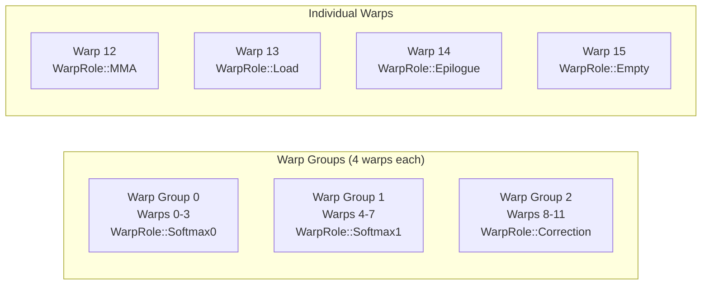
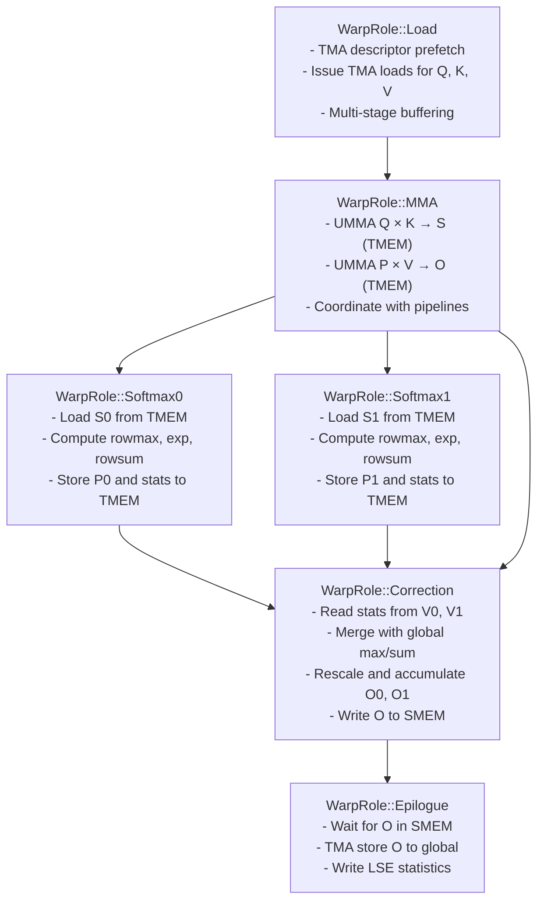
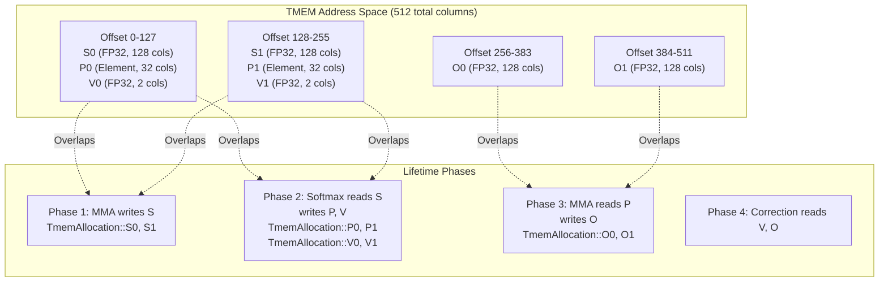
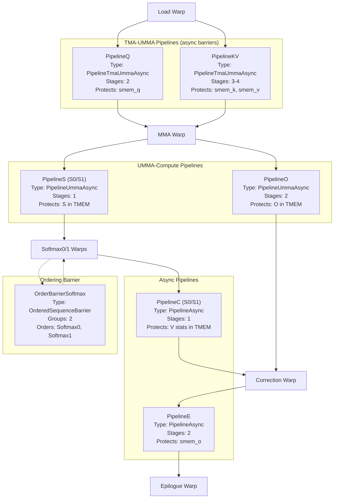
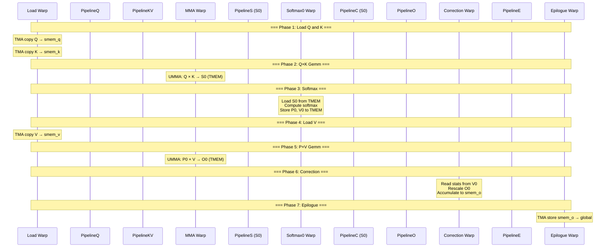

<!-- source: DeepWiki mcp.deepwiki.com · repo NVIDIA/cutlass · page 6.4 FMHA Pipeline Coordination and Warp Specialization · fetched 2026-10-26 -->

# FMHA Pipeline Coordination and Warp Specialization

<details>
<summary>Relevant source files</summary>

The following files were used as context for generating this wiki page:

- [examples/77_blackwell_fmha/77_blackwell_fmha.cu](examples/77_blackwell_fmha/77_blackwell_fmha.cu)
- [examples/77_blackwell_fmha/77_blackwell_fmha_bwd.cu](examples/77_blackwell_fmha/77_blackwell_fmha_bwd.cu)
- [examples/77_blackwell_fmha/77_blackwell_fmha_gen.cu](examples/77_blackwell_fmha/77_blackwell_fmha_gen.cu)
- [examples/77_blackwell_fmha/77_blackwell_mla.cu](examples/77_blackwell_fmha/77_blackwell_mla.cu)
- [examples/77_blackwell_fmha/CMakeLists.txt](examples/77_blackwell_fmha/CMakeLists.txt)
- [examples/77_blackwell_fmha/collective/fmha_fusion.hpp](examples/77_blackwell_fmha/collective/fmha_fusion.hpp)
- [examples/77_blackwell_fmha/collective/sm100_fmha_fwd_epilogue_tma_warpspecialized.hpp](examples/77_blackwell_fmha/collective/sm100_fmha_fwd_epilogue_tma_warpspecialized.hpp)
- [examples/77_blackwell_fmha/collective/sm100_fmha_fwd_mainloop_tma_warpspecialized.hpp](examples/77_blackwell_fmha/collective/sm100_fmha_fwd_mainloop_tma_warpspecialized.hpp)
- [examples/77_blackwell_fmha/device/fmha_device_bwd.hpp](examples/77_blackwell_fmha/device/fmha_device_bwd.hpp)
- [examples/77_blackwell_fmha/kernel/fmha_kernel_bwd_convert.hpp](examples/77_blackwell_fmha/kernel/fmha_kernel_bwd_convert.hpp)
- [examples/77_blackwell_fmha/kernel/fmha_kernel_bwd_sum_OdO.hpp](examples/77_blackwell_fmha/kernel/fmha_kernel_bwd_sum_OdO.hpp)
- [examples/77_blackwell_fmha/kernel/sm100_fmha_bwd_kernel_tma_warpspecialized.hpp](examples/77_blackwell_fmha/kernel/sm100_fmha_bwd_kernel_tma_warpspecialized.hpp)
- [examples/77_blackwell_fmha/kernel/sm100_fmha_fwd_kernel_tma_warpspecialized.hpp](examples/77_blackwell_fmha/kernel/sm100_fmha_fwd_kernel_tma_warpspecialized.hpp)
- [examples/77_blackwell_fmha/kernel/sm100_fmha_mla_reduction.hpp](examples/77_blackwell_fmha/kernel/sm100_fmha_mla_reduction.hpp)
- [examples/77_blackwell_fmha/reference/fmha_bwd_reference.hpp](examples/77_blackwell_fmha/reference/fmha_bwd_reference.hpp)
- [examples/77_blackwell_fmha/reference/fmha_fwd_reference.hpp](examples/77_blackwell_fmha/reference/fmha_fwd_reference.hpp)
- [examples/77_blackwell_fmha/reference/reference_abs_error.hpp](examples/77_blackwell_fmha/reference/reference_abs_error.hpp)

</details>


This document describes the multi-pipeline architecture and warp specialization strategy used in the Blackwell SM100 FMHA (Fused Multi-Head Attention) implementation. The kernel employs seven distinct pipelines (`PipelineQ`, `PipelineKV`, `PipelineS`, `PipelineC`, `PipelineO`, `PipelineE`, `OrderBarrierSoftmax`) to coordinate data flow between specialized warp groups (Load, MMA, Softmax0, Softmax1, Correction, Epilogue). Each warp group has a dedicated role and register allocation to maximize throughput through overlapped execution.

The coordination relies on a carefully designed TMEM allocation strategy that allows different computation stages to share tensor memory through non-overlapping lifetimes. This enables attention score computation, softmax, and output accumulation to proceed concurrently with minimal synchronization overhead.

For high-level FMHA kernel structure, see [6.1](). For masking and variable length support, see [6.2](). For the MLA variant, see [6.3](). For SM100 Blackwell architecture features, see [7.2]().

---

## Warp Specialization Schedule

The SM100 FMHA kernel divides the 16 warps in a CTA into specialized roles, each with dedicated register allocation and computational responsibilities. This static assignment enables fine-grained pipeline coordination and overlapped execution.

### Warp Role Assignment (Sm100FmhaCtxKernelWarpspecializedSchedule)

Title: Warp Index to Role Mapping



**Role Assignment Logic:**
```cpp
// From warp_idx_to_WarpRole() in Sm100FmhaCtxKernelWarpspecializedSchedule
static constexpr WarpRole warp_idx_to_WarpRole(int warp_idx) {
    int wg_idx = warp_idx / 4;
    if (wg_idx == 0) return WarpRole::Softmax0;       // warps 0-3
    if (wg_idx == 1) return WarpRole::Softmax1;       // warps 4-7
    if (wg_idx == 2) return WarpRole::Correction;     // warps 8-11
    if (warp_idx == 12) return WarpRole::MMA;         // warp 12
    if (warp_idx == 13) return WarpRole::Load;        // warp 13
    if (warp_idx == 14) return WarpRole::Epilogue;    // warp 14
    return WarpRole::Empty;                           // warp 15
}
```

**Sources:** [examples/77_blackwell_fmha/kernel/sm100_fmha_fwd_kernel_tma_warpspecialized.hpp:63-72]()

### Register Allocation Per Role

Title: Register Budget by Warp Role

| Warp Role | Warp Count | Registers Per Warp | Purpose |
|-----------|------------|-------------------|---------|
| **Softmax0** | 4 | 192 | Loads S from TMEM, computes softmax, stores P and statistics to TMEM |
| **Softmax1** | 4 | 192 | Same as Softmax0, processes second half of Q tiles |
| **Correction** | 4 | 96 | Reads statistics from both softmax warps, rescales and merges O accumulators |
| **MMA** | 1 | 32 | Executes UMMA instructions for Q×K→S and P×V→O gemms |
| **Load** | 1 | 32 | Issues TMA commands to load Q, K, V from global to shared memory |
| **Epilogue** | 1 | 32 | Issues TMA stores to write O from shared memory to global |
| **Empty** | 1 | 24 | Unused, minimal register allocation |

**Register Allocation Implementation:**
```cpp
static const int NumRegsSoftmax = 192;
static const int NumRegsCorrection = 96;
static const int NumRegsOther = 32;
static const int NumRegsEmpty = 24;
```

**Sources:** [examples/77_blackwell_fmha/kernel/sm100_fmha_fwd_kernel_tma_warpspecialized.hpp:80-86]()

### Warp Role Responsibilities

Title: Warp Role Computational Pipeline



**Sources:** [examples/77_blackwell_fmha/kernel/sm100_fmha_fwd_kernel_tma_warpspecialized.hpp:53-61](), [examples/77_blackwell_fmha/collective/sm100_fmha_fwd_mainloop_tma_warpspecialized.hpp:145-168]()

---

## TMEM Allocation Strategy

Tensor memory (TMEM) is organized to support overlapped execution of multiple computation stages. The allocation strategy exploits non-overlapping lifetimes to reuse TMEM regions, maximizing throughput while minimizing synchronization.

### TMEM Address Space Layout and Overlapping

Title: TMEM Region Allocation with Lifetime Overlaps



### TmemAllocation Enum and Memory Reuse

```cpp
enum class TmemAllocation : uint32_t {
    kSizeS = 128,   // Attention scores (FP32)
    kSizeO = 128,   // Output accumulator (FP32)
    kSizeP = 32,    // Softmax probabilities (Element: FP8/FP16)
    S0 = 0,         // Base for first tile
    S1 = S0 + kSizeS,  // 128, base for second tile
    V0 = S0,        // Statistics overlap with S0 base
    V1 = S1,        // Statistics overlap with S1 base
    P0 = S0 + kSizeP,  // 32, overlaps latter part of S0
    P1 = S1 + kSizeP,  // 160, overlaps latter part of S1
    O0 = S1 + kSizeS,  // 256, separate region
    O1 = O0 + kSizeO,  // 384, separate region
    kEnd = O1 + kSizeO // 512
};
```

**Memory Reuse Patterns:**

| TMEM Region | Offset | Phase 1 Usage | Phase 2 Usage | Phase 3 Usage |
|-------------|--------|---------------|---------------|---------------|
| **0-31** | S0 base | S0 scores (FP32) | P0 probs (Element) | - |
| **0-1** | S0 base | S0 scores | V0 stats (rowmax, rowsum) | - |
| **128-159** | S1 base | S1 scores (FP32) | P1 probs (Element) | - |
| **128-129** | S1 base | S1 scores | V1 stats (rowmax, rowsum) | - |
| **256-383** | O0 | - | - | O0 accumulator (FP32) |
| **384-511** | O1 | - | - | O1 accumulator (FP32) |

**Key Design Decisions:**
- **S→P reuse**: Softmax converts FP32 scores to FP8/FP16 probabilities in-place, using only first 32 columns.
- **S→V reuse**: Statistics (2 columns) written to S base address, consumed by correction before next S write.
- **O separation**: Output accumulators allocated separately to avoid conflicts with ongoing P×V operations.
- **Double buffering**: Two sets of S/P/V regions enable Softmax0 and Softmax1 to process different tiles concurrently.

**Sources:** [examples/77_blackwell_fmha/collective/sm100_fmha_fwd_mainloop_tma_warpspecialized.hpp:121-134]()

### Statistics Storage in TMEM

```cpp
// Statistics indices for V0/V1 storage
enum : int {
    kIdxOldRowMax = 0,   // Previous iteration's row max
    kIdxNewRowMax = 1,   // Current iteration's row max
    kIdxFinalRowSum = 0, // Final row sum (reused index)
    kIdxFinalRowMax = 1  // Final row max (reused index)
};
```

**Sources:** [examples/77_blackwell_fmha/collective/sm100_fmha_fwd_mainloop_tma_warpspecialized.hpp:137-142]()

---

## Multi-Pipeline Architecture

The FMHA kernel employs seven coordinated pipelines to orchestrate data flow between warp groups. Each pipeline protects specific memory regions and enforces producer-consumer relationships.

### Pipeline Definitions and Protected Resources

Title: Seven Pipeline System for Warp Coordination



**Sources:** [examples/77_blackwell_fmha/collective/sm100_fmha_fwd_mainloop_tma_warpspecialized.hpp:145-171]()

### Pipeline Type Characteristics

| Pipeline | Type | Stage Count | Protected Resource | Producer | Consumer |
|----------|------|-------------|-------------------|----------|----------|
| `PipelineQ` | `PipelineTmaUmmaAsync` | 2 | `TensorStorage::smem_q` | Load warp | MMA warp |
| `PipelineKV` | `PipelineTmaUmmaAsync` | 3-4 | `TensorStorage::smem_k`, `smem_v` | Load warp | MMA warp |
| `PipelineS` | `PipelineUmmaAsync` | 1 | `TmemAllocation::S0/S1` | MMA warp | Softmax0/1 warps |
| `PipelineC` | `PipelineAsync` | 1 | `TmemAllocation::V0/V1` | Softmax0/1 warps | Correction warp |
| `PipelineO` | `PipelineUmmaAsync` | 2 | `TmemAllocation::O0/O1` | MMA warp | Correction warp |
| `PipelineE` | `PipelineAsync` | 2 | `TensorStorage::smem_o` | Correction warp | Epilogue warp |
| `OrderBarrierSoftmax` | `OrderedSequenceBarrier` | 1 (2 groups) | Execution order | Softmax0 ↔ Softmax1 | - |

**Stage Count Rationale:**
- **PipelineQ (2 stages)**: Q is loaded once and reused across K-tile iterations.
- **PipelineKV (3-4 stages)**: More stages are used for FP8 (4 stages) vs FP16 (3 stages) to better hide TMA latency.
- **PipelineS/C (1 stage)**: Single-stage is sufficient as TMEM regions are partitioned by warp group.

**Sources:** [examples/77_blackwell_fmha/collective/sm100_fmha_fwd_mainloop_tma_warpspecialized.hpp:76-80](), [examples/77_blackwell_fmha/collective/sm100_fmha_fwd_mainloop_tma_warpspecialized.hpp:145-168]()

---

## Pipeline Coordination Patterns

This section details how warp groups coordinate through the seven pipelines to achieve overlapped execution.

### Complete Tile Processing Flow

Title: End-to-End Pipeline Coordination for One K Tile



**Sources:** [examples/77_blackwell_fmha/collective/sm100_fmha_fwd_mainloop_tma_warpspecialized.hpp:145-168](), [examples/77_blackwell_fmha/collective/sm100_fmha_fwd_epilogue_tma_warpspecialized.hpp:159-188]()

---

## SharedStorage Layout and Pipeline Barriers

The `SharedStorage` structure organizes shared memory and pipeline barrier storage, with different layouts for persistent vs. non-persistent execution modes.

### SharedStorage Structure

```cpp
struct SharedStorage {
    using UnionType = union {
      typename CollectiveMainloop::TensorStorage mainloop;
      typename CollectiveEpilogue::TensorStorage epilogue;
    };

    using  StructType = struct {
      typename CollectiveMainloop::TensorStorage mainloop;
      typename CollectiveEpilogue::TensorStorage epilogue;
    };

    static constexpr bool IsPersistent = std::is_same_v<TileScheduler, PersistentTileScheduler> || std::is_same_v<TileScheduler, CausalPersistentTileScheduler>;
    using MainloopEpilogueStorage = std::conditional_t<IsPersistent, 
                                                       std::conditional_t<IsMla, 
                                                                          std::conditional_t<CollectiveMainloop::IsOrderLoadEpilogue, UnionType, StructType>,
                                                                          StructType>,
                                                       UnionType>;

    MainloopEpilogueStorage mainloop_epilogue; 
};
```

**Sources:** [examples/77_blackwell_fmha/kernel/sm100_fmha_fwd_kernel_tma_warpspecialized.hpp:167-184]()

### TensorStorage Contents

```cpp
// From CollectiveMainloop::TensorStorage
struct TensorStorage {
    cute::array_aligned<Element, cute::cosize_v<SmemLayoutQ>> smem_q;
    union {
      cute::array_aligned<Element, cute::cosize_v<SmemLayoutK>> smem_k;
      cute::array_aligned<Element, cute::cosize_v<SmemLayoutV>> smem_v;
    };
};
```

**K/V Union Rationale:**
- K and V are never accessed simultaneously (K during QK gemm, V during PV gemm).
- Union reduces SMEM usage by reusing the same physical storage.

**Sources:** [examples/77_blackwell_fmha/collective/sm100_fmha_fwd_mainloop_tma_warpspecialized.hpp:113-119]()

---

## Backward Pass Pipeline Coordination

The backward FMHA pass (`Sm100FmhaBwdKernelTmaWarpSpecialized`) follows a similar warp specialization strategy but with a different TMEM allocation to handle gradient accumulation for Q, K, and V.

### Backward TMEM Allocation

Title: Bwd TMEM Allocation for Gradient Accumulation

| Region | Offset | Purpose |
|--------|--------|---------|
| `kDK` | 0 | Gradient of K (TileShapeK x TileShapeDQK) |
| `kDV` | 128 | Gradient of V (TileShapeK x TileShapeDVO) |
| `kDQ` | 256 | Gradient of Q (TileShapeQ x TileShapeDQK) |
| `kS` | 384 | Intermediate attention scores |

**Sources:** [examples/77_blackwell_fmha/kernel/sm100_fmha_bwd_kernel_tma_warpspecialized.hpp:71-79]()

### Backward Warp Roles

The backward kernel uses a `kWarpAssignment` bitmask to map 16 warps to `WarpRole::Load`, `Mma`, `Compute`, and `Reduce`.

```cpp
enum class WarpRole {
    Empty = 0x0, Load = 0x1, Mma = 0x2, Compute = 0x3, Reduce = 0x4
};
static constexpr unsigned long long kWarpAssignment = 0x12'3333'3333'4444ull;
```

**Sources:** [examples/77_blackwell_fmha/kernel/sm100_fmha_bwd_kernel_tma_warpspecialized.hpp:86-95]()

---

## Summary Table

| Component | Purpose | Key Files |
|-----------|---------|-----------|
| **Three-level hierarchy** | GMEM → SMEM → TMEM reduces traffic and enables overlap | [examples/77_blackwell_fmha/collective/sm100_fmha_fwd_mainloop_tma_warpspecialized.hpp]() |
| **TmemAllocation** | Address mapping for S, P, O, V in TMEM with overlapping regions | [examples/77_blackwell_fmha/collective/sm100_fmha_fwd_mainloop_tma_warpspecialized.hpp:121-134]() |
| **PipelineQ/KV** | TMA-UMMA async pipelines with multi-stage buffering | [examples/77_blackwell_fmha/collective/sm100_fmha_fwd_mainloop_tma_warpspecialized.hpp:145-154]() |
| **OrderBarrierSoftmax** | Synchronizes Softmax0 and Softmax1 tile processing order | [examples/77_blackwell_fmha/collective/sm100_fmha_fwd_mainloop_tma_warpspecialized.hpp:170-171]() |
| **SharedStorage** | Manages SMEM and pipeline barrier allocation | [examples/77_blackwell_fmha/kernel/sm100_fmha_fwd_kernel_tma_warpspecialized.hpp:167-184]() |

---

