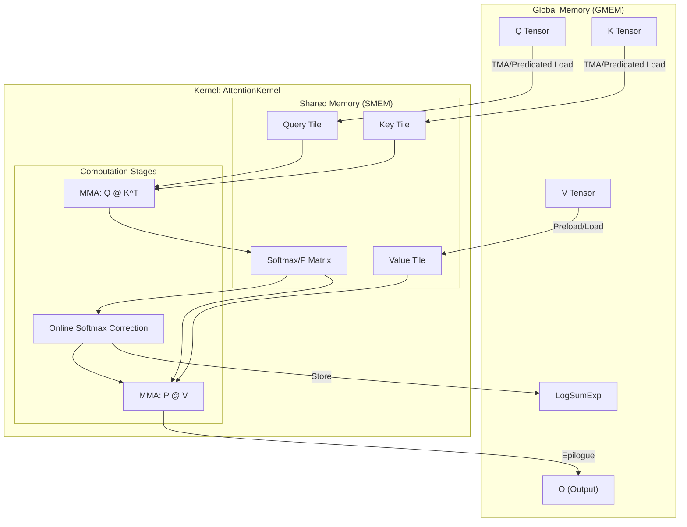
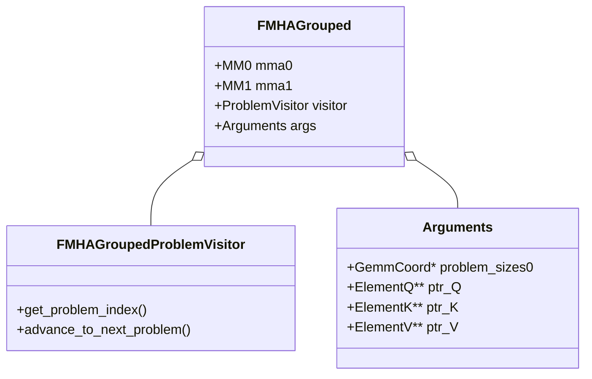

<!-- source: DeepWiki mcp.deepwiki.com · repo NVIDIA/cutlass · page 6.5 Hopper FMHA and State Space Decomposition · fetched 2026-10-26 -->

# Hopper FMHA and State Space Decomposition

Relevant source files

The following files were used as context for generating this wiki page:

- [examples/41_fused_multi_head_attention/default_fmha_grouped.h](examples/41_fused_multi_head_attention/default_fmha_grouped.h)
- [examples/41_fused_multi_head_attention/fmha_backward_test.py](examples/41_fused_multi_head_attention/fmha_backward_test.py)
- [examples/41_fused_multi_head_attention/fmha_grouped.h](examples/41_fused_multi_head_attention/fmha_grouped.h)
- [examples/41_fused_multi_head_attention/fused_multi_head_attention_backward.cu](examples/41_fused_multi_head_attention/fused_multi_head_attention_backward.cu)
- [examples/41_fused_multi_head_attention/fused_multihead_attention_fixed_seqlen.cu](examples/41_fused_multi_head_attention/fused_multihead_attention_fixed_seqlen.cu)
- [examples/41_fused_multi_head_attention/fused_multihead_attention_variable_seqlen.cu](examples/41_fused_multi_head_attention/fused_multihead_attention_variable_seqlen.cu)
- [examples/41_fused_multi_head_attention/gemm/custom_mma_multistage.h](examples/41_fused_multi_head_attention/gemm/custom_mma_multistage.h)
- [examples/41_fused_multi_head_attention/gemm/custom_mma_pipelined.h](examples/41_fused_multi_head_attention/gemm/custom_mma_pipelined.h)
- [examples/41_fused_multi_head_attention/gemm/mma_from_smem.h](examples/41_fused_multi_head_attention/gemm/mma_from_smem.h)
- [examples/41_fused_multi_head_attention/gemm_kernel_utils.h](examples/41_fused_multi_head_attention/gemm_kernel_utils.h)
- [examples/41_fused_multi_head_attention/iterators/default_warp_iterator_from_smem.h](examples/41_fused_multi_head_attention/iterators/default_warp_iterator_from_smem.h)
- [examples/41_fused_multi_head_attention/iterators/transpose_warp_iterator.h](examples/41_fused_multi_head_attention/iterators/transpose_warp_iterator.h)
- [examples/41_fused_multi_head_attention/iterators/warp_iterator_from_smem.h](examples/41_fused_multi_head_attention/iterators/warp_iterator_from_smem.h)
- [examples/41_fused_multi_head_attention/kernel_backward.h](examples/41_fused_multi_head_attention/kernel_backward.h)
- [examples/41_fused_multi_head_attention/kernel_forward.h](examples/41_fused_multi_head_attention/kernel_forward.h)
- [examples/41_fused_multi_head_attention/transform/tile_smem_loader.h](examples/41_fused_multi_head_attention/transform/tile_smem_loader.h)
- [examples/python/CuTeDSL/cute/blackwell/kernel/attention/mamba2_ssd/mamba2_ssd.py](examples/python/CuTeDSL/cute/blackwell/kernel/attention/mamba2_ssd/mamba2_ssd.py)
- [examples/python/CuTeDSL/cute/blackwell/kernel/blockwise_gemm/blockwise_gemm.py](examples/python/CuTeDSL/cute/blackwell/kernel/blockwise_gemm/blockwise_gemm.py)
- [examples/python/CuTeDSL/cute/blackwell/kernel/blockwise_gemm/contiguous_grouped_gemm.py](examples/python/CuTeDSL/cute/blackwell/kernel/blockwise_gemm/contiguous_grouped_gemm.py)
- [examples/python/CuTeDSL/cute/blackwell/kernel/blockwise_gemm/masked_grouped_gemm.py](examples/python/CuTeDSL/cute/blackwell/kernel/blockwise_gemm/masked_grouped_gemm.py)

This section documents the implementation of Fused Multi-Head Attention (FMHA) and State Space Decomposition (SSD/Mamba2) kernels in CUTLASS, specifically focusing on optimizations for the NVIDIA Hopper (SM90) and Blackwell (SM100/111/112) architectures. These implementations leverage warp-specialization, TMA (Tensor Memory Accelerator), and TMEM (Tile Memory) to achieve high performance in LLM inference and training.

## Hopper and Blackwell FMHA Implementation

The FMHA implementation in CUTLASS 3.x utilizes a warp-specialized architecture to pipeline data movement and computation. The kernels support Multi-Head Attention (MHA), Grouped-Query Attention (GQA), and Multi-Query Attention (MQA) through flexible layout strides [examples/41_fused_multi_head_attention/kernel_forward.h:128-150]().

### Forward and Backward Pass Architecture

The forward pass is implemented in `AttentionKernel`, which partitions queries and keys into blocks (e.g., `kQueriesPerBlock`, `kKeysPerBlock`) [examples/41_fused_multi_head_attention/kernel_forward.h:112-128](). It supports online softmax correction, allowing the output to be computed incrementally without storing the full attention matrix in global memory [examples/41_fused_multi_head_attention/fused_multihead_attention_fixed_seqlen.cu:42-55]().

| Warp Role | Responsibility |
| :--- | :--- |
| **Load** | Issues asynchronous TMA loads for Q, K, V, O, dO, and LSE tensors [examples/41_fused_multi_head_attention/kernel_forward.h:171-185]() |
| **Mma** | Executes the core matrix multiplications ($QK^T$, $PV$, and their gradients) using `TiledMma` [examples/41_fused_multi_head_attention/gemm/mma_from_smem.h:157-162]() |
| **Compute** | Handles softmax-derivative calculations and intermediate scaling via `accum_t` (typically `float`) [examples/41_fused_multi_head_attention/kernel_forward.h:137-143]() |
| **Epilogue** | Rescales output based on logsumexp (LSE) and stores to GMEM [examples/41_fused_multi_head_attention/gemm/mma_from_smem.h:55-62]() |

### Hopper Implementation (Example 88)
The Hopper (SM90) implementation provides optimized forward and backward kernels. The backward pass involves several stages, including the summation of $O \cdot dO$ and conversion of accumulated gradients using `GmemTile` for efficient register-to-global-memory transfers [examples/41_fused_multi_head_attention/kernel_backward.h:93-130]().

### Data Flow Diagram: SM90/SM100 FMHA Forward

The following diagram maps the high-level forward pass logic to the specific CUTLASS kernel components and shared memory structures.

Title: FMHA Forward Data Flow and SMEM Mapping

Sources: [examples/41_fused_multi_head_attention/kernel_forward.h:128-170](), [examples/41_fused_multi_head_attention/fused_multihead_attention_fixed_seqlen.cu:42-67]()

## Masking and Variable Length Support

CUTLASS provides modular masking and sequence handling for both fixed and variable length inputs.

### Variable Length Sequences
Variable length support uses a grouped GEMM approach where each sequence in a batch is treated as a separate problem. The `FMHAGrouped` kernel uses `FMHAGroupedProblemVisitor` to dynamically assign CTAs to different sequences [examples/41_fused_multi_head_attention/fmha_grouped.h:153-157]().

### Masking Types
The kernel supports multiple masking strategies defined in `CustomMaskType` [examples/41_fused_multi_head_attention/kernel_forward.h:129-134]():
*   **NoCustomMask**: Standard attention.
*   **CausalFromTopLeft**: Standard causal masking.
*   **CausalFromBottomRight**: Causal masking relative to the end of the sequence.

Sources: [examples/41_fused_multi_head_attention/fmha_grouped.h:49-53](), [examples/41_fused_multi_head_attention/fused_multihead_attention_variable_seqlen.cu:86-88]()

## State Space Decomposition (SSD / Mamba2)

CUTLASS includes kernels for State Space Decomposition (SSD), used in Mamba2 architectures, implemented using the CuTe Python DSL for Blackwell (SM100).

### SSD Kernel Architecture
The `SSDKernel` class manages a complex pipeline involving multiple MMA stages and specialized warps [examples/python/CuTeDSL/cute/blackwell/kernel/attention/mamba2_ssd/mamba2_ssd.py:72-92]():
*   **Intra-block MMA**: Computes interactions within a local sequence tile.
*   **Inter-block MMA**: Handles state transitions between sequence blocks.
*   **Specialized Warps**: Includes `tma_b_c_warp`, `tma_deltas_x_d_warp`, and `epilog_warp` [examples/python/CuTeDSL/cute/blackwell/kernel/attention/mamba2_ssd/mamba2_ssd.py:121-127]().

### Grouped FMHA and SSD Coordination
The `FMHAGrouped` structure allows for executing multiple attention or SSD problems in a single kernel launch using a `ProblemVisitor` to balance work across CTAs [examples/41_fused_multi_head_attention/fmha_grouped.h:72-82]().

### Code Entity Mapping: Grouped Execution
Title: Grouped FMHA and SSD Entity Mapping

Sources: [examples/41_fused_multi_head_attention/fmha_grouped.h:82-195](), [examples/41_fused_multi_head_attention/fused_multihead_attention_variable_seqlen.cu:146-177]()

## FP8 Accumulation and Numerical Stability

For Hopper and Blackwell, FMHA and SSD support FP8 (e4m3/e5m2) inputs.

*   **FP8 in SSD**: The `SSDKernel` supports `Float8E4M3FN` for inputs and uses `Float32` for accumulation to maintain precision during the cumulative sum and state updates [examples/python/CuTeDSL/cute/blackwell/kernel/attention/mamba2_ssd/mamba2_ssd.py:94-101]().
*   **Scaling Factors**: Blockwise scaling is applied where $C = (SFA \cdot A) \cdot (SFB \cdot B)$, ensuring that the dynamic range of FP8 is maximized [examples/python/CuTeDSL/cute/blackwell/kernel/blockwise_gemm/blockwise_gemm.py:47-54]().
*   **Stability**: The forward FMHA kernel uses `accum_t` (float) for the softmax denominator and numerator accumulation to prevent overflow/underflow [examples/41_fused_multi_head_attention/kernel_forward.h:137-143]().

Sources: [examples/python/CuTeDSL/cute/blackwell/kernel/blockwise_gemm/blockwise_gemm.py:111-122](), [examples/41_fused_multi_head_attention/kernel_forward.h:156-158]()

---

