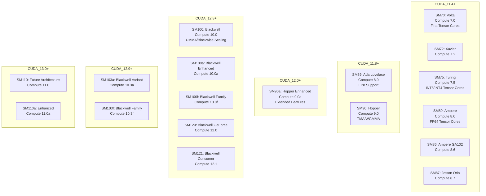
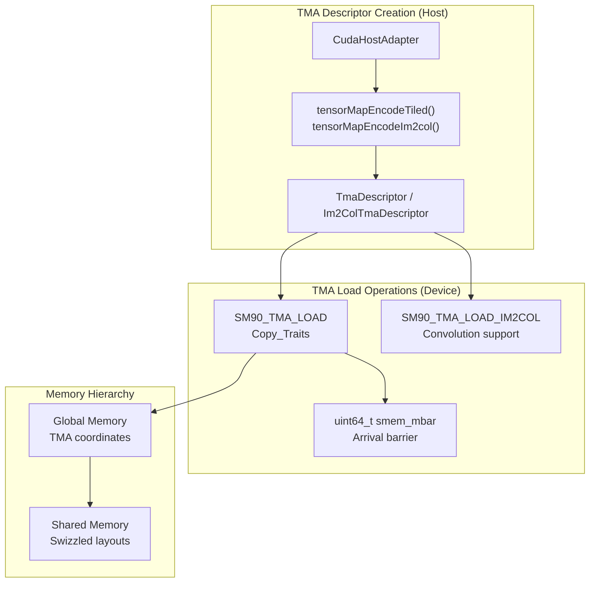
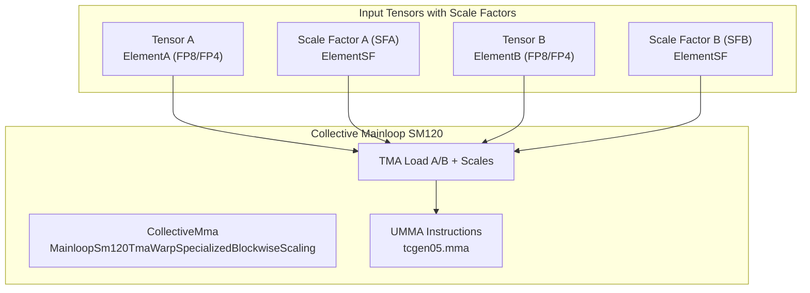
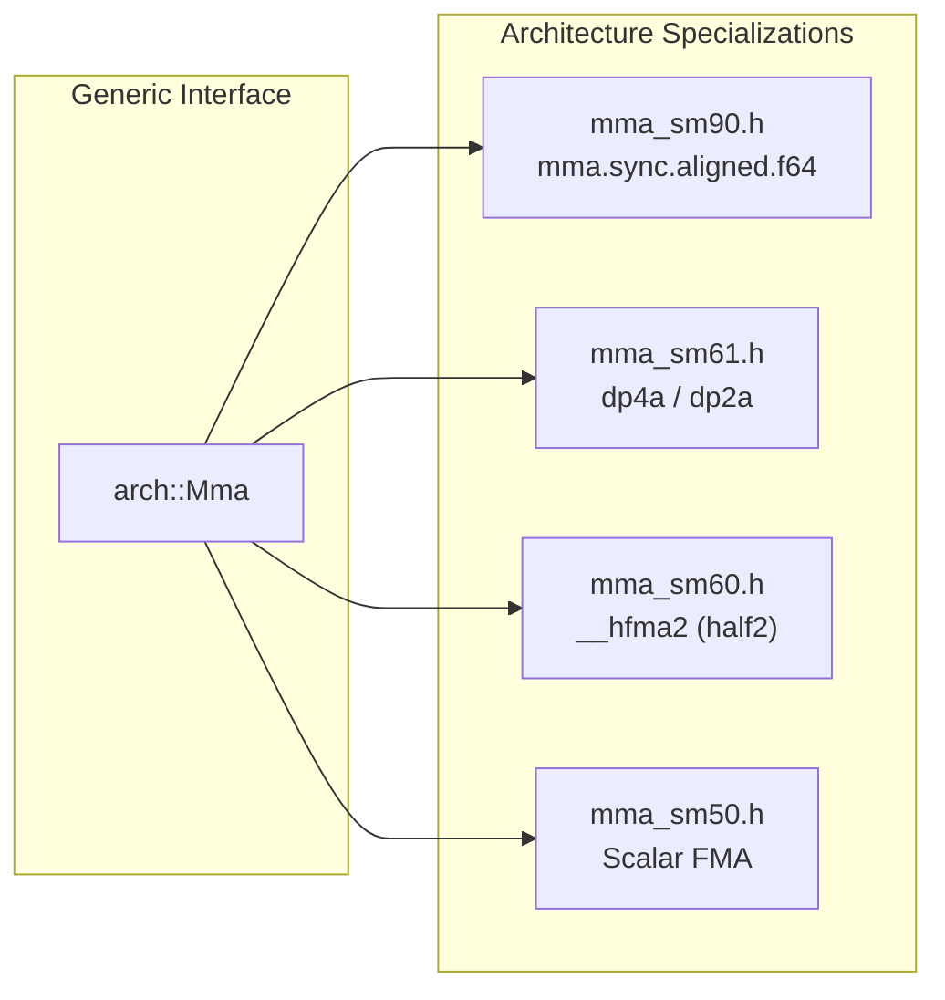

<!-- source: DeepWiki mcp.deepwiki.com · repo NVIDIA/cutlass · page 7 Hardware Architecture Implementations · fetched 2026-10-26 -->

# Hardware Architecture Implementations

<details>
<summary>Relevant source files</summary>

The following files were used as context for generating this wiki page:

- [examples/77_blackwell_fmha/collective/fmha_common.hpp](examples/77_blackwell_fmha/collective/fmha_common.hpp)
- [examples/93_blackwell_low_latency_gqa/CMakeLists.txt](examples/93_blackwell_low_latency_gqa/CMakeLists.txt)
- [examples/93_blackwell_low_latency_gqa/common.cuh](examples/93_blackwell_low_latency_gqa/common.cuh)
- [examples/93_blackwell_low_latency_gqa/readme.md](examples/93_blackwell_low_latency_gqa/readme.md)
- [examples/93_blackwell_low_latency_gqa/tgv_gqa.cu](examples/93_blackwell_low_latency_gqa/tgv_gqa.cu)
- [examples/93_blackwell_low_latency_gqa/tgv_gqa.cuh](examples/93_blackwell_low_latency_gqa/tgv_gqa.cuh)
- [examples/93_blackwell_low_latency_gqa/tgv_gqa_paged.cuh](examples/93_blackwell_low_latency_gqa/tgv_gqa_paged.cuh)
- [include/cute/arch/mma_sm100_umma.hpp](include/cute/arch/mma_sm100_umma.hpp)
- [include/cute/atom/mma_traits_sm100.hpp](include/cute/atom/mma_traits_sm100.hpp)
- [include/cutlass/gemm/collective/sm120_blockscaled_mma_array_tma.hpp](include/cutlass/gemm/collective/sm120_blockscaled_mma_array_tma.hpp)
- [include/cutlass/gemm/collective/sm120_blockscaled_mma_tma.hpp](include/cutlass/gemm/collective/sm120_blockscaled_mma_tma.hpp)
- [include/cutlass/gemm/collective/sm120_mma_array_tma_blockwise_scaling.hpp](include/cutlass/gemm/collective/sm120_mma_array_tma_blockwise_scaling.hpp)
- [include/cutlass/gemm/collective/sm120_mma_tma.hpp](include/cutlass/gemm/collective/sm120_mma_tma.hpp)
- [include/cutlass/gemm/collective/sm120_mma_tma_blockwise_scaling.hpp](include/cutlass/gemm/collective/sm120_mma_tma_blockwise_scaling.hpp)
- [include/cutlass/gemm/kernel/sm90_gemm_array_tma_warpspecialized_cooperative.hpp](include/cutlass/gemm/kernel/sm90_gemm_array_tma_warpspecialized_cooperative.hpp)
- [include/cutlass/gemm/kernel/sm90_gemm_array_tma_warpspecialized_pingpong.hpp](include/cutlass/gemm/kernel/sm90_gemm_array_tma_warpspecialized_pingpong.hpp)
- [include/cutlass/gemm/kernel/sm90_gemm_tma_warpspecialized_cooperative.hpp](include/cutlass/gemm/kernel/sm90_gemm_tma_warpspecialized_cooperative.hpp)
- [include/cutlass/gemm/kernel/sm90_gemm_tma_warpspecialized_pingpong.hpp](include/cutlass/gemm/kernel/sm90_gemm_tma_warpspecialized_pingpong.hpp)
- [include/cutlass/gemm/kernel/tile_scheduler_params.h](include/cutlass/gemm/kernel/tile_scheduler_params.h)

</details>


This page covers CUTLASS's GPU architecture-specific optimizations, kernel implementations, and hardware dispatch mechanisms. CUTLASS provides specialized kernels and collective operations tailored to different NVIDIA GPU generations to maximize performance by leveraging features like TMA, WGMMA, and UMMA.

## Architecture Support Overview

CUTLASS supports multiple NVIDIA GPU architectures from SM50 (Maxwell) through SM100+ (Blackwell family). Architecture support is determined at compile time through CUDA version requirements and gencode flags configured in CMake.

### Architecture Support Matrix by CUDA Version

**Diagram: CUTLASS Architecture Support and CUDA Requirements**



**Sources:** [CMakeLists.txt:176-207]()

### Compile-Time Architecture Selection

CUTLASS uses CMake gencode flags to configure which architectures are compiled. The build system configures flags through `cutlass_apply_cuda_gencode_flags()` which sets both `-real` (cubin embedding) and `-virtual` (PTX embedding) flags.

| CMake Variable | Purpose |
|----------------|---------|
| `CUTLASS_NVCC_ARCHS` | Requested architectures for compilation |
| `CUTLASS_ENABLE_GDC_FOR_SM100` | Enables Grid Dependency Control for Blackwell |

**Sources:** [CMakeLists.txt:209-221](), [CMakeLists.txt:453-470](), [tools/library/CMakeLists.txt:129-137]()

## SM90 Hopper Architecture Features

SM90 Hopper introduces significant architectural improvements that CUTLASS leverages through specialized kernel implementations. For details, see [SM90 Hopper Architecture Features](#7.1).

### TMA (Tensor Memory Accelerator)

TMA is a hardware unit in Hopper (SM90) and later architectures that provides hardware-accelerated asynchronous data movement between global memory and shared memory with automatic address generation.

**Diagram: TMA Architecture and Copy Operations**



**Sources:** [include/cute/atom/copy_traits_sm90_tma.hpp:98-134](), [include/cute/atom/copy_traits_sm90_im2col.hpp:106-159](), [include/cutlass/cuda_host_adapter.hpp:349-389]()

### Warp Specialization Patterns

SM90 kernels use warp specialization to overlap computation and data movement. Roles are defined by specialized templates like `GemmUniversal` with `KernelTmaWarpSpecializedPingpong`.

| Kernel Type | Threads | Role |
|-------------|---------|------|
| `KernelTmaWarpSpecializedPingpong` | 384 | 2 Math WarpGroups + 1 Load WarpGroup |
| `KernelTmaWarpSpecializedCooperative` | 320 | 2 Math WarpGroups + 1 Load WarpGroup |

**Sources:** [include/cutlass/gemm/kernel/sm90_gemm_tma_warpspecialized_pingpong.hpp:128-140](), [include/cutlass/gemm/kernel/sm90_gemm_tma_warpspecialized_cooperative.hpp:115-125]()

## SM100 Blackwell Architecture Features

SM100 Blackwell introduces UMMA (Unified Matrix Multiply-Accumulate) instructions and blockwise scaling for narrow-precision AI workloads. For details, see [SM100 Blackwell Architecture](#7.2).

### Blockwise Scaling Architecture

Blockwise scaling enables efficient narrow-precision computation by applying per-block scale factors (SFA/SFB) during matrix multiplication. This is implemented in `CollectiveMma` using specialized dispatch policies such as `MainloopSm120TmaWarpSpecializedBlockwiseScaling`.

**Diagram: SM100 Blockwise Scaling Data Flow**



**Sources:** [include/cutlass/gemm/collective/sm120_mma_tma_blockwise_scaling.hpp:75-105](), [include/cutlass/gemm/collective/sm120_blockscaled_mma_tma.hpp:76-120]()

## Grid Dependency Control (GDC)

GDC enables programmatic dependent launches (PDL) on SM90+ and SM100+ architectures, allowing kernels to coordinate execution without CPU intervention. For details, see [Grid Dependency Control (GDC)](#7.3).

**GDC API Functions:**

```cpp
namespace cutlass::arch {
  // Hints to launch dependent kernels early
  CUTLASS_DEVICE void launch_dependent_grids();

  // Enforces global memory ordering before dependent kernel access
  CUTLASS_DEVICE void wait_on_dependent_grids();

  // Compile-time query for GDC availability
  static constexpr bool IsGdcGloballyEnabled;
}
```

**Sources:** [include/cutlass/arch/grid_dependency_control.h:78-107](), [include/cutlass/gemm/kernel/sm90_gemm_tma_warpspecialized_pingpong.hpp:78-79]()

## SM80 Ampere and Earlier Architectures

Cover Ampere (SM80), Turing (SM75), and Volta (SM70) architectures, their tensor core capabilities, and implementation differences from modern architectures. For details, see [SM80 Ampere and Earlier Architectures](#7.4).

### Architecture-Specific MMA Implementations

CUTLASS provides a `Mma` template specialized for different architectures and data types to map high-level matrix operations to specific hardware instructions.

| Architecture | Instruction Example | Supported Types |
|--------------|---------------------|-----------------|
| SM90 | `mma.sync.aligned.m16n8k16.row.col.f64` | FP64, FP16, BF16 |
| SM61 | `dp4a.s32.s32` | INT8 (Dot product) |
| SM60 | `__hfma2` | FP16 (SIMD) |
| SM50 | `d[0] = a[0] * b[0] + c[0]` | FP32, FP64, INT32 |

**Diagram: Hardware-to-Code Mapping for MMA**



**Sources:** [include/cutlass/arch/mma_sm90.h:98-102](), [include/cutlass/arch/mma_sm61.h:76-78](), [include/cutlass/arch/mma_sm60.h:81-83](), [include/cutlass/arch/mma_sm50.h:74-74]()

### Key Differences
- **Memory Movement**: Uses `cp.async` (SM80) or `ld.shared` instead of TMA.
- **Synchronization**: Uses `__syncthreads()` and `cp.async.wait_all` instead of `mbarrier`.
- **MMA**: Uses `mma.sync` instructions instead of `wgmma` or `tcgen05`.

**Sources:** [python/cutlass_library/generator.py:142-160]()

---

