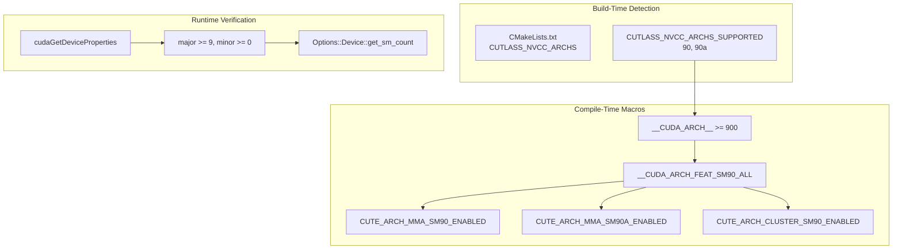
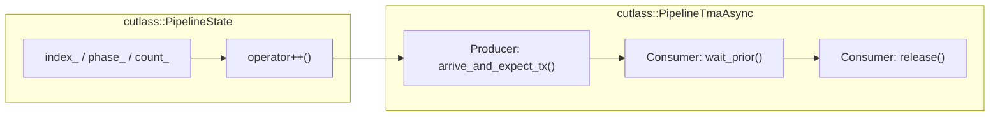
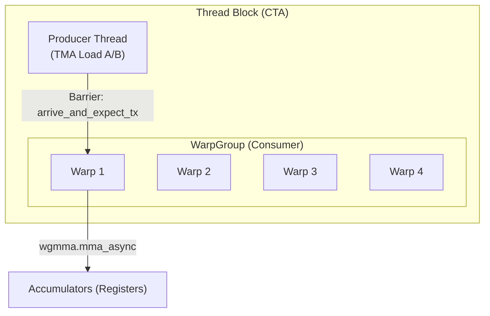

<!-- source: DeepWiki mcp.deepwiki.com · repo NVIDIA/cutlass · page 7.1 SM90 Hopper Architecture Features · fetched 2026-10-26 -->

# SM90 Hopper Architecture Features

<details>
<summary>Relevant source files</summary>

The following files were used as context for generating this wiki page:

- [include/cute/arch/cluster_sm90.hpp](include/cute/arch/cluster_sm90.hpp)
- [include/cute/arch/mma_sm90.hpp](include/cute/arch/mma_sm90.hpp)
- [include/cute/arch/mma_sm90_gmma.hpp](include/cute/arch/mma_sm90_gmma.hpp)
- [include/cute/arch/mma_sm90_gmma_ext.hpp](include/cute/arch/mma_sm90_gmma_ext.hpp)
- [include/cute/arch/mma_sm90_gmma_sparse.hpp](include/cute/arch/mma_sm90_gmma_sparse.hpp)
- [include/cute/arch/mma_sm90_gmma_sparse_ext.hpp](include/cute/arch/mma_sm90_gmma_sparse_ext.hpp)
- [include/cute/atom/mma_traits_sm90_gmma.hpp](include/cute/atom/mma_traits_sm90_gmma.hpp)
- [include/cute/atom/mma_traits_sm90_gmma_ext.hpp](include/cute/atom/mma_traits_sm90_gmma_ext.hpp)
- [include/cute/atom/mma_traits_sm90_gmma_sparse.hpp](include/cute/atom/mma_traits_sm90_gmma_sparse.hpp)
- [include/cute/atom/mma_traits_sm90_gmma_sparse_ext.hpp](include/cute/atom/mma_traits_sm90_gmma_sparse_ext.hpp)
- [include/cute/numeric/integral_constant.hpp](include/cute/numeric/integral_constant.hpp)
- [include/cutlass/arch/mma_sm90.h](include/cutlass/arch/mma_sm90.h)
- [include/cutlass/gemm/collective/sm90_mma_tma_gmma_rs_warpspecialized.hpp](include/cutlass/gemm/collective/sm90_mma_tma_gmma_rs_warpspecialized.hpp)
- [include/cutlass/gemm/collective/sm90_mma_tma_gmma_ss_warpspecialized.hpp](include/cutlass/gemm/collective/sm90_mma_tma_gmma_ss_warpspecialized.hpp)
- [include/cutlass/gemm/collective/sm90_mma_tma_gmma_ss_warpspecialized_fp8.hpp](include/cutlass/gemm/collective/sm90_mma_tma_gmma_ss_warpspecialized_fp8.hpp)
- [include/cutlass/pipeline/sm90_pipeline.hpp](include/cutlass/pipeline/sm90_pipeline.hpp)
- [test/unit/gemm/device/gemm_testbed_3x.hpp](test/unit/gemm/device/gemm_testbed_3x.hpp)
- [tools/profiler/src/options.cu](tools/profiler/src/options.cu)

</details>


## Purpose and Scope

This page documents the NVIDIA Hopper (SM90) architecture-specific features and their implementation in CUTLASS. SM90 introduced transformative capabilities for high-performance computing, including the Tensor Memory Accelerator (TMA) for asynchronous memory operations, Warp Group Matrix Multiply-Accumulate (WGMMA) instructions for larger matrix tiles, and Thread Block Clusters for enhanced parallelism.

For SM100/Blackwell architecture features, see [SM100 Blackwell Architecture](#7.2). For Grid Dependency Control (GDC) programmatic dependent launches, see [Grid Dependency Control (GDC)](#7.3). For earlier architectures (SM80/Ampere and before), see [SM80 Ampere and Earlier Architectures](#7.4).

## Hardware Features Overview

SM90 (Hopper) represents a major architectural leap with compute capability 9.0. CUTLASS support requires CUDA 11.8 or higher, with optimal support in CUDA 12.0+ for advanced features.

**Key SM90 Hardware Capabilities**

| Feature | Description | Minimum CUDA Version |
|---------|-------------|---------------------|
| TMA (Tensor Memory Accelerator) | Hardware-accelerated asynchronous memory transfers | 11.8 |
| WGMMA | Warp Group Matrix Multiply-Accumulate instructions | 11.8 |
| Thread Block Clusters | Up to 8 CTAs cooperative execution | 11.8 |
| Async Copy Barriers | Hardware barrier synchronization for pipelines | 11.8 |
| Sparse WGMMA | 2:4 structured sparsity acceleration | 11.8 |

Sources: [include/cute/arch/mma_sm90.hpp:38-41](), [include/cute/arch/cluster_sm90.hpp:37-40](), [include/cute/arch/mma_sm90_gmma.hpp:38-40]()

### SM90 Architecture Detection

The following diagram illustrates how SM90 features are enabled through the stack, from build-time configuration to runtime validation.

**Hopper Feature Enablement Flow**


Sources: [include/cute/arch/mma_sm90.hpp:38-41](), [include/cute/arch/mma_sm90_gmma.hpp:38-40](), [include/cute/arch/cluster_sm90.hpp:37-40](), [tools/profiler/src/options.cu:127-132](), [tools/profiler/src/options.cu:149-154]()

## Tensor Memory Accelerator (TMA)

TMA is a hardware unit that performs asynchronous bulk data transfers between global memory and shared memory, offloading this work from compute threads.

### TMA Pipeline Coordination

The TMA pipeline uses hardware async barriers that track transaction bytes. The producer issues TMA operations and the barrier automatically decrements as hardware completes transfers. The `PipelineTmaAsync` class manages these transitions using `PipelineState` to track buffer indices and phases.

**TMA Synchronization Logic**


Sources: [include/cutlass/pipeline/sm90_pipeline.hpp:171-213](), [include/cutlass/gemm/collective/sm90_mma_tma_gmma_ss_warpspecialized_fp8.hpp:113-114]()

## Warp Group Matrix Multiply-Accumulate (WGMMA)

WGMMA instructions perform matrix multiply-accumulate on 128 threads (a Warp Group). Unlike previous MMA instructions that source operands from registers, WGMMA can source A and B operands directly from Shared Memory descriptors.

### WGMMA Instruction Variants

CUTLASS supports several WGMMA flavors via `MMA_Atom` specializations:
* **SS (Shared-Shared):** Both operands A and B are in shared memory.
* **RS (Register-Shared):** Operand A is in registers, B is in shared memory.
* **Sparse:** 2:4 structured sparsity acceleration using metadata.

**WGMMA PTX Mapping Example**
```cpp
// Example: F16 SS WGMMA (64x8x16)
asm volatile(
  "wgmma.mma_async.sync.aligned.m64n8k16.f16.f16.f16 "
  "{%0, %1},"
  " %2,"
  " %3,"
  " p,  %5, %6, %7, %8;\n"
  : "+r"(d0), "+r"(d1)
  : "l"(desc_a), "l"(desc_b), "r"(int32_t(scale_D)), ...);
```

Sources: [include/cute/arch/mma_sm90_gmma.hpp:158-167](), [include/cute/arch/mma_sm90_gmma.hpp:205-214](), [include/cute/arch/mma_sm90_gmma_sparse.hpp:76-87]()

### WGMMA Synchronization Primitives

WGMMA operations are asynchronous and require specific fence and wait primitives to coordinate register and memory access:
* `warpgroup_arrive()`: Issues a `wgmma.fence.sync.aligned`.
* `warpgroup_commit_batch()`: Issues a `wgmma.commit_group.sync.aligned`.
* `warpgroup_wait<N>()`: Issues a `wgmma.wait_group.sync.aligned N`, waiting until only `N` batches are outstanding.
* `warpgroup_fence_operand()`: Fences between GMMA destination accumulators and dependent uses to prevent RAW hazards.

Sources: [include/cute/arch/mma_sm90_gmma.hpp:47-57](), [include/cute/arch/mma_sm90_gmma.hpp:61-71](), [include/cute/arch/mma_sm90_gmma.hpp:75-84](), [include/cute/atom/mma_traits_sm90_gmma.hpp:46-66]()

## Thread Block Clusters

Hopper introduces Thread Block Clusters, allowing CTAs within a cluster to share data via Distributed Shared Memory (DSMEM).

### Cluster Primitives
* `cluster_sync()`: Synchronizes all CTAs in a cluster via `barrier.cluster.arrive` and `wait`.
* `cluster_id_in_grid()`: Returns the cluster's coordinates in the grid using `%%clusterid`.
* `block_rank_in_cluster()`: Returns the CTA's linear rank within its cluster using `%%cluster_ctarank`.
* `set_block_rank()`: Uses `mapa.shared::cluster` to map a shared memory address to a specific CTA rank in the cluster.

Sources: [include/cute/arch/cluster_sm90.hpp:75-83](), [include/cute/arch/cluster_sm90.hpp:106-123](), [include/cute/arch/cluster_sm90.hpp:154-163](), [include/cute/arch/cluster_sm90.hpp:166-177]()

## Warp Specialization Patterns

SM90 kernels typically employ "Warp Specialization," where different warps are assigned specific roles (Producers vs. Consumers).

### Collective Mainloop Roles
In a typical `CollectiveMma` for SM90 (e.g., `MainloopSm90TmaGmmaWarpSpecializedFP8`):
1. **Producers:** One thread (or warp) responsible for issuing TMA loads.
2. **Consumers:** One or more Warp Groups (128 threads each) responsible for issuing WGMMA instructions.

**Warp Group Role Assignment**


Sources: [include/cutlass/gemm/collective/sm90_mma_tma_gmma_ss_warpspecialized_fp8.hpp:118-120](), [include/cutlass/gemm/collective/sm90_mma_tma_gmma_ss_warpspecialized_fp8.hpp:74-90]()

## Sparse WGMMA Support

SM90 supports 2:4 structured sparsity for matrix multiplication. This is implemented via specialized `MMA_Traits` that handle the additional metadata (E) operand.

### Sparse MMA Traits
Sparse WGMMA requires a metadata operand (E) which encodes which elements are non-zero. The `MMA_Traits` for sparse operations define the layouts for A, B, C, and E.

| Type | Code Entity | Description |
|------|-------------|-------------|
| **Metadata Type** | `ValTypeE` | Metadata elements (e.g., `sparse_elem<8, uint8_t>`) |
| **Sparse Type** | `ValTypeA` | Sparse elements (e.g., `sparse_elem<2, half_t>`) |
| **Metadata Layout**| `ELayout` | Layout of the sparsity metadata (e.g., `ELayout_64x32`) |

Sources: [include/cute/atom/mma_traits_sm90_gmma_sparse_ext.hpp:42-56](), [include/cute/arch/mma_sm90_gmma_sparse.hpp:47-55]()

## Implementation Reference

### Key Files and Classes

| Entity | File | Role |
|--------|------|------|
| `SM90::GMMA` | [include/cute/arch/mma_sm90_gmma.hpp:105]() | Namespace for Hopper WGMMA PTX wrappers and enums (`Major`, `ScaleOut`) |
| `PipelineTmaAsync` | [include/cutlass/pipeline/sm90_pipeline.hpp:330]() | Hardware-accelerated TMA barrier pipeline implementation |
| `CollectiveMma` | [include/cutlass/gemm/collective/sm90_mma_tma_gmma_ss_warpspecialized_fp8.hpp:74]() | SM90 specialized collective mainloop for FP8 with TMA |
| `MMA_Traits` | [include/cute/atom/mma_traits_sm90_gmma.hpp:39]() | Traits mapping WGMMA instructions to CuTe MMA atoms |
| `cluster_id_in_grid` | [include/cute/arch/cluster_sm90.hpp:106]() | Device-side intrinsic for retrieving cluster positioning in the grid |
| `warpgroup_fence_operand` | [include/cute/atom/mma_traits_sm90_gmma.hpp:46]() | Fences to coordinate async WGMMA accumulator updates |

Sources: [include/cute/arch/mma_sm90_gmma.hpp:105](), [include/cutlass/pipeline/sm90_pipeline.hpp:330](), [include/cutlass/gemm/collective/sm90_mma_tma_gmma_ss_warpspecialized_fp8.hpp:74](), [include/cute/atom/mma_traits_sm90_gmma.hpp:39-46](), [include/cute/arch/cluster_sm90.hpp:106]()

---

