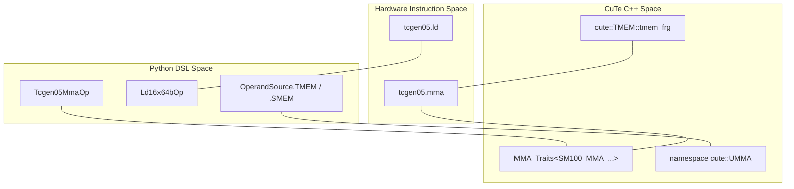
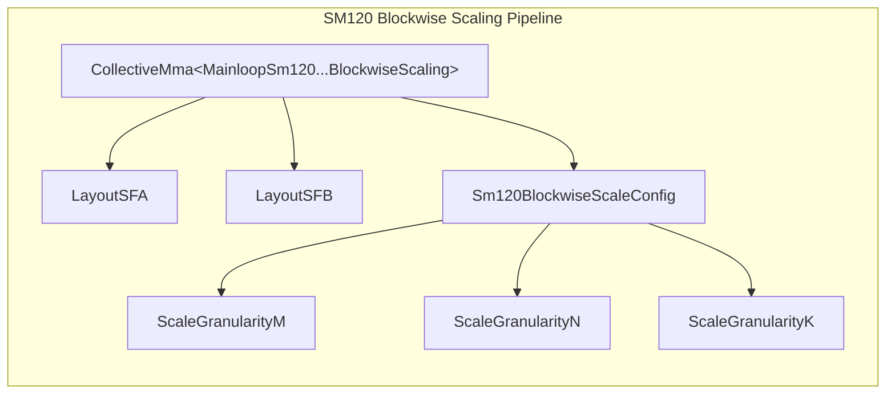

<!-- source: DeepWiki mcp.deepwiki.com · repo NVIDIA/cutlass · page 7.2 SM100 Blackwell Architecture · fetched 2026-10-26 -->

# SM100 Blackwell Architecture

<details>
<summary>Relevant source files</summary>

The following files were used as context for generating this wiki page:

- [examples/77_blackwell_fmha/collective/fmha_common.hpp](examples/77_blackwell_fmha/collective/fmha_common.hpp)
- [examples/93_blackwell_low_latency_gqa/CMakeLists.txt](examples/93_blackwell_low_latency_gqa/CMakeLists.txt)
- [examples/93_blackwell_low_latency_gqa/common.cuh](examples/93_blackwell_low_latency_gqa/common.cuh)
- [examples/93_blackwell_low_latency_gqa/readme.md](examples/93_blackwell_low_latency_gqa/readme.md)
- [examples/93_blackwell_low_latency_gqa/tgv_gqa.cu](examples/93_blackwell_low_latency_gqa/tgv_gqa.cu)
- [examples/93_blackwell_low_latency_gqa/tgv_gqa.cuh](examples/93_blackwell_low_latency_gqa/tgv_gqa.cuh)
- [examples/93_blackwell_low_latency_gqa/tgv_gqa_paged.cuh](examples/93_blackwell_low_latency_gqa/tgv_gqa_paged.cuh)
- [include/cute/arch/mma_sm100_umma.hpp](include/cute/arch/mma_sm100_umma.hpp)
- [include/cute/atom/mma_traits_sm100.hpp](include/cute/atom/mma_traits_sm100.hpp)
- [include/cutlass/gemm/collective/sm120_blockscaled_mma_array_tma.hpp](include/cutlass/gemm/collective/sm120_blockscaled_mma_array_tma.hpp)
- [include/cutlass/gemm/collective/sm120_blockscaled_mma_tma.hpp](include/cutlass/gemm/collective/sm120_blockscaled_mma_tma.hpp)
- [include/cutlass/gemm/collective/sm120_mma_array_tma_blockwise_scaling.hpp](include/cutlass/gemm/collective/sm120_mma_array_tma_blockwise_scaling.hpp)
- [include/cutlass/gemm/collective/sm120_mma_tma.hpp](include/cutlass/gemm/collective/sm120_mma_tma.hpp)
- [include/cutlass/gemm/collective/sm120_mma_tma_blockwise_scaling.hpp](include/cutlass/gemm/collective/sm120_mma_tma_blockwise_scaling.hpp)
- [include/cutlass/gemm/kernel/sm90_gemm_array_tma_warpspecialized_cooperative.hpp](include/cutlass/gemm/kernel/sm90_gemm_array_tma_warpspecialized_cooperative.hpp)
- [include/cutlass/gemm/kernel/sm90_gemm_array_tma_warpspecialized_pingpong.hpp](include/cutlass/gemm/kernel/sm90_gemm_array_tma_warpspecialized_pingpong.hpp)
- [include/cutlass/gemm/kernel/sm90_gemm_tma_warpspecialized_cooperative.hpp](include/cutlass/gemm/kernel/sm90_gemm_tma_warpspecialized_cooperative.hpp)
- [include/cutlass/gemm/kernel/sm90_gemm_tma_warpspecialized_pingpong.hpp](include/cutlass/gemm/kernel/sm90_gemm_tma_warpspecialized_pingpong.hpp)
- [include/cutlass/gemm/kernel/tile_scheduler_params.h](include/cutlass/gemm/kernel/tile_scheduler_params.h)
- [python/CuTeDSL/cutlass/base_dsl/compiler.py](python/CuTeDSL/cutlass/base_dsl/compiler.py)
- [python/CuTeDSL/cutlass/cute/arch/mbar.py](python/CuTeDSL/cutlass/cute/arch/mbar.py)
- [python/CuTeDSL/cutlass/cute/nvgpu/tcgen05/copy.py](python/CuTeDSL/cutlass/cute/nvgpu/tcgen05/copy.py)
- [python/CuTeDSL/cutlass/cute/nvgpu/tcgen05/mma.py](python/CuTeDSL/cutlass/cute/nvgpu/tcgen05/mma.py)
- [python/CuTeDSL/cutlass/cute/testing.py](python/CuTeDSL/cutlass/cute/testing.py)

</details>


## Purpose and Scope

This page documents CUTLASS support for NVIDIA's Blackwell datacenter GPU architecture (SM100 family, compute capability 10.0+). It covers SM100-specific hardware features, implementation patterns, and kernel examples. This architecture introduces significant enhancements to the Tensor Memory Accelerator (TMA), the introduction of Unified MMA (UMMA/tcgen05), 2-CTA instructions, and hardware-accelerated blockwise scaling.

**Sources**: [include/cutlass/gemm/kernel/sm90_gemm_tma_warpspecialized_pingpong.hpp:78-78](), [include/cute/atom/mma_traits_sm100.hpp:37-40]()

---

## Architecture Variants and Compute Capabilities

The SM100 Blackwell family includes multiple architecture variants. CUTLASS uses these tags to specialize collective operations, MMA atoms, and kernel schedules.

| Architecture | Compute Capability | ArchTag | Description |
|--------------|-------------------|---------|-------------|
| SM100        | 10.0              | `arch::Sm100` | Base Blackwell datacenter architecture. |
| SM101/SM110  | 11.0              | `arch::Sm110` | Enhanced variant (Thor). |
| SM120        | 12.0              | `arch::Sm120` | Blackwell variant with hardware Blockwise Scaling. |

**Sources**: [include/cutlass/gemm/kernel/sm90_gemm_tma_warpspecialized_cooperative.hpp:145-145](), [include/cutlass/gemm/collective/sm120_mma_tma.hpp:111-111]()

---

## Unified MMA (UMMA) and tcgen05

Blackwell introduces the `tcgen05.mma` instruction set, referred to in CUTLASS as Unified MMA (UMMA). Unlike previous generations where MMA instructions were warp-scoped, SM100 UMMA instructions are launched at a higher scope and interact directly with Tensor Memory (TMEM).

### 2-CTA (2SM) Instructions
A key feature of SM100 is the ability for two CTAs (running on adjacent SMs) to collaborate on a single MMA instruction.
- **Leader CTA**: The CTA that executes the MMA instruction.
- **Peer CTA**: The collaborating CTA.
- **Data Flow**: MMA reads A and B matrices from SMEM or TMEM and writes the accumulator directly to TMEM.

### Code-to-System Mapping: UMMA Implementation
The following diagram maps system-level UMMA concepts to the C++ and Python DSL entities in the codebase.



**Sources**: [include/cute/atom/mma_traits_sm100.hpp:37-49](), [python/CuTeDSL/cutlass/cute/nvgpu/tcgen05/mma.py:83-142](), [python/CuTeDSL/cutlass/cute/nvgpu/tcgen05/copy.py:166-172]()

---

## Blockwise Scaling (SM120)

The SM120 architecture provides hardware-accelerated blockwise scaling, allowing high-precision accumulation from low-precision (FP8/FP4) inputs using per-block scale factors.

### Collective Implementation
The `CollectiveMma` for SM120 manages a complex pipeline that loads four distinct tensors: Matrix A, Matrix B, Scale Factor A (SFA), and Scale Factor B (SFB). The `Sm120BlockwiseScaleConfig` defines the granularity of these factors.



**Key Code Entities**:
- `MainloopSm120ArrayTmaWarpSpecializedBlockwiseScaling`: The dispatch policy for block-scaled GEMM [include/cutlass/gemm/collective/sm120_mma_array_tma_blockwise_scaling.hpp:94-94]().
- `Sm120BlockwiseScaleConfig`: Defines the granularity (M, N, K) of the scaling factors [include/cutlass/gemm/collective/sm120_mma_tma_blockwise_scaling.hpp:140-144]().
- `SFVecSize`: The vector size of the scale factors, typically defined in the MMA traits [include/cutlass/gemm/collective/sm120_blockscaled_mma_array_tma.hpp:132-133]().

**Sources**: [include/cutlass/gemm/collective/sm120_mma_tma_blockwise_scaling.hpp:94-150](), [include/cutlass/gemm/collective/sm120_blockscaled_mma_array_tma.hpp:95-133]()

---

## Warp Specialization and Resource Management

SM100 kernels utilize a "Warp Specialized" architecture where different warps are assigned specific roles to hide memory latency and maximize throughput.

### Thread and Register Configuration
Due to the complexity of UMMA and block-scaling, these kernels often face high register pressure. CUTLASS includes logic to detect `HeavyRegisterPressure` and reconfigure the register file.

```cpp
// Detect if this is SM120 blockscaled kernel which hits high register pressure
static constexpr bool HeavyRegisterPressure = 
  IsSm120BlockScaled<DispatchPolicy>::value ? (RegsPerThread >= 128) : false;
```
[include/cutlass/gemm/kernel/sm90_gemm_tma_warpspecialized_cooperative.hpp:147-148]()

### Warp Roles in SM100
1. **Scheduler Warp**: Manages tile distribution [include/cutlass/gemm/kernel/sm90_gemm_tma_warpspecialized_pingpong.hpp:128-128]().
2. **Mainloop Load Warp**: Triggers TMA loads for A, B, and scale factors [include/cutlass/gemm/kernel/sm90_gemm_tma_warpspecialized_pingpong.hpp:129-129]().
3. **MMA Warp Groups**: Execute the UMMA instructions (typically 128-256 threads) [include/cutlass/gemm/kernel/sm90_gemm_tma_warpspecialized_pingpong.hpp:134-135]().
4. **Epilogue Load Warp**: Handles data movement for the output phase [include/cutlass/gemm/kernel/sm90_gemm_tma_warpspecialized_pingpong.hpp:130-130]().

**Sources**: [include/cutlass/gemm/kernel/sm90_gemm_tma_warpspecialized_cooperative.hpp:115-128](), [include/cutlass/gemm/kernel/sm90_gemm_tma_warpspecialized_pingpong.hpp:128-140]()

---

## Enhanced TMA Capabilities

SM100 enhances the Tensor Memory Accelerator (TMA) to support multicast patterns specialized for 2-SM instructions.

### 2-SM Multicast TMA
When using 2-SM MMA instructions, the TMA can perform a 2-SM multicast load, ensuring that both collaborating SMs have the necessary data in their respective shared memory banks simultaneously. This is often handled by `SM90_TMA_LOAD_MULTICAST` atoms in the collective mainloop.

**Sources**: [include/cutlass/gemm/collective/sm120_mma_tma.hpp:156-159](), [include/cute/atom/mma_traits_sm100.hpp:42-45]()

---

## Grid Dependency Control (GDC)

Blackwell provides hardware support for programmatic dependent launches (PDL).

- **Purpose**: Allows a grid to wait for a preceding grid or launch a dependent grid without returning control to the host.
- **Implementation**: The kernel template checks `IsGdcEnabled` which defaults to `cutlass::arch::IsGdcGloballyEnabled`.
- **Usage**: Integrated into `GemmUniversal` and the `TileScheduler` to manage inter-grid synchronization.

**Sources**: [include/cutlass/gemm/kernel/sm90_gemm_tma_warpspecialized_pingpong.hpp:78-78](), [include/cutlass/gemm/kernel/sm90_gemm_array_tma_warpspecialized_cooperative.hpp:51-51](), [include/cutlass/gemm/kernel/sm90_gemm_tma_warpspecialized_cooperative.hpp:121-121]()

---

